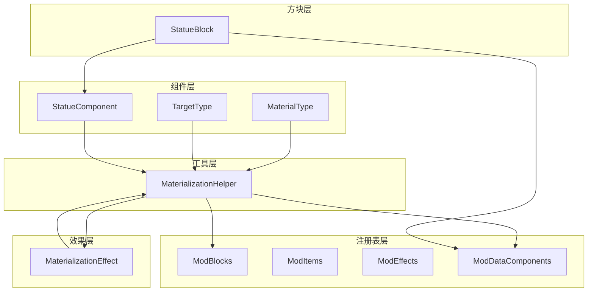
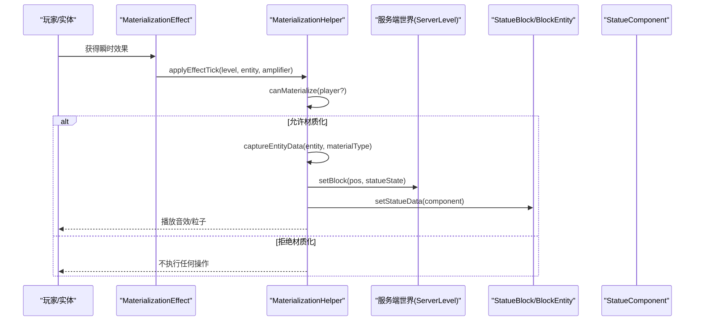
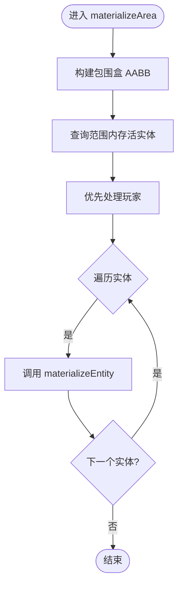
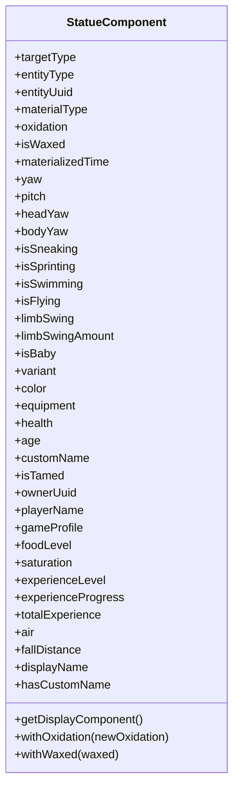
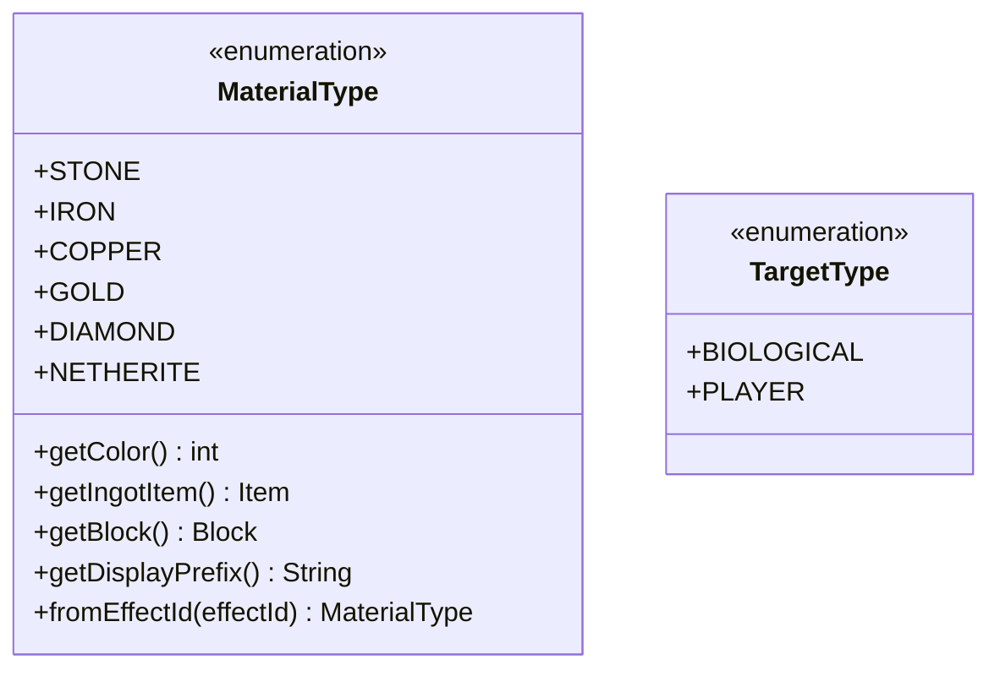
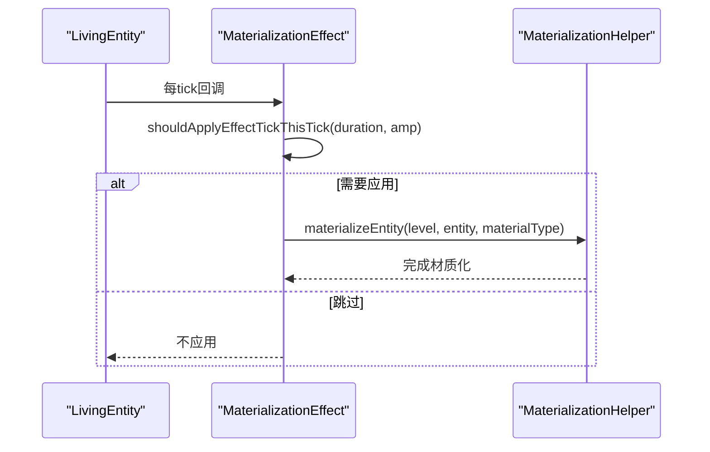
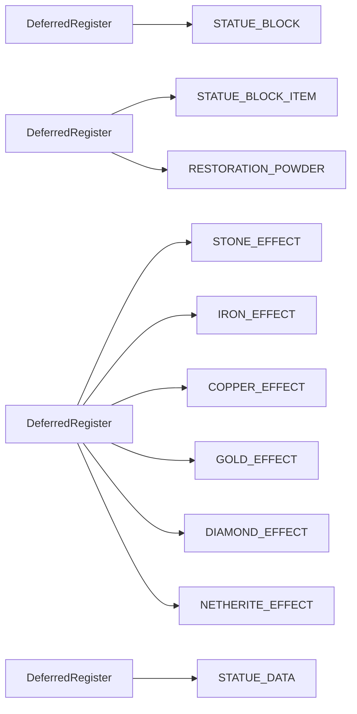
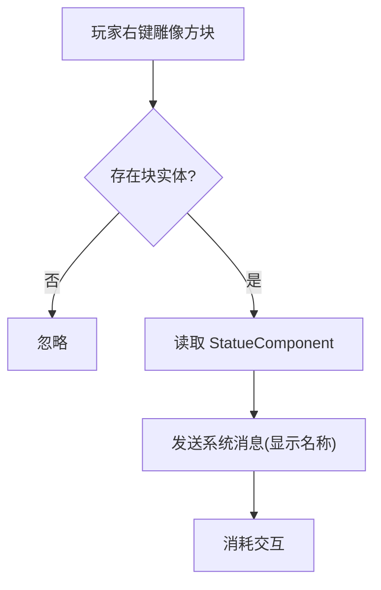
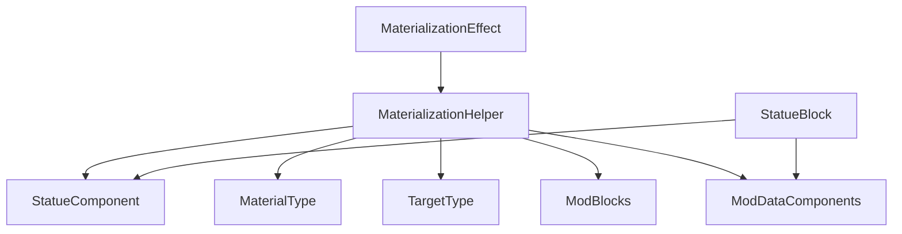

# API参考

<cite>
**本文引用的文件**
- [MaterializationHelper.java](file://src/main/java/com/xiong/petrification/util/MaterializationHelper.java)
- [StatueComponent.java](file://src/main/java/com/xiong/petrification/component/StatueComponent.java)
- [MaterialType.java](file://src/main/java/com/xiong/petrification/component/MaterialType.java)
- [TargetType.java](file://src/main/java/com/xiong/petrification/component/TargetType.java)
- [MaterializationEffect.java](file://src/main/java/com/xiong/petrification/effect/MaterializationEffect.java)
- [ModBlocks.java](file://src/main/java/com/xiong/petrification/registry/ModBlocks.java)
- [ModItems.java](file://src/main/java/com/xiong/petrification/registry/ModItems.java)
- [ModEffects.java](file://src/main/java/com/xiong/petrification/registry/ModEffects.java)
- [ModDataComponents.java](file://src/main/java/com/xiong/petrification/registry/ModDataComponents.java)
- [StatueBlock.java](file://src/main/java/com/xiong/petrification/block/StatueBlock.java)
</cite>

## 目录
1. [简介](#简介)
2. [项目结构](#项目结构)
3. [核心组件](#核心组件)
4. [架构总览](#架构总览)
5. [详细组件分析](#详细组件分析)
6. [依赖关系分析](#依赖关系分析)
7. [性能考虑](#性能考虑)
8. [故障排查指南](#故障排查指南)
9. [结论](#结论)
10. [附录：API版本兼容性与迁移指南](#附录api版本兼容性与迁移指南)

## 简介
本API参考文档面向希望集成或扩展“石化”模组功能的开发者。文档聚焦以下目标：
- 完整记录公共接口、类与方法的规格说明（参数类型、返回值、异常处理）
- 深入解释 MaterializationHelper 工具类的材质化操作、目标检测与状态查询能力
- 详细说明 MaterialType 与 TargetType 枚举的可用选项及使用场景
- 记录注册表系统的API，包括方块、物品、效果与数据组件的注册方法
- 提供完整的代码示例路径，展示正确用法、错误处理与边界情况
- 提供API版本兼容性信息与迁移建议

## 项目结构
本项目采用按功能域划分的模块化组织方式：
- component：定义核心数据模型与枚举（StatueComponent、MaterialType、TargetType）
- util：提供材质化核心逻辑（MaterializationHelper）
- effect：将材质化能力暴露为可被实体生效的效果（MaterializationEffect）
- registry：集中管理方块、物品、效果与数据组件的注册
- block：实现雕像方块及其行为（StatueBlock）

图表来源
- [MaterializationHelper.java:33-262](file://src/main/java/com/xiong/petrification/util/MaterializationHelper.java#L33-L262)
- [StatueComponent.java:14-255](file://src/main/java/com/xiong/petrification/component/StatueComponent.java#L14-L255)
- [MaterialType.java:9-67](file://src/main/java/com/xiong/petrification/component/MaterialType.java#L9-L67)
- [TargetType.java:6-22](file://src/main/java/com/xiong/petrification/component/TargetType.java#L6-L22)
- [MaterializationEffect.java:10-37](file://src/main/java/com/xiong/petrification/effect/MaterializationEffect.java#L10-L37)
- [ModBlocks.java:16-33](file://src/main/java/com/xiong/petrification/registry/ModBlocks.java#L16-L33)
- [ModItems.java:12-30](file://src/main/java/com/xiong/petrification/registry/ModItems.java#L12-L30)
- [ModEffects.java:13-33](file://src/main/java/com/xiong/petrification/registry/ModEffects.java#L13-L33)
- [ModDataComponents.java:11-25](file://src/main/java/com/xiong/petrification/registry/ModDataComponents.java#L11-L25)
- [StatueBlock.java:38-151](file://src/main/java/com/xiong/petrification/block/StatueBlock.java#L38-L151)

章节来源
- [MaterializationHelper.java:33-262](file://src/main/java/com/xiong/petrification/util/MaterializationHelper.java#L33-L262)
- [StatueComponent.java:14-255](file://src/main/java/com/xiong/petrification/component/StatueComponent.java#L14-L255)
- [MaterialType.java:9-67](file://src/main/java/com/xiong/petrification/component/MaterialType.java#L9-L67)
- [TargetType.java:6-22](file://src/main/java/com/xiong/petrification/component/TargetType.java#L6-L22)
- [MaterializationEffect.java:10-37](file://src/main/java/com/xiong/petrification/effect/MaterializationEffect.java#L10-L37)
- [ModBlocks.java:16-33](file://src/main/java/com/xiong/petrification/registry/ModBlocks.java#L16-L33)
- [ModItems.java:12-30](file://src/main/java/com/xiong/petrification/registry/ModItems.java#L12-L30)
- [ModEffects.java:13-33](file://src/main/java/com/xiong/petrification/registry/ModEffects.java#L13-L33)
- [ModDataComponents.java:11-25](file://src/main/java/com/xiong/petrification/registry/ModDataComponents.java#L11-L25)
- [StatueBlock.java:38-151](file://src/main/java/com/xiong/petrification/block/StatueBlock.java#L38-L151)

## 核心组件
本节概述模组对外暴露的核心API与数据结构，便于快速定位与理解。

- 材质化工具：MaterializationHelper
  - 提供权限校验、实体材质化、区域材质化、方块材质化、装备恢复等能力
  - 关键方法：canMaterialize、materializeEntity、materializeArea、captureEntityData、restoreEquipment、materializeBlocks
- 数据模型：StatueComponent
  - 使用record封装雕像实体的全部持久化信息（姿态、装备、玩家属性、显示名等）
  - 提供Codec编解码、默认构造、不可变更新器（withOxidation、withWaxed）
- 枚举类型：MaterialType、TargetType
  - MaterialType：材质种类（石头、铁、铜、金、钻石、下界合金），包含颜色、对应物品与方块、显示前缀
  - TargetType：目标类型（生物、玩家）
- 效果：MaterializationEffect
  - 将材质化作为瞬时效果应用到实体上
- 注册表：ModBlocks、ModItems、ModEffects、ModDataComponents
  - 统一通过DeferredRegister注册方块、物品、效果与数据组件
- 方块：StatueBlock
  - 支持水浸没、方向属性、交互显示信息、掉落时携带StatueComponent、模拟信号输出（铜材质氧化度）

章节来源
- [MaterializationHelper.java:33-262](file://src/main/java/com/xiong/petrification/util/MaterializationHelper.java#L33-L262)
- [StatueComponent.java:14-255](file://src/main/java/com/xiong/petrification/component/StatueComponent.java#L14-L255)
- [MaterialType.java:9-67](file://src/main/java/com/xiong/petrification/component/MaterialType.java#L9-L67)
- [TargetType.java:6-22](file://src/main/java/com/xiong/petrification/component/TargetType.java#L6-L22)
- [MaterializationEffect.java:10-37](file://src/main/java/com/xiong/petrification/effect/MaterializationEffect.java#L10-L37)
- [ModBlocks.java:16-33](file://src/main/java/com/xiong/petrification/registry/ModBlocks.java#L16-L33)
- [ModItems.java:12-30](file://src/main/java/com/xiong/petrification/registry/ModItems.java#L12-L30)
- [ModEffects.java:13-33](file://src/main/java/com/xiong/petrification/registry/ModEffects.java#L13-L33)
- [ModDataComponents.java:11-25](file://src/main/java/com/xiong/petrification/registry/ModDataComponents.java#L11-L25)
- [StatueBlock.java:38-151](file://src/main/java/com/xiong/petrification/block/StatueBlock.java#L38-L151)

## 架构总览
下图展示了从“效果触发”到“材质化执行”再到“数据持久化”的整体流程。

图表来源
- [MaterializationEffect.java:22-31](file://src/main/java/com/xiong/petrification/effect/MaterializationEffect.java#L22-L31)
- [MaterializationHelper.java:36-81](file://src/main/java/com/xiong/petrification/util/MaterializationHelper.java#L36-L81)
- [StatueBlock.java:89-120](file://src/main/java/com/xiong/petrification/block/StatueBlock.java#L89-L120)

## 详细组件分析

### MaterializationHelper 工具类
职责：提供材质化的核心逻辑，包括权限检查、实体数据捕获、区域批量处理、方块材质化与装备恢复。

- 权限校验
  - canMaterialize(Player): 根据配置与权限级别判断是否允许材质化
- 实体材质化
  - materializeEntity(ServerLevel, LivingEntity, MaterialType): 将实体转化为雕像并保存数据
- 区域材质化
  - materializeArea(ServerLevel, Vec3, double, MaterialType): 在指定半径内对存活实体进行排序后逐一材质化
- 数据捕获
  - captureEntityData(LivingEntity, MaterialType): 捕获实体装备、姿态、玩家特有属性等，生成 StatueComponent
- 装备恢复
  - restoreEquipment(LivingEntity, CompoundTag): 从NBT恢复装备槽位
- 方块材质化
  - materializeBlocks(ServerLevel, Vec3, double, MaterialType): 扫描区域内方块并记录材质化数据（用于后续还原）

图表来源
- [MaterializationHelper.java:83-96](file://src/main/java/com/xiong/petrification/util/MaterializationHelper.java#L83-L96)

章节来源
- [MaterializationHelper.java:33-262](file://src/main/java/com/xiong/petrification/util/MaterializationHelper.java#L33-L262)

### StatueComponent 数据模型
职责：以不可变record形式存储雕像的全部状态，并提供Codec编解码与便捷更新方法。

- 字段分组与编解码
  - 将37个字段拆分为四组（GroupA/B/C/D），再组合为Pair1/Pair2/Combined，最终映射回StatueComponent
  - 提供CODEC常量用于持久化与网络传输
- 默认构造
  - defaultStatue(MaterialType): 创建默认雕像数据（例如僵尸）
- 显示名称
  - getDisplayComponent(): 返回本地化或自定义显示文本
- 不可变更新
  - withOxidation(float): 更新氧化程度
  - withWaxed(boolean): 更新是否打蜡

图表来源
- [StatueComponent.java:14-255](file://src/main/java/com/xiong/petrification/component/StatueComponent.java#L14-L255)

章节来源
- [StatueComponent.java:14-255](file://src/main/java/com/xiong/petrification/component/StatueComponent.java#L14-L255)

### MaterialType 与 TargetType 枚举
- MaterialType
  - 选项：STONE、IRON、COPPER、GOLD、DIAMOND、NETHERITE
  - 属性：序列化名称、颜色、对应物品、对应方块、显示前缀
  - 工厂方法：fromEffectId(String)
- TargetType
  - 选项：BIOLOGICAL、PLAYER
  - 用途：区分普通生物与玩家，影响名称构建与数据捕获范围

图表来源
- [MaterialType.java:9-67](file://src/main/java/com/xiong/petrification/component/MaterialType.java#L9-L67)
- [TargetType.java:6-22](file://src/main/java/com/xiong/petrification/component/TargetType.java#L6-L22)

章节来源
- [MaterialType.java:9-67](file://src/main/java/com/xiong/petrification/component/MaterialType.java#L9-L67)
- [TargetType.java:6-22](file://src/main/java/com/xiong/petrification/component/TargetType.java#L6-L22)

### MaterializationEffect 效果
职责：将材质化能力以瞬时效果的形式应用于实体。

- 构造：传入效果类别、颜色与材质类型
- 应用：applyEffectTick 中调用 MaterializationHelper.materializeEntity
- 行为：shouldApplyEffectTickThisTick 仅在持续时间为1时触发；isInstantaneous 标记为瞬时

图表来源
- [MaterializationEffect.java:10-37](file://src/main/java/com/xiong/petrification/effect/MaterializationEffect.java#L10-L37)
- [MaterializationHelper.java:55-81](file://src/main/java/com/xiong/petrification/util/MaterializationHelper.java#L55-L81)

章节来源
- [MaterializationEffect.java:10-37](file://src/main/java/com/xiong/petrification/effect/MaterializationEffect.java#L10-L37)

### 注册表系统API
- 方块注册（ModBlocks）
  - 使用 DeferredRegister<Block> 注册雕像方块 STATUE_BLOCK
  - 提供 register(BusGroup) 方法绑定事件总线
- 物品注册（ModItems）
  - 注册雕像方块物品与复原粉末
- 效果注册（ModEffects）
  - 为每种材质类型注册对应的瞬时效果
- 数据组件注册（ModDataComponents）
  - 注册 StatueComponent 的数据组件类型，启用持久化与编码缓存

图表来源
- [ModBlocks.java:16-33](file://src/main/java/com/xiong/petrification/registry/ModBlocks.java#L16-L33)
- [ModItems.java:12-30](file://src/main/java/com/xiong/petrification/registry/ModItems.java#L12-L30)
- [ModEffects.java:13-33](file://src/main/java/com/xiong/petrification/registry/ModEffects.java#L13-L33)
- [ModDataComponents.java:11-25](file://src/main/java/com/xiong/petrification/registry/ModDataComponents.java#L11-L25)

章节来源
- [ModBlocks.java:16-33](file://src/main/java/com/xiong/petrification/registry/ModBlocks.java#L16-L33)
- [ModItems.java:12-30](file://src/main/java/com/xiong/petrification/registry/ModItems.java#L12-L30)
- [ModEffects.java:13-33](file://src/main/java/com/xiong/petrification/registry/ModEffects.java#L13-L33)
- [ModDataComponents.java:11-25](file://src/main/java/com/xiong/petrification/registry/ModDataComponents.java#L11-L25)

### StatueBlock 方块行为
- 属性：水平朝向与水浸没
- 渲染：隐藏渲染（由块实体负责可视化）
- 交互：右键读取并显示雕像信息
- 掉落：掉落雕像方块物品并附带 StatueComponent 数据
- 红石：当材质类型为铜时，输出强度与氧化度成正比

图表来源
- [StatueBlock.java:103-120](file://src/main/java/com/xiong/petrification/block/StatueBlock.java#L103-L120)

章节来源
- [StatueBlock.java:38-151](file://src/main/java/com/xiong/petrification/block/StatueBlock.java#L38-L151)

## 依赖关系分析
- 模块耦合
  - MaterializationHelper 强依赖 StatueComponent、MaterialType、TargetType 以及注册表中的 ModBlocks 与数据持久化相关类
  - MaterializationEffect 仅依赖 MaterializationHelper 与 MaterialType
  - StatueBlock 依赖 StatueComponent 与 ModDataComponents
- 外部依赖
  - 使用 Minecraft 的 ServerLevel、LivingEntity、BlockState、NBT、声音与粒子系统
  - 使用 Forge 的 DeferredRegister 与 BusGroup

图表来源
- [MaterializationHelper.java:33-262](file://src/main/java/com/xiong/petrification/util/MaterializationHelper.java#L33-L262)
- [StatueComponent.java:14-255](file://src/main/java/com/xiong/petrification/component/StatueComponent.java#L14-L255)
- [MaterialType.java:9-67](file://src/main/java/com/xiong/petrification/component/MaterialType.java#L9-L67)
- [TargetType.java:6-22](file://src/main/java/com/xiong/petrification/component/TargetType.java#L6-L22)
- [MaterializationEffect.java:10-37](file://src/main/java/com/xiong/petrification/effect/MaterializationEffect.java#L10-L37)
- [ModBlocks.java:16-33](file://src/main/java/com/xiong/petrification/registry/ModBlocks.java#L16-L33)
- [ModDataComponents.java:11-25](file://src/main/java/com/xiong/petrification/registry/ModDataComponents.java#L11-L25)
- [StatueBlock.java:38-151](file://src/main/java/com/xiong/petrification/block/StatueBlock.java#L38-L151)

章节来源
- [MaterializationHelper.java:33-262](file://src/main/java/com/xiong/petrification/util/MaterializationHelper.java#L33-L262)
- [StatueComponent.java:14-255](file://src/main/java/com/xiong/petrification/component/StatueComponent.java#L14-L255)
- [MaterializationEffect.java:10-37](file://src/main/java/com/xiong/petrification/effect/MaterializationEffect.java#L10-L37)
- [ModBlocks.java:16-33](file://src/main/java/com/xiong/petrification/registry/ModBlocks.java#L16-L33)
- [ModDataComponents.java:11-25](file://src/main/java/com/xiong/petrification/registry/ModDataComponents.java#L11-L25)
- [StatueBlock.java:38-151](file://src/main/java/com/xiong/petrification/block/StatueBlock.java#L38-L151)

## 性能考虑
- 区域材质化
  - 使用AABB筛选实体并按优先级排序，避免不必要的计算
  - 建议合理设置半径，防止大规模实体扫描导致卡顿
- NBT编解码
  - 装备与游戏档案使用NBT编解码，注意大对象频繁读写可能带来开销
- 粒子与音效
  - 每次材质化都会播放音效与粒子，建议在批量操作中合并或节流
- 方块材质化
  - 扫描立方体区域并进行距离过滤，确保只处理有效方块

[本节为通用性能建议，不直接分析具体文件]

## 故障排查指南
常见问题与定位要点：
- 权限不足导致无法材质化
  - 检查 canMaterialize 的逻辑与服务器权限级别
  - 参考：[MaterializationHelper.java:36-53](file://src/main/java/com/xiong/petrification/util/MaterializationHelper.java#L36-L53)
- 玩家断开连接
  - 材质化玩家时会断开连接，确认是否为预期行为
  - 参考：[MaterializationHelper.java:63-66](file://src/main/java/com/xiong/petrification/util/MaterializationHelper.java#L63-L66)
- 雕像无显示名称
  - 检查 StatueComponent.displayName 与 hasCustomName 的设置
  - 参考：[StatueComponent.java:229-234](file://src/main/java/com/xiong/petrification/component/StatueComponent.java#L229-L234)
- 铜雕像红石信号异常
  - 确认材质类型为铜且氧化度设置正确
  - 参考：[StatueBlock.java:142-151](file://src/main/java/com/xiong/petrification/block/StatueBlock.java#L142-L151)
- 效果未触发
  - 检查效果的持续时间与瞬时标志
  - 参考：[MaterializationEffect.java:22-37](file://src/main/java/com/xiong/petrification/effect/MaterializationEffect.java#L22-L37)

章节来源
- [MaterializationHelper.java:36-66](file://src/main/java/com/xiong/petrification/util/MaterializationHelper.java#L36-L66)
- [StatueComponent.java:229-234](file://src/main/java/com/xiong/petrification/component/StatueComponent.java#L229-L234)
- [StatueBlock.java:142-151](file://src/main/java/com/xiong/petrification/block/StatueBlock.java#L142-L151)
- [MaterializationEffect.java:22-37](file://src/main/java/com/xiong/petrification/effect/MaterializationEffect.java#L22-L37)

## 结论
本模组提供了完善的材质化API，涵盖权限控制、实体与方块材质化、数据持久化与注册表管理。开发者可通过 MaterializationHelper 与 StatueComponent 轻松扩展新的材质类型、目标类型与业务逻辑。配合注册表系统，可安全地添加新方块、物品与效果。

[本节为总结性内容，不直接分析具体文件]

## 附录：API版本兼容性与迁移指南
- 版本目标
  - 基于Minecraft 26.2与Forge 65.1.0
- 权限检查变更
  - 已移除 hasPermissions 的使用，改为通过服务器权限级别判断
  - 参考：[MaterializationHelper.java:40-51](file://src/main/java/com/xiong/petrification/util/MaterializationHelper.java#L40-L51)
- 注册表API
  - 使用 DeferredRegister 与 BusGroup 进行注册，需确保在正确的生命周期阶段调用 register
  - 参考：[ModBlocks.java:31-33](file://src/main/java/com/xiong/petrification/registry/ModBlocks.java#L31-L33)、[ModItems.java:28-30](file://src/main/java/com/xiong/petrification/registry/ModItems.java#L28-L30)、[ModEffects.java:31-33](file://src/main/java/com/xiong/petrification/registry/ModEffects.java#L31-L33)、[ModDataComponents.java:23-25](file://src/main/java/com/xiong/petrification/registry/ModDataComponents.java#L23-L25)
- 数据组件
  - 使用 DataComponentType.builder().persistent(Codecs).cacheEncoding() 进行持久化与缓存
  - 参考：[ModDataComponents.java:15-19](file://src/main/java/com/xiong/petrification/registry/ModDataComponents.java#L15-L19)
- 迁移建议
  - 若从旧版本升级，请替换权限检查逻辑为基于服务器权限级别的方式
  - 确保所有注册项在模组初始化时通过 BusGroup 正确注册
  - 对于新增材质类型，需在 MaterialType 中添加枚举值并在注册表中补充对应效果

章节来源
- [MaterializationHelper.java:40-51](file://src/main/java/com/xiong/petrification/util/MaterializationHelper.java#L40-L51)
- [ModBlocks.java:31-33](file://src/main/java/com/xiong/petrification/registry/ModBlocks.java#L31-L33)
- [ModItems.java:28-30](file://src/main/java/com/xiong/petrification/registry/ModItems.java#L28-L30)
- [ModEffects.java:31-33](file://src/main/java/com/xiong/petrification/registry/ModEffects.java#L31-L33)
- [ModDataComponents.java:15-19](file://src/main/java/com/xiong/petrification/registry/ModDataComponents.java#L15-L19)