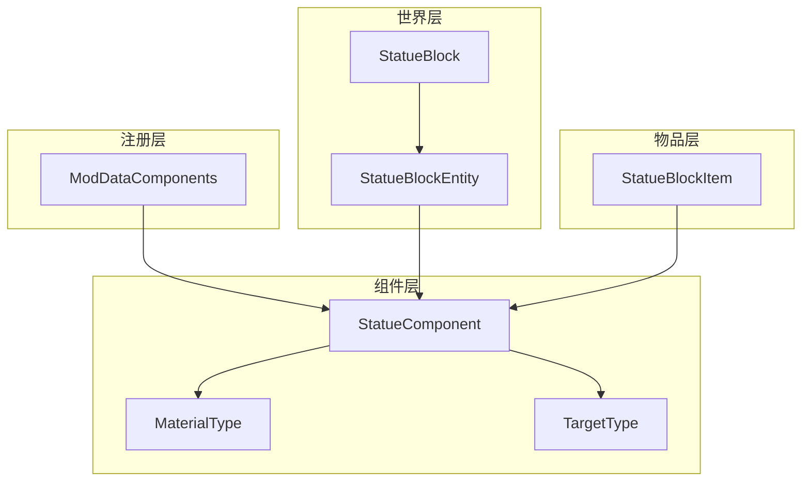
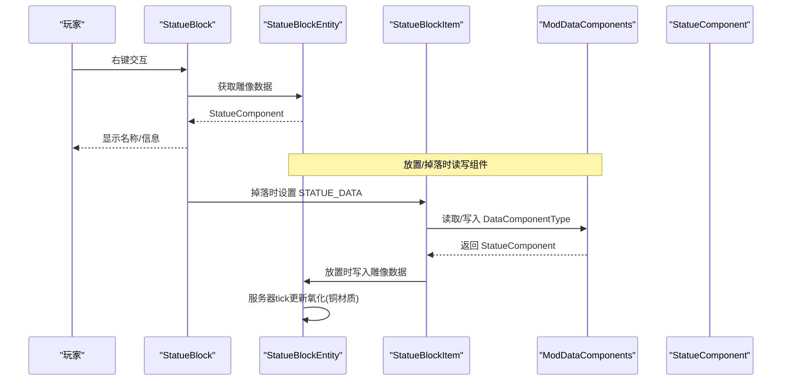
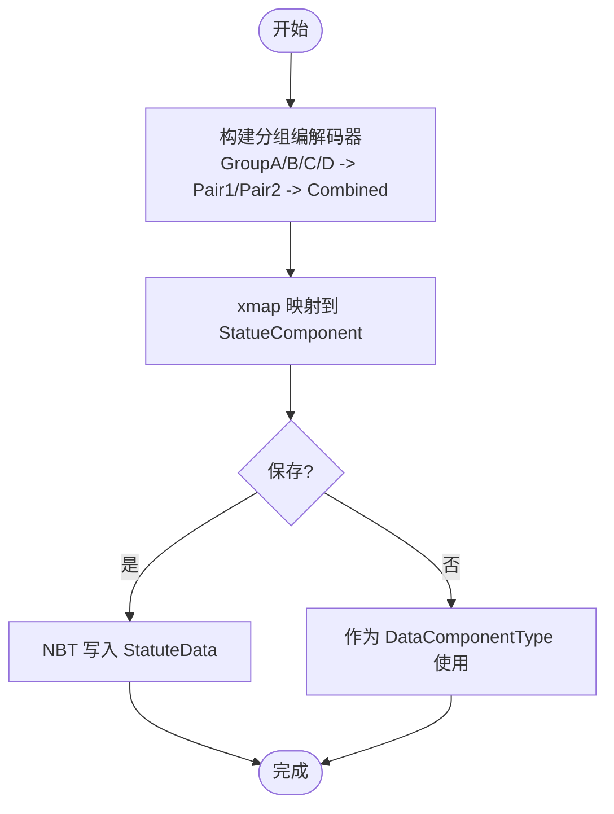
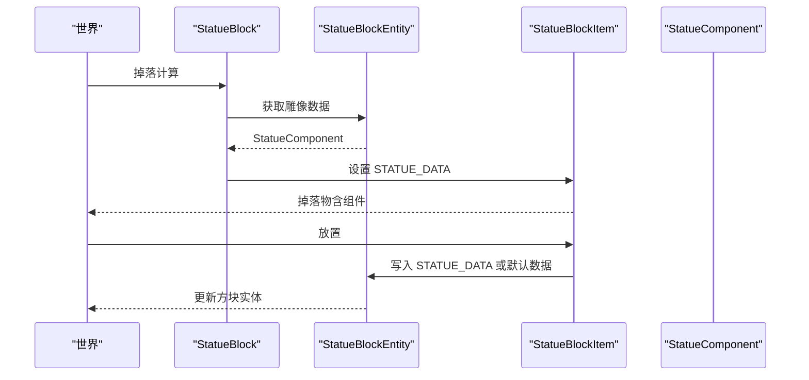
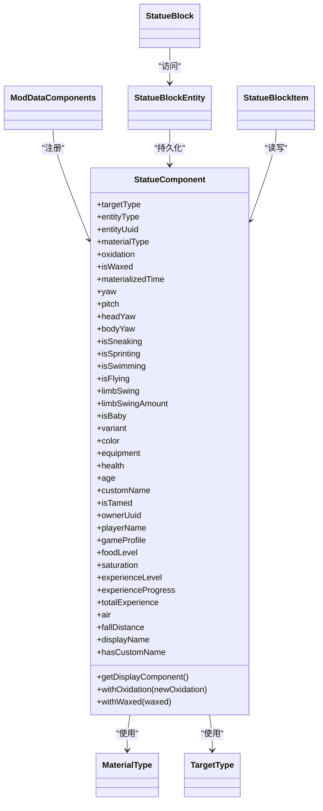

# 数据组件API

<cite>
**本文引用的文件**
- [StatueComponent.java](file://src/main/java/com/xiong/petrification/component/StatueComponent.java)
- [MaterialType.java](file://src/main/java/com/xiong/petrification/component/MaterialType.java)
- [TargetType.java](file://src/main/java/com/xiong/petrification/component/TargetType.java)
- [ModDataComponents.java](file://src/main/java/com/xiong/petrification/registry/ModDataComponents.java)
- [StatueBlockEntity.java](file://src/main/java/com/xiong/petrification/block/StatueBlockEntity.java)
- [StatueBlock.java](file://src/main/java/com/xiong/petrification/block/StatueBlock.java)
- [StatueBlockItem.java](file://src/main/java/com/xiong/petrification/item/StatueBlockItem.java)
</cite>

## 目录
1. [简介](#简介)
2. [项目结构](#项目结构)
3. [核心组件](#核心组件)
4. [架构总览](#架构总览)
5. [详细组件分析](#详细组件分析)
6. [依赖关系分析](#依赖关系分析)
7. [性能考虑](#性能考虑)
8. [故障排查指南](#故障排查指南)
9. [结论](#结论)
10. [附录](#附录)

## 简介
本文件为 StatueComponent 数据组件的完整 API 文档，覆盖字段定义、数据类型与约束、创建方式、序列化/反序列化流程、跨模块安全传递示例、版本兼容与迁移策略，以及性能与内存优化建议。该组件用于持久化“雕像”状态信息，包括目标类型、实体标识、材质属性、姿态、可选状态（装备、血量、经验等）及显示名称等。

## 项目结构
围绕 StatueComponent 的关键代码分布在以下位置：
- 组件定义与编解码：component/StatueComponent.java
- 枚举类型：component/MaterialType.java、component/TargetType.java
- 数据组件注册：registry/ModDataComponents.java
- 方块与方块实体：block/StatueBlock.java、block/StatueBlockEntity.java
- 物品读写：item/StatueBlockItem.java

图表来源
- [StatueComponent.java:14-52](file://src/main/java/com/xiong/petrification/component/StatueComponent.java#L14-L52)
- [MaterialType.java:9-17](file://src/main/java/com/xiong/petrification/component/MaterialType.java#L9-L17)
- [TargetType.java:6-10](file://src/main/java/com/xiong/petrification/component/TargetType.java#L6-L10)
- [ModDataComponents.java:15-19](file://src/main/java/com/xiong/petrification/registry/ModDataComponents.java#L15-L19)
- [StatueBlockEntity.java:17-74](file://src/main/java/com/xiong/petrification/block/StatueBlockEntity.java#L17-L74)
- [StatueBlock.java:38-151](file://src/main/java/com/xiong/petrification/block/StatueBlock.java#L38-L151)
- [StatueBlockItem.java:24-99](file://src/main/java/com/xiong/petrification/item/StatueBlockItem.java#L24-L99)

章节来源
- [StatueComponent.java:14-52](file://src/main/java/com/xiong/petrification/component/StatueComponent.java#L14-L52)
- [ModDataComponents.java:15-19](file://src/main/java/com/xiong/petrification/registry/ModDataComponents.java#L15-L19)

## 核心组件
StatueComponent 是一个不可变记录（record），包含 37 个字段，按逻辑分组并通过 Codec 进行结构化序列化。其设计要点：
- 不可变性：所有修改通过 withXxx 方法返回新实例，保证线程安全与可预测性。
- 分组编解码：将字段分为四组（A/B/C/D），再两两组合（Pair1/Pair2），最终合并为 Combined，以适配编解码框架限制。
- 默认值：大量 Optional 字段提供空值语义；部分基础字段提供默认值（如氧化度、姿态角度等）。
- 展示与辅助：提供 getDisplayComponent() 获取显示文本，withOxidation()/withWaxed() 用于更新铜材质相关状态。

章节来源
- [StatueComponent.java:14-52](file://src/main/java/com/xiong/petrification/component/StatueComponent.java#L14-L52)
- [StatueComponent.java:55-192](file://src/main/java/com/xiong/petrification/component/StatueComponent.java#L55-L192)
- [StatueComponent.java:194-254](file://src/main/java/com/xiong/petrification/component/StatueComponent.java#L194-L254)

## 架构总览
StatueComponent 在模组中的生命周期与交互如下：
- 创建：通过 defaultStatue(MaterialType) 生成默认雕像数据。
- 存储：StatueBlockEntity 使用 CODEC 将组件持久化到 NBT。
- 传输：通过 DataComponentType 将组件绑定到 ItemStack，跨网络/客户端同步。
- 读取：方块交互或物品悬停时读取并展示组件信息。
- 更新：服务器 tick 中根据配置对铜材质雕像进行氧化增长。

图表来源
- [StatueBlock.java:103-151](file://src/main/java/com/xiong/petrification/block/StatueBlock.java#L103-L151)
- [StatueBlockEntity.java:28-74](file://src/main/java/com/xiong/petrification/block/StatueBlockEntity.java#L28-L74)
- [StatueBlockItem.java:29-39](file://src/main/java/com/xiong/petrification/item/StatueBlockItem.java#L29-L39)
- [ModDataComponents.java:15-19](file://src/main/java/com/xiong/petrification/registry/ModDataComponents.java#L15-L19)

## 详细组件分析

### 字段定义、数据类型与约束
- 目标与实体
  - targetType: TargetType（生物/玩家）
  - entityType: Identifier（实体资源标识）
  - entityUuid: Optional<UUID>（实体唯一标识，可选）
- 材质与外观
  - materialType: MaterialType（石/铁/铜/金/钻石/下界合金）
  - oxidation: float（氧化程度，非负，受配置上限限制）
  - isWaxed: boolean（是否打蜡，阻止氧化）
  - displayName: Optional<String>（自定义显示名）
  - hasCustomName: boolean（是否存在自定义名）
- 姿态与动画
  - yaw/pitch/headYaw/bodyYaw: float（朝向与视角）
  - isSneaking/isSprinting/isSwimming/isFlying: boolean（动作状态）
  - limbSwing/limbSwingAmount: float（肢体摆动）
- 实体附加状态（均为 Optional）
  - variant/color/equipment/health/age/customName/isTamed/ownerUuid/playerName
  - gameProfile/foodLevel/saturation/experienceLevel/experienceProgress/totalExperience
  - air/fallDistance
- 时间戳
  - materializedTime: long（材料化时间）

约束说明
- 氧化度：非负且不超过配置最大值；铜材质且未打蜡时会随时间增加。
- 布尔标志：表示当前姿态/行为快照，无范围约束。
- Optional 字段：缺失表示未设置，读取时应判空。
- 显示名：若存在则优先使用，否则回退到翻译键。

章节来源
- [StatueComponent.java:14-52](file://src/main/java/com/xiong/petrification/component/StatueComponent.java#L14-L52)
- [StatueComponent.java:81-128](file://src/main/java/com/xiong/petrification/component/StatueComponent.java#L81-L128)
- [StatueComponent.java:194-234](file://src/main/java/com/xiong/petrification/component/StatueComponent.java#L194-L234)
- [MaterialType.java:9-66](file://src/main/java/com/xiong/petrification/component/MaterialType.java#L9-L66)
- [TargetType.java:6-22](file://src/main/java/com/xiong/petrification/component/TargetType.java#L6-L22)

### 创建与默认值
- 默认雕像：defaultStatue(MaterialType) 提供最小可用状态，包含基础目标类型、默认实体、材质、初始姿态与显示名前缀等。
- 构造建议：通过工厂方法创建，避免手动构造遗漏必填字段。

章节来源
- [StatueComponent.java:194-227](file://src/main/java/com/xiong/petrification/component/StatueComponent.java#L194-L227)

### 序列化与反序列化
- 编解码器：CODEC 基于 RecordCodecBuilder 将字段分组成 part1/part2 结构，支持 JSON/NBT 双向转换。
- 持久化：StatueBlockEntity.saveAdditional/loadAdditional 使用 CODEC 读写 NBT。
- 数据组件：ModDataComponents 注册 DATA_COMPONENT_TYPE，允许将 StatueComponent 作为 DataComponentType 存储在物品上，并启用缓存编码以提升性能。

图表来源
- [StatueComponent.java:81-148](file://src/main/java/com/xiong/petrification/component/StatueComponent.java#L81-L148)
- [StatueBlockEntity.java:62-74](file://src/main/java/com/xiong/petrification/block/StatueBlockEntity.java#L62-L74)
- [ModDataComponents.java:15-19](file://src/main/java/com/xiong/petrification/registry/ModDataComponents.java#L15-L19)

章节来源
- [StatueComponent.java:81-148](file://src/main/java/com/xiong/petrification/component/StatueComponent.java#L81-L148)
- [StatueBlockEntity.java:62-74](file://src/main/java/com/xiong/petrification/block/StatueBlockEntity.java#L62-L74)
- [ModDataComponents.java:15-19](file://src/main/java/com/xiong/petrification/registry/ModDataComponents.java#L15-L19)

### 跨模块安全传递示例
- 方块掉落：当雕像方块被破坏时，从方块实体读取 StatueComponent 并设置到掉落物品的 STATUE_DATA 组件中，确保数据不丢失。
- 放置还原：放置雕像物品时，若物品携带 STATUE_DATA，则将其写入对应方块实体；否则写入默认雕像数据。
- 交互读取：右键雕像方块时，读取组件并发送系统消息显示名称。

图表来源
- [StatueBlock.java:123-135](file://src/main/java/com/xiong/petrification/block/StatueBlock.java#L123-L135)
- [StatueBlockItem.java:29-39](file://src/main/java/com/xiong/petrification/item/StatueBlockItem.java#L29-L39)

章节来源
- [StatueBlock.java:123-135](file://src/main/java/com/xiong/petrification/block/StatueBlock.java#L123-L135)
- [StatueBlockItem.java:29-39](file://src/main/java/com/xiong/petrification/item/StatueBlockItem.java#L29-L39)

### 版本兼容性与数据迁移
- 向后兼容：编解码器大量使用 optionalFieldOf 并提供默认值，旧版本缺失字段不会导致加载失败。
- 新增字段：新增 Optional 字段不会影响旧存档；非 Optional 字段需确保默认值合理。
- 迁移策略：
  - 升级时若引入必需字段，应在 loadAdditional 中检测缺失并填充默认值。
  - 若字段语义变更，可在加载阶段进行映射转换。
  - 建议在重大变更时记录版本号并在加载时执行迁移脚本。

章节来源
- [StatueComponent.java:81-128](file://src/main/java/com/xiong/petrification/component/StatueComponent.java#L81-L128)
- [StatueBlockEntity.java:70-74](file://src/main/java/com/xiong/petrification/block/StatueBlockEntity.java#L70-L74)

### 性能与内存优化建议
- 不可变对象：StatueComponent 为 record，修改返回新实例，避免并发问题；但频繁创建可能带来 GC 压力。建议批量更新后一次性提交。
- 编解码缓存：注册时启用 cacheEncoding()，减少重复编码开销。
- 氧化更新节流：服务器 tick 中按固定间隔更新铜材质氧化，避免每 tick 计算。
- 可选字段：大量 Optional 字段可减少不必要的数据传输与存储；仅在需要时设置。
- 显示文本：getDisplayComponent() 优先使用 displayName，避免每次生成翻译键。

章节来源
- [ModDataComponents.java:15-19](file://src/main/java/com/xiong/petrification/registry/ModDataComponents.java#L15-L19)
- [StatueBlockEntity.java:28-50](file://src/main/java/com/xiong/petrification/block/StatueBlockEntity.java#L28-L50)
- [StatueComponent.java:229-234](file://src/main/java/com/xiong/petrification/component/StatueComponent.java#L229-L234)

## 依赖关系分析
- StatueComponent 依赖：
  - TargetType、MaterialType 枚举用于类型安全与序列化。
  - Identifier 用于实体资源定位。
  - CompoundTag 用于复杂数据（装备、游戏档案）的嵌套存储。
- 注册与使用：
  - ModDataComponents 将 StatueComponent 注册为 DataComponentType，供物品持有。
  - StatueBlockEntity 使用 CODEC 进行 NBT 持久化。
  - StatueBlock/StatueBlockItem 负责在交互与放置过程中读写组件。

图表来源
- [StatueComponent.java:14-52](file://src/main/java/com/xiong/petrification/component/StatueComponent.java#L14-L52)
- [MaterialType.java:9-66](file://src/main/java/com/xiong/petrification/component/MaterialType.java#L9-L66)
- [TargetType.java:6-22](file://src/main/java/com/xiong/petrification/component/TargetType.java#L6-L22)
- [ModDataComponents.java:15-19](file://src/main/java/com/xiong/petrification/registry/ModDataComponents.java#L15-L19)
- [StatueBlockEntity.java:17-74](file://src/main/java/com/xiong/petrification/block/StatueBlockEntity.java#L17-L74)
- [StatueBlock.java:38-151](file://src/main/java/com/xiong/petrification/block/StatueBlock.java#L38-L151)
- [StatueBlockItem.java:24-99](file://src/main/java/com/xiong/petrification/item/StatueBlockItem.java#L24-L99)

章节来源
- [StatueComponent.java:14-52](file://src/main/java/com/xiong/petrification/component/StatueComponent.java#L14-L52)
- [ModDataComponents.java:15-19](file://src/main/java/com/xiong/petrification/registry/ModDataComponents.java#L15-L19)

## 性能考虑
- 编解码性能：启用缓存编码，减少重复序列化成本。
- 更新频率：氧化更新采用固定间隔，降低每 tick 计算量。
- 数据传输：Optional 字段按需设置，减少网络负载。
- 内存占用：不可变对象虽安全但频繁创建会产生临时对象；建议在服务端集中处理并复用结果。

[本节为通用性能指导，不直接分析具体文件]

## 故障排查指南
- 组件为空：检查方块实体是否成功加载数据；确认 save/load 路径是否正确调用 CODEC。
- 显示名称不生效：确认 hasCustomName 与 displayName 同时设置；优先使用 displayName。
- 氧化异常：确认材质为铜、未打蜡、且未达到最大氧化值；检查配置项是否启用氧化。
- 放置失败：确认物品携带 STATUE_DATA；若无则写入默认雕像数据。

章节来源
- [StatueBlockEntity.java:28-50](file://src/main/java/com/xiong/petrification/block/StatueBlockEntity.java#L28-L50)
- [StatueBlockItem.java:29-39](file://src/main/java/com/xiong/petrification/item/StatueBlockItem.java#L29-L39)
- [StatueComponent.java:229-234](file://src/main/java/com/xiong/petrification/component/StatueComponent.java#L229-L234)

## 结论
StatueComponent 提供了完整的雕像状态建模与持久化能力，通过分组编解码与 DataComponentType 实现高效、安全的跨模块数据传递。结合服务器 tick 的氧化机制与可选字段设计，既满足功能需求又兼顾性能与兼容性。建议在实际使用中遵循不可变更新模式、按需设置可选字段，并在版本升级时做好迁移策略。

[本节为总结性内容，不直接分析具体文件]

## 附录
- 常用操作路径参考：
  - 创建默认雕像：StatueComponent.defaultStatue(MaterialType)
  - 更新氧化：StatueComponent.withOxidation(float)
  - 更新打蜡：StatueComponent.withWaxed(boolean)
  - 获取显示文本：StatueComponent.getDisplayComponent()
  - 物品读写组件：StatueBlockItem.updateCustomBlockEntityTag / appendHoverText
  - 方块实体持久化：StatueBlockEntity.saveAdditional / loadAdditional

章节来源
- [StatueComponent.java:194-254](file://src/main/java/com/xiong/petrification/component/StatueComponent.java#L194-L254)
- [StatueBlockItem.java:29-99](file://src/main/java/com/xiong/petrification/item/StatueBlockItem.java#L29-L99)
- [StatueBlockEntity.java:62-74](file://src/main/java/com/xiong/petrification/block/StatueBlockEntity.java#L62-L74)