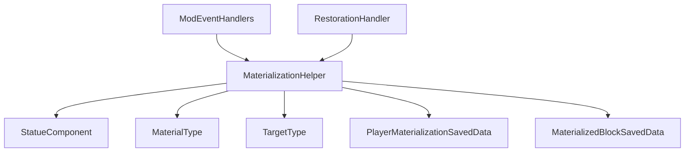
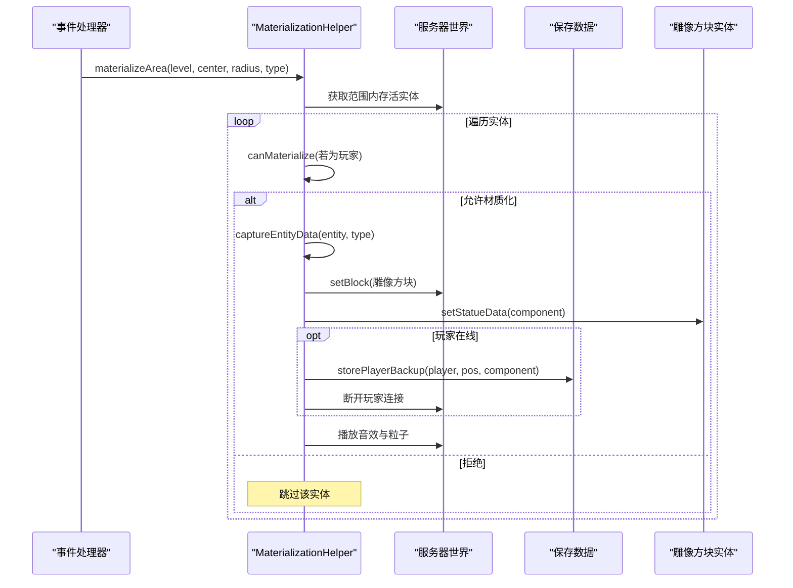
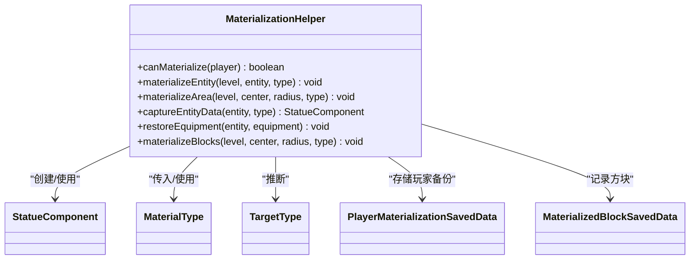

# 材质化工具类API

<cite>
**本文引用的文件**
- [MaterializationHelper.java](file://src/main/java/com/xiong/petrification/util/MaterializationHelper.java)
- [StatueComponent.java](file://src/main/java/com/xiong/petrification/component/StatueComponent.java)
- [MaterialType.java](file://src/main/java/com/xiong/petrification/component/MaterialType.java)
- [TargetType.java](file://src/main/java/com/xiong/petrification/component/TargetType.java)
- [ModEventHandlers.java](file://src/main/java/com/xiong/petrification/handler/ModEventHandlers.java)
- [RestorationHandler.java](file://src/main/java/com/xiong/petrification/handler/RestorationHandler.java)
- [PlayerMaterializationSavedData.java](file://src/main/java/com/xiong/petrification/data/PlayerMaterializationSavedData.java)
- [MaterializedBlockSavedData.java](file://src/main/java/com/xiong/petrification/data/MaterializedBlockSavedData.java)
</cite>

## 目录
1. [简介](#简介)
2. [项目结构](#项目结构)
3. [核心组件](#核心组件)
4. [架构总览](#架构总览)
5. [详细组件分析](#详细组件分析)
6. [依赖关系分析](#依赖关系分析)
7. [性能考虑](#性能考虑)
8. [故障排查指南](#故障排查指南)
9. [结论](#结论)
10. [附录：使用示例与最佳实践](#附录使用示例与最佳实践)

## 简介
本文件为 MaterializationHelper 工具类的完整 API 文档，聚焦以下公共方法：
- canMaterialize：权限检查
- materializeEntity：实体材质化
- materializeArea：区域材质化
- captureEntityData：数据捕获
- restoreEquipment：装备恢复

文档将详细说明每个方法的参数类型、返回值、异常处理、使用场景，并提供基于仓库代码的调用流程与最佳实践。

## 项目结构
MaterializationHelper 位于 util 包中，负责材质化的核心逻辑；与之协作的关键组件包括：
- component：StatueComponent（材质化数据载体）、MaterialType（材质类型）、TargetType（目标类型）
- data：PlayerMaterializationSavedData（玩家离线备份）、MaterializedBlockSavedData（方块材质化记录）
- handler：ModEventHandlers（事件触发材质化）、RestorationHandler（恢复逻辑）
- registry：ModBlocks（雕像方块等注册项）

图表来源
- [MaterializationHelper.java:33-262](file://src/main/java/com/xiong/petrification/util/MaterializationHelper.java#L33-L262)
- [StatueComponent.java:14-52](file://src/main/java/com/xiong/petrification/component/StatueComponent.java#L14-L52)
- [MaterialType.java:9-68](file://src/main/java/com/xiong/petrification/component/MaterialType.java#L9-L68)
- [TargetType.java:6-23](file://src/main/java/com/xiong/petrification/component/TargetType.java#L6-L23)
- [PlayerMaterializationSavedData.java:22-95](file://src/main/java/com/xiong/petrification/data/PlayerMaterializationSavedData.java#L22-L95)
- [MaterializedBlockSavedData.java:19-85](file://src/main/java/com/xiong/petrification/data/MaterializedBlockSavedData.java#L19-L85)
- [ModEventHandlers.java:30-63](file://src/main/java/com/xiong/petrification/handler/ModEventHandlers.java#L30-L63)
- [RestorationHandler.java:31-229](file://src/main/java/com/xiong/petrification/handler/RestorationHandler.java#L31-L229)

章节来源
- [MaterializationHelper.java:33-262](file://src/main/java/com/xiong/petrification/util/MaterializationHelper.java#L33-L262)

## 核心组件
- StatueComponent：承载实体材质化后的全部状态信息（类型、姿态、装备、玩家属性等），支持序列化与反序列化。
- MaterialType：定义材质种类（石头、铁、铜、金、钻石、下界合金），包含颜色、显示前缀、对应物品与方块。
- TargetType：区分生物与玩家两类目标。

章节来源
- [StatueComponent.java:14-52](file://src/main/java/com/xiong/petrification/component/StatueComponent.java#L14-L52)
- [MaterialType.java:9-68](file://src/main/java/com/xiong/petrification/component/MaterialType.java#L9-L68)
- [TargetType.java:6-23](file://src/main/java/com/xiong/petrification/component/TargetType.java#L6-L23)

## 架构总览
材质化流程由事件或命令触发，最终通过 MaterializationHelper 完成：
- 权限校验：canMaterialize
- 数据捕获：captureEntityData
- 实体转雕像：materializeEntity
- 区域批量处理：materializeArea
- 方块材质化记录：materializeBlocks
- 恢复时装备还原：restoreEquipment

图表来源
- [ModEventHandlers.java:45-63](file://src/main/java/com/xiong/petrification/handler/ModEventHandlers.java#L45-L63)
- [MaterializationHelper.java:83-96](file://src/main/java/com/xiong/petrification/util/MaterializationHelper.java#L83-L96)
- [MaterializationHelper.java:55-81](file://src/main/java/com/xiong/petrification/util/MaterializationHelper.java#L55-L81)
- [PlayerMaterializationSavedData.java:77-80](file://src/main/java/com/xiong/petrification/data/PlayerMaterializationSavedData.java#L77-L80)

## 详细组件分析

### canMaterialize(Player player) -> boolean
- 用途：判断当前玩家是否允许执行材质化操作。
- 参数：
  - player：玩家实例（可为客户端或服务端，但权限检查在服务端生效）。
- 返回：true 表示允许，false 表示拒绝。
- 行为说明：
  - 若玩家在创造模式且配置不允许创造模式材质化，则拒绝。
  - 若配置不允许 OP 材质化，且玩家权限等级达到或超过阈值，则拒绝。
- 异常：无显式抛出异常；内部访问服务器权限集合可能因环境差异产生运行时错误，建议在服务端调用并保证 ServerPlayer 存在。
- 使用场景：在 materializeEntity 入口对玩家进行权限拦截。

章节来源
- [MaterializationHelper.java:36-53](file://src/main/java/com/xiong/petrification/util/MaterializationHelper.java#L36-L53)

### materializeEntity(ServerLevel level, LivingEntity entity, MaterialType materialType) -> void
- 用途：将单个实体转化为雕像方块，并持久化其数据。
- 参数：
  - level：服务器世界实例。
  - entity：要材质化的实体（可为玩家或生物）。
  - materialType：材质类型。
- 行为说明：
  - 若实体为玩家且未通过 canMaterialize，直接返回。
  - 调用 captureEntityData 生成 StatueComponent。
  - 若实体为玩家，先存储离线备份，再断开玩家连接。
  - 在原位置放置雕像方块，并将 StatueComponent 写入方块实体。
  - 若非玩家实体，则销毁原实体。
  - 播放音效与粒子效果。
- 异常：无显式抛出异常；依赖服务端上下文。
- 使用场景：单实体材质化；被 materializeArea 循环调用。

章节来源
- [MaterializationHelper.java:55-81](file://src/main/java/com/xiong/petrification/util/MaterializationHelper.java#L55-L81)

### materializeArea(ServerLevel level, Vec3 center, double radius, MaterialType materialType) -> void
- 用途：以指定中心与半径的区域为单位，批量材质化范围内的所有存活实体。
- 参数：
  - level：服务器世界实例。
  - center：区域中心坐标。
  - radius：半径。
  - materialType：材质类型。
- 行为说明：
  - 计算 AABB 范围，筛选存活实体。
  - 优先处理玩家（排序策略确保玩家优先）。
  - 逐个调用 materializeEntity。
- 异常：无显式抛出异常；大量实体时注意性能。
- 使用场景：药水溅射、指令或事件触发的区域材质化。

章节来源
- [MaterializationHelper.java:83-96](file://src/main/java/com/xiong/petrification/util/MaterializationHelper.java#L83-L96)
- [ModEventHandlers.java:45-63](file://src/main/java/com/xiong/petrification/handler/ModEventHandlers.java#L45-L63)

### captureEntityData(LivingEntity entity, MaterialType materialType) -> StatueComponent
- 用途：捕获实体的完整状态，生成可序列化的 StatueComponent。
- 参数：
  - entity：任意活体实体。
  - materialType：材质类型（用于构建显示名称前缀）。
- 返回：StatueComponent，包含实体类型、UUID、姿态、装备、玩家属性（如适用）、驯服信息等。
- 行为说明：
  - 根据实体类型设置 TargetType。
  - 序列化六个装备槽位到 NBT。
  - 若为玩家，额外捕获用户名、游戏档案、饥饿值、经验、空气值、坠落距离等。
  - 若为可驯服动物且已驯服，记录驯服状态与所有者 UUID。
  - 构建 displayName 并填充 StatueComponent。
- 异常：无显式抛出异常；NBT 编解码失败时会回退为空栈或空值。
- 使用场景：材质化前的数据快照；恢复时读取 StatueComponent 重建实体。

章节来源
- [MaterializationHelper.java:98-186](file://src/main/java/com/xiong/petrification/util/MaterializationHelper.java#L98-L186)
- [StatueComponent.java:14-52](file://src/main/java/com/xiong/petrification/component/StatueComponent.java#L14-L52)

### restoreEquipment(LivingEntity entity, CompoundTag equipment) -> void
- 用途：将之前捕获的装备 NBT 恢复到实体的各装备槽位。
- 参数：
  - entity：目标实体。
  - equipment：装备 NBT（包含 mainHand、offHand、helmet、chestplate、leggings、boots 子标签）。
- 行为说明：
  - 若 equipment 为 null，直接返回。
  - 依次解析各槽位的 NBT 并设置到对应 EquipmentSlot。
  - 解析失败时回退为空物品。
- 异常：无显式抛出异常；NBT 解析失败会安全回退。
- 使用场景：从雕像恢复生物或玩家时，还原其装备。

章节来源
- [MaterializationHelper.java:211-232](file://src/main/java/com/xiong/petrification/util/MaterializationHelper.java#L211-L232)
- [RestorationHandler.java:140-162](file://src/main/java/com/xiong/petrification/handler/RestorationHandler.java#L140-L162)
- [RestorationHandler.java:169-182](file://src/main/java/com/xiong/petrification/handler/RestorationHandler.java#L169-L182)

### 补充：materializeBlocks(ServerLevel level, Vec3 center, double radius, MaterialType materialType) -> void
- 用途：记录指定区域内非空气、非雕像方块的原始方块信息，以便后续恢复。
- 参数：
  - level：服务器世界实例。
  - center：区域中心坐标。
  - radius：半径。
  - materialType：材质类型。
- 行为说明：
  - 遍历球形区域内的方块，过滤空气与雕像方块。
  - 若该位置尚未记录，则写入 MaterializedBlockSavedData。
- 异常：无显式抛出异常。
- 使用场景：配合区域材质化，记录方块以便恢复。

章节来源
- [MaterializationHelper.java:234-255](file://src/main/java/com/xiong/petrification/util/MaterializationHelper.java#L234-L255)
- [MaterializedBlockSavedData.java:19-85](file://src/main/java/com/xiong/petrification/data/MaterializedBlockSavedData.java#L19-L85)

## 依赖关系分析
- MaterializationHelper 依赖：
  - component：StatueComponent、MaterialType、TargetType
  - data：PlayerMaterializationSavedData、MaterializedBlockSavedData
  - registry：ModBlocks（雕像方块）
  - Minecraft API：ServerLevel、LivingEntity、Player、ServerPlayer、NBT、声音与粒子等
- 外部交互：
  - ModEventHandlers 在药水溅射事件中调用 materializeArea 与 materializeBlocks。
  - RestorationHandler 在恢复时调用 restoreEquipment 应用装备。

图表来源
- [MaterializationHelper.java:33-262](file://src/main/java/com/xiong/petrification/util/MaterializationHelper.java#L33-L262)
- [StatueComponent.java:14-52](file://src/main/java/com/xiong/petrification/component/StatueComponent.java#L14-L52)
- [MaterialType.java:9-68](file://src/main/java/com/xiong/petrification/component/MaterialType.java#L9-L68)
- [TargetType.java:6-23](file://src/main/java/com/xiong/petrification/component/TargetType.java#L6-L23)
- [PlayerMaterializationSavedData.java:22-95](file://src/main/java/com/xiong/petrification/data/PlayerMaterializationSavedData.java#L22-L95)
- [MaterializedBlockSavedData.java:19-85](file://src/main/java/com/xiong/petrification/data/MaterializedBlockSavedData.java#L19-L85)

章节来源
- [MaterializationHelper.java:33-262](file://src/main/java/com/xiong/petrification/util/MaterializationHelper.java#L33-L262)

## 性能考虑
- 区域材质化：
  - 使用 AABB 筛选实体，避免全图扫描。
  - 对实体排序优先处理玩家，减少关键用户延迟。
  - 建议限制最大半径或批量分帧处理，避免卡顿。
- 数据捕获：
  - 装备 NBT 序列化开销较大，尽量合并批次操作。
  - 玩家额外属性较多，仅在必要时启用。
- 方块记录：
  - 仅记录非空气与非雕像方块，减少冗余。
  - 使用 SavedData 持久化，注意定期清理过期数据。
- 音效与粒子：
  - 单次材质化播放一次音效与粒子，避免重复触发。

[本节为通用性能建议，不直接分析具体文件]

## 故障排查指南
- 权限问题：
  - 确认 canMaterialize 返回 true；检查创造模式与 OP 权限配置。
  - 若玩家权限等级过高或被禁止，材质化将被拒绝。
- 玩家离线恢复：
  - 玩家材质化后会断开连接并存储备份；恢复时需确保 UUID 存在且未被移除。
- 装备恢复失败：
  - 检查 equipment NBT 是否完整；解析失败会回退为空物品。
- 方块恢复：
  - 确认 MaterializedBlockSavedData 中存在对应位置的记录；否则无法恢复。

章节来源
- [MaterializationHelper.java:36-53](file://src/main/java/com/xiong/petrification/util/MaterializationHelper.java#L36-L53)
- [PlayerMaterializationSavedData.java:77-93](file://src/main/java/com/xiong/petrification/data/PlayerMaterializationSavedData.java#L77-L93)
- [MaterializationHelper.java:211-232](file://src/main/java/com/xiong/petrification/util/MaterializationHelper.java#L211-L232)
- [MaterializedBlockSavedData.java:61-85](file://src/main/java/com/xiong/petrification/data/MaterializedBlockSavedData.java#L61-L85)

## 结论
MaterializationHelper 提供了完整的材质化能力：权限校验、数据捕获、实体与区域材质化、方块记录以及装备恢复。通过与 StatueComponent、SavedData 及事件处理器的协作，实现了从材质化到恢复的闭环。使用时应关注权限配置、性能优化与异常回退策略，确保稳定运行。

[本节为总结性内容，不直接分析具体文件]

## 附录：使用示例与最佳实践

### 示例一：事件触发区域材质化
- 触发点：药水溅射事件。
- 调用链：
  - ModEventHandlers.onPotionSplash 检测材质化药水
  - 调用 MaterializationHelper.materializeArea 与 materializeBlocks
- 要点：
  - 半径按配置倍率放大
  - 同时记录方块以便恢复

章节来源
- [ModEventHandlers.java:45-63](file://src/main/java/com/xiong/petrification/handler/ModEventHandlers.java#L45-L63)
- [MaterializationHelper.java:83-96](file://src/main/java/com/xiong/petrification/util/MaterializationHelper.java#L83-L96)
- [MaterializationHelper.java:234-255](file://src/main/java/com/xiong/petrification/util/MaterializationHelper.java#L234-L255)

### 示例二：单实体材质化
- 调用：MaterializationHelper.materializeEntity
- 步骤：
  - 权限检查 canMaterialize（若为玩家）
  - 数据捕获 captureEntityData
  - 放置雕像方块并写入 StatueComponent
  - 玩家备份与断开连接（若为玩家）
  - 播放音效与粒子

章节来源
- [MaterializationHelper.java:55-81](file://src/main/java/com/xiong/petrification/util/MaterializationHelper.java#L55-L81)
- [PlayerMaterializationSavedData.java:77-80](file://src/main/java/com/xiong/petrification/data/PlayerMaterializationSavedData.java#L77-L80)

### 示例三：恢复时装备还原
- 调用：MaterializationHelper.restoreEquipment
- 步骤：
  - 从 StatueComponent.equipment 读取 NBT
  - 解析并设置到实体各槽位
  - 解析失败回退为空物品

章节来源
- [RestorationHandler.java:140-162](file://src/main/java/com/xiong/petrification/handler/RestorationHandler.java#L140-L162)
- [RestorationHandler.java:169-182](file://src/main/java/com/xiong/petrification/handler/RestorationHandler.java#L169-L182)
- [MaterializationHelper.java:211-232](file://src/main/java/com/xiong/petrification/util/MaterializationHelper.java#L211-L232)

### 最佳实践
- 始终在服务端执行材质化相关逻辑，确保权限与数据一致性。
- 对大区域材质化进行限流或分批处理，避免服务器卡顿。
- 合理设置权限配置，防止滥用材质化能力。
- 在恢复流程中做好 NBT 解析失败的容错处理。
- 定期清理过期的方块与玩家备份数据，减少存档体积。

[本节为通用最佳实践，不直接分析具体文件]