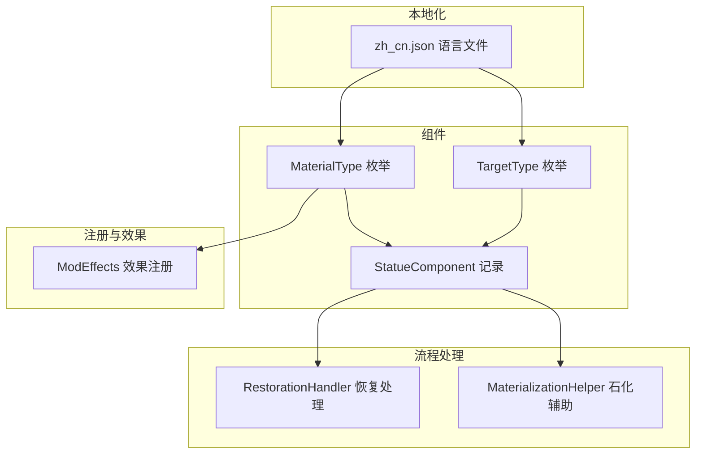
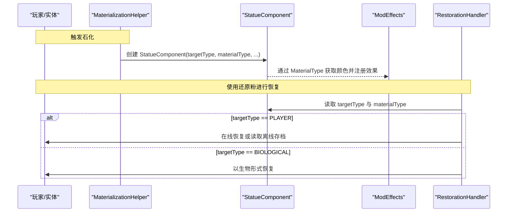
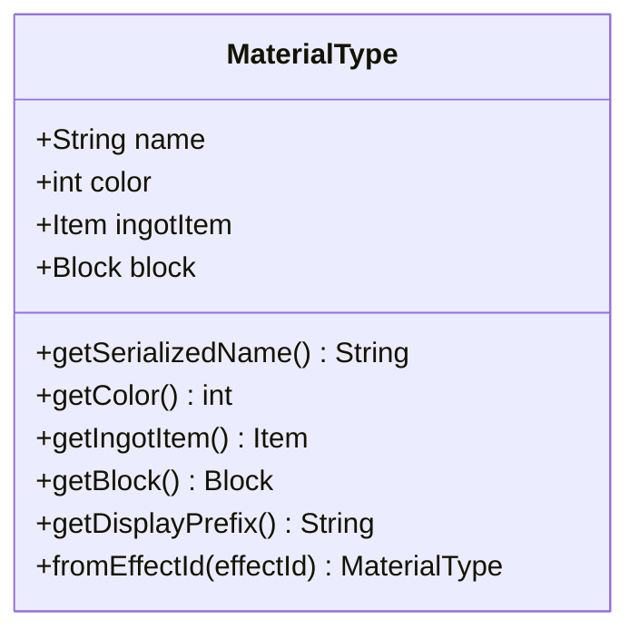
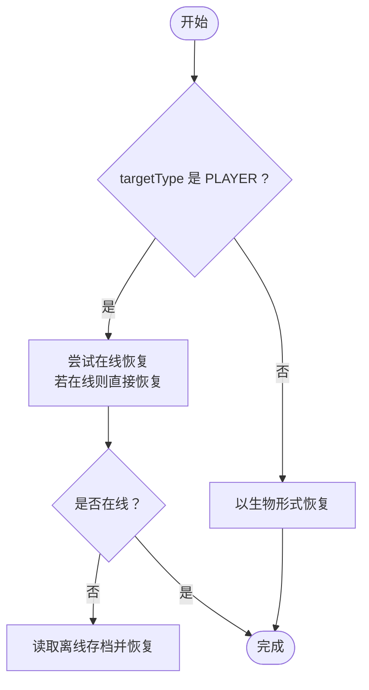
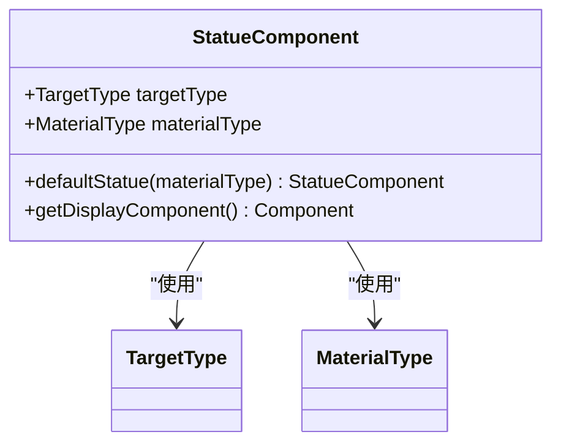
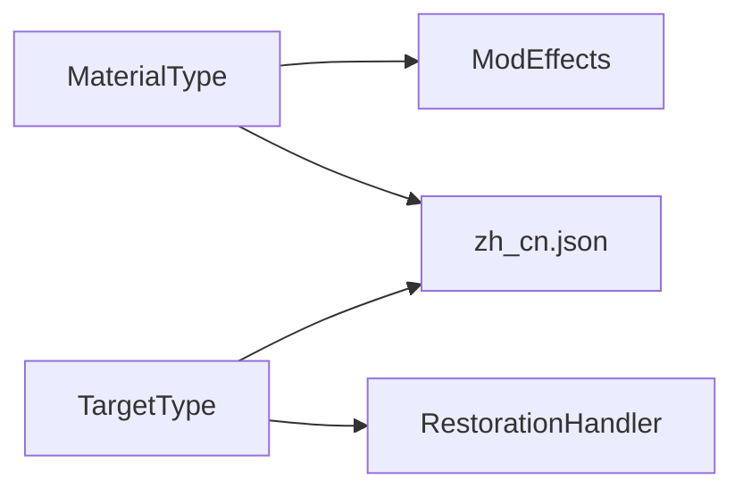

# 枚举类型API

<cite>
**本文引用的文件**
- [MaterialType.java](file://src/main/java/com/xiong/petrification/component/MaterialType.java)
- [TargetType.java](file://src/main/java/com/xiong/petrification/component/TargetType.java)
- [StatueComponent.java](file://src/main/java/com/xiong/petrification/component/StatueComponent.java)
- [ModEffects.java](file://src/main/java/com/xiong/petrification/registry/ModEffects.java)
- [RestorationHandler.java](file://src/main/java/com/xiong/petrification/handler/RestorationHandler.java)
- [MaterializationHelper.java](file://src/main/java/com/xiong/petrification/util/MaterializationHelper.java)
- [zh_cn.json](file://src/main/resources/assets/petrification/lang/zh_cn.json)
</cite>

## 目录
1. [简介](#简介)
2. [项目结构](#项目结构)
3. [核心组件](#核心组件)
4. [架构总览](#架构总览)
5. [详细组件分析](#详细组件分析)
6. [依赖关系分析](#依赖关系分析)
7. [性能与扩展性考虑](#性能与扩展性考虑)
8. [故障排查指南](#故障排查指南)
9. [结论](#结论)
10. [附录：使用示例与扩展指南](#附录使用示例与扩展指南)

## 简介
本章节面向开发者，提供 MaterialType 与 TargetType 两个枚举类型的完整 API 文档。内容涵盖：
- MaterialType：石头、铁、铜、金、钻石、下界合金的材质定义、颜色值、显示前缀、关联物品与方块等属性说明。
- TargetType：目标类型（玩家、生物）及其在石化/还原流程中的处理逻辑。
- 枚举值的完整列表、代码引用方式与扩展方法，帮助新增材质或目标类型。

## 项目结构
与枚举相关的核心代码位于 component 包中，并在效果注册、恢复处理、工具类等模块中被广泛使用。

图表来源
- [MaterialType.java:9-67](file://src/main/java/com/xiong/petrification/component/MaterialType.java#L9-L67)
- [TargetType.java:6-22](file://src/main/java/com/xiong/petrification/component/TargetType.java#L6-L22)
- [StatueComponent.java:14-52](file://src/main/java/com/xiong/petrification/component/StatueComponent.java#L14-L52)
- [ModEffects.java:13-27](file://src/main/java/com/xiong/petrification/registry/ModEffects.java#L13-L27)
- [RestorationHandler.java:48-86](file://src/main/java/com/xiong/petrification/handler/RestorationHandler.java#L48-L86)
- [MaterializationHelper.java:99-99](file://src/main/java/com/xiong/petrification/util/MaterializationHelper.java#L99-L99)
- [zh_cn.json:35-50](file://src/main/resources/assets/petrification/lang/zh_cn.json#L35-L50)

章节来源
- [MaterialType.java:9-67](file://src/main/java/com/xiong/petrification/component/MaterialType.java#L9-L67)
- [TargetType.java:6-22](file://src/main/java/com/xiong/petrification/component/TargetType.java#L6-L22)
- [StatueComponent.java:14-52](file://src/main/java/com/xiong/petrification/component/StatueComponent.java#L14-L52)
- [ModEffects.java:13-27](file://src/main/java/com/xiong/petrification/registry/ModEffects.java#L13-L27)
- [RestorationHandler.java:48-86](file://src/main/java/com/xiong/petrification/handler/RestorationHandler.java#L48-L86)
- [MaterializationHelper.java:99-99](file://src/main/java/com/xiong/petrification/util/MaterializationHelper.java#L99-L99)
- [zh_cn.json:35-50](file://src/main/resources/assets/petrification/lang/zh_cn.json#L35-L50)

## 核心组件
本节对两个枚举进行逐条说明，包括字段含义、可用方法与行为约定。

### MaterialType 枚举
- 作用：定义雕像材质类型，包含名称、颜色、对应物品与方块、显示前缀、序列化编解码器等。
- 已实现材质：
  - STONE：名称 stone；颜色 0x808080；物品 圆石；方块 圆石块；显示前缀 Petrified
  - IRON：名称 iron；颜色 0xA0A0A0；物品 铁锭；方块 铁块；显示前缀 Iron
  - COPPER：名称 copper；颜色 0xB87333；物品 铜锭；方块 粗铜块；显示前缀 Copper
  - GOLD：名称 gold；颜色 0xFFD700；物品 金锭；方块 金块；显示前缀 Golden
  - DIAMOND：名称 diamond；颜色 0x00FFFF；物品 钻石；方块 钻石块；显示前缀 Diamond
  - NETHERITE：名称 netherite；颜色 0x454545；物品 下界合金锭；方块 下界合金块；显示前缀 Netherite
- 关键方法：
  - getSerializedName()：返回字符串标识（如 stone、iron 等），用于序列化/反序列化与配方匹配。
  - getColor()：返回材质对应的渲染颜色（十六进制整型）。
  - getIngotItem()：返回与该材质对应的“锭”类物品。
  - getBlock()：返回与该材质对应的方块。
  - getDisplayPrefix()：返回用于命名/提示的前缀（例如 “Petrified”、“Iron” 等）。
  - fromEffectId(String)：根据效果 ID 字符串解析为对应材质，未匹配时回退到 STONE。
- 序列化：
  - CODEC：基于 StringRepresentable 的枚举编解码器，支持数据持久化与网络传输。

章节来源
- [MaterialType.java:9-67](file://src/main/java/com/xiong/petrification/component/MaterialType.java#L9-L67)
- [ModEffects.java:17-22](file://src/main/java/com/xiong/petrification/registry/ModEffects.java#L17-L22)
- [zh_cn.json:35-40](file://src/main/resources/assets/petrification/lang/zh_cn.json#L35-L40)

### TargetType 枚举
- 作用：定义被石化/还原的目标类型，当前实现包含：
  - BIOLOGICAL：生物（非玩家实体）
  - PLAYER：玩家
- 关键方法：
  - getSerializedName()：返回字符串标识（BIOLOGICAL、PLAYER），用于序列化/反序列化。
  - CODEC：基于 StringRepresentable 的枚举编解码器。
- 处理逻辑：
  - 在恢复流程中，若为目标类型为 PLAYER，则优先尝试在线恢复或读取离线存档；否则按生物处理。
  - 在生成雕像时，会根据实体类型自动推断目标类型：玩家 -> PLAYER，其他生物 -> BIOLOGICAL。

章节来源
- [TargetType.java:6-22](file://src/main/java/com/xiong/petrification/component/TargetType.java#L6-L22)
- [RestorationHandler.java:48-86](file://src/main/java/com/xiong/petrification/handler/RestorationHandler.java#L48-L86)
- [MaterializationHelper.java:99-99](file://src/main/java/com/xiong/petrification/util/MaterializationHelper.java#L99-L99)
- [zh_cn.json:48-50](file://src/main/resources/assets/petrification/lang/zh_cn.json#L48-L50)

## 架构总览
下图展示了 MaterialType 与 TargetType 在系统中的协作关系：材质决定外观与材料属性，目标类型决定实体捕获与恢复路径。

图表来源
- [MaterializationHelper.java:60-81](file://src/main/java/com/xiong/petrification/util/MaterializationHelper.java#L60-L81)
- [StatueComponent.java:14-52](file://src/main/java/com/xiong/petrification/component/StatueComponent.java#L14-L52)
- [ModEffects.java:17-27](file://src/main/java/com/xiong/petrification/registry/ModEffects.java#L17-L27)
- [RestorationHandler.java:48-86](file://src/main/java/com/xiong/petrification/handler/RestorationHandler.java#L48-L86)

## 详细组件分析

### MaterialType 枚举详解
- 数据结构与复杂度
  - 枚举常量数量固定（6个），遍历查找时间复杂度 O(n)，n=6，可视为常数级。
  - 从 effectId 解析采用线性扫描，未命中时回退到 STONE，保证健壮性。
- 依赖链
  - 依赖 Minecraft 的 Item 与 Block 注册表，用于获取对应物品与方块。
  - 通过 StringRepresentable 提供序列化能力，便于存储与网络同步。
- 优化建议
  - 如需频繁查找，可引入静态 Map<String, MaterialType> 缓存以提升查找性能。
  - 新增材质时，需同步更新语言文件与效果注册。

图表来源
- [MaterialType.java:9-67](file://src/main/java/com/xiong/petrification/component/MaterialType.java#L9-L67)

章节来源
- [MaterialType.java:9-67](file://src/main/java/com/xiong/petrification/component/MaterialType.java#L9-L67)

### TargetType 枚举详解
- 数据结构与复杂度
  - 枚举常量数量固定（2个），查找与判断均为 O(1)。
- 处理逻辑
  - 恢复流程中依据 targetType 分支处理：玩家优先在线恢复，否则回退到生物恢复。
  - 生成雕像时根据实体类型自动设置 targetType。

图表来源
- [RestorationHandler.java:48-86](file://src/main/java/com/xiong/petrification/handler/RestorationHandler.java#L48-L86)
- [MaterializationHelper.java:99-99](file://src/main/java/com/xiong/petrification/util/MaterializationHelper.java#L99-L99)

章节来源
- [TargetType.java:6-22](file://src/main/java/com/xiong/petrification/component/TargetType.java#L6-L22)
- [RestorationHandler.java:48-86](file://src/main/java/com/xiong/petrification/handler/RestorationHandler.java#L48-L86)
- [MaterializationHelper.java:99-99](file://src/main/java/com/xiong/petrification/util/MaterializationHelper.java#L99-L99)

### 与 StatueComponent 的关系
- StatueComponent 将 targetType 与 materialType 作为核心字段，承载雕像的状态与元数据。
- 默认雕像创建时使用 TargetType.BIOLOGICAL 与指定 MaterialType，并自动生成显示名称前缀。

图表来源
- [StatueComponent.java:14-52](file://src/main/java/com/xiong/petrification/component/StatueComponent.java#L14-L52)
- [StatueComponent.java:194-227](file://src/main/java/com/xiong/petrification/component/StatueComponent.java#L194-L227)

章节来源
- [StatueComponent.java:14-52](file://src/main/java/com/xiong/petrification/component/StatueComponent.java#L14-L52)
- [StatueComponent.java:194-227](file://src/main/java/com/xiong/petrification/component/StatueComponent.java#L194-L227)

## 依赖关系分析
- 材质与效果绑定：每种 MaterialType 对应一个 MaterializationEffect，颜色来自材质。
- 目标类型与恢复逻辑绑定：TargetType 控制恢复分支。
- 本地化资源：语言文件提供材质与目标类型的中文显示文本。

图表来源
- [ModEffects.java:17-27](file://src/main/java/com/xiong/petrification/registry/ModEffects.java#L17-L27)
- [RestorationHandler.java:48-86](file://src/main/java/com/xiong/petrification/handler/RestorationHandler.java#L48-L86)
- [zh_cn.json:35-50](file://src/main/resources/assets/petrification/lang/zh_cn.json#L35-L50)

章节来源
- [ModEffects.java:17-27](file://src/main/java/com/xiong/petrification/registry/ModEffects.java#L17-L27)
- [RestorationHandler.java:48-86](file://src/main/java/com/xiong/petrification/handler/RestorationHandler.java#L48-L86)
- [zh_cn.json:35-50](file://src/main/resources/assets/petrification/lang/zh_cn.json#L35-L50)

## 性能与扩展性考虑
- 性能
  - 枚举查找为 O(1) 或 O(n)（n很小），整体开销可忽略。
  - 建议在高频场景中使用缓存映射提升查找效率（可选）。
- 扩展性
  - 新增材质：在 MaterialType 中添加枚举常量，并在 ModEffects 中注册对应效果，同时补充语言文件条目。
  - 新增目标类型：在 TargetType 中添加枚举常量，并在 RestorationHandler 与 MaterializationHelper 中补充相应分支逻辑。

[本节为通用指导，不直接分析具体文件]

## 故障排查指南
- 常见问题
  - 材质颜色不生效：检查 MaterialType.getColor() 是否正确配置，并确保效果注册使用了该颜色。
  - 目标类型错误导致恢复失败：确认 StatueComponent.targetType 设置正确，并在恢复流程中正确处理分支。
  - 本地化缺失：确保 zh_cn.json 中包含材质与目标类型的键值对。
- 定位方法
  - 查看日志输出与消息翻译键，确认枚举序列化的字符串标识是否符合预期。
  - 检查 StatueComponent 的 defaultStatue 与 withWaxed/withOxidation 等方法调用是否正确。

章节来源
- [RestorationHandler.java:48-86](file://src/main/java/com/xiong/petrification/handler/RestorationHandler.java#L48-L86)
- [ModEffects.java:17-27](file://src/main/java/com/xiong/petrification/registry/ModEffects.java#L17-L27)
- [zh_cn.json:35-50](file://src/main/resources/assets/petrification/lang/zh_cn.json#L35-L50)

## 结论
MaterialType 与 TargetType 构成了石化系统的核心抽象：前者定义材质外观与材料属性，后者决定实体捕获与恢复路径。通过统一的序列化机制与清晰的分支逻辑，系统具备良好的可扩展性与可维护性。遵循本文档的扩展指南，可以安全地添加新的材质或目标类型。

[本节为总结，不直接分析具体文件]

## 附录：使用示例与扩展指南

### 枚举值完整列表
- MaterialType
  - STONE：stone，颜色 0x808080，物品 圆石，方块 圆石块，前缀 Petrified
  - IRON：iron，颜色 0xA0A0A0，物品 铁锭，方块 铁块，前缀 Iron
  - COPPER：copper，颜色 0xB87333，物品 铜锭，方块 粗铜块，前缀 Copper
  - GOLD：gold，颜色 0xFFD700，物品 金锭，方块 金块，前缀 Golden
  - DIAMOND：diamond，颜色 0x00FFFF，物品 钻石，方块 钻石块，前缀 Diamond
  - NETHERITE：netherite，颜色 0x454545，物品 下界合金锭，方块 下界合金块，前缀 Netherite
- TargetType
  - BIOLOGICAL：生物
  - PLAYER：玩家

章节来源
- [MaterialType.java:9-67](file://src/main/java/com/xiong/petrification/component/MaterialType.java#L9-L67)
- [TargetType.java:6-22](file://src/main/java/com/xiong/petrification/component/TargetType.java#L6-L22)
- [zh_cn.json:35-50](file://src/main/resources/assets/petrification/lang/zh_cn.json#L35-L50)

### 在代码中正确引用枚举
- 引用材质类型
  - 使用 MaterialType.STONE、MaterialType.IRON 等常量。
  - 通过 MaterialType.fromEffectId("stone") 解析字符串标识。
  - 通过 MaterialType.CODEC 进行序列化/反序列化。
- 引用目标类型
  - 使用 TargetType.PLAYER、TargetType.BIOLOGICAL 常量。
  - 通过 TargetType.CODEC 进行序列化/反序列化。
- 在 StatueComponent 中组合使用
  - 使用 StatueComponent.defaultStatue(MaterialType.XXX) 创建默认雕像。
  - 根据实体类型设置 targetType：玩家 -> PLAYER，其他生物 -> BIOLOGICAL。

章节来源
- [MaterialType.java:9-67](file://src/main/java/com/xiong/petrification/component/MaterialType.java#L9-L67)
- [TargetType.java:6-22](file://src/main/java/com/xiong/petrification/component/TargetType.java#L6-L22)
- [StatueComponent.java:194-227](file://src/main/java/com/xiong/petrification/component/StatueComponent.java#L194-L227)
- [MaterializationHelper.java:99-99](file://src/main/java/com/xiong/petrification/util/MaterializationHelper.java#L99-L99)

### 扩展指南：新增材质类型
步骤：
1. 在 MaterialType 中添加新枚举常量，包含名称、颜色、物品与方块。
2. 在 ModEffects 中为新材质注册对应的 MaterializationEffect，并传入颜色。
3. 在 zh_cn.json 中添加材质的中文名称与相关提示文本。
4. 如有需要，更新配方与掉落表以支持新材质。

章节来源
- [MaterialType.java:9-67](file://src/main/java/com/xiong/petrification/component/MaterialType.java#L9-L67)
- [ModEffects.java:17-27](file://src/main/java/com/xiong/petrification/registry/ModEffects.java#L17-L27)
- [zh_cn.json:35-40](file://src/main/resources/assets/petrification/lang/zh_cn.json#L35-L40)

### 扩展指南：新增目标类型
步骤：
1. 在 TargetType 中添加新枚举常量，并实现 getSerializedName()。
2. 在 RestorationHandler 中为新目标类型添加恢复分支逻辑。
3. 在 MaterializationHelper 中根据需要调整目标类型推断逻辑。
4. 在 zh_cn.json 中添加新目标类型的中文名称与提示文本。

章节来源
- [TargetType.java:6-22](file://src/main/java/com/xiong/petrification/component/TargetType.java#L6-L22)
- [RestorationHandler.java:48-86](file://src/main/java/com/xiong/petrification/handler/RestorationHandler.java#L48-L86)
- [MaterializationHelper.java:99-99](file://src/main/java/com/xiong/petrification/util/MaterializationHelper.java#L99-L99)
- [zh_cn.json:48-50](file://src/main/resources/assets/petrification/lang/zh_cn.json#L48-L50)