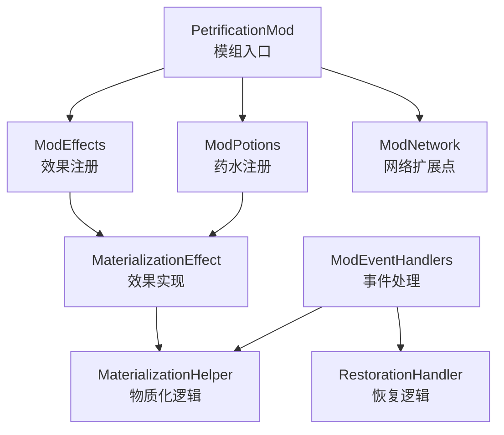
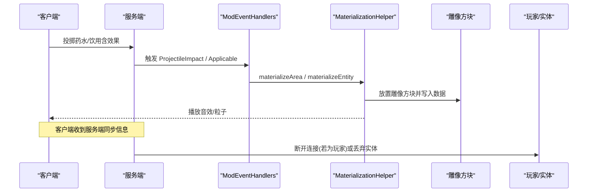
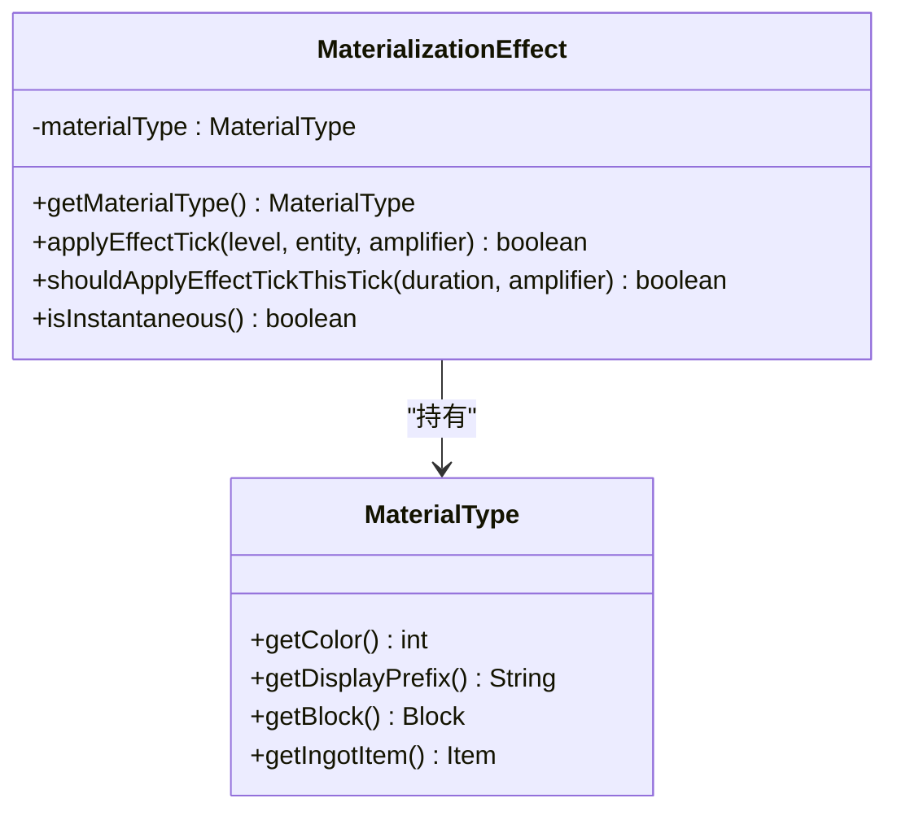
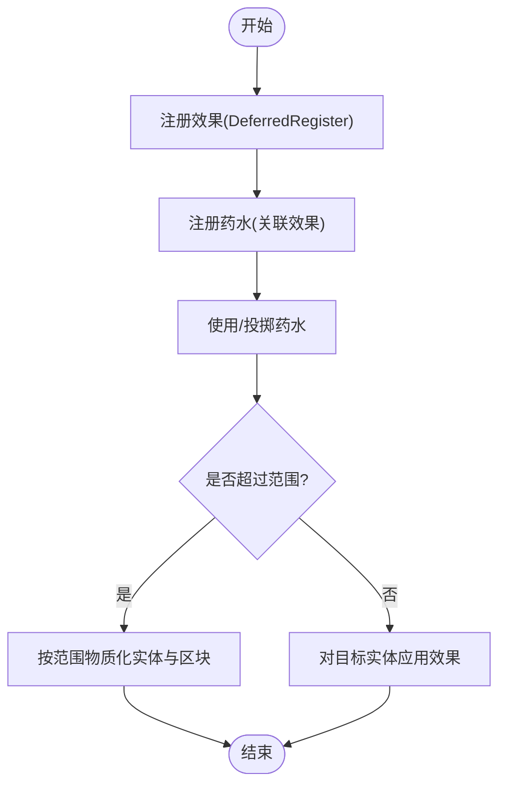
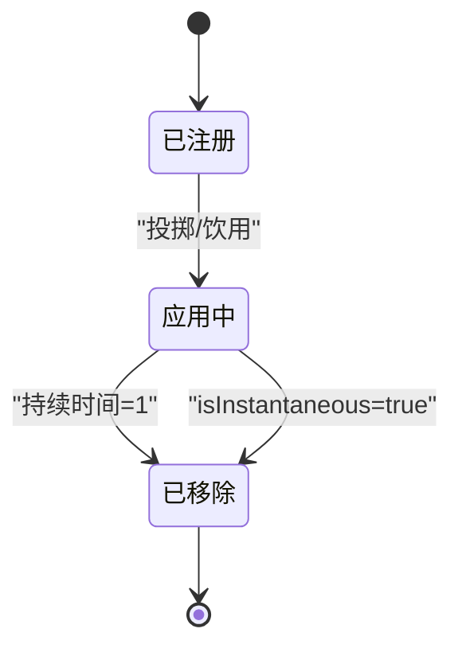
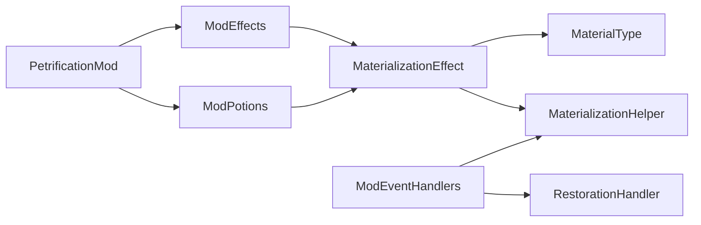

# 效果注册API

<cite>
**本文引用的文件**
- [MaterializationEffect.java](file://src/main/java/com/xiong/petrification/effect/MaterializationEffect.java)
- [ModEffects.java](file://src/main/java/com/xiong/petrification/registry/ModEffects.java)
- [ModPotions.java](file://src/main/java/com/xiong/petrification/registry/ModPotions.java)
- [MaterialType.java](file://src/main/java/com/xiong/petrification/component/MaterialType.java)
- [MaterializationHelper.java](file://src/main/java/com/xiong/petrification/util/MaterializationHelper.java)
- [ModEventHandlers.java](file://src/main/java/com/xiong/petrification/handler/ModEventHandlers.java)
- [RestorationHandler.java](file://src/main/java/com/xiong/petrification/handler/RestorationHandler.java)
- [ModNetwork.java](file://src/main/java/com/xiong/petrification/network/ModNetwork.java)
- [PetrificationMod.java](file://src/main/java/com/xiong/petrification/PetrificationMod.java)
</cite>

## 目录
1. [简介](#简介)
2. [项目结构](#项目结构)
3. [核心组件](#核心组件)
4. [架构总览](#架构总览)
5. [详细组件分析](#详细组件分析)
6. [依赖关系分析](#依赖关系分析)
7. [性能考虑](#性能考虑)
8. [故障排查指南](#故障排查指南)
9. [结论](#结论)
10. [附录](#附录)

## 简介
本文件为“药水效果注册系统”的完整API文档，聚焦于效果类与注册流程、配置项、客户端/服务器同步、生命周期管理与性能优化。以 MaterializationEffect 为核心，说明如何注册自定义药水效果、设置持续时间与强度、配置视觉效果，并给出完整的注册与实现路径参考。

## 项目结构
本项目采用按功能域划分的包结构：
- effect：自定义效果实现
- registry：使用 DeferredRegister 集中注册效果与药水
- component：材质类型等数据载体
- util：实体/区域物质化逻辑
- handler：事件处理（药水投掷、登录恢复等）
- network：网络同步扩展点
- 主模块入口负责统一注册与初始化

图表来源
- [PetrificationMod.java:27-45](file://src/main/java/com/xiong/petrification/PetrificationMod.java#L27-L45)
- [ModEffects.java:13-33](file://src/main/java/com/xiong/petrification/registry/ModEffects.java#L13-L33)
- [ModPotions.java:12-32](file://src/main/java/com/xiong/petrification/registry/ModPotions.java#L12-L32)
- [MaterializationEffect.java:10-36](file://src/main/java/com/xiong/petrification/effect/MaterializationEffect.java#L10-L36)
- [MaterializationHelper.java:55-81](file://src/main/java/com/xiong/petrification/util/MaterializationHelper.java#L55-L81)
- [ModEventHandlers.java:38-63](file://src/main/java/com/xiong/petrification/handler/ModEventHandlers.java#L38-L63)
- [RestorationHandler.java:34-91](file://src/main/java/com/xiong/petrification/handler/RestorationHandler.java#L34-L91)
- [ModNetwork.java:6-8](file://src/main/java/com/xiong/petrification/network/ModNetwork.java#L6-L8)

章节来源
- [PetrificationMod.java:27-45](file://src/main/java/com/xiong/petrification/PetrificationMod.java#L27-L45)

## 核心组件
- MaterializationEffect：继承自 MobEffect，封装材质类型，在效果tick中触发实体物质化；通过覆盖方法控制是否瞬时生效与每tick应用策略。
- ModEffects：使用 DeferredRegister 注册多种材质对应的效果实例，提供统一的注册入口。
- ModPotions：将已注册的效果包装为 Potion，默认持续时间为1秒，用于投掷或饮用触发。
- MaterialType：枚举定义材质名称、颜色、对应物品与方块，以及显示前缀。
- MaterializationHelper：服务端核心逻辑，包含权限校验、实体数据捕获、雕像块放置、粒子与音效、区域物质化与区块记录。
- ModEventHandlers：拦截药水投掷事件，根据效果类型执行范围物质化；允许特殊效果被应用；玩家登录时恢复离线雕像状态。
- RestorationHandler：从雕像恢复实体/玩家，支持装备还原、属性恢复、铜像上蜡等。
- ModNetwork：网络同步扩展点（当前为空，可后续扩展）。

章节来源
- [MaterializationEffect.java:10-36](file://src/main/java/com/xiong/petrification/effect/MaterializationEffect.java#L10-L36)
- [ModEffects.java:13-33](file://src/main/java/com/xiong/petrification/registry/ModEffects.java#L13-L33)
- [ModPotions.java:12-32](file://src/main/java/com/xiong/petrification/registry/ModPotions.java#L12-L32)
- [MaterialType.java:9-66](file://src/main/java/com/xiong/petrification/component/MaterialType.java#L9-L66)
- [MaterializationHelper.java:33-263](file://src/main/java/com/xiong/petrification/util/MaterializationHelper.java#L33-L263)
- [ModEventHandlers.java:38-123](file://src/main/java/com/xiong/petrification/handler/ModEventHandlers.java#L38-L123)
- [RestorationHandler.java:34-229](file://src/main/java/com/xiong/petrification/handler/RestorationHandler.java#L34-L229)
- [ModNetwork.java:6-8](file://src/main/java/com/xiong/petrification/network/ModNetwork.java#L6-L8)

## 架构总览
效果从注册到生效的关键路径：
- 启动阶段：模组入口统一调用各注册类的 register(BusGroup)，完成 DeferredRegister 的注册。
- 运行时：玩家或投掷物触发效果；服务端事件拦截后调用物质化逻辑；效果tick在服务端执行具体变化。
- 客户端：粒子与音效由服务端广播，客户端自动渲染；玩家登录时根据保存数据恢复位置与属性。

图表来源
- [ModEventHandlers.java:45-63](file://src/main/java/com/xiong/petrification/handler/ModEventHandlers.java#L45-L63)
- [MaterializationHelper.java:55-81](file://src/main/java/com/xiong/petrification/util/MaterializationHelper.java#L55-L81)
- [PetrificationMod.java:27-45](file://src/main/java/com/xiong/petrification/PetrificationMod.java#L27-L45)

## 详细组件分析

### MaterializationEffect 类结构与用法
- 作用：定义一种“物质化”效果，绑定特定材质类型，在效果tick中将实体转化为雕像。
- 关键方法：
  - applyEffectTick：在服务端每tick调用，委托给 MaterializationHelper 执行实体物质化。
  - shouldApplyEffectTickThisTick：仅当持续时间为1时应用，配合 isInstantaneous 实现“瞬时”行为。
  - isInstantaneous：标记为瞬时效果，避免常规持续更新开销。
- 构造参数：
  - 类别：中性效果
  - 颜色：来自材质类型的颜色，用于粒子/视觉
  - 材质类型：决定转化后的雕像材质与显示前缀

图表来源
- [MaterializationEffect.java:10-36](file://src/main/java/com/xiong/petrification/effect/MaterializationEffect.java#L10-L36)
- [MaterialType.java:9-66](file://src/main/java/com/xiong/petrification/component/MaterialType.java#L9-L66)

章节来源
- [MaterializationEffect.java:10-36](file://src/main/java/com/xiong/petrification/effect/MaterializationEffect.java#L10-L36)

### 效果注册流程与配置选项
- 注册入口：
  - ModEffects 使用 DeferredRegister 注册多个材质对应的 MaterializationEffect。
  - 每个效果名称形如 “{材质}_materialization”，类别为中性，颜色取自材质类型。
- 药水关联：
  - ModPotions 将已注册的效果包装为 Potion，默认持续时间为1秒，强度为1级。
  - 可通过创建新的 Potion 并传入不同的 MobEffectInstance 来调整持续时间与强度。
- 配置项：
  - 药水范围倍率：由 ModConfigSpecHolder.potionRangeMultiplier 控制投掷药水的物质化半径。
  - 创意模式/OP权限：MaterializationHelper.canMaterialize 依据配置限制某些玩家进行物质化。

图表来源
- [ModEffects.java:13-33](file://src/main/java/com/xiong/petrification/registry/ModEffects.java#L13-L33)
- [ModPotions.java:12-32](file://src/main/java/com/xiong/petrification/registry/ModPotions.java#L12-L32)
- [ModEventHandlers.java:45-63](file://src/main/java/com/xiong/petrification/handler/ModEventHandlers.java#L45-L63)

章节来源
- [ModEffects.java:13-33](file://src/main/java/com/xiong/petrification/registry/ModEffects.java#L13-L33)
- [ModPotions.java:12-32](file://src/main/java/com/xiong/petrification/registry/ModPotions.java#L12-L32)
- [ModEventHandlers.java:45-63](file://src/main/java/com/xiong/petrification/handler/ModEventHandlers.java#L45-L63)

### 自定义效果注册示例（步骤与要点）
- 步骤概览：
  1) 在 ModEffects 中添加新的 RegistryObject，调用私有 register(name, materialType)。
  2) 如需新药水，在 ModPotions 中新增对应 Potion 注册，传入新的效果引用。
  3) 若需不同持续时间/强度，创建新的 Potion 并设置 MobEffectInstance 的参数。
  4) 可选：在 ModEventHandlers 中扩展投掷事件逻辑，增加额外行为（如区块物质化）。
- 注意事项：
  - 效果名称需唯一，建议遵循 “{材质}_materialization” 命名规范。
  - 颜色来自 MaterialType.getColor，确保视觉效果与材质一致。
  - 药水默认持续时间为1秒，若需要持续效果，请修改 Potion 构建时的持续时间。

章节来源
- [ModEffects.java:17-27](file://src/main/java/com/xiong/petrification/registry/ModEffects.java#L17-L27)
- [ModPotions.java:16-26](file://src/main/java/com/xiong/petrification/registry/ModPotions.java#L16-L26)
- [MaterialType.java:9-66](file://src/main/java/com/xiong/petrification/component/MaterialType.java#L9-L66)

### 效果生命周期管理
- 注册期：
  - 模组构造函数中统一调用各注册类的 register(BusGroup)，完成 DeferredRegister 注册。
- 运行期：
  - 效果应用：通过事件允许 MaterializationEffect 被应用（MobEffectEvent.Applicable）。
  - 效果tick：仅在持续时间为1时触发一次，随后效果移除。
  - 投掷药水：拦截 ProjectileImpactEvent，根据效果类型执行范围物质化。
- 退出期：
  - 玩家登录时检查离线雕像数据，恢复位置与属性，并清理保存数据。

图表来源
- [PetrificationMod.java:27-45](file://src/main/java/com/xiong/petrification/PetrificationMod.java#L27-L45)
- [ModEventHandlers.java:38-43](file://src/main/java/com/xiong/petrification/handler/ModEventHandlers.java#L38-L43)
- [MaterializationEffect.java:22-36](file://src/main/java/com/xiong/petrification/effect/MaterializationEffect.java#L22-L36)
- [ModEventHandlers.java:86-107](file://src/main/java/com/xiong/petrification/handler/ModEventHandlers.java#L86-L107)

章节来源
- [PetrificationMod.java:27-45](file://src/main/java/com/xiong/petrification/PetrificationMod.java#L27-L45)
- [ModEventHandlers.java:38-107](file://src/main/java/com/xiong/petrification/handler/ModEventHandlers.java#L38-L107)
- [MaterializationEffect.java:22-36](file://src/main/java/com/xiong/petrification/effect/MaterializationEffect.java#L22-L36)

### 客户端/服务器同步
- 服务端职责：
  - 权限校验、实体数据捕获、放置雕像、播放音效与粒子、记录区块物质化数据。
  - 玩家被物质化时断开连接，并在登录时恢复。
- 客户端职责：
  - 接收服务端广播的音效与粒子，渲染雕像方块。
  - 登录时根据保存数据恢复位置与属性。
- 扩展点：
  - ModNetwork.register 可用于未来多玩家同步需求（当前为空）。

章节来源
- [MaterializationHelper.java:55-81](file://src/main/java/com/xiong/petrification/util/MaterializationHelper.java#L55-L81)
- [ModEventHandlers.java:86-107](file://src/main/java/com/xiong/petrification/handler/ModEventHandlers.java#L86-L107)
- [ModNetwork.java:6-8](file://src/main/java/com/xiong/petrification/network/ModNetwork.java#L6-L8)

### 性能优化
- 瞬时效果：
  - 通过 isInstantaneous 与 shouldApplyEffectTickThisTick 控制，减少每tick计算开销。
- 范围限制：
  - 投掷药水范围受配置倍率影响，避免大范围无谓计算。
- 批量处理：
  - 区域物质化时对实体排序优先处理玩家，减少潜在卡顿。
- 资源释放：
  - 非玩家实体被丢弃，雕像方块存储必要数据，降低内存占用。

章节来源
- [MaterializationEffect.java:22-36](file://src/main/java/com/xiong/petrification/effect/MaterializationEffect.java#L22-L36)
- [MaterializationHelper.java:83-96](file://src/main/java/com/xiong/petrification/util/MaterializationHelper.java#L83-L96)
- [ModEventHandlers.java:45-63](file://src/main/java/com/xiong/petrification/handler/ModEventHandlers.java#L45-L63)

## 依赖关系分析
- 模块耦合：
  - MaterializationEffect 依赖 MaterialType 与 MaterializationHelper。
  - ModEffects 与 ModPotions 通过 DeferredRegister 解耦注册过程。
  - ModEventHandlers 依赖 MaterializationHelper 与 RestorationHandler 完成运行时逻辑。
- 外部依赖：
  - Minecraft 效果系统与事件总线。
  - Forge 注册表与事件机制。

图表来源
- [MaterializationEffect.java:10-36](file://src/main/java/com/xiong/petrification/effect/MaterializationEffect.java#L10-L36)
- [ModEffects.java:13-33](file://src/main/java/com/xiong/petrification/registry/ModEffects.java#L13-L33)
- [ModPotions.java:12-32](file://src/main/java/com/xiong/petrification/registry/ModPotions.java#L12-L32)
- [ModEventHandlers.java:38-123](file://src/main/java/com/xiong/petrification/handler/ModEventHandlers.java#L38-L123)
- [PetrificationMod.java:27-45](file://src/main/java/com/xiong/petrification/PetrificationMod.java#L27-L45)

章节来源
- [MaterializationEffect.java:10-36](file://src/main/java/com/xiong/petrification/effect/MaterializationEffect.java#L10-L36)
- [ModEffects.java:13-33](file://src/main/java/com/xiong/petrification/registry/ModEffects.java#L13-L33)
- [ModPotions.java:12-32](file://src/main/java/com/xiong/petrification/registry/ModPotions.java#L12-L32)
- [ModEventHandlers.java:38-123](file://src/main/java/com/xiong/petrification/handler/ModEventHandlers.java#L38-L123)
- [PetrificationMod.java:27-45](file://src/main/java/com/xiong/petrification/PetrificationMod.java#L27-L45)

## 性能考虑
- 使用瞬时效果减少tick开销。
- 合理设置药水范围倍率，避免大范围计算。
- 批量处理实体时优先玩家，提升交互体验。
- 及时释放非玩家实体，减少内存占用。
- 利用配置限制创意模式与OP权限，防止滥用。

[本节为通用指导，不直接分析具体文件]

## 故障排查指南
- 效果未生效：
  - 检查是否已在 ModEventHandlers 中允许 MaterializationEffect 应用。
  - 确认药水已正确关联效果且持续时间不为0。
- 投掷药水无效：
  - 确认事件拦截逻辑能识别 MaterializationEffect。
  - 检查范围倍率配置是否过小。
- 玩家登录后未恢复：
  - 检查保存数据是否存在，并确保登录事件正确处理。
- 权限问题：
  - 查看 MaterializationHelper.canMaterialize 的配置限制。

章节来源
- [ModEventHandlers.java:38-43](file://src/main/java/com/xiong/petrification/handler/ModEventHandlers.java#L38-L43)
- [ModEventHandlers.java:45-63](file://src/main/java/com/xiong/petrification/handler/ModEventHandlers.java#L45-L63)
- [ModEventHandlers.java:86-107](file://src/main/java/com/xiong/petrification/handler/ModEventHandlers.java#L86-L107)
- [MaterializationHelper.java:36-53](file://src/main/java/com/xiong/petrification/util/MaterializationHelper.java#L36-L53)

## 结论
本系统通过 DeferredRegister 与事件驱动实现了稳定高效的药水效果注册与执行。MaterializationEffect 作为核心，结合 MaterializationHelper 的服务端逻辑与 ModEventHandlers 的事件拦截，完成了从注册到生效的全流程。通过配置与瞬时效果设计，系统在性能与用户体验之间取得平衡。未来可在 ModNetwork 中扩展多玩家同步能力，进一步完善多人游戏体验。

[本节为总结，不直接分析具体文件]

## 附录
- 最佳实践
  - 保持效果名称唯一且语义清晰。
  - 使用 MaterialType 统一管理颜色与显示前缀。
  - 通过配置控制范围与权限，避免滥用。
  - 在事件中做最小必要计算，复杂逻辑下沉至工具类。
- 调试技巧
  - 在事件处理器中加入日志输出，追踪药水投掷与效果应用。
  - 检查保存数据是否正确写入与读取。
  - 观察粒子与音效是否正常播放，验证客户端同步。

[本节为通用指导，不直接分析具体文件]