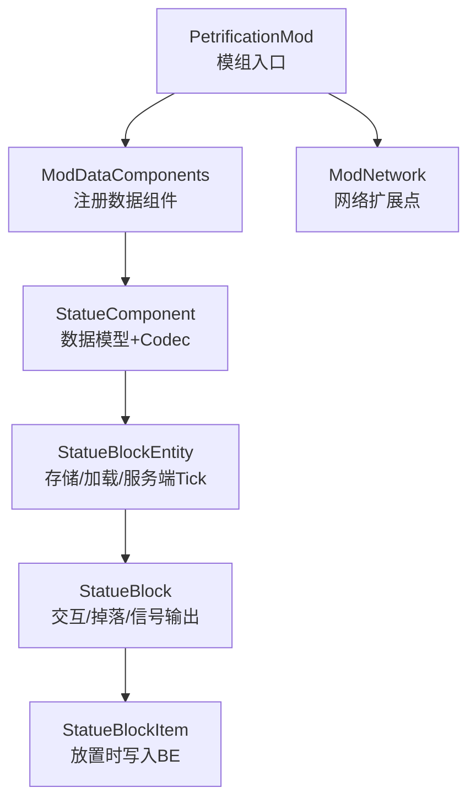
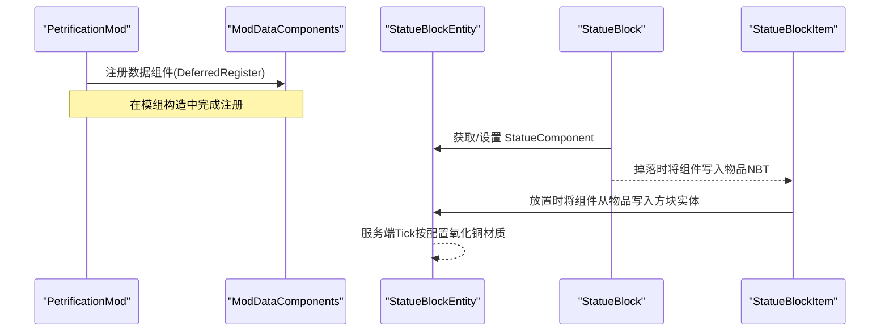
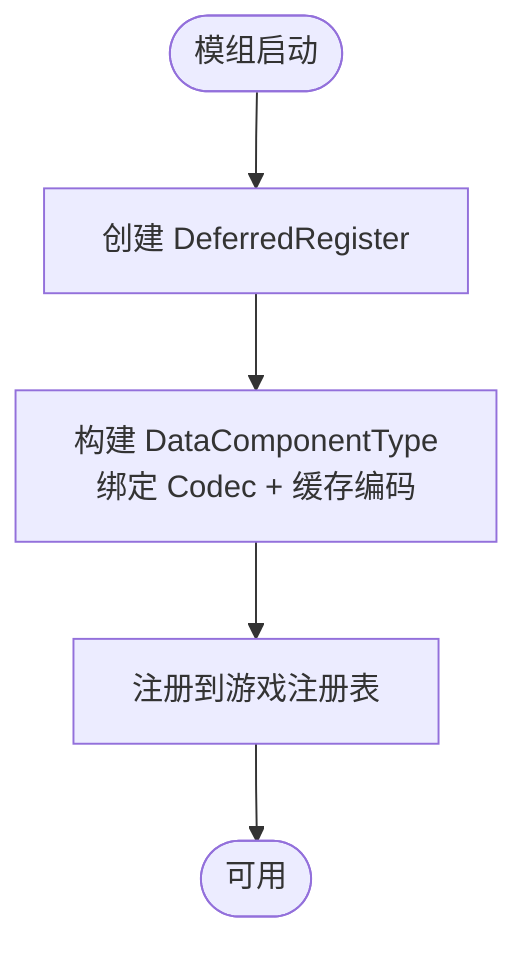
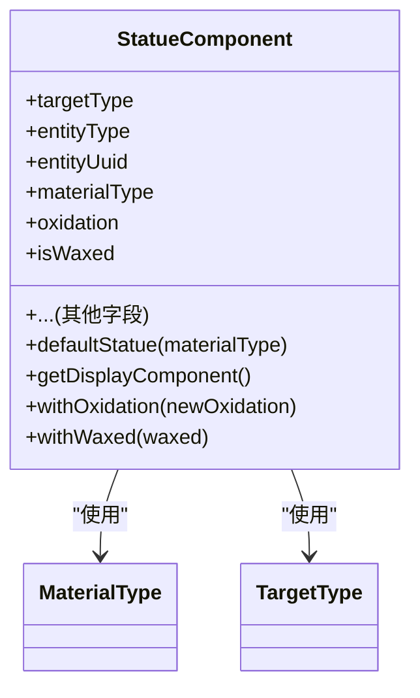
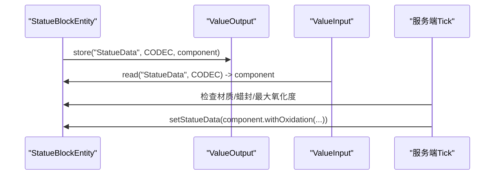
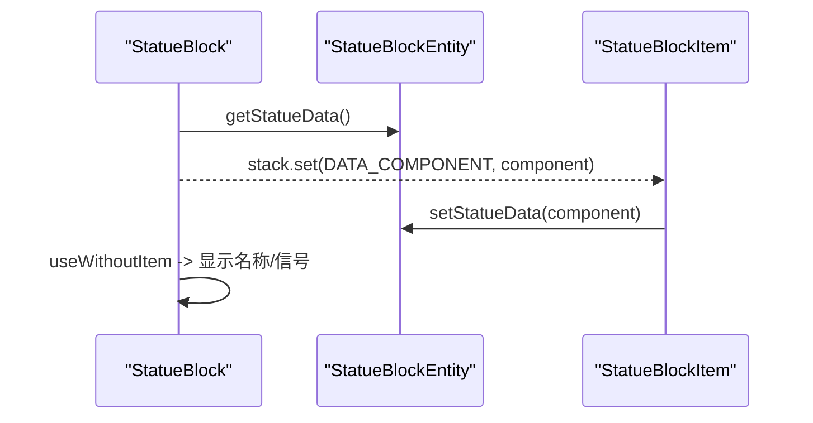
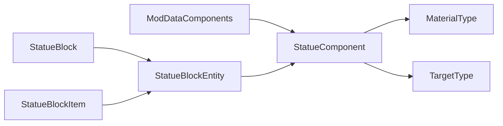
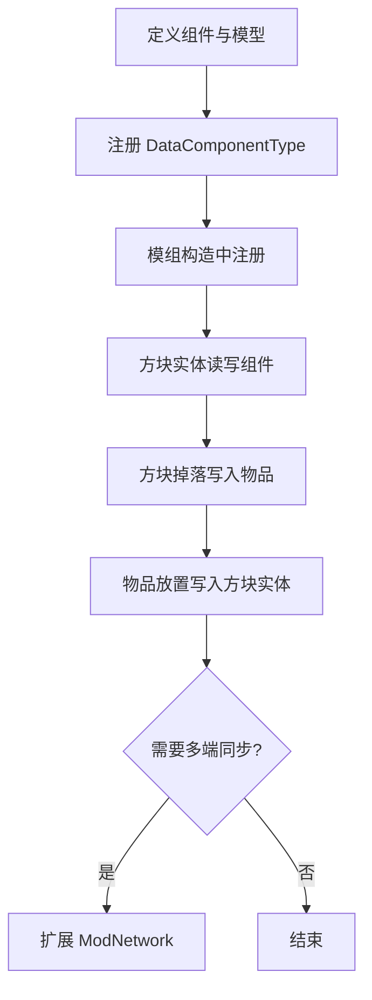

# 数据组件注册API

<cite>
**本文引用的文件**
- [ModDataComponents.java](file://src/main/java/com/xiong/petrification/registry/ModDataComponents.java)
- [StatueComponent.java](file://src/main/java/com/xiong/petrification/component/StatueComponent.java)
- [MaterialType.java](file://src/main/java/com/xiong/petrification/component/MaterialType.java)
- [TargetType.java](file://src/main/java/com/xiong/petrification/component/TargetType.java)
- [PetrificationMod.java](file://src/main/java/com/xiong/petrification/PetrificationMod.java)
- [StatueBlockEntity.java](file://src/main/java/com/xiong/petrification/block/StatueBlockEntity.java)
- [StatueBlock.java](file://src/main/java/com/xiong/petrification/block/StatueBlock.java)
- [StatueBlockItem.java](file://src/main/java/com/xiong/petrification/item/StatueBlockItem.java)
- [ModNetwork.java](file://src/main/java/com/xiong/petrification/network/ModNetwork.java)
</cite>

## 目录
1. [简介](#简介)
2. [项目结构](#项目结构)
3. [核心组件](#核心组件)
4. [架构总览](#架构总览)
5. [详细组件分析](#详细组件分析)
6. [依赖关系分析](#依赖关系分析)
7. [性能考虑](#性能考虑)
8. [故障排查指南](#故障排查指南)
9. [结论](#结论)
10. [附录：完整注册流程与最佳实践](#附录完整注册流程与最佳实践)

## 简介
本文件面向Minecraft 26.2（Forge）环境下的“数据组件注册系统”，聚焦于如何定义、注册和使用自定义数据组件。以本项目中的 StatueComponent、MaterialType、TargetType 为例，说明：
- 使用 DataComponentType 与 DeferredRegister 进行组件注册
- 通过 Codec 实现序列化/反序列化与版本兼容
- 在方块实体、物品与客户端渲染中读取/写入组件数据
- 网络同步的扩展点与注意事项
- 性能优化策略与开发最佳实践

## 项目结构
该模组围绕“雕像”主题实现了数据组件的使用闭环：
- 组件类型与数据模型：StatueComponent、MaterialType、TargetType
- 组件注册：ModDataComponents
- 数据读写：StatueBlockEntity（持久化）、StatueBlock（掉落时写入物品）、StatueBlockItem（放置时写入方块实体）
- 模组初始化：PetrificationMod（注册所有模块）
- 网络扩展点：ModNetwork（预留多端同步扩展）

图表来源
- [PetrificationMod.java:27-45](file://src/main/java/com/xiong/petrification/PetrificationMod.java#L27-L45)
- [ModDataComponents.java:11-25](file://src/main/java/com/xiong/petrification/registry/ModDataComponents.java#L11-L25)
- [StatueComponent.java:14-148](file://src/main/java/com/xiong/petrification/component/StatueComponent.java#L14-L148)
- [StatueBlockEntity.java:17-86](file://src/main/java/com/xiong/petrification/block/StatueBlockEntity.java#L17-L86)
- [StatueBlock.java:103-135](file://src/main/java/com/xiong/petrification/block/StatueBlock.java#L103-L135)
- [StatueBlockItem.java:29-40](file://src/main/java/com/xiong/petrification/item/StatueBlockItem.java#L29-L40)
- [ModNetwork.java:6-8](file://src/main/java/com/xiong/petrification/network/ModNetwork.java#L6-L8)

章节来源
- [PetrificationMod.java:27-45](file://src/main/java/com/xiong/petrification/PetrificationMod.java#L27-L45)
- [ModDataComponents.java:11-25](file://src/main/java/com/xiong/petrification/registry/ModDataComponents.java#L11-L25)

## 核心组件
- 数据组件类型注册：通过 DeferredRegister 将 DataComponentType 注册到游戏注册表，并绑定 Codec 与缓存编码。
- 数据模型：StatueComponent 是一个包含大量字段的记录类型，内部拆分为多个分组 Record，并通过 Codec 组合实现高效序列化。
- 枚举类型：MaterialType、TargetType 提供可序列化的枚举值，用于限定组件字段取值范围。

章节来源
- [ModDataComponents.java:11-25](file://src/main/java/com/xiong/petrification/registry/ModDataComponents.java#L11-L25)
- [StatueComponent.java:14-148](file://src/main/java/com/xiong/petrification/component/StatueComponent.java#L14-L148)
- [MaterialType.java:9-67](file://src/main/java/com/xiong/petrification/component/MaterialType.java#L9-L67)
- [TargetType.java:6-22](file://src/main/java/com/xiong/petrification/component/TargetType.java#L6-L22)

## 架构总览
下图展示了从模组启动到数据组件注册、再到方块实体读写与物品交互的整体流程。

图表来源
- [PetrificationMod.java:27-45](file://src/main/java/com/xiong/petrification/PetrificationMod.java#L27-L45)
- [ModDataComponents.java:11-25](file://src/main/java/com/xiong/petrification/registry/ModDataComponents.java#L11-L25)
- [StatueBlock.java:103-135](file://src/main/java/com/xiong/petrification/block/StatueBlock.java#L103-L135)
- [StatueBlockItem.java:29-40](file://src/main/java/com/xiong/petrification/item/StatueBlockItem.java#L29-L40)
- [StatueBlockEntity.java:28-50](file://src/main/java/com/xiong/petrification/block/StatueBlockEntity.java#L28-L50)

## 详细组件分析

### 数据组件类型注册（ModDataComponents）
- 使用 DeferredRegister 将 DataComponentType 注册到 Registries.DATA_COMPONENT_TYPE。
- 为组件指定 persistent Codec，启用缓存编码以提升性能。
- 在模组构造中调用 register(BusGroup) 完成注册。

图表来源
- [ModDataComponents.java:11-25](file://src/main/java/com/xiong/petrification/registry/ModDataComponents.java#L11-L25)

章节来源
- [ModDataComponents.java:11-25](file://src/main/java/com/xiong/petrification/registry/ModDataComponents.java#L11-L25)
- [PetrificationMod.java:27-45](file://src/main/java/com/xiong/petrification/PetrificationMod.java#L27-L45)

### 数据模型与序列化（StatueComponent）
- 使用 record 定义不可变数据结构，字段覆盖目标类型、实体信息、姿态、可选属性等。
- 将字段分组为 GroupA/B/C/D，再组合为 Pair1/Pair2/Combined，最终生成统一的 Codec。
- 提供默认实例工厂方法，便于快速创建初始状态。
- 提供 withXxx 方法返回新实例，保持不可变性。

图表来源
- [StatueComponent.java:14-148](file://src/main/java/com/xiong/petrification/component/StatueComponent.java#L14-L148)
- [MaterialType.java:9-67](file://src/main/java/com/xiong/petrification/component/MaterialType.java#L9-L67)
- [TargetType.java:6-22](file://src/main/java/com/xiong/petrification/component/TargetType.java#L6-L22)

章节来源
- [StatueComponent.java:14-148](file://src/main/java/com/xiong/petrification/component/StatueComponent.java#L14-L148)
- [StatueComponent.java:194-254](file://src/main/java/com/xiong/petrification/component/StatueComponent.java#L194-L254)

### 枚举类型（MaterialType、TargetType）
- 实现 StringRepresentable，提供 CODEC 用于序列化。
- MaterialType 关联颜色、锭物品与方块，并提供显示前缀与解析方法。
- TargetType 区分生物与玩家两种目标类型。

章节来源
- [MaterialType.java:9-67](file://src/main/java/com/xiong/petrification/component/MaterialType.java#L9-L67)
- [TargetType.java:6-22](file://src/main/java/com/xiong/petrification/component/TargetType.java#L6-L22)

### 方块实体中的数据读写（StatueBlockEntity）
- 保存/加载：使用 ValueOutput/ValueInput 配合 StatueComponent.CODEC 进行 NBT 读写。
- 服务端 Tick：根据配置对铜材质雕像进行周期性氧化，更新组件数据。
- 网络更新：提供 getUpdatePacket 以便客户端同步。

图表来源
- [StatueBlockEntity.java:28-50](file://src/main/java/com/xiong/petrification/block/StatueBlockEntity.java#L28-L50)
- [StatueBlockEntity.java:62-86](file://src/main/java/com/xiong/petrification/block/StatueBlockEntity.java#L62-L86)

章节来源
- [StatueBlockEntity.java:28-50](file://src/main/java/com/xiong/petrification/block/StatueBlockEntity.java#L28-L50)
- [StatueBlockEntity.java:62-86](file://src/main/java/com/xiong/petrification/block/StatueBlockEntity.java#L62-L86)

### 方块与物品的数据流转（StatueBlock、StatueBlockItem）
- 方块掉落：从方块实体读取 StatueComponent 并写入掉落物品的数据组件。
- 物品放置：从物品读取 StatueComponent 并写入对应方块实体的数据。
- 交互：右键显示组件的显示文本；铜材质时根据氧化程度输出红石信号。

图表来源
- [StatueBlock.java:103-135](file://src/main/java/com/xiong/petrification/block/StatueBlock.java#L103-L135)
- [StatueBlock.java:142-150](file://src/main/java/com/xiong/petrification/block/StatueBlock.java#L142-L150)
- [StatueBlockItem.java:29-40](file://src/main/java/com/xiong/petrification/item/StatueBlockItem.java#L29-L40)

章节来源
- [StatueBlock.java:103-135](file://src/main/java/com/xiong/petrification/block/StatueBlock.java#L103-L135)
- [StatueBlock.java:142-150](file://src/main/java/com/xiong/petrification/block/StatueBlock.java#L142-L150)
- [StatueBlockItem.java:29-40](file://src/main/java/com/xiong/petrification/item/StatueBlockItem.java#L29-L40)

### 网络同步机制（ModNetwork）
- 当前为预留扩展点，未实现具体数据包。
- 可在 FMLCommonSetupEvent 中注册网络通道与消息处理器，用于多端同步组件变更（如氧化进度）。

章节来源
- [ModNetwork.java:6-8](file://src/main/java/com/xiong/petrification/network/ModNetwork.java#L6-L8)
- [PetrificationMod.java:48-50](file://src/main/java/com/xiong/petrification/PetrificationMod.java#L48-L50)

## 依赖关系分析
- 组件注册依赖 DeferredRegister 与游戏注册表。
- 数据模型依赖 Mojang Codec 体系，确保跨版本兼容。
- 方块实体依赖配置项控制氧化行为。
- 物品与方块通过数据组件桥接，形成“掉落-放置”的数据流。

图表来源
- [ModDataComponents.java:11-25](file://src/main/java/com/xiong/petrification/registry/ModDataComponents.java#L11-L25)
- [StatueComponent.java:14-148](file://src/main/java/com/xiong/petrification/component/StatueComponent.java#L14-L148)
- [StatueBlockEntity.java:17-86](file://src/main/java/com/xiong/petrification/block/StatueBlockEntity.java#L17-L86)
- [StatueBlock.java:103-135](file://src/main/java/com/xiong/petrification/block/StatueBlock.java#L103-L135)
- [StatueBlockItem.java:29-40](file://src/main/java/com/xiong/petrification/item/StatueBlockItem.java#L29-L40)

章节来源
- [ModDataComponents.java:11-25](file://src/main/java/com/xiong/petrification/registry/ModDataComponents.java#L11-L25)
- [StatueComponent.java:14-148](file://src/main/java/com/xiong/petrification/component/StatueComponent.java#L14-L148)
- [StatueBlockEntity.java:17-86](file://src/main/java/com/xiong/petrification/block/StatueBlockEntity.java#L17-L86)
- [StatueBlock.java:103-135](file://src/main/java/com/xiong/petrification/block/StatueBlock.java#L103-L135)
- [StatueBlockItem.java:29-40](file://src/main/java/com/xiong/petrification/item/StatueBlockItem.java#L29-L40)

## 性能考虑
- 使用 cacheEncoding() 缓存编码结果，减少重复序列化开销。
- 将复杂对象拆分为小组合 Codec，降低单次编解码负担。
- 服务端 Tick 中对氧化逻辑进行节流（固定间隔），避免每刻计算。
- 仅在必要时更新组件数据（如氧化达到上限或已打蜡则跳过）。

章节来源
- [ModDataComponents.java:15-19](file://src/main/java/com/xiong/petrification/registry/ModDataComponents.java#L15-L19)
- [StatueComponent.java:81-148](file://src/main/java/com/xiong/petrification/component/StatueComponent.java#L81-L148)
- [StatueBlockEntity.java:28-50](file://src/main/java/com/xiong/petrification/block/StatueBlockEntity.java#L28-L50)

## 故障排查指南
- 组件为空：检查方块实体是否成功设置 StatueComponent；确认物品放置流程是否正确读取并写入。
- 序列化失败：确认 StatueComponent.CODEC 与字段映射一致；检查枚举值与字符串表示是否匹配。
- 氧化不生效：检查配置开关与最大氧化度限制；确认材质为铜且未打蜡。
- 客户端不同步：确保方块实体提供 getUpdatePacket；如需增量同步，扩展 ModNetwork 发送数据包。

章节来源
- [StatueBlockItem.java:29-40](file://src/main/java/com/xiong/petrification/item/StatueBlockItem.java#L29-L40)
- [StatueBlockEntity.java:28-50](file://src/main/java/com/xiong/petrification/block/StatueBlockEntity.java#L28-L50)
- [StatueBlockEntity.java:76-86](file://src/main/java/com/xiong/petrification/block/StatueBlockEntity.java#L76-L86)
- [ModNetwork.java:6-8](file://src/main/java/com/xiong/petrification/network/ModNetwork.java#L6-L8)

## 结论
本项目基于 Minecraft 26.2 的数据组件系统，完整实现了自定义组件的定义、注册、序列化与在游戏对象间的流转。通过合理的 Codec 设计与性能优化，以及可扩展的网络层，为后续功能迭代提供了坚实基础。建议遵循本文的最佳实践，确保组件的可维护性与兼容性。

## 附录：完整注册流程与最佳实践

### 注册步骤概览
- 定义组件数据类型与数据模型（StatueComponent、MaterialType、TargetType）。
- 使用 DeferredRegister 注册 DataComponentType，并绑定 Codec 与缓存编码。
- 在模组构造中调用注册方法。
- 在方块实体中实现数据的持久化与更新。
- 在方块与物品间建立数据组件的读写链路。
- 按需扩展网络同步。

图表来源
- [ModDataComponents.java:11-25](file://src/main/java/com/xiong/petrification/registry/ModDataComponents.java#L11-L25)
- [PetrificationMod.java:27-45](file://src/main/java/com/xiong/petrification/PetrificationMod.java#L27-L45)
- [StatueBlockEntity.java:62-86](file://src/main/java/com/xiong/petrification/block/StatueBlockEntity.java#L62-L86)
- [StatueBlock.java:103-135](file://src/main/java/com/xiong/petrification/block/StatueBlock.java#L103-L135)
- [StatueBlockItem.java:29-40](file://src/main/java/com/xiong/petrification/item/StatueBlockItem.java#L29-L40)
- [ModNetwork.java:6-8](file://src/main/java/com/xiong/petrification/network/ModNetwork.java#L6-L8)

### 代码示例路径（参考）
- 组件注册与类型定义：[ModDataComponents.java:11-25](file://src/main/java/com/xiong/petrification/registry/ModDataComponents.java#L11-L25)
- 数据模型与序列化：[StatueComponent.java:14-148](file://src/main/java/com/xiong/petrification/component/StatueComponent.java#L14-L148)
- 枚举类型定义：[MaterialType.java:9-67](file://src/main/java/com/xiong/petrification/component/MaterialType.java#L9-L67)、[TargetType.java:6-22](file://src/main/java/com/xiong/petrification/component/TargetType.java#L6-L22)
- 方块实体持久化与更新：[StatueBlockEntity.java:28-50](file://src/main/java/com/xiong/petrification/block/StatueBlockEntity.java#L28-L50)、[StatueBlockEntity.java:62-86](file://src/main/java/com/xiong/petrification/block/StatueBlockEntity.java#L62-L86)
- 方块掉落与物品放置：[StatueBlock.java:103-135](file://src/main/java/com/xiong/petrification/block/StatueBlock.java#L103-L135)、[StatueBlockItem.java:29-40](file://src/main/java/com/xiong/petrification/item/StatueBlockItem.java#L29-L40)
- 网络扩展点：[ModNetwork.java:6-8](file://src/main/java/com/xiong/petrification/network/ModNetwork.java#L6-L8)

### 最佳实践
- 使用不可变数据模型（record）与 withXxx 方法，保证线程安全与一致性。
- 合理拆分 Codec，提升可读性与性能。
- 启用缓存编码以减少序列化开销。
- 在服务端 Tick 中节流更新，避免频繁计算。
- 对可选字段使用 Optional，避免冗余数据。
- 通过配置控制行为（如氧化速率与上限），增强可玩性与可调性。
- 预留网络层接口，便于未来扩展多端同步。