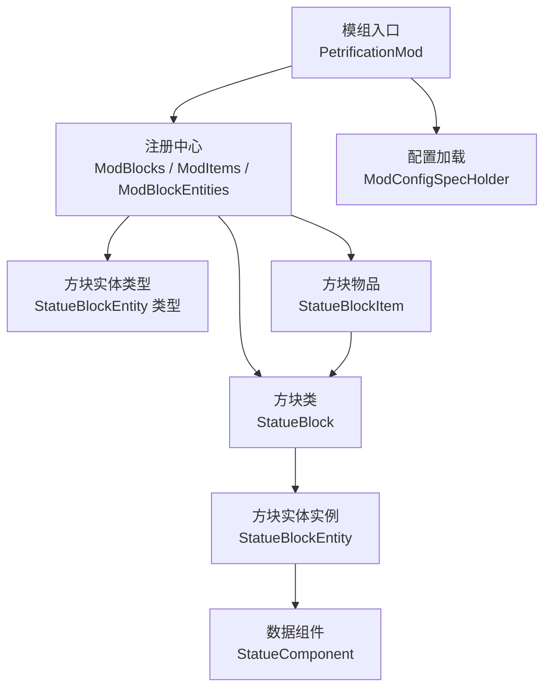
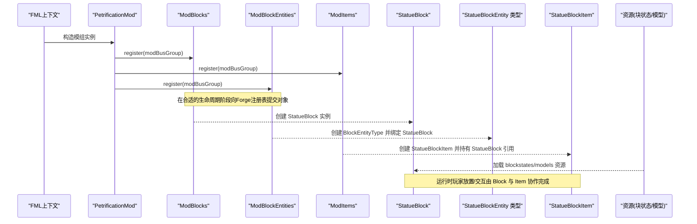
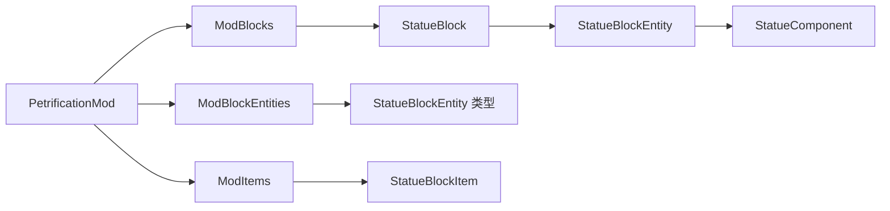
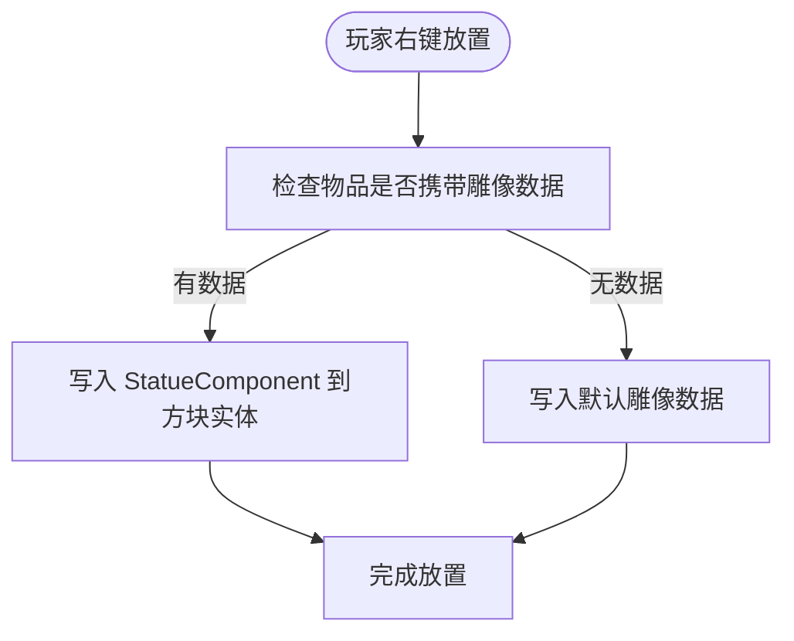
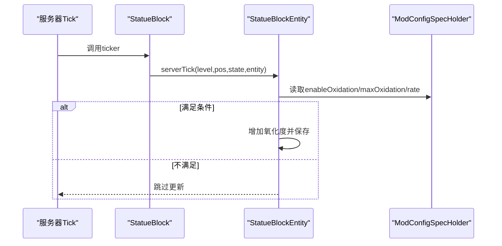

# 方块注册API

<cite>
**本文引用的文件**
- [PetrificationMod.java](file://src/main/java/com/xiong/petrification/PetrificationMod.java)
- [ModBlocks.java](file://src/main/java/com/xiong/petrification/registry/ModBlocks.java)
- [StatueBlock.java](file://src/main/java/com/xiong/petrification/block/StatueBlock.java)
- [StatueBlockEntity.java](file://src/main/java/com/xiong/petrification/block/StatueBlockEntity.java)
- [ModBlockEntities.java](file://src/main/java/com/xiong/petrification/registry/ModBlockEntities.java)
- [ModItems.java](file://src/main/java/com/xiong/petrification/registry/ModItems.java)
- [StatueBlockItem.java](file://src/main/java/com/xiong/petrification/item/StatueBlockItem.java)
- [StatueComponent.java](file://src/main/java/com/xiong/petrification/component/StatueComponent.java)
- [ModConfigSpecHolder.java](file://src/main/java/com/xiong/petrification/ModConfigSpecHolder.java)
- [statue_block.json（方块状态）](file://src/main/resources/assets/petrification/blockstates/statue_block.json)
- [statue_block.json（方块模型）](file://src/main/resources/assets/petrification/models/block/statue_block.json)
</cite>

## 目录
1. [简介](#简介)
2. [项目结构](#项目结构)
3. [核心组件](#核心组件)
4. [架构总览](#架构总览)
5. [详细组件分析](#详细组件分析)
6. [依赖关系分析](#依赖关系分析)
7. [性能考量](#性能考量)
8. [故障排查指南](#故障排查指南)
9. [结论](#结论)
10. [附录](#附录)

## 简介
本文件为“方块注册系统”的完整API文档，聚焦于使用 DeferredRegister 进行方块、物品与方块实体的注册流程。以 StatueBlock 为例，详细说明如何配置方块属性、行为、实体关联、数据持久化、客户端渲染资源绑定，以及初始化顺序、依赖管理与错误处理策略。同时提供最佳实践与性能优化建议，帮助你在 Forge 26.2 + Minecraft 1.20+ 环境下正确扩展方块功能。

## 项目结构
本项目采用按功能域组织的结构：
- 注册中心：registry 包集中管理 DeferredRegister 实例与 RegistryObject 引用
- 方块与实体：block 包实现具体方块逻辑与方块实体
- 物品：item 包实现方块对应的可放置物品
- 组件与配置：component 与 ModConfigSpecHolder 提供数据承载与配置项
- 客户端资源：resources/assets 下定义方块状态、模型、语言等

图表来源
- [PetrificationMod.java:27-46](file://src/main/java/com/xiong/petrification/PetrificationMod.java#L27-L46)
- [ModBlocks.java:16-33](file://src/main/java/com/xiong/petrification/registry/ModBlocks.java#L16-L33)
- [ModBlockEntities.java:13-25](file://src/main/java/com/xiong/petrification/registry/ModBlockEntities.java#L13-L25)
- [ModItems.java:12-30](file://src/main/java/com/xiong/petrification/registry/ModItems.java#L12-L30)

章节来源
- [PetrificationMod.java:27-46](file://src/main/java/com/xiong/petrification/PetrificationMod.java#L27-L46)

## 核心组件
- 方块注册器：通过 DeferredRegister<Block> 统一注册方块，并以 RegistryObject 暴露引用，避免直接静态初始化耦合
- 方块实体类型注册器：通过 DeferredRegister<BlockEntityType<?>> 注册方块实体类型，并绑定到对应方块
- 方块类：继承自 BaseEntityBlock，实现放置、交互、掉落、信号输出等行为
- 方块实体：承载复杂状态（如雕像数据），提供服务端 tick 更新与数据序列化
- 方块物品：负责将带数据的 ItemStack 放置时写入方块实体
- 数据组件：使用 Codec 对大量字段进行分组编码/解码，支持 NBT 存储与网络同步
- 配置：通过 ForgeConfigSpec 暴露可调参数（如氧化速率、最大氧化值、渲染距离等）

章节来源
- [ModBlocks.java:16-33](file://src/main/java/com/xiong/petrification/registry/ModBlocks.java#L16-L33)
- [ModBlockEntities.java:13-25](file://src/main/java/com/xiong/petrification/registry/ModBlockEntities.java#L13-L25)
- [StatueBlock.java:38-152](file://src/main/java/com/xiong/petrification/block/StatueBlock.java#L38-L152)
- [StatueBlockEntity.java:17-88](file://src/main/java/com/xiong/petrification/block/StatueBlockEntity.java#L17-L88)
- [StatueBlockItem.java:24-99](file://src/main/java/com/xiong/petrification/item/StatueBlockItem.java#L24-L99)
- [StatueComponent.java:14-256](file://src/main/java/com/xiong/petrification/component/StatueComponent.java#L14-L256)
- [ModConfigSpecHolder.java:8-69](file://src/main/java/com/xiong/petrification/ModConfigSpecHolder.java#L8-L69)

## 架构总览
下图展示了从模组启动到方块可用的完整生命周期，包括 DeferredRegister 的创建、注册时机、方块与实体类型的绑定、客户端资源加载与运行时行为。

图表来源
- [PetrificationMod.java:27-46](file://src/main/java/com/xiong/petrification/PetrificationMod.java#L27-L46)
- [ModBlocks.java:16-33](file://src/main/java/com/xiong/petrification/registry/ModBlocks.java#L16-L33)
- [ModBlockEntities.java:13-25](file://src/main/java/com/xiong/petrification/registry/ModBlockEntities.java#L13-L25)
- [ModItems.java:12-30](file://src/main/java/com/xiong/petrification/registry/ModItems.java#L12-L30)

## 详细组件分析

### DeferredRegister 与方块注册流程
- 使用 DeferredRegister.create(ForgeRegistries.BLOCKS, MODID) 创建方块注册器
- 通过 BLOCKS.register("id", Supplier) 注册方块，返回 RegistryObject<StatueBlock>
- 在模组构造函数中调用 ModBlocks.register(modBusGroup) 完成实际注册
- 方块属性通过 BlockBehaviour.Properties 配置：材质颜色、硬度、工具需求、声音、遮挡等

章节来源
- [ModBlocks.java:16-33](file://src/main/java/com/xiong/petrification/registry/ModBlocks.java#L16-L33)
- [PetrificationMod.java:27-46](file://src/main/java/com/xiong/petrification/PetrificationMod.java#L27-L46)

### StatueBlock 的行为与属性
- 继承 BaseEntityBlock 并实现 SimpleWaterloggedBlock，支持水浸没
- 默认状态包含朝向与水浸没标志；放置时根据点击方向设置朝向，并根据液体设置水浸没
- 覆盖 getRenderShape 返回不可见形状，实际渲染由客户端模型或自定义渲染器负责
- 重写 newBlockEntity 返回 StatueBlockEntity 实例
- 提供服务器端 ticker，驱动 StatueBlockEntity.serverTick 周期性更新
- 交互 useWithoutItem 读取雕像数据并显示信息
- 掉落 getDrops 将 StatueComponent 写入掉落物品的数据组件
- 模拟信号 hasAnalogOutputSignal/getAnalogOutputSignal 基于材料氧化度输出信号强度

章节来源
- [StatueBlock.java:38-152](file://src/main/java/com/xiong/petrification/block/StatueBlock.java#L38-L152)

### StatueBlockEntity 的数据与更新
- 保存 StatueComponent 并通过 saveAdditional/loadAdditional 进行NBT读写
- serverTick 每固定刻数检查是否应增加铜质雕像的氧化度，受配置开关与上限控制
- 提供 getter/setter 用于外部修改雕像数据并标记脏块

章节来源
- [StatueBlockEntity.java:17-88](file://src/main/java/com/xiong/petrification/block/StatueBlockEntity.java#L17-L88)
- [ModConfigSpecHolder.java:28-38](file://src/main/java/com/xiong/petrification/ModConfigSpecHolder.java#L28-L38)

### 方块实体类型注册与绑定
- 使用 DeferredRegister<BlockEntityType<?>> 注册实体类型
- 在构造 BlockEntityType 时传入方块类集合，建立“实体类型 -> 方块”的映射
- 确保 StatuteBlock 先于实体类型注册，以避免空引用

章节来源
- [ModBlockEntities.java:13-25](file://src/main/java/com/xiong/petrification/registry/ModBlockEntities.java#L13-L25)
- [StatueBlock.java:90-101](file://src/main/java/com/xiong/petrification/block/StatueBlock.java#L90-L101)

### 方块物品与数据传递
- StatueBlockItem 继承 BlockItem，并在 updateCustomBlockEntityTag 中将物品携带的 StatueComponent 写入方块实体
- 若物品无数据则写入默认雕像数据
- 悬停提示展示目标类型、材料、实体名、自定义名、氧化进度等信息

章节来源
- [StatueBlockItem.java:24-99](file://src/main/java/com/xiong/petrification/item/StatueBlockItem.java#L24-L99)
- [StatueComponent.java:194-227](file://src/main/java/com/xiong/petrification/component/StatueComponent.java#L194-L227)

### 客户端资源绑定
- blockstates/statue_block.json 定义朝向变体与模型引用
- models/block/statue_block.json 指定父模型与纹理路径
- 这些资源与方块状态属性联动，确保客户端正确渲染

章节来源
- [statue_block.json（方块状态）:1-9](file://src/main/resources/assets/petrification/blockstates/statue_block.json#L1-L9)
- [statue_block.json（方块模型）:1-7](file://src/main/resources/assets/petrification/models/block/statue_block.json#L1-L7)

### 数据组件 StatueComponent
- 使用 RecordCodecBuilder 将大量字段分组编码，保证NBT/网络传输高效稳定
- 提供 defaultStatue 工厂方法生成默认雕像数据
- 提供 withOxidation/withWaxed 等不可变更新方法，便于线程安全的状态变更

章节来源
- [StatueComponent.java:14-256](file://src/main/java/com/xiong/petrification/component/StatueComponent.java#L14-L256)

### 配置项与运行时行为
- 通过 ForgeConfigSpec 暴露多项配置：药水范围倍率、创意模式限制、OP玩家限制、方块硬度、氧化速率、最大氧化值、是否启用氧化、渲染距离等
- 在模组启动时加载配置到静态字段，供运行时使用（如雕像氧化逻辑）

章节来源
- [ModConfigSpecHolder.java:8-69](file://src/main/java/com/xiong/petrification/ModConfigSpecHolder.java#L8-L69)
- [StatueBlockEntity.java:28-50](file://src/main/java/com/xiong/petrification/block/StatueBlockEntity.java#L28-L50)

## 依赖关系分析
- 模组入口 PetrificationMod 在构造时依次注册数据组件、方块、物品、方块实体类型、效果、药水、创造栏等
- 注册顺序要求：方块必须先于方块实体类型注册，以便实体类型能安全引用方块
- 物品依赖方块引用以完成放置逻辑
- 方块实体依赖 StatueComponent 进行数据持久化
- 客户端资源依赖方块状态属性（如 facing、waterlogged）

图表来源
- [PetrificationMod.java:27-46](file://src/main/java/com/xiong/petrification/PetrificationMod.java#L27-L46)
- [ModBlocks.java:16-33](file://src/main/java/com/xiong/petrification/registry/ModBlocks.java#L16-L33)
- [ModBlockEntities.java:13-25](file://src/main/java/com/xiong/petrification/registry/ModBlockEntities.java#L13-L25)
- [ModItems.java:12-30](file://src/main/java/com/xiong/petrification/registry/ModItems.java#L12-L30)

章节来源
- [PetrificationMod.java:27-46](file://src/main/java/com/xiong/petrification/PetrificationMod.java#L27-L46)

## 性能考量
- 使用 DeferredRegister 延迟创建对象，减少启动期开销与循环依赖风险
- 将复杂数据封装为 StatueComponent 并使用 Codec 分组编码，降低NBT体积与解析成本
- 服务端 tick 更新使用固定间隔（如200刻）与配置开关，避免每刻计算造成卡顿
- 合理设置方块硬度、声音与遮挡，减少不必要的物理与渲染计算
- 客户端资源使用最小必要变体，避免过多模型分支

[本节为通用性能建议，不直接分析具体代码文件]

## 故障排查指南
- 方块无法放置或无实体：确认方块已注册且实体类型已绑定该方块；检查 newBlockEntity 是否正确返回实体实例
- 放置后无数据：检查 StatueBlockItem.updateCustomBlockEntityTag 是否写入 StatueComponent；确认物品数据组件键一致
- 氧化不生效：检查配置 enableOxidation 是否为真；确认材料类型为铜；检查 tick 计数与最大氧化值
- 客户端渲染异常：核对 blockstates 与 models 中的属性名与变体是否与方块状态一致
- 模拟信号异常：确认 hasAnalogOutputSignal 返回 true 且 getAnalogOutputSignal 正确读取雕像数据

章节来源
- [StatueBlock.java:90-101](file://src/main/java/com/xiong/petrification/block/StatueBlock.java#L90-L101)
- [StatueBlockItem.java:30-40](file://src/main/java/com/xiong/petrification/item/StatueBlockItem.java#L30-L40)
- [StatueBlockEntity.java:28-50](file://src/main/java/com/xiong/petrification/block/StatueBlockEntity.java#L28-L50)
- [statue_block.json（方块状态）:1-9](file://src/main/resources/assets/petrification/blockstates/statue_block.json#L1-L9)

## 结论
通过 DeferredRegister 与 RegistryObject，本项目实现了松耦合、可扩展的方块注册体系。StatueBlock 作为示例，展示了方块属性配置、行为定制、实体关联、数据持久化与客户端资源绑定的完整流程。遵循推荐的注册顺序与配置管理方式，可以在保证性能的同时快速扩展新的方块类型。

[本节为总结性内容，不直接分析具体代码文件]

## 附录

### 新增方块类型的注册步骤（以 StatueBlock 为例）
- 在 registry 包中创建 DeferredRegister<Block> 实例，并通过 register("id", Supplier) 注册新方块
- 在 registry 包中创建 DeferredRegister<BlockEntityType<?>> 实例，注册新方块实体类型并绑定到新方块
- 在 item 包中创建对应 BlockItem，必要时重写 updateCustomBlockEntityTag 以写入数据
- 在 resources/assets 下添加 blockstates 与 models 资源，匹配方块状态属性
- 在模组入口中按顺序注册：数据组件 → 方块 → 物品 → 方块实体类型 → 其他模块

章节来源
- [ModBlocks.java:16-33](file://src/main/java/com/xiong/petrification/registry/ModBlocks.java#L16-L33)
- [ModBlockEntities.java:13-25](file://src/main/java/com/xiong/petrification/registry/ModBlockEntities.java#L13-L25)
- [StatueBlockItem.java:24-99](file://src/main/java/com/xiong/petrification/item/StatueBlockItem.java#L24-L99)
- [statue_block.json（方块状态）:1-9](file://src/main/resources/assets/petrification/blockstates/statue_block.json#L1-L9)
- [statue_block.json（方块模型）:1-7](file://src/main/resources/assets/petrification/models/block/statue_block.json#L1-L7)

### 关键流程图：方块放置与数据写入

图表来源
- [StatueBlockItem.java:30-40](file://src/main/java/com/xiong/petrification/item/StatueBlockItem.java#L30-L40)
- [StatueComponent.java:194-227](file://src/main/java/com/xiong/petrification/component/StatueComponent.java#L194-L227)

### 关键时序图：服务端氧化更新

图表来源
- [StatueBlock.java:97-101](file://src/main/java/com/xiong/petrification/block/StatueBlock.java#L97-L101)
- [StatueBlockEntity.java:28-50](file://src/main/java/com/xiong/petrification/block/StatueBlockEntity.java#L28-L50)
- [ModConfigSpecHolder.java:28-38](file://src/main/java/com/xiong/petrification/ModConfigSpecHolder.java#L28-L38)