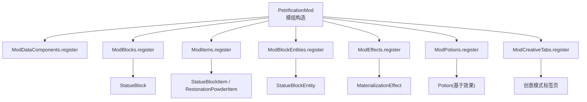
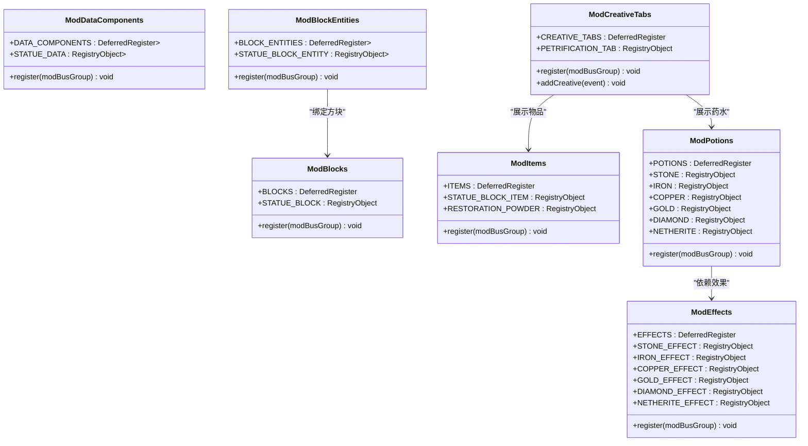
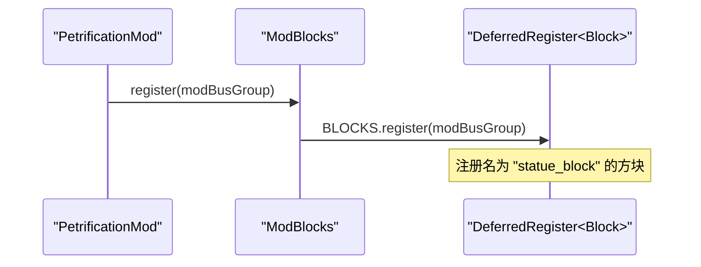
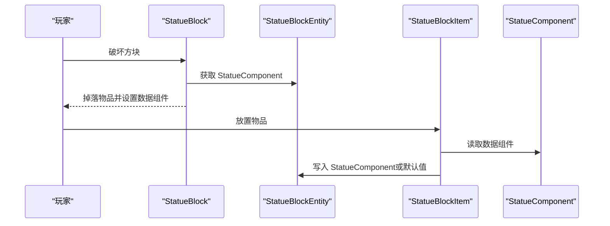
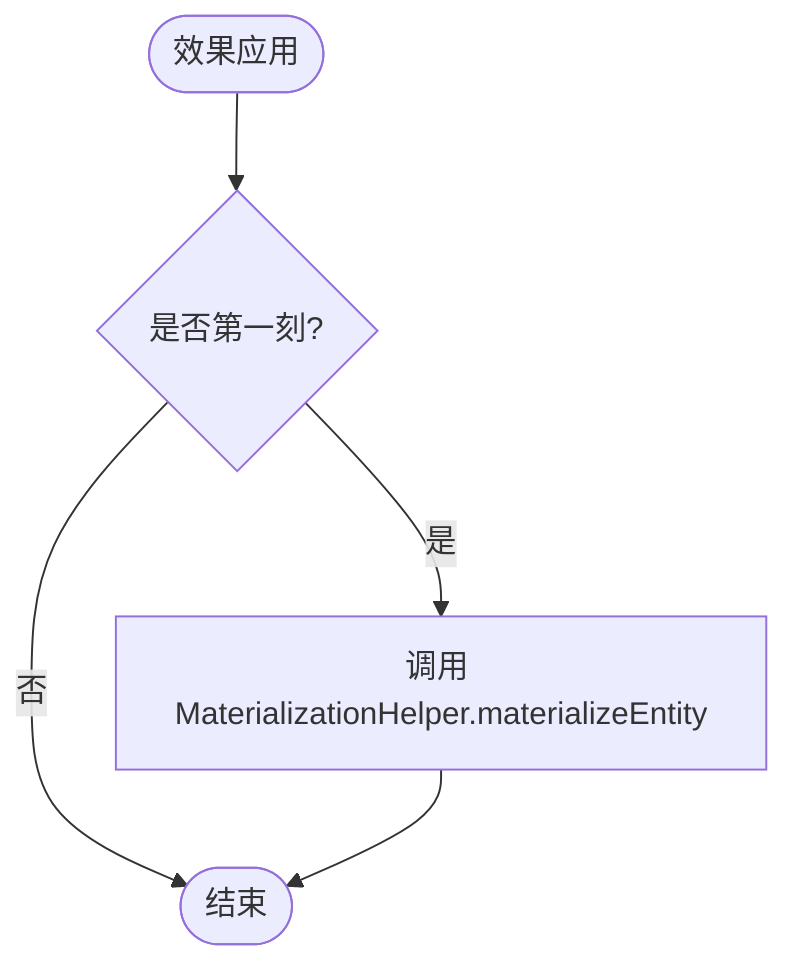
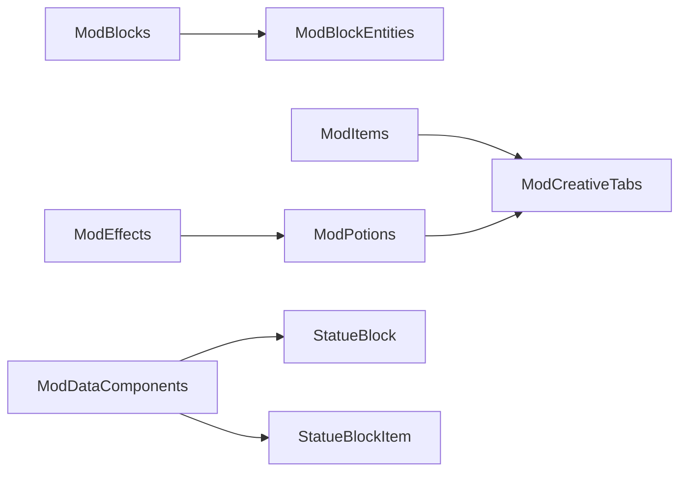

# 注册表API

<cite>
**本文引用的文件**
- [PetrificationMod.java](file://src/main/java/com/xiong/petrification/PetrificationMod.java)
- [ModBlocks.java](file://src/main/java/com/xiong/petrification/registry/ModBlocks.java)
- [ModItems.java](file://src/main/java/com/xiong/petrification/registry/ModItems.java)
- [ModEffects.java](file://src/main/java/com/xiong/petrification/registry/ModEffects.java)
- [ModDataComponents.java](file://src/main/java/com/xiong/petrification/registry/ModDataComponents.java)
- [ModBlockEntities.java](file://src/main/java/com/xiong/petrification/registry/ModBlockEntities.java)
- [ModPotions.java](file://src/main/java/com/xiong/petrification/registry/ModPotions.java)
- [ModCreativeTabs.java](file://src/main/java/com/xiong/petrification/registry/ModCreativeTabs.java)
- [StatueBlock.java](file://src/main/java/com/xiong/petrification/block/StatueBlock.java)
- [StatueBlockItem.java](file://src/main/java/com/xiong/petrification/item/StatueBlockItem.java)
- [MaterializationEffect.java](file://src/main/java/com/xiong/petrification/effect/MaterializationEffect.java)
- [StatueComponent.java](file://src/main/java/com/xiong/petrification/component/StatueComponent.java)
- [MaterialType.java](file://src/main/java/com/xiong/petrification/component/MaterialType.java)
</cite>

## 目录
1. [简介](#简介)
2. [项目结构](#项目结构)
3. [核心组件](#核心组件)
4. [架构总览](#架构总览)
5. [详细组件分析](#详细组件分析)
6. [依赖关系分析](#依赖关系分析)
7. [性能与初始化顺序](#性能与初始化顺序)
8. [故障排查与调试](#故障排查与调试)
9. [结论](#结论)
10. [附录：注册示例与最佳实践](#附录：注册示例与最佳实践)

## 简介
本文件为模组的注册表系统提供完整的API文档，聚焦于方块、物品、效果与数据组件的注册流程与方法调用。通过解析模组中的注册类（ModBlocks、ModItems、ModEffects、ModDataComponents等），说明如何正确注册新的游戏对象，并给出初始化顺序、依赖管理与版本兼容性处理建议，同时记录注册失败时的错误处理与调试方法。

## 项目结构
该模组采用“按功能模块组织”的结构，注册相关代码集中在 registry 包中，并通过主类在模组构造阶段统一注册。关键路径如下：
- 注册入口：PetrificationMod 构造函数中依次调用各注册类的 register(BusGroup)
- 注册类：ModBlocks、ModItems、ModEffects、ModDataComponents、ModBlockEntities、ModPotions、ModCreativeTabs
- 被注册对象：StatueBlock、StatueBlockItem、MaterializationEffect、StatueComponent 等

图表来源
- [PetrificationMod.java:27-46](file://src/main/java/com/xiong/petrification/PetrificationMod.java#L27-L46)
- [ModBlocks.java:16-33](file://src/main/java/com/xiong/petrification/registry/ModBlocks.java#L16-L33)
- [ModItems.java:12-30](file://src/main/java/com/xiong/petrification/registry/ModItems.java#L12-L30)
- [ModEffects.java:13-33](file://src/main/java/com/xiong/petrification/registry/ModEffects.java#L13-L33)
- [ModDataComponents.java:11-25](file://src/main/java/com/xiong/petrification/registry/ModDataComponents.java#L11-L25)
- [ModBlockEntities.java:13-25](file://src/main/java/com/xiong/petrification/registry/ModBlockEntities.java#L13-L25)
- [ModPotions.java:12-32](file://src/main/java/com/xiong/petrification/registry/ModPotions.java#L12-L32)
- [ModCreativeTabs.java:16-70](file://src/main/java/com/xiong/petrification/registry/ModCreativeTabs.java#L16-L70)

章节来源
- [PetrificationMod.java:27-46](file://src/main/java/com/xiong/petrification/PetrificationMod.java#L27-L46)

## 核心组件
- ModBlocks：使用 DeferredRegister 注册方块，并提供静态 RegistryObject 供其他模块引用。
- ModItems：使用 DeferredRegister 注册物品，包含方块对应的放置物品与恢复粉末。
- ModEffects：注册自定义药水效果，并与 MaterialType 关联。
- ModDataComponents：注册数据组件类型，用于持久化存储雕像状态。
- ModBlockEntities：注册方块实体类型，绑定到具体方块。
- ModPotions：基于已注册的效果创建药水实例。
- ModCreativeTabs：将注册的物品加入创意模式标签页。

章节来源
- [ModBlocks.java:16-33](file://src/main/java/com/xiong/petrification/registry/ModBlocks.java#L16-L33)
- [ModItems.java:12-30](file://src/main/java/com/xiong/petrification/registry/ModItems.java#L12-L30)
- [ModEffects.java:13-33](file://src/main/java/com/xiong/petrification/registry/ModEffects.java#L13-L33)
- [ModDataComponents.java:11-25](file://src/main/java/com/xiong/petrification/registry/ModDataComponents.java#L11-L25)
- [ModBlockEntities.java:13-25](file://src/main/java/com/xiong/petrification/registry/ModBlockEntities.java#L13-L25)
- [ModPotions.java:12-32](file://src/main/java/com/xiong/petrification/registry/ModPotions.java#L12-L32)
- [ModCreativeTabs.java:16-70](file://src/main/java/com/xiong/petrification/registry/ModCreativeTabs.java#L16-L70)

## 架构总览
注册体系以 DeferredRegister 为核心，所有注册项在模组构造阶段集中注册。各注册类之间通过静态 RegistryObject 相互引用，形成清晰的依赖链。

图表来源
- [ModBlocks.java:16-33](file://src/main/java/com/xiong/petrification/registry/ModBlocks.java#L16-L33)
- [ModItems.java:12-30](file://src/main/java/com/xiong/petrification/registry/ModItems.java#L12-L30)
- [ModEffects.java:13-33](file://src/main/java/com/xiong/petrification/registry/ModEffects.java#L13-L33)
- [ModDataComponents.java:11-25](file://src/main/java/com/xiong/petrification/registry/ModDataComponents.java#L11-L25)
- [ModBlockEntities.java:13-25](file://src/main/java/com/xiong/petrification/registry/ModBlockEntities.java#L13-L25)
- [ModPotions.java:12-32](file://src/main/java/com/xiong/petrification/registry/ModPotions.java#L12-L32)
- [ModCreativeTabs.java:16-70](file://src/main/java/com/xiong/petrification/registry/ModCreativeTabs.java#L16-L70)

## 详细组件分析

### 方块注册（ModBlocks）
- 使用 DeferredRegister.create 创建方块注册表，并在类中定义静态 RegistryObject 指向 StatueBlock。
- 通过 register("statue_block", () -> new StatueBlock(...)) 完成注册。
- 提供 register(BusGroup) 方法，由模组构造阶段调用。

图表来源
- [PetrificationMod.java:27-46](file://src/main/java/com/xiong/petrification/PetrificationMod.java#L27-L46)
- [ModBlocks.java:16-33](file://src/main/java/com/xiong/petrification/registry/ModBlocks.java#L16-L33)

章节来源
- [ModBlocks.java:16-33](file://src/main/java/com/xiong/petrification/registry/ModBlocks.java#L16-L33)

### 物品注册（ModItems）
- 使用 DeferredRegister.create 创建物品注册表，并注册 StatueBlockItem 与 RestorationPowderItem。
- 每个物品通过 register(name, () -> new Item(...)) 方式注册。
- 提供 register(BusGroup) 方法，由模组构造阶段调用。

章节来源
- [ModItems.java:12-30](file://src/main/java/com/xiong/petrification/registry/ModItems.java#L12-L30)

### 效果注册（ModEffects）
- 使用 DeferredRegister.create 注册自定义效果 MaterializationEffect。
- 通过私有辅助方法 register(name, materialType) 批量注册不同材料类型的效果。
- 提供 register(BusGroup) 方法，由模组构造阶段调用。

章节来源
- [ModEffects.java:13-33](file://src/main/java/com/xiong/petrification/registry/ModEffects.java#L13-L33)

### 数据组件注册（ModDataComponents）
- 使用 DeferredRegister.create 注册 DataComponentType，类型为 StatueComponent。
- 配置 persistent 与 cacheEncoding，确保组件可序列化与缓存编码。
- 提供 register(BusGroup) 方法，由模组构造阶段调用。

章节来源
- [ModDataComponents.java:11-25](file://src/main/java/com/xiong/petrification/registry/ModDataComponents.java#L11-L25)

### 方块实体注册（ModBlockEntities）
- 使用 DeferredRegister.create 注册 BlockEntityType，并将 StatueBlockEntity 绑定到 StatueBlock。
- 提供 register(BusGroup) 方法，由模组构造阶段调用。

章节来源
- [ModBlockEntities.java:13-25](file://src/main/java/com/xiong/petrification/registry/ModBlockEntities.java#L13-L25)

### 药水注册（ModPotions）
- 使用 DeferredRegister.create 注册 Potion，基于已注册的效果创建药水实例。
- 通过私有辅助方法 register(name, effect) 批量注册不同材料类型的药水。
- 提供 register(BusGroup) 方法，由模组构造阶段调用。

章节来源
- [ModPotions.java:12-32](file://src/main/java/com/xiong/petrification/registry/ModPotions.java#L12-L32)

### 创意模式标签页（ModCreativeTabs）
- 使用 DeferredRegister.create 注册 CreativeModeTab，并将注册的物品与药水添加到标签页。
- 提供 register(BusGroup) 方法与 addCreative 事件处理器。

章节来源
- [ModCreativeTabs.java:16-70](file://src/main/java/com/xiong/petrification/registry/ModCreativeTabs.java#L16-L70)

### 方块与物品的交互流程
- StatueBlock 在掉落时从方块实体读取 StatueComponent，并将其设置到对应物品的数据组件上。
- StatueBlockItem 在放置时，将数据组件写入方块实体；若没有数据则使用默认雕像数据。

图表来源
- [StatueBlock.java:123-135](file://src/main/java/com/xiong/petrification/block/StatueBlock.java#L123-L135)
- [StatueBlockItem.java:30-40](file://src/main/java/com/xiong/petrification/item/StatueBlockItem.java#L30-L40)

章节来源
- [StatueBlock.java:123-135](file://src/main/java/com/xiong/petrification/block/StatueBlock.java#L123-L135)
- [StatueBlockItem.java:30-40](file://src/main/java/com/xiong/petrification/item/StatueBlockItem.java#L30-L40)

### 效果执行流程
- MaterializationEffect 在应用时调用 MaterializationHelper 对实体进行“石化”处理。
- 效果为瞬时型，仅在第一刻生效。

图表来源
- [MaterializationEffect.java:22-36](file://src/main/java/com/xiong/petrification/effect/MaterializationEffect.java#L22-L36)

章节来源
- [MaterializationEffect.java:22-36](file://src/main/java/com/xiong/petrification/effect/MaterializationEffect.java#L22-L36)

## 依赖关系分析
- 初始化顺序：PetrificationMod 构造函数中按固定顺序调用各注册类的 register，确保依赖先于后依赖注册。
- 依赖链：
  - ModBlockEntities 依赖 ModBlocks（绑定方块）。
  - ModPotions 依赖 ModEffects（基于效果创建药水）。
  - ModCreativeTabs 依赖 ModItems 与 ModPotions（展示物品与药水）。
  - StatueBlockItem 与 StatueBlock 通过 ModDataComponents 共享 StatueComponent。

图表来源
- [PetrificationMod.java:27-46](file://src/main/java/com/xiong/petrification/PetrificationMod.java#L27-L46)
- [ModBlockEntities.java:13-25](file://src/main/java/com/xiong/petrification/registry/ModBlockEntities.java#L13-L25)
- [ModPotions.java:12-32](file://src/main/java/com/xiong/petrification/registry/ModPotions.java#L12-L32)
- [ModCreativeTabs.java:16-70](file://src/main/java/com/xiong/petrification/registry/ModCreativeTabs.java#L16-L70)
- [ModDataComponents.java:11-25](file://src/main/java/com/xiong/petrification/registry/ModDataComponents.java#L11-L25)

章节来源
- [PetrificationMod.java:27-46](file://src/main/java/com/xiong/petrification/PetrificationMod.java#L27-L46)

## 性能与初始化顺序
- 初始化顺序：在模组构造阶段集中注册，避免运行时延迟导致的依赖问题。
- 性能考虑：
  - 数据组件使用 cacheEncoding 提升序列化性能。
  - 效果为瞬时型，减少每刻计算开销。
  - 创意模式标签页仅在构建时添加物品，避免重复操作。

[本节为通用指导，不直接分析具体文件]

## 故障排查与调试
- 常见问题：
  - 重复注册名称：检查各注册类中 register 的名称是否唯一。
  - 依赖未就绪：确保依赖方先于依赖者注册（如 ModBlockEntities 需在 ModBlocks 之后）。
  - 数据组件缺失：确认 StatueComponent 的 CODEC 配置正确且组件类型已注册。
- 调试方法：
  - 在 PetrificationMod.commonSetup 中打印日志，确认网络与模组初始化完成。
  - 检查创意模式标签页是否正确显示物品与药水。
  - 验证方块掉落与放置时数据组件的读写逻辑。

章节来源
- [PetrificationMod.java:48-51](file://src/main/java/com/xiong/petrification/PetrificationMod.java#L48-L51)
- [StatueBlock.java:123-135](file://src/main/java/com/xiong/petrification/block/StatueBlock.java#L123-L135)
- [StatueBlockItem.java:30-40](file://src/main/java/com/xiong/petrification/item/StatueBlockItem.java#L30-L40)

## 结论
该模组的注册表系统通过 DeferredRegister 实现了模块化、可扩展的对象注册机制。各注册类职责清晰，依赖关系明确，初始化顺序合理。配合数据组件与效果系统，实现了复杂的雕像与药水功能。遵循本文档的注册流程与最佳实践，可安全地扩展新的游戏对象。

[本节为总结性内容，不直接分析具体文件]

## 附录：注册示例与最佳实践

### 新增方块注册步骤
- 在 ModBlocks 中创建 DeferredRegister 并注册新方块。
- 如需方块实体，在 ModBlockEntities 中注册并绑定到方块。
- 如有对应物品，在 ModItems 中注册并实现放置逻辑。
- 在创意模式标签页中添加新物品（可选）。

章节来源
- [ModBlocks.java:16-33](file://src/main/java/com/xiong/petrification/registry/ModBlocks.java#L16-L33)
- [ModBlockEntities.java:13-25](file://src/main/java/com/xiong/petrification/registry/ModBlockEntities.java#L13-L25)
- [ModItems.java:12-30](file://src/main/java/com/xiong/petrification/registry/ModItems.java#L12-L30)
- [ModCreativeTabs.java:16-70](file://src/main/java/com/xiong/petrification/registry/ModCreativeTabs.java#L16-L70)

### 新增物品注册步骤
- 在 ModItems 中创建 DeferredRegister 并注册新物品。
- 如需数据组件，确保 ModDataComponents 已注册相应类型。
- 在创意模式标签页中添加新物品（可选）。

章节来源
- [ModItems.java:12-30](file://src/main/java/com/xiong/petrification/registry/ModItems.java#L12-L30)
- [ModDataComponents.java:11-25](file://src/main/java/com/xiong/petrification/registry/ModDataComponents.java#L11-L25)
- [ModCreativeTabs.java:16-70](file://src/main/java/com/xiong/petrification/registry/ModCreativeTabs.java#L16-L70)

### 新增效果与药水注册步骤
- 在 ModEffects 中注册自定义效果，并关联 MaterialType。
- 在 ModPotions 中基于效果创建药水实例。
- 在创意模式标签页中添加药水（可选）。

章节来源
- [ModEffects.java:13-33](file://src/main/java/com/xiong/petrification/registry/ModEffects.java#L13-L33)
- [ModPotions.java:12-32](file://src/main/java/com/xiong/petrification/registry/ModPotions.java#L12-L32)
- [ModCreativeTabs.java:16-70](file://src/main/java/com/xiong/petrification/registry/ModCreativeTabs.java#L16-L70)

### 数据组件使用要点
- 确保组件类型已注册并配置了 CODEC。
- 在方块掉落与物品放置时读写组件数据。
- 使用默认值处理缺失数据的情况。

章节来源
- [ModDataComponents.java:11-25](file://src/main/java/com/xiong/petrification/registry/ModDataComponents.java#L11-L25)
- [StatueBlock.java:123-135](file://src/main/java/com/xiong/petrification/block/StatueBlock.java#L123-L135)
- [StatueBlockItem.java:30-40](file://src/main/java/com/xiong/petrification/item/StatueBlockItem.java#L30-L40)