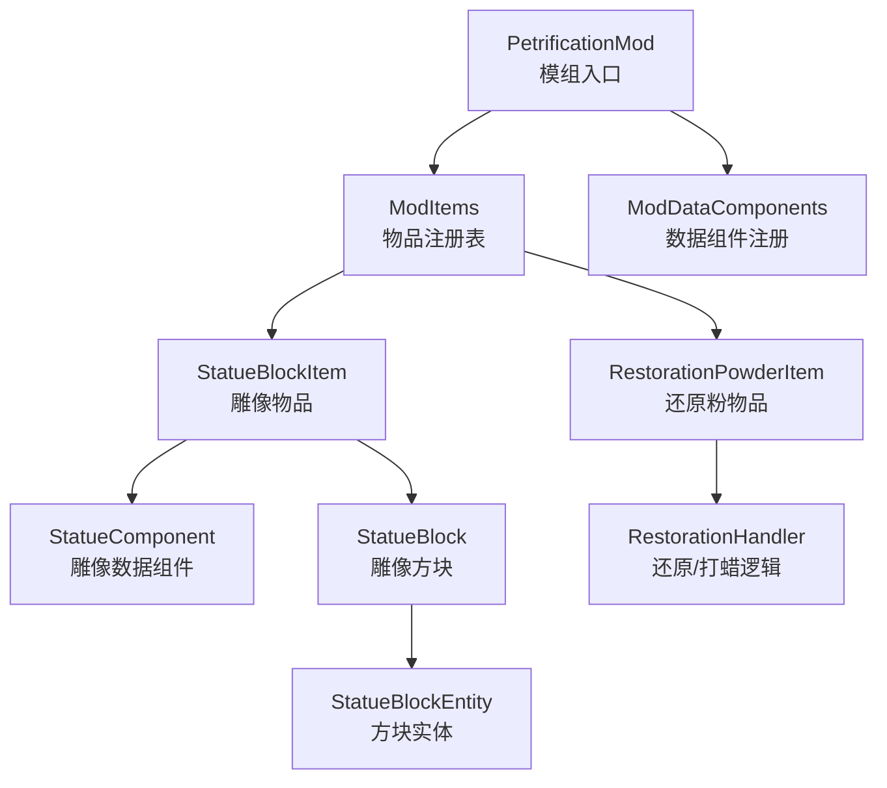
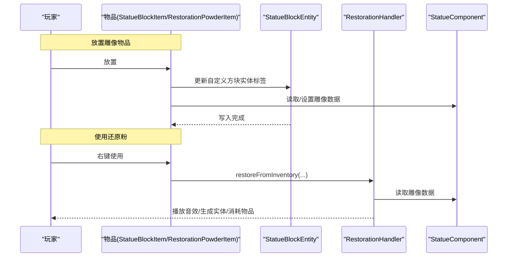
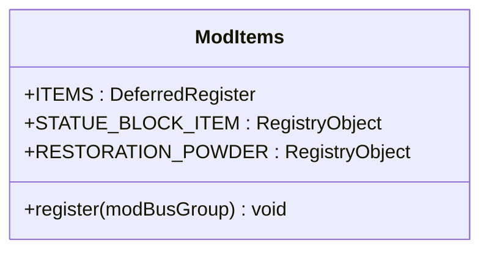
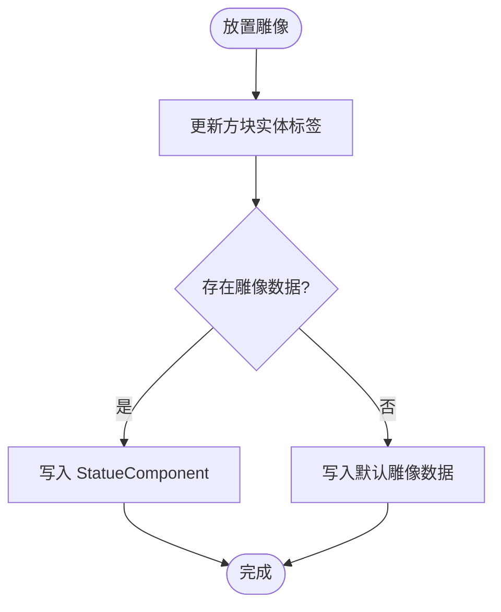
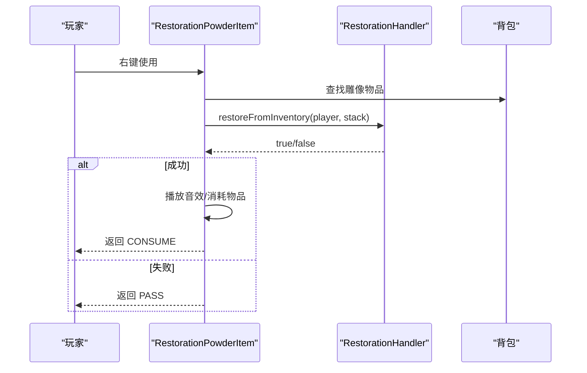
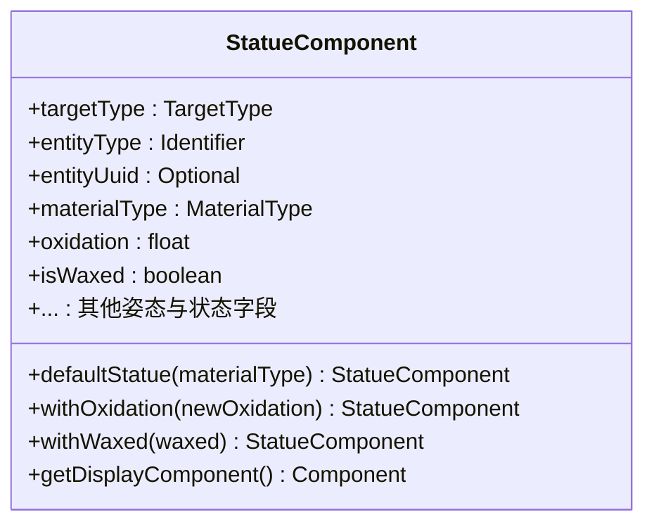
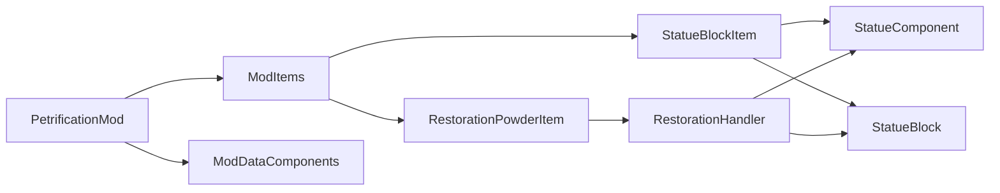

# 物品注册API

<cite>
**本文引用的文件**
- [ModItems.java](file://src/main/java/com/xiong/petrification/registry/ModItems.java)
- [StatueBlockItem.java](file://src/main/java/com/xiong/petrification/item/StatueBlockItem.java)
- [RestorationPowderItem.java](file://src/main/java/com/xiong/petrification/item/RestorationPowderItem.java)
- [PetrificationMod.java](file://src/main/java/com/xiong/petrification/PetrificationMod.java)
- [StatueComponent.java](file://src/main/java/com/xiong/petrification/component/StatueComponent.java)
- [MaterialType.java](file://src/main/java/com/xiong/petrification/component/MaterialType.java)
- [TargetType.java](file://src/main/java/com/xiong/petrification/component/TargetType.java)
- [ModDataComponents.java](file://src/main/java/com/xiong/petrification/registry/ModDataComponents.java)
- [RestorationHandler.java](file://src/main/java/com/xiong/petrification/handler/RestorationHandler.java)
- [StatueBlock.java](file://src/main/java/com/xiong/petrification/block/StatueBlock.java)
- [zh_cn.json](file://src/main/resources/assets/petrification/lang/zh_cn.json)
</cite>

## 目录
1. [简介](#简介)
2. [项目结构](#项目结构)
3. [核心组件](#核心组件)
4. [架构总览](#架构总览)
5. [详细组件分析](#详细组件分析)
6. [依赖关系分析](#依赖关系分析)
7. [性能与最佳实践](#性能与最佳实践)
8. [故障排查指南](#故障排查指南)
9. [结论](#结论)
10. [附录：完整注册流程示例](#附录完整注册流程示例)

## 简介
本文件为“石化”模组的物品注册系统提供详细的API文档，重点围绕 ModItems 类的结构与用法，解释各类物品的注册方法、属性配置、渲染与交互逻辑。文档以 StatueBlockItem（雕像方块对应的物品）和 RestorationPowderItem（还原粉）为例，展示从注册到使用的全流程，并记录数据组件、生命周期管理与事件处理要点，最后给出最佳实践与常见问题解决方案。

## 项目结构
该模组采用按功能分层的组织方式：
- 注册中心：ModItems、ModBlocks、ModDataComponents 等集中管理可注册对象
- 物品实现：StatueBlockItem、RestorationPowderItem 等具体物品类
- 数据组件：StatueComponent 及其编解码器，用于持久化雕像信息
- 业务处理器：RestorationHandler 负责还原、打蜡等核心逻辑
- 方块与实体：StatueBlock 与 StatueBlockEntity 承载可视化与状态
- 模组入口：PetrificationMod 统一初始化各子系统

图表来源
- [PetrificationMod.java:27-46](file://src/main/java/com/xiong/petrification/PetrificationMod.java#L27-L46)
- [ModItems.java:12-30](file://src/main/java/com/xiong/petrification/registry/ModItems.java#L12-L30)
- [StatueBlockItem.java:24-99](file://src/main/java/com/xiong/petrification/item/StatueBlockItem.java#L24-L99)
- [RestorationPowderItem.java:11-32](file://src/main/java/com/xiong/petrification/item/RestorationPowderItem.java#L11-L32)
- [StatueComponent.java:14-52](file://src/main/java/com/xiong/petrification/component/StatueComponent.java#L14-L52)
- [StatueBlock.java:38-153](file://src/main/java/com/xiong/petrification/block/StatueBlock.java#L38-L153)
- [RestorationHandler.java:31-229](file://src/main/java/com/xiong/petrification/handler/RestorationHandler.java#L31-L229)

章节来源
- [PetrificationMod.java:27-46](file://src/main/java/com/xiong/petrification/PetrificationMod.java#L27-L46)
- [ModItems.java:12-30](file://src/main/java/com/xiong/petrification/registry/ModItems.java#L12-L30)

## 核心组件
- ModItems：通过 DeferredRegister 统一管理物品注册，提供 StatueBlockItem 与 RestorationPowderItem 的注册点与访问句柄
- StatueBlockItem：继承 BlockItem，覆写放置时更新方块实体标签、悬停提示与名称显示，绑定 StatueComponent 数据
- RestorationPowderItem：覆写使用逻辑，调用 RestorationHandler 完成还原或打蜡等业务
- StatueComponent：基于 Codec 的可序列化数据组件，保存目标类型、材质、姿态、装备、玩家状态等大量字段
- ModDataComponents：注册 StatueComponent 的数据组件类型，支持持久化与缓存编码
- RestorationHandler：服务端逻辑，负责从库存或方块处恢复实体、应用玩家数据、打蜡等
- StatueBlock：不可见方块，持有 StatueBlockEntity，提供交互、掉落、红石信号等行为

章节来源
- [ModItems.java:12-30](file://src/main/java/com/xiong/petrification/registry/ModItems.java#L12-L30)
- [StatueBlockItem.java:24-99](file://src/main/java/com/xiong/petrification/item/StatueBlockItem.java#L24-L99)
- [RestorationPowderItem.java:11-32](file://src/main/java/com/xiong/petrification/item/RestorationPowderItem.java#L11-L32)
- [StatueComponent.java:14-52](file://src/main/java/com/xiong/petrification/component/StatueComponent.java#L14-L52)
- [ModDataComponents.java:11-25](file://src/main/java/com/xiong/petrification/registry/ModDataComponents.java#L11-L25)
- [RestorationHandler.java:31-229](file://src/main/java/com/xiong/petrification/handler/RestorationHandler.java#L31-L229)
- [StatueBlock.java:38-153](file://src/main/java/com/xiong/petrification/block/StatueBlock.java#L38-L153)

## 架构总览
物品注册与使用的主流程如下：
- 模组启动时，PetrificationMod 初始化并注册 ModItems、ModDataComponents 等
- 客户端与服务端均可通过 ModItems.STATUE_BLOCK_ITEM 与 ModItems.RESTORATION_POWDER 获取物品实例
- StatueBlockItem 在放置时将 StatueComponent 写入 StatueBlockEntity；悬停提示读取组件内容
- RestorationPowderItem 使用时在服务端调用 RestorationHandler 执行还原或打蜡，并在成功时消耗物品

图表来源
- [StatueBlockItem.java:29-45](file://src/main/java/com/xiong/petrification/item/StatueBlockItem.java#L29-L45)
- [StatueBlockItem.java:47-99](file://src/main/java/com/xiong/petrification/item/StatueBlockItem.java#L47-L99)
- [RestorationPowderItem.java:16-31](file://src/main/java/com/xiong/petrification/item/RestorationPowderItem.java#L16-L31)
- [RestorationHandler.java:55-91](file://src/main/java/com/xiong/petrification/handler/RestorationHandler.java#L55-L91)
- [StatueComponent.java:14-52](file://src/main/java/com/xiong/petrification/component/StatueComponent.java#L14-L52)

## 详细组件分析

### ModItems 注册中心
- 使用 DeferredRegister<Item> 创建物品注册表，绑定模组ID
- 注册 StatueBlockItem 与 RestorationPowderItem，并通过 Item.Properties 设置堆叠数等基础属性
- 提供 register(BusGroup) 方法供模组入口统一注册

图表来源
- [ModItems.java:12-30](file://src/main/java/com/xiong/petrification/registry/ModItems.java#L12-L30)

章节来源
- [ModItems.java:12-30](file://src/main/java/com/xiong/petrification/registry/ModItems.java#L12-L30)

### StatueBlockItem：雕像物品
- 继承 BlockItem，构造时绑定对应方块
- 放置时覆写 updateCustomBlockEntityTag，将 StatueComponent 写入 StatueBlockEntity；若无组件则写入默认雕像数据
- 覆写 appendHoverText，根据 StatueComponent 显示目标类型、材质、实体名、自定义名、铜氧化进度与打蜡状态
- 覆写 getName，优先返回自定义名称

图表来源
- [StatueBlockItem.java:29-45](file://src/main/java/com/xiong/petrification/item/StatueBlockItem.java#L29-L45)
- [StatueComponent.java:194-227](file://src/main/java/com/xiong/petrification/component/StatueComponent.java#L194-L227)

章节来源
- [StatueBlockItem.java:24-99](file://src/main/java/com/xiong/petrification/item/StatueBlockItem.java#L24-L99)

### RestorationPowderItem：还原粉物品
- 继承 Item，覆写 use 方法
- 客户端直接返回成功，服务端查找背包中的雕像物品并调用 RestorationHandler.restoreFromInventory
- 若成功则播放音效、消耗物品并返回 CONSUME

图表来源
- [RestorationPowderItem.java:16-31](file://src/main/java/com/xiong/petrification/item/RestorationPowderItem.java#L16-L31)
- [RestorationHandler.java:55-91](file://src/main/java/com/xiong/petrification/handler/RestorationHandler.java#L55-L91)

章节来源
- [RestorationPowderItem.java:11-32](file://src/main/java/com/xiong/petrification/item/RestorationPowderItem.java#L11-L32)
- [RestorationHandler.java:55-91](file://src/main/java/com/xiong/petrification/handler/RestorationHandler.java#L55-L91)

### StatueComponent：雕像数据组件
- 使用 record 定义大量字段，分为基本、姿态、可选A、可选B四组，并通过 Codec 组合进行序列化
- 提供 defaultStatue(MaterialType) 创建默认雕像数据
- 提供 withOxidation、withWaxed 等不可变更新方法
- 提供 getDisplayComponent 用于显示名称

图表来源
- [StatueComponent.java:14-52](file://src/main/java/com/xiong/petrification/component/StatueComponent.java#L14-L52)
- [StatueComponent.java:194-227](file://src/main/java/com/xiong/petrification/component/StatueComponent.java#L194-L227)
- [StatueComponent.java:236-254](file://src/main/java/com/xiong/petrification/component/StatueComponent.java#L236-L254)

章节来源
- [StatueComponent.java:14-52](file://src/main/java/com/xiong/petrification/component/StatueComponent.java#L14-L52)
- [StatueComponent.java:194-227](file://src/main/java/com/xiong/petrification/component/StatueComponent.java#L194-L227)
- [StatueComponent.java:236-254](file://src/main/java/com/xiong/petrification/component/StatueComponent.java#L236-L254)

### 材质与目标类型
- MaterialType：枚举定义石头、铁、铜、金、钻石、下界合金等材质，附带颜色、锭物品、方块与显示前缀
- TargetType：枚举定义生物与玩家两种目标类型

章节来源
- [MaterialType.java:9-68](file://src/main/java/com/xiong/petrification/component/MaterialType.java#L9-L68)
- [TargetType.java:6-23](file://src/main/java/com/xiong/petrification/component/TargetType.java#L6-L23)

### 数据组件注册
- ModDataComponents 注册 StatueComponent 的数据组件类型，启用持久化与缓存编码，便于跨会话存储与网络同步

章节来源
- [ModDataComponents.java:11-25](file://src/main/java/com/xiong/petrification/registry/ModDataComponents.java#L11-L25)

### 方块与交互
- StatueBlock 为不可见方块，持有 StatueBlockEntity，提供交互显示名称、掉落时携带 StatueComponent、红石信号输出（铜材质氧化程度）
- 放置雕像物品时，StatueBlockItem 将 StatueComponent 写入方块实体

章节来源
- [StatueBlock.java:38-153](file://src/main/java/com/xiong/petrification/block/StatueBlock.java#L38-L153)
- [StatueBlockItem.java:29-45](file://src/main/java/com/xiong/petrification/item/StatueBlockItem.java#L29-L45)

## 依赖关系分析
- 模组入口 PetrificationMod 统一注册 ModItems、ModDataComponents 等，确保生命周期正确
- StatueBlockItem 依赖 StatueComponent、ModDataComponents、StatueBlock
- RestorationPowderItem 依赖 RestorationHandler
- RestorationHandler 依赖 StatueComponent、StatueBlockEntity、MaterializationHelper、ModItems、ModBlocks
- StatueBlock 依赖 StatueBlockEntity、ModItems、ModDataComponents

图表来源
- [PetrificationMod.java:27-46](file://src/main/java/com/xiong/petrification/PetrificationMod.java#L27-L46)
- [ModItems.java:12-30](file://src/main/java/com/xiong/petrification/registry/ModItems.java#L12-L30)
- [StatueBlockItem.java:24-99](file://src/main/java/com/xiong/petrification/item/StatueBlockItem.java#L24-L99)
- [RestorationPowderItem.java:11-32](file://src/main/java/com/xiong/petrification/item/RestorationPowderItem.java#L11-L32)
- [RestorationHandler.java:31-229](file://src/main/java/com/xiong/petrification/handler/RestorationHandler.java#L31-L229)

章节来源
- [PetrificationMod.java:27-46](file://src/main/java/com/xiong/petrification/PetrificationMod.java#L27-L46)
- [ModItems.java:12-30](file://src/main/java/com/xiong/petrification/registry/ModItems.java#L12-L30)
- [StatueBlockItem.java:24-99](file://src/main/java/com/xiong/petrification/item/StatueBlockItem.java#L24-L99)
- [RestorationPowderItem.java:11-32](file://src/main/java/com/xiong/petrification/item/RestorationPowderItem.java#L11-L32)
- [RestorationHandler.java:31-229](file://src/main/java/com/xiong/petrification/handler/RestorationHandler.java#L31-L229)

## 性能与最佳实践
- 使用 DeferredRegister 集中注册物品与数据组件，避免重复创建与循环依赖
- StatueComponent 使用 Codec 分组序列化，减少NBT体积与网络开销
- 仅在服务端执行还原逻辑，客户端仅做视觉反馈，避免重复计算
- 对铜材质雕像提供打蜡能力，锁定氧化进度，降低频繁状态更新
- 悬停提示按需读取 StatueComponent，避免不必要的计算
- 使用不可变更新方法（withOxidation、withWaxed）保证数据一致性

[本节为通用指导，不直接分析具体文件]

## 故障排查指南
- 无法还原在线玩家的雕像
  - 现象：使用还原粉时提示无法还原在线玩家
  - 原因：服务端检测到目标玩家在线，阻止还原以避免冲突
  - 解决：等待玩家离线或使用其他方式处理
  - 参考路径：[RestorationHandler.java:70-79](file://src/main/java/com/xiong/petrification/handler/RestorationHandler.java#L70-L79)

- 雕像无数据导致还原失败
  - 现象：使用还原粉无效
  - 原因：背包中雕像物品缺少 StatueComponent
  - 解决：重新放置雕像物品以写入默认数据
  - 参考路径：[RestorationHandler.java:60-68](file://src/main/java/com/xiong/petrification/handler/RestorationHandler.java#L60-L68)

- 铜材质雕像未显示打蜡状态
  - 现象：悬停提示未显示已打蜡
  - 原因：未正确设置 isWaxed 或未刷新组件
  - 解决：使用打蜡逻辑更新组件并播放音效
  - 参考路径：[RestorationHandler.java:199-207](file://src/main/java/com/xiong/petrification/handler/RestorationHandler.java#L199-L207)

- 方块掉落未携带雕像数据
  - 现象：破坏雕像方块后掉落物无数据
  - 原因：未正确传递 StatueComponent
  - 解决：在掉落逻辑中设置组件
  - 参考路径：[StatueBlock.java:123-135](file://src/main/java/com/xiong/petrification/block/StatueBlock.java#L123-L135)

章节来源
- [RestorationHandler.java:70-79](file://src/main/java/com/xiong/petrification/handler/RestorationHandler.java#L70-L79)
- [RestorationHandler.java:60-68](file://src/main/java/com/xiong/petrification/handler/RestorationHandler.java#L60-L68)
- [RestorationHandler.java:199-207](file://src/main/java/com/xiong/petrification/handler/RestorationHandler.java#L199-L207)
- [StatueBlock.java:123-135](file://src/main/java/com/xiong/petrification/block/StatueBlock.java#L123-L135)

## 结论
本模组通过 ModItems 集中注册物品，结合 StatueComponent 数据组件与 RestorationHandler 业务逻辑，实现了完整的雕像与还原系统。StatueBlockItem 负责放置时的数据写入与UI展示，RestorationPowderItem 负责触发还原流程。整体架构清晰、可扩展性强，适合继续添加新材质与新物品类型。

[本节为总结性内容，不直接分析具体文件]

## 附录：完整注册流程示例

### 注册 StatueBlockItem
- 在 ModItems 中通过 DeferredRegister 注册 StatueBlockItem，设置堆叠数等属性
- 在模组入口调用 ModItems.register 完成注册
- 放置雕像物品时，StatueBlockItem 将 StatueComponent 写入 StatueBlockEntity
- 悬停提示读取 StatueComponent 显示详细信息

章节来源
- [ModItems.java:16-24](file://src/main/java/com/xiong/petrification/registry/ModItems.java#L16-L24)
- [StatueBlockItem.java:24-99](file://src/main/java/com/xiong/petrification/item/StatueBlockItem.java#L24-L99)
- [PetrificationMod.java:30-35](file://src/main/java/com/xiong/petrification/PetrificationMod.java#L30-L35)

### 注册 RestorationPowderItem
- 在 ModItems 中通过 DeferredRegister 注册 RestorationPowderItem，设置堆叠数等属性
- 在模组入口调用 ModItems.register 完成注册
- 使用还原粉时，服务端查找背包中的雕像物品并调用 RestorationHandler 执行还原
- 成功后播放音效并消耗物品

章节来源
- [ModItems.java:21-24](file://src/main/java/com/xiong/petrification/registry/ModItems.java#L21-L24)
- [RestorationPowderItem.java:16-31](file://src/main/java/com/xiong/petrification/item/RestorationPowderItem.java#L16-L31)
- [RestorationHandler.java:55-91](file://src/main/java/com/xiong/petrification/handler/RestorationHandler.java#L55-L91)

### 数据组件与本地化
- 通过 ModDataComponents 注册 StatueComponent，启用持久化与缓存编码
- 中文本地化文本位于 zh_cn.json，包含物品名、材质名、提示语与消息

章节来源
- [ModDataComponents.java:11-25](file://src/main/java/com/xiong/petrification/registry/ModDataComponents.java#L11-L25)
- [zh_cn.json:1-63](file://src/main/resources/assets/petrification/lang/zh_cn.json#L1-L63)