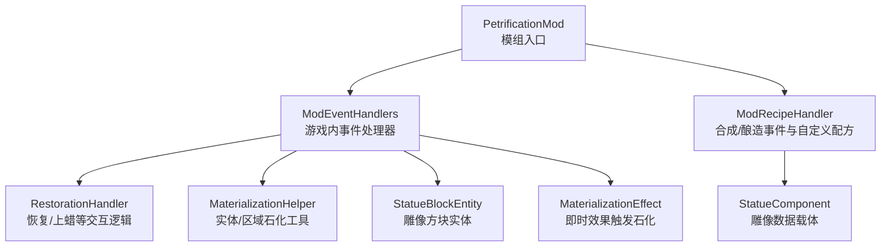
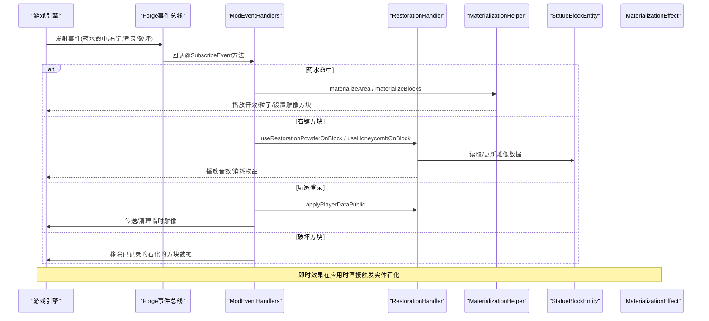
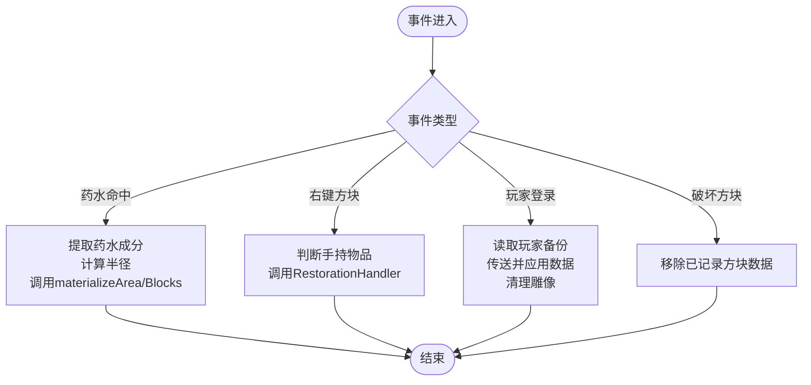
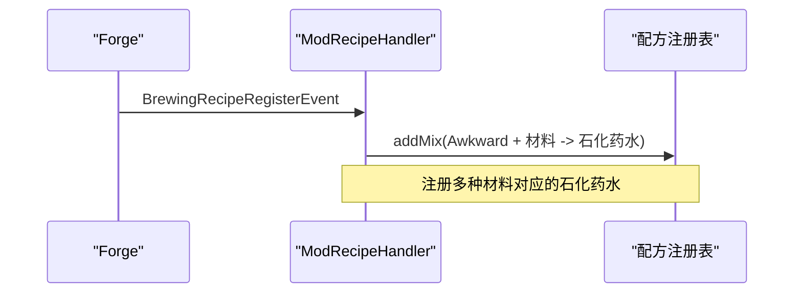
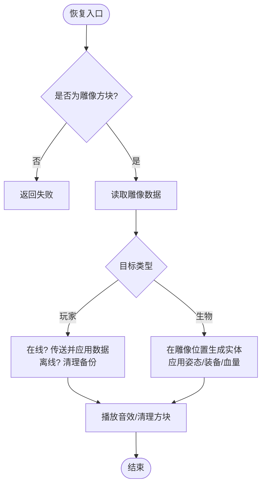
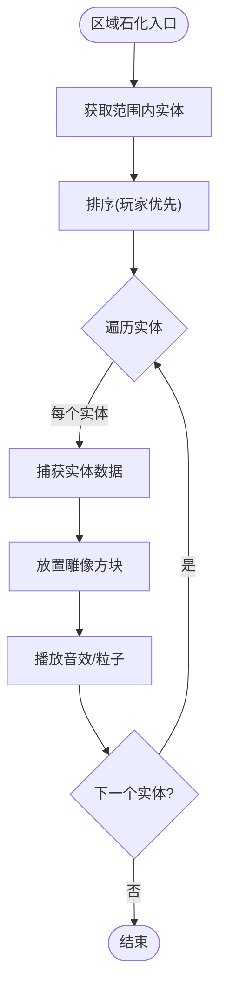
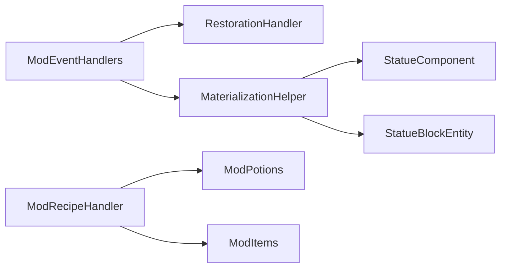

# 事件处理

<cite>
**本文引用的文件**
- [PetrificationMod.java](file://src/main/java/com/xiong/petrification/PetrificationMod.java)
- [ModEventHandlers.java](file://src/main/java/com/xiong/petrification/handler/ModEventHandlers.java)
- [ModRecipeHandler.java](file://src/main/java/com/xiong/petrification/handler/ModRecipeHandler.java)
- [RestorationHandler.java](file://src/main/java/com/xiong/petrification/handler/RestorationHandler.java)
- [MaterializationHelper.java](file://src/main/java/com/xiong/petrification/util/MaterializationHelper.java)
- [StatueBlockEntity.java](file://src/main/java/com/xiong/petrification/block/StatueBlockEntity.java)
- [StatueComponent.java](file://src/main/java/com/xiong/petrification/component/StatueComponent.java)
- [MaterializationEffect.java](file://src/main/java/com/xiong/petrification/effect/MaterializationEffect.java)
</cite>

## 目录
1. [简介](#简介)
2. [项目结构](#项目结构)
3. [核心组件](#核心组件)
4. [架构总览](#架构总览)
5. [详细组件分析](#详细组件分析)
6. [依赖关系分析](#依赖关系分析)
7. [性能考虑](#性能考虑)
8. [故障排查指南](#故障排查指南)
9. [结论](#结论)
10. [附录：最佳实践与扩展点](#附录最佳实践与扩展点)

## 简介
本文件为Minecraft石化模组的事件处理系统提供全面文档，聚焦于基于Forge事件总线的响应式编程架构。内容涵盖事件的订阅、触发与处理流程；深入解析全局事件处理器（药水命中、方块交互、合成配方）的实现逻辑；介绍自定义事件的处理机制与扩展点；说明事件优先级、异步处理与错误处理策略；并提供调试技巧、性能监控方法与常见问题解决方案。同时给出具体监听器实现示例路径与最佳实践指导，帮助开发者理解并扩展现有事件处理机制。

## 项目结构
该模组采用按功能域划分的包结构，事件处理相关代码集中在 handler 包中，并通过 @Mod.EventBusSubscriber 注解注册到Forge事件总线。主类负责统一初始化各子系统与注册事件处理器。

图表来源
- [PetrificationMod.java:25-49](file://src/main/java/com/xiong/petrification/PetrificationMod.java#L25-L49)
- [ModEventHandlers.java:30-118](file://src/main/java/com/xiong/petrification/handler/ModEventHandlers.java#L30-L118)
- [ModRecipeHandler.java:27-59](file://src/main/java/com/xiong/petrification/handler/ModRecipeHandler.java#L27-L59)
- [RestorationHandler.java:31-229](file://src/main/java/com/xiong/petrification/handler/RestorationHandler.java#L31-L229)
- [MaterializationHelper.java:33-263](file://src/main/java/com/xiong/petrification/util/MaterializationHelper.java#L33-L263)
- [StatueBlockEntity.java:17-88](file://src/main/java/com/xiong/petrification/block/StatueBlockEntity.java#L17-L88)
- [StatueComponent.java:14-256](file://src/main/java/com/xiong/petrification/component/StatueComponent.java#L14-L256)
- [MaterializationEffect.java:10-38](file://src/main/java/com/xiong/petrification/effect/MaterializationEffect.java#L10-L38)

章节来源
- [PetrificationMod.java:25-49](file://src/main/java/com/xiong/petrification/PetrificationMod.java#L25-L49)

## 核心组件
- 全局事件处理器 ModEventHandlers：集中订阅游戏内事件，包括药水溅射命中、玩家右键方块、玩家登录、方块破坏等，驱动石化与恢复流程。
- 配方与酿造处理器 ModRecipeHandler：订阅酿造配方注册事件，注册多种材料对应的石化药水；定义雕像分解/组合的自定义配方。
- 恢复处理器 RestorationHandler：封装了从雕像恢复实体/玩家的逻辑，以及铜雕像上蜡等交互行为。
- 石化工具 MaterializationHelper：提供实体、区域、方块的石化能力，包含权限检查、数据捕获、粒子与音效反馈。
- 雕像数据 StatueComponent：以record形式持久化雕像状态，支持序列化/反序列化，承载实体信息、装备、姿态、经验等。
- 雕像方块实体 StatueBlockEntity：维护雕像方块的状态，周期性氧化（可配置），同步客户端。
- 即时效果 MaterializationEffect：瞬时生效的效果，在应用时调用工具方法完成实体石化。

章节来源
- [ModEventHandlers.java:30-118](file://src/main/java/com/xiong/petrification/handler/ModEventHandlers.java#L30-L118)
- [ModRecipeHandler.java:27-169](file://src/main/java/com/xiong/petrification/handler/ModRecipeHandler.java#L27-L169)
- [RestorationHandler.java:31-229](file://src/main/java/com/xiong/petrification/handler/RestorationHandler.java#L31-L229)
- [MaterializationHelper.java:33-263](file://src/main/java/com/xiong/petrification/util/MaterializationHelper.java#L33-L263)
- [StatueComponent.java:14-256](file://src/main/java/com/xiong/petrification/component/StatueComponent.java#L14-L256)
- [StatueBlockEntity.java:17-88](file://src/main/java/com/xiong/petrification/block/StatueBlockEntity.java#L17-L88)
- [MaterializationEffect.java:10-38](file://src/main/java/com/xiong/petrification/effect/MaterializationEffect.java#L10-L38)

## 架构总览
下图展示了事件从触发到处理的完整链路：Forge事件总线分发事件至对应处理器，处理器调用业务逻辑与工具方法，最终修改世界状态或实体状态。

图表来源
- [ModEventHandlers.java:38-118](file://src/main/java/com/xiong/petrification/handler/ModEventHandlers.java#L38-L118)
- [RestorationHandler.java:34-229](file://src/main/java/com/xiong/petrification/handler/RestorationHandler.java#L34-L229)
- [MaterializationHelper.java:55-96](file://src/main/java/com/xiong/petrification/util/MaterializationHelper.java#L55-L96)
- [StatueBlockEntity.java:28-50](file://src/main/java/com/xiong/petrification/block/StatueBlockEntity.java#L28-L50)
- [MaterializationEffect.java:22-31](file://src/main/java/com/xiong/petrification/effect/MaterializationEffect.java#L22-L31)

## 详细组件分析

### 全局事件处理器 ModEventHandlers
- 事件订阅方式：使用 @Mod.EventBusSubscriber(modid = ...) 将静态方法注册为事件监听器，无需手动实例化对象。
- 关键事件：
  - 药水命中 ProjectileImpactEvent：检测投掷药水中是否包含“石化”效果，若存在则根据配置范围对区域内实体与方块执行石化。
  - 玩家右键 PlayerInteractEvent.RightClickBlock：当手持恢复粉末或蜂巢时，调用恢复/上蜡逻辑，并拦截默认行为。
  - 玩家登录 PlayerLoggedInEvent：若存在离线玩家雕像备份，将其传送到原位置并应用数据，清理临时雕像。
  - 方块破坏 BlockEvent.BreakEvent：删除已记录的“已石化方块”数据，避免残留。
- 结果控制：通过 event.setResult(Result.ALLOW/DENY) 与 setCancellationResult(...) 控制后续行为。

图表来源
- [ModEventHandlers.java:38-118](file://src/main/java/com/xiong/petrification/handler/ModEventHandlers.java#L38-L118)

章节来源
- [ModEventHandlers.java:38-118](file://src/main/java/com/xiong/petrification/handler/ModEventHandlers.java#L38-L118)

### 配方与酿造处理器 ModRecipeHandler
- 酿造配方注册：订阅 BrewingRecipeRegisterEvent，将不同材料（圆石、铁锭、铜锭、金锭、钻石、下界合金锭）与对应石化药水进行混合注册。
- 自定义配方：
  - 雕像分解：输入单个雕像方块，输出9个对应材料的锭。
  - 雕像组合：输入3x3同种材料锭，输出一个带有雕像数据的雕像方块。
- 注册时机：在模组启动阶段通过 DeferredRegister 注册配方序列化器，并在 MOD 总线组中注册。

图表来源
- [ModRecipeHandler.java:42-59](file://src/main/java/com/xiong/petrification/handler/ModRecipeHandler.java#L42-L59)

章节来源
- [ModRecipeHandler.java:27-169](file://src/main/java/com/xiong/petrification/handler/ModRecipeHandler.java#L27-L169)

### 恢复处理器 RestorationHandler
- 恢复逻辑：
  - 从雕像方块恢复实体/玩家：读取雕像数据，生成实体或传送在线玩家，播放音效，清理雕像方块。
  - 从背包中的雕像恢复：在玩家面前生成实体或传送在线玩家，消耗雕像。
  - 铜雕像上蜡：使用蜂巢对铜材质雕像进行上蜡，防止继续氧化。
- 数据应用：将保存的经验、饥饿、氧气、掉落距离、装备等信息应用到玩家或实体。

图表来源
- [RestorationHandler.java:34-182](file://src/main/java/com/xiong/petrification/handler/RestorationHandler.java#L34-L182)

章节来源
- [RestorationHandler.java:34-182](file://src/main/java/com/xiong/petrification/handler/RestorationHandler.java#L34-L182)

### 石化工具 MaterializationHelper
- 权限校验：根据配置允许/禁止创造模式与OP进行石化。
- 实体石化：捕获实体数据（类型、UUID、装备、姿态、经验等），放置雕像方块，断开在线玩家连接或销毁非玩家实体，播放音效与粒子。
- 区域石化：获取范围内所有存活实体，优先处理玩家，逐个石化。
- 方块石化：记录被石化的方块原始状态，便于后续还原或统计。
- 装备恢复：从NBT中解析并装备到实体。

图表来源
- [MaterializationHelper.java:83-96](file://src/main/java/com/xiong/petrification/util/MaterializationHelper.java#L83-L96)
- [MaterializationHelper.java:55-81](file://src/main/java/com/xiong/petrification/util/MaterializationHelper.java#L55-L81)

章节来源
- [MaterializationHelper.java:33-263](file://src/main/java/com/xiong/petrification/util/MaterializationHelper.java#L33-L263)

### 即时效果 MaterializationEffect
- 特性：瞬时效果，仅在持续时间为1时应用。
- 行为：在应用时调用工具方法完成实体石化。

章节来源
- [MaterializationEffect.java:10-38](file://src/main/java/com/xiong/petrification/effect/MaterializationEffect.java#L10-L38)

### 雕像方块实体 StatueBlockEntity
- 周期氧化：每OXIDATION_INTERVAL刻检查一次，若为铜材质且未上蜡且未达到最大氧化度，则增加氧化值。
- 数据持久化：通过Codec将雕像数据保存到NBT，并在客户端同步。

章节来源
- [StatueBlockEntity.java:17-88](file://src/main/java/com/xiong/petrification/block/StatueBlockEntity.java#L17-L88)

### 雕像数据 StatueComponent
- 数据结构：以record形式组织大量字段，分为四组并通过Codec链式编解码，确保高效序列化。
- 常用方法：创建默认雕像、更新氧化/上蜡状态、获取显示名称。

章节来源
- [StatueComponent.java:14-256](file://src/main/java/com/xiong/petrification/component/StatueComponent.java#L14-L256)

## 依赖关系分析
- 事件总线：ModEventHandlers 与 ModRecipeHandler 通过 @Mod.EventBusSubscriber 自动注册到对应总线（游戏内与MOD）。
- 业务耦合：
  - ModEventHandlers 依赖 RestorationHandler 与 MaterializationHelper 完成交互与石化逻辑。
  - MaterializationHelper 依赖 StatueComponent 与 StatueBlockEntity 进行数据与状态管理。
  - ModRecipeHandler 依赖 ModPotions 与 ModItems 注册配方与产物。
- 外部集成：通过 ForgeRegistries、BuiltInRegistries 访问实体与方块注册表。

图表来源
- [ModEventHandlers.java:30-118](file://src/main/java/com/xiong/petrification/handler/ModEventHandlers.java#L30-L118)
- [ModRecipeHandler.java:27-169](file://src/main/java/com/xiong/petrification/handler/ModRecipeHandler.java#L27-L169)
- [MaterializationHelper.java:33-263](file://src/main/java/com/xiong/petrification/util/MaterializationHelper.java#L33-L263)

章节来源
- [ModEventHandlers.java:30-118](file://src/main/java/com/xiong/petrification/handler/ModEventHandlers.java#L30-L118)
- [ModRecipeHandler.java:27-169](file://src/main/java/com/xiong/petrification/handler/ModRecipeHandler.java#L27-L169)

## 性能考虑
- 事件处理尽量轻量：ModEventHandlers 中对药水命中的处理仅做必要检查与范围计算，避免重复操作。
- 批量处理优化：MaterializationHelper.materializeArea 先收集实体再排序处理，减少多次世界查询。
- 周期任务节流：StatueBlockEntity 的氧化逻辑每固定刻数执行一次，降低CPU开销。
- 配置开关：通过 ModConfigSpecHolder 控制创造模式/OP石化、氧化速率与上限，便于在不同服务器环境下调优。
- 建议：
  - 在大范围石化时注意实体数量，必要时限制最大处理数量或分片处理。
  - 避免在事件回调中进行重型I/O或网络请求，必要时使用 enqueueWork 或后台线程。
  - 合理使用 Result.DENY/ALLOW 减少不必要的后续处理。

[本节为通用性能建议，不直接分析具体文件]

## 故障排查指南
- 常见症状与定位：
  - 药水无效：检查 ProjectileImpactEvent 是否正确识别 AbstractThrownPotion 与 MaterializationEffect，确认药水成分与配置范围。
  - 恢复失败：确认雕像方块是否存在、是否包含有效 StatueComponent，玩家是否在线或是否有离线备份。
  - 配方不生效：确认 BrewingRecipeRegisterEvent 是否触发，配方序列化器是否注册成功。
- 日志与调试：
  - 在关键分支添加日志输出（如事件进入、条件判断、异常捕获），便于追踪执行路径。
  - 使用 Minecraft 调试界面查看实体、方块状态与NBT数据。
- 错误处理策略：
  - 对空引用与Optional进行安全访问，避免NPE。
  - 对非法输入（如未知实体类型、缺失数据）进行降级处理，保证稳定性。
  - 在网络与跨端同步时，确保服务端权威性与客户端一致性。

章节来源
- [ModEventHandlers.java:38-118](file://src/main/java/com/xiong/petrification/handler/ModEventHandlers.java#L38-L118)
- [RestorationHandler.java:34-229](file://src/main/java/com/xiong/petrification/handler/RestorationHandler.java#L34-L229)
- [MaterializationHelper.java:33-263](file://src/main/java/com/xiong/petrification/util/MaterializationHelper.java#L33-L263)

## 结论
该模组通过Forge事件总线实现了清晰、可扩展的事件驱动架构。全局事件处理器集中管理游戏内交互与状态变更，配合配方处理器与工具方法，形成完整的石化与恢复闭环。通过合理的事件优先级控制、异步处理与错误处理策略，保证了系统的稳定性与性能。开发者可在此基础上扩展更多事件与自定义逻辑，满足多样化玩法需求。

[本节为总结性内容，不直接分析具体文件]

## 附录：最佳实践与扩展点
- 事件订阅最佳实践：
  - 使用 @Mod.EventBusSubscriber 静态方法注册监听器，保持无状态与高内聚。
  - 明确区分游戏内事件与MOD事件总线，避免误用导致生命周期问题。
- 事件优先级与顺序：
  - 通过事件优先级注解或注册顺序控制处理顺序，确保关键逻辑优先执行。
  - 对于相互冲突的事件，使用 Result.DENY 阻止后续处理。
- 异步处理：
  - 对耗时操作使用 FMLCommonSetupEvent.getBus().enqueueWork 或后台线程，避免阻塞主线程。
- 错误处理：
  - 捕获并记录异常，提供友好提示；对不可恢复错误进行回滚或降级。
- 扩展点：
  - 新增事件：在 ModEventHandlers 中添加新的 @SubscribeEvent 方法，遵循现有命名与职责划分。
  - 新增配方：在 ModRecipeHandler 中注册新的酿造或合成配方，复用 StatueComponent 与 MaterialType。
  - 自定义效果：参考 MaterializationEffect 实现新的即时或持续效果，并在事件中触发。

章节来源
- [PetrificationMod.java:25-49](file://src/main/java/com/xiong/petrification/PetrificationMod.java#L25-L49)
- [ModEventHandlers.java:30-118](file://src/main/java/com/xiong/petrification/handler/ModEventHandlers.java#L30-L118)
- [ModRecipeHandler.java:27-169](file://src/main/java/com/xiong/petrification/handler/ModRecipeHandler.java#L27-L169)