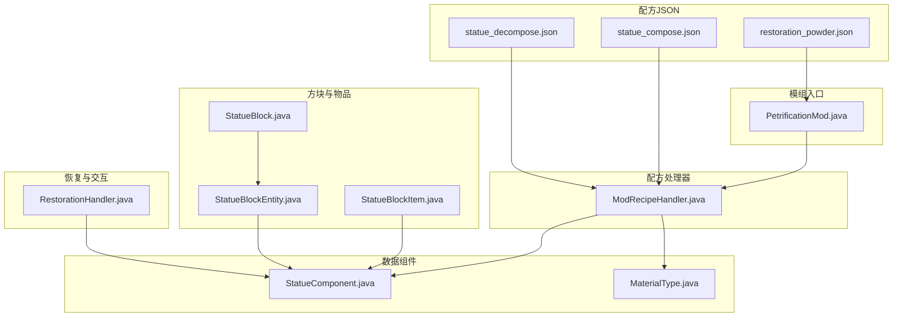
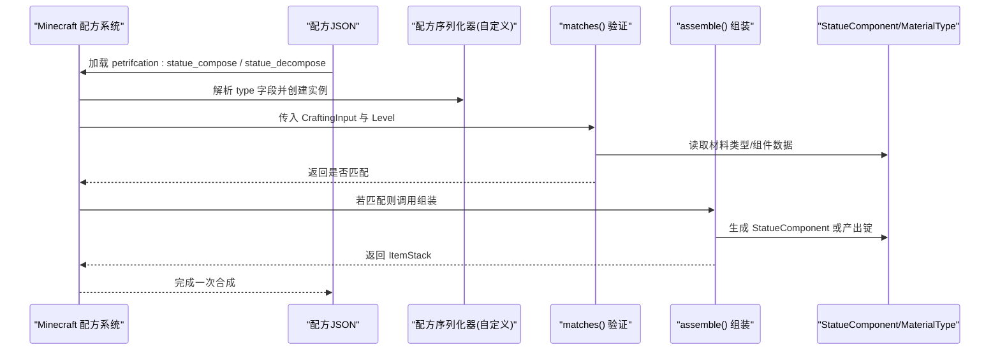
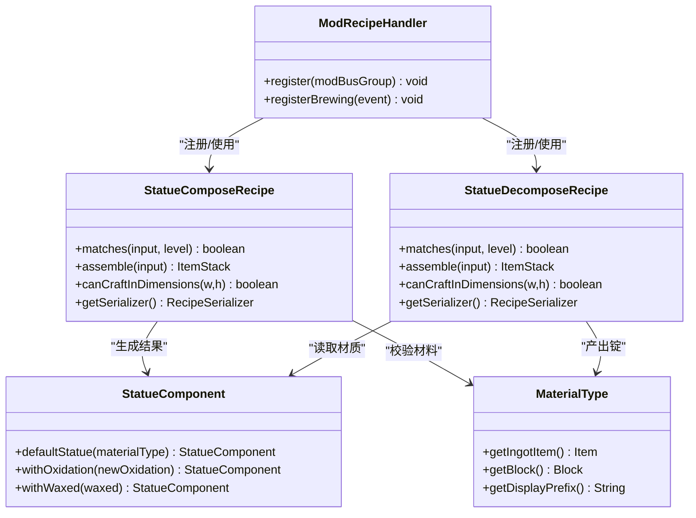
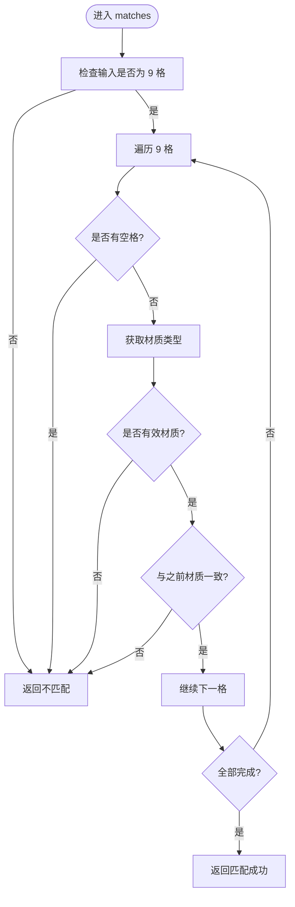
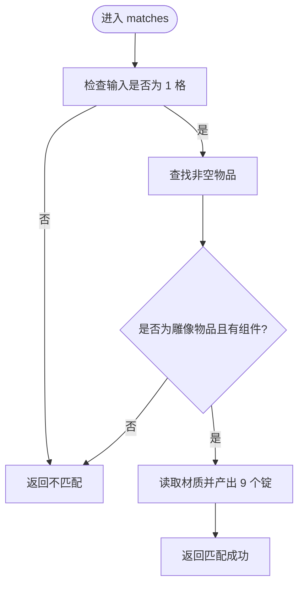
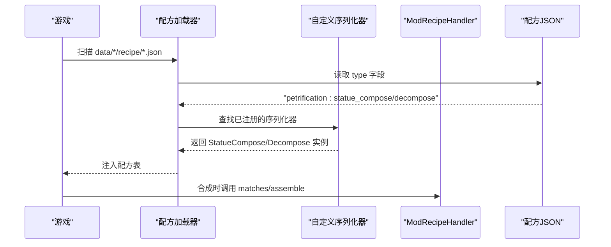
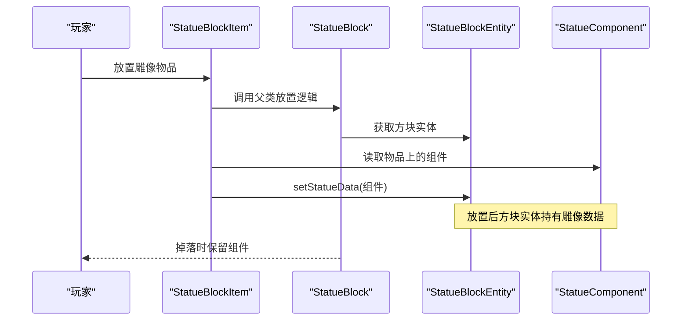
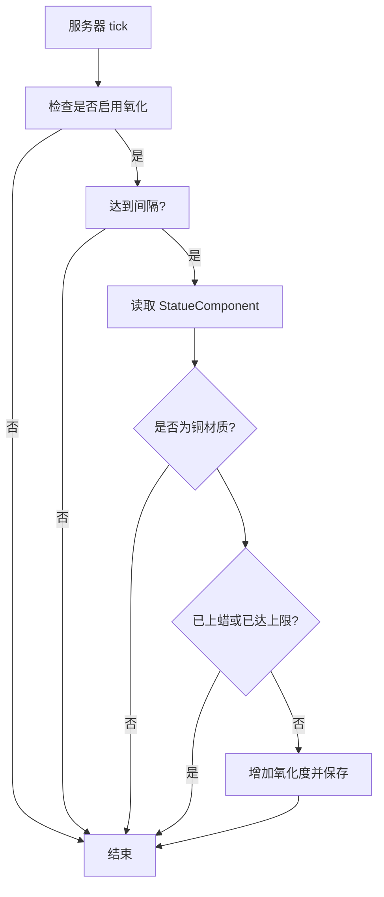
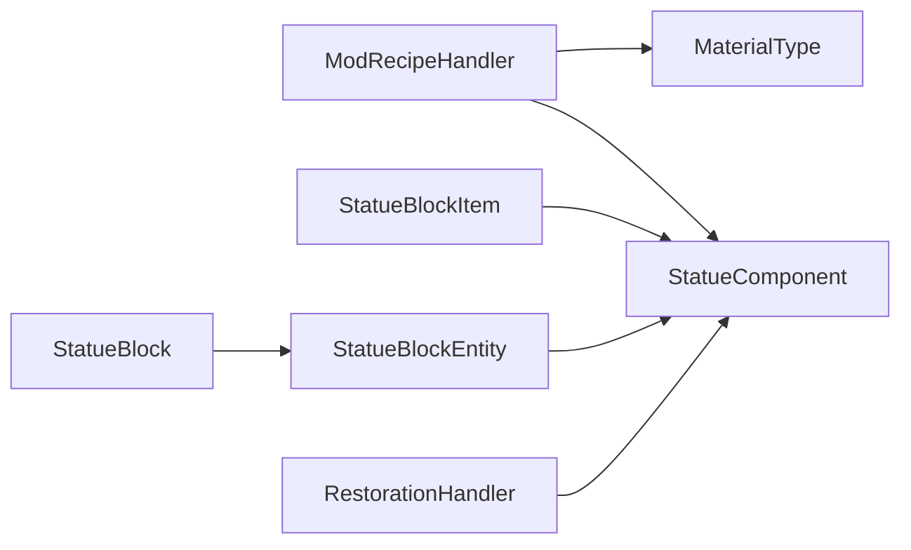

# 合成配方事件

<cite>
**本文引用的文件**
- [ModRecipeHandler.java](file://src/main/java/com/xiong/petrification/handler/ModRecipeHandler.java)
- [StatueBlock.java](file://src/main/java/com/xiong/petrification/block/StatueBlock.java)
- [StatueBlockItem.java](file://src/main/java/com/xiong/petrification/item/StatueBlockItem.java)
- [StatueComponent.java](file://src/main/java/com/xiong/petrification/component/StatueComponent.java)
- [MaterialType.java](file://src/main/java/com/xiong/petrification/component/MaterialType.java)
- [StatueBlockEntity.java](file://src/main/java/com/xiong/petrification/block/StatueBlockEntity.java)
- [RestorationHandler.java](file://src/main/java/com/xiong/petrification/handler/RestorationHandler.java)
- [PetrificationMod.java](file://src/main/java/com/xiong/petrification/PetrificationMod.java)
- [statue_compose.json](file://src/main/resources/data/petrification/recipe/statue_compose.json)
- [statue_decompose.json](file://src/main/resources/data/petrification/recipe/statue_decompose.json)
- [restoration_powder.json](file://src/main/resources/data/petrification/recipe/restoration_powder.json)
</cite>

## 目录
1. [简介](#简介)
2. [项目结构](#项目结构)
3. [核心组件](#核心组件)
4. [架构总览](#架构总览)
5. [详细组件分析](#详细组件分析)
6. [依赖关系分析](#依赖关系分析)
7. [性能考量](#性能考量)
8. [故障排查指南](#故障排查指南)
9. [结论](#结论)
10. [附录：自定义配方与调试](#附录：自定义配方与调试)

## 简介
本文件面向扩展“石化”模组的开发者，系统化说明该模组在合成配方事件处理方面的设计与实现。重点包括：
- 自定义合成配方的注册与处理机制（雕像合成、雕像分解）
- ModRecipeHandler 中的配方事件监听与拦截逻辑
- 配方验证、材料检查与结果生成流程
- 与 Minecraft 原生配方系统的集成方式（JSON 配方解析与执行）
- 自定义配方添加指南、冲突解决策略与性能优化建议
- 具体配方定义示例与调试方法

## 项目结构
围绕合成配方事件的核心代码分布在 handler、component、block、item 等包中；配方定义以 JSON 形式位于 resources/data/petrification/recipe。

图表来源
- [ModRecipeHandler.java:27-40](file://src/main/java/com/xiong/petrification/handler/ModRecipeHandler.java#L27-L40)
- [StatueComponent.java:14-52](file://src/main/java/com/xiong/petrification/component/StatueComponent.java#L14-L52)
- [MaterialType.java:9-15](file://src/main/java/com/xiong/petrification/component/MaterialType.java#L9-L15)
- [StatueBlock.java:38-101](file://src/main/java/com/xiong/petrification/block/StatueBlock.java#L38-L101)
- [StatueBlockItem.java:24-45](file://src/main/java/com/xiong/petrification/item/StatueBlockItem.java#L24-L45)
- [StatueBlockEntity.java:17-50](file://src/main/java/com/xiong/petrification/block/StatueBlockEntity.java#L17-L50)
- [RestorationHandler.java:31-53](file://src/main/java/com/xiong/petrification/handler/RestorationHandler.java#L31-L53)
- [PetrificationMod.java:27-46](file://src/main/java/com/xiong/petrification/PetrificationMod.java#L27-L46)
- [statue_compose.json:1-4](file://src/main/resources/data/petrification/recipe/statue_compose.json#L1-L4)
- [statue_decompose.json:1-4](file://src/main/resources/data/petrification/recipe/statue_decompose.json#L1-L4)
- [restoration_powder.json:1-18](file://src/main/resources/data/petrification/recipe/restoration_powder.json#L1-L18)

章节来源
- [PetrificationMod.java:27-46](file://src/main/java/com/xiong/petrification/PetrificationMod.java#L27-L46)

## 核心组件
- 自定义配方序列化器与监听器：ModRecipeHandler
  - 注册两个自定义配方类型：statue_compose（雕像合成）、statue_decompose（雕像分解）
  - 通过 @EventBusSubscriber(modid=..., bus=MOD) 订阅 MOD 总线事件
  - 同时注册酿造配方（将基础药水与不同金属锭混合为对应材质药水）
- 数据组件：StatueComponent、MaterialType
  - StatueComponent 记录雕像目标类型、实体信息、材质、氧化度、姿态、装备等大量状态
  - MaterialType 枚举定义了可合成的材质及其对应的锭与方块
- 方块与物品：StatueBlock、StatueBlockItem、StatueBlockEntity
  - 放置时根据物品携带的 StatueComponent 设置方块实体数据
  - 掉落时保留 StatueComponent 到掉落物
  - 服务器端定时更新铜雕像氧化度（受配置控制）
- 恢复与交互：RestorationHandler
  - 提供使用恢复粉末或蜂巢蜡对雕像进行恢复/上蜡的逻辑
  - 与事件处理器配合，拦截玩家右键行为并执行恢复/上蜡

章节来源
- [ModRecipeHandler.java:27-169](file://src/main/java/com/xiong/petrification/handler/ModRecipeHandler.java#L27-L169)
- [StatueComponent.java:14-256](file://src/main/java/com/xiong/petrification/component/StatueComponent.java#L14-L256)
- [MaterialType.java:9-68](file://src/main/java/com/xiong/petrification/component/MaterialType.java#L9-L68)
- [StatueBlock.java:38-153](file://src/main/java/com/xiong/petrification/block/StatueBlock.java#L38-L153)
- [StatueBlockItem.java:24-83](file://src/main/java/com/xiong/petrification/item/StatueBlockItem.java#L24-L83)
- [StatueBlockEntity.java:17-88](file://src/main/java/com/xiong/petrification/block/StatueBlockEntity.java#L17-L88)
- [RestorationHandler.java:31-229](file://src/main/java/com/xiong/petrification/handler/RestorationHandler.java#L31-L229)

## 架构总览
下图展示了从 JSON 配方到 Java 自定义配方的映射，以及合成过程中的匹配、组装与结果生成流程。

图表来源
- [statue_compose.json:1-4](file://src/main/resources/data/petrification/recipe/statue_compose.json#L1-L4)
- [statue_decompose.json:1-4](file://src/main/resources/data/petrification/recipe/statue_decompose.json#L1-L4)
- [ModRecipeHandler.java:61-169](file://src/main/java/com/xiong/petrification/handler/ModRecipeHandler.java#L61-L169)
- [StatueComponent.java:194-227](file://src/main/java/com/xiong/petrification/component/StatueComponent.java#L194-L227)
- [MaterialType.java:9-46](file://src/main/java/com/xiong/petrification/component/MaterialType.java#L9-L46)

## 详细组件分析

### 自定义配方注册与事件监听（ModRecipeHandler）
- 通过 DeferredRegister 注册两个 RecipeSerializer：
  - statue_decompose：用于将雕像分解为对应材质的锭
  - statue_compose：用于用 3x3 同材质锭合成雕像
- 同时订阅 BrewingRecipeRegisterEvent，将基础药水与各金属锭混合为对应材质药水
- 关键类：
  - StatueDecomposeRecipe：匹配单个含 StatueComponent 的雕像物品，输出 9 个对应材质锭
  - StatueComposeRecipe：匹配 3x3 全满且材质一致的锭，输出带 StatueComponent 的雕像物品

图表来源
- [ModRecipeHandler.java:27-40](file://src/main/java/com/xiong/petrification/handler/ModRecipeHandler.java#L27-L40)
- [ModRecipeHandler.java:61-169](file://src/main/java/com/xiong/petrification/handler/ModRecipeHandler.java#L61-L169)
- [MaterialType.java:9-46](file://src/main/java/com/xiong/petrification/component/MaterialType.java#L9-L46)
- [StatueComponent.java:194-227](file://src/main/java/com/xiong/petrification/component/StatueComponent.java#L194-L227)

章节来源
- [ModRecipeHandler.java:27-169](file://src/main/java/com/xiong/petrification/handler/ModRecipeHandler.java#L27-L169)

### 雕像合成（StatueComposeRecipe）
- 匹配规则：
  - 必须为 3x3 网格，共 9 格，全部非空
  - 所有格子必须是同一 MaterialType 对应的锭
- 组装过程：
  - 提取任意一格的材质类型
  - 生成一个雕像物品，并设置 StatueComponent.defaultStatue(type)
- 尺寸限制：
  - canCraftInDimensions 要求至少 3x3

图表来源
- [ModRecipeHandler.java:109-131](file://src/main/java/com/xiong/petrification/handler/ModRecipeHandler.java#L109-L131)
- [MaterialType.java:9-46](file://src/main/java/com/xiong/petrification/component/MaterialType.java#L9-L46)

章节来源
- [ModRecipeHandler.java:103-169](file://src/main/java/com/xiong/petrification/handler/ModRecipeHandler.java#L103-L169)

### 雕像分解（StatueDecomposeRecipe）
- 匹配规则：
  - 仅允许 1 格输入
  - 该物品必须是雕像物品且包含 StatueComponent
- 组装过程：
  - 读取 StatueComponent.materialType()
  - 产出 9 个对应材质的锭
- 尺寸限制：
  - canCraftInDimensions 允许 1x1

图表来源
- [ModRecipeHandler.java:67-91](file://src/main/java/com/xiong/petrification/handler/ModRecipeHandler.java#L67-L91)

章节来源
- [ModRecipeHandler.java:61-101](file://src/main/java/com/xiong/petrification/handler/ModRecipeHandler.java#L61-L101)

### 与 Minecraft 原生配方系统集成
- JSON 配方：
  - statue_compose.json：type 指向 petrification:statue_compose
  - statue_decompose.json：type 指向 petrification:statue_decompose
  - restoration_powder.json：标准 crafting_shaped 配方
- 集成流程：
  - 游戏启动时由 ModRecipeHandler.register 注册自定义 RecipeSerializer
  - 加载 JSON 时，Minecraft 根据 type 字段找到对应序列化器并构造实例
  - 合成时调用 matches/assemble 完成验证与结果生成

图表来源
- [statue_compose.json:1-4](file://src/main/resources/data/petrification/recipe/statue_compose.json#L1-L4)
- [statue_decompose.json:1-4](file://src/main/resources/data/petrification/recipe/statue_decompose.json#L1-L4)
- [restoration_powder.json:1-18](file://src/main/resources/data/petrification/recipe/restoration_powder.json#L1-L18)
- [ModRecipeHandler.java:27-40](file://src/main/java/com/xiong/petrification/handler/ModRecipeHandler.java#L27-L40)

章节来源
- [statue_compose.json:1-4](file://src/main/resources/data/petrification/recipe/statue_compose.json#L1-L4)
- [statue_decompose.json:1-4](file://src/main/resources/data/petrification/recipe/statue_decompose.json#L1-L4)
- [restoration_powder.json:1-18](file://src/main/resources/data/petrification/recipe/restoration_powder.json#L1-L18)
- [ModRecipeHandler.java:27-40](file://src/main/java/com/xiong/petrification/handler/ModRecipeHandler.java#L27-L40)

### 雕像方块与物品协作
- 放置雕像物品时：
  - StatueBlockItem.updateCustomBlockEntityTag 将 StatueComponent 写入方块实体
  - 若无组件则默认设置为石质雕像
- 掉落时：
  - StatueBlock.getDrops 从方块实体取出 StatueComponent 并写入掉落物
- 客户端提示：
  - StatueBlockItem.appendHoverText 显示材质、氧化度、实体类型等信息

图表来源
- [StatueBlockItem.java:29-45](file://src/main/java/com/xiong/petrification/item/StatueBlockItem.java#L29-L45)
- [StatueBlock.java:123-135](file://src/main/java/com/xiong/petrification/block/StatueBlock.java#L123-L135)
- [StatueBlockEntity.java:52-60](file://src/main/java/com/xiong/petrification/block/StatueBlockEntity.java#L52-L60)

章节来源
- [StatueBlockItem.java:24-83](file://src/main/java/com/xiong/petrification/item/StatueBlockItem.java#L24-L83)
- [StatueBlock.java:38-153](file://src/main/java/com/xiong/petrification/block/StatueBlock.java#L38-L153)
- [StatueBlockEntity.java:17-88](file://src/main/java/com/xiong/petrification/block/StatueBlockEntity.java#L17-L88)

### 铜雕像氧化与交互
- 服务器端每固定 tick 增加铜雕像氧化度（受配置开关与上限控制）
- 使用蜂巢蜡可对铜雕像上蜡，阻止进一步氧化
- 使用恢复粉末可将雕像恢复为实体或玩家

图表来源
- [StatueBlockEntity.java:28-50](file://src/main/java/com/xiong/petrification/block/StatueBlockEntity.java#L28-L50)
- [RestorationHandler.java:184-207](file://src/main/java/com/xiong/petrification/handler/RestorationHandler.java#L184-L207)

章节来源
- [StatueBlockEntity.java:17-88](file://src/main/java/com/xiong/petrification/block/StatueBlockEntity.java#L17-L88)
- [RestorationHandler.java:184-229](file://src/main/java/com/xiong/petrification/handler/RestorationHandler.java#L184-L229)

## 依赖关系分析
- 低耦合高内聚：
  - 配方逻辑集中在 ModRecipeHandler，避免分散
  - 数据模型集中在 StatueComponent，便于序列化与持久化
- 外部依赖：
  - 依赖 Minecraft 配方系统与 Forge 事件总线
  - 依赖配置项控制氧化等行为
- 潜在循环依赖：
  - 当前未发现直接循环依赖；StatueComponent 被多处引用但无反向强依赖

图表来源
- [ModRecipeHandler.java:27-169](file://src/main/java/com/xiong/petrification/handler/ModRecipeHandler.java#L27-L169)
- [StatueComponent.java:14-256](file://src/main/java/com/xiong/petrification/component/StatueComponent.java#L14-L256)
- [MaterialType.java:9-68](file://src/main/java/com/xiong/petrification/component/MaterialType.java#L9-L68)
- [StatueBlockItem.java:24-83](file://src/main/java/com/xiong/petrification/item/StatueBlockItem.java#L24-L83)
- [StatueBlock.java:38-153](file://src/main/java/com/xiong/petrification/block/StatueBlock.java#L38-L153)
- [StatueBlockEntity.java:17-88](file://src/main/java/com/xiong/petrification/block/StatueBlockEntity.java#L17-L88)
- [RestorationHandler.java:31-229](file://src/main/java/com/xiong/petrification/handler/RestorationHandler.java#L31-L229)

章节来源
- [ModRecipeHandler.java:27-169](file://src/main/java/com/xiong/petrification/handler/ModRecipeHandler.java#L27-L169)
- [StatueComponent.java:14-256](file://src/main/java/com/xiong/petrification/component/StatueComponent.java#L14-L256)
- [MaterialType.java:9-68](file://src/main/java/com/xiong/petrification/component/MaterialType.java#L9-L68)
- [StatueBlockItem.java:24-83](file://src/main/java/com/xiong/petrification/item/StatueBlockItem.java#L24-L83)
- [StatueBlock.java:38-153](file://src/main/java/com/xiong/petrification/block/StatueBlock.java#L38-L153)
- [StatueBlockEntity.java:17-88](file://src/main/java/com/xiong/petrification/block/StatueBlockEntity.java#L17-L88)
- [RestorationHandler.java:31-229](file://src/main/java/com/xiong/petrification/handler/RestorationHandler.java#L31-L229)

## 性能考量
- 配方匹配复杂度：
  - 雕像合成：固定 9 格遍历，时间复杂度 O(1)，空间 O(1)
  - 雕像分解：单格检查，时间复杂度 O(1)
- 服务器开销：
  - 铜雕像氧化按固定 tick 间隔计算，避免每 tick 频繁运算
  - 仅在服务器端执行氧化逻辑，客户端跳过
- 建议：
  - 保持配方匹配逻辑简洁，避免复杂 NBT 或网络请求
  - 批量操作时注意减少重复计算（如多次查询 MaterialType）
  - 合理设置氧化间隔与速率，避免过多方块实体频繁更新

[本节为通用性能指导，无需特定文件来源]

## 故障排查指南
- 合成不生效
  - 确认 JSON 的 type 字段正确指向自定义序列化器
  - 检查配方网格是否符合 matches 的尺寸与内容要求
  - 查看日志中是否有序列化器未注册或配方加载失败
- 雕像分解无效
  - 确保输入物品为雕像物品且包含 StatueComponent
  - 检查 StatueComponent.materialType 是否正确设置
- 合成结果异常
  - 核对 assemble 中 StatueComponent 的生成逻辑
  - 确认 MaterialType 与物品映射关系正确
- 铜雕像氧化问题
  - 检查配置是否启用氧化、最大氧化度与速率
  - 确认方块实体是否在服务器端运行 tick
- 交互恢复失败
  - 检查玩家是否持有恢复粉末或蜂巢蜡
  - 确认目标位置存在雕像方块实体且包含有效组件

章节来源
- [ModRecipeHandler.java:61-169](file://src/main/java/com/xiong/petrification/handler/ModRecipeHandler.java#L61-L169)
- [StatueBlockEntity.java:28-50](file://src/main/java/com/xiong/petrification/block/StatueBlockEntity.java#L28-L50)
- [RestorationHandler.java:209-229](file://src/main/java/com/xiong/petrification/handler/RestorationHandler.java#L209-L229)

## 结论
本模组通过自定义配方序列化器与事件监听，实现了雕像的合成与分解，并与 Minecraft 原生配方系统无缝集成。StatueComponent 作为核心数据载体，贯穿配方、方块、物品与恢复逻辑，保证了数据的一致性与可序列化性。通过合理的匹配与组装逻辑、配置驱动的氧化机制以及与事件的协作，系统在功能完整性与性能之间取得平衡。开发者可基于此框架扩展更多材质、配方与交互行为。

[本节为总结性内容，无需特定文件来源]

## 附录：自定义配方与调试

### 添加自定义配方步骤
- 定义新的 RecipeSerializer（参考 StatueCompose/Decompose 的实现模式）
- 在 ModRecipeHandler 中通过 DeferredRegister 注册序列化器
- 在 resources/data/petrification/recipe 下新增 JSON 文件，指定 type 为新序列化器
- 在 matches 中实现材料检查与尺寸限制
- 在 assemble 中生成结果（可为物品、附魔、NBT 等）
- 测试合成并在服务端/客户端验证结果

章节来源
- [ModRecipeHandler.java:27-40](file://src/main/java/com/xiong/petrification/handler/ModRecipeHandler.java#L27-L40)
- [statue_compose.json:1-4](file://src/main/resources/data/petrification/recipe/statue_compose.json#L1-L4)
- [statue_decompose.json:1-4](file://src/main/resources/data/petrification/recipe/statue_decompose.json#L1-L4)

### 配方冲突解决策略
- 优先顺序：
  - 自定义配方与原生配方共存时，确保 matches 条件足够严格以避免误匹配
- 命名空间隔离：
  - 使用独立的命名空间（如 petrification）避免与其他模组冲突
- 资源覆盖：
  - 如需覆盖默认配方，确保资源包优先级正确
- 调试技巧：
  - 打印匹配的输入与期望输出
  - 使用 F3+H 显示高级调试信息，观察合成台输入与结果

章节来源
- [ModRecipeHandler.java:61-169](file://src/main/java/com/xiong/petrification/handler/ModRecipeHandler.java#L61-L169)

### 调试方法
- 日志输出：
  - 在 matches/assemble 中加入关键路径日志，定位失败点
- 可视化提示：
  - 利用 StatueBlockItem 的 tooltip 显示组件信息，辅助调试
- 服务器端检查：
  - 确认方块实体是否存在并包含正确的 StatueComponent
- 配方加载检查：
  - 确认 JSON 文件语法正确，type 字段与序列化器一致

章节来源
- [StatueBlockItem.java:47-72](file://src/main/java/com/xiong/petrification/item/StatueBlockItem.java#L47-L72)
- [StatueBlockEntity.java:52-74](file://src/main/java/com/xiong/petrification/block/StatueBlockEntity.java#L52-L74)
- [ModRecipeHandler.java:61-169](file://src/main/java/com/xiong/petrification/handler/ModRecipeHandler.java#L61-L169)