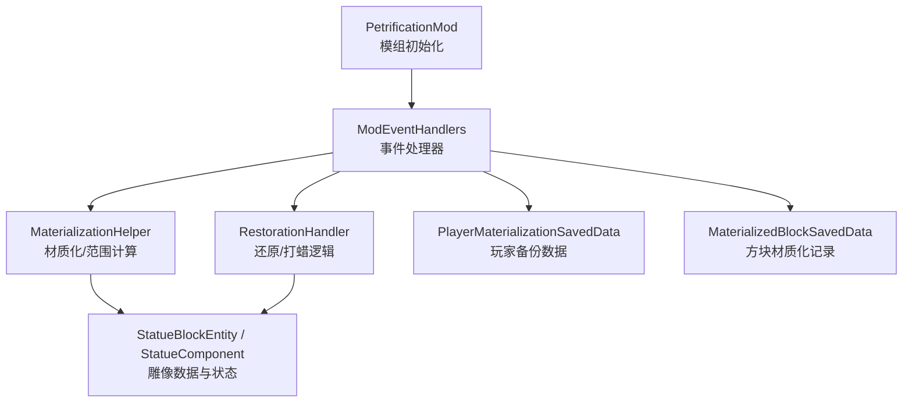
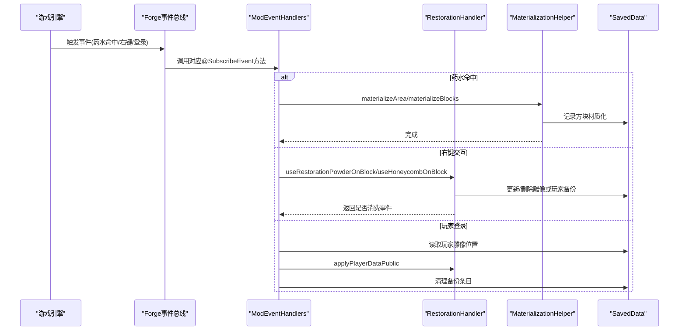
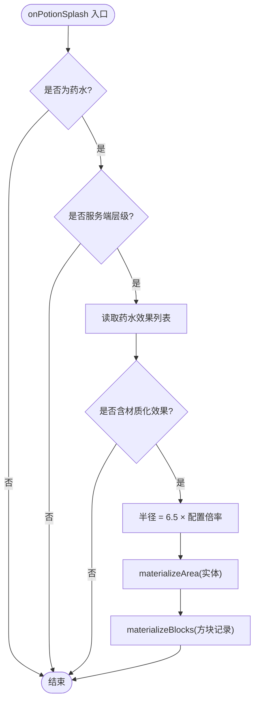
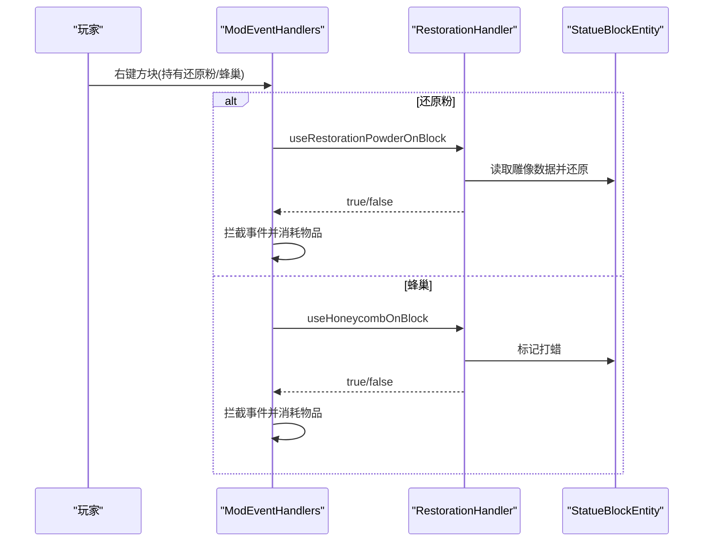
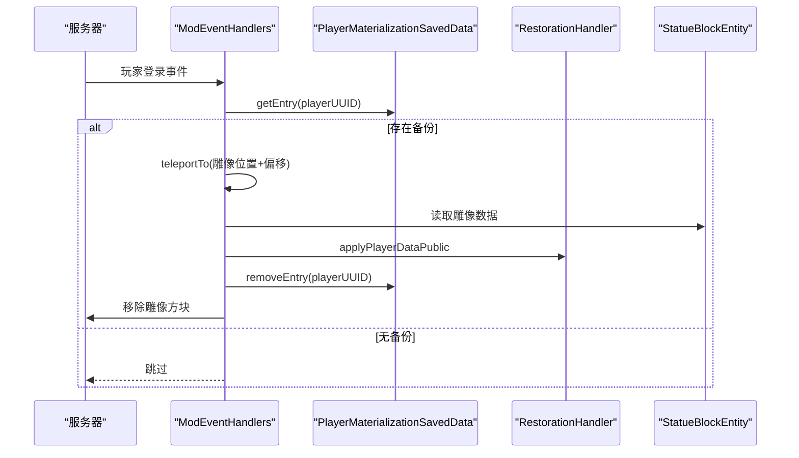
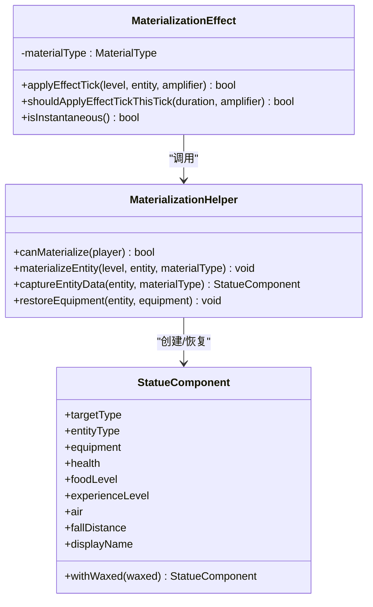
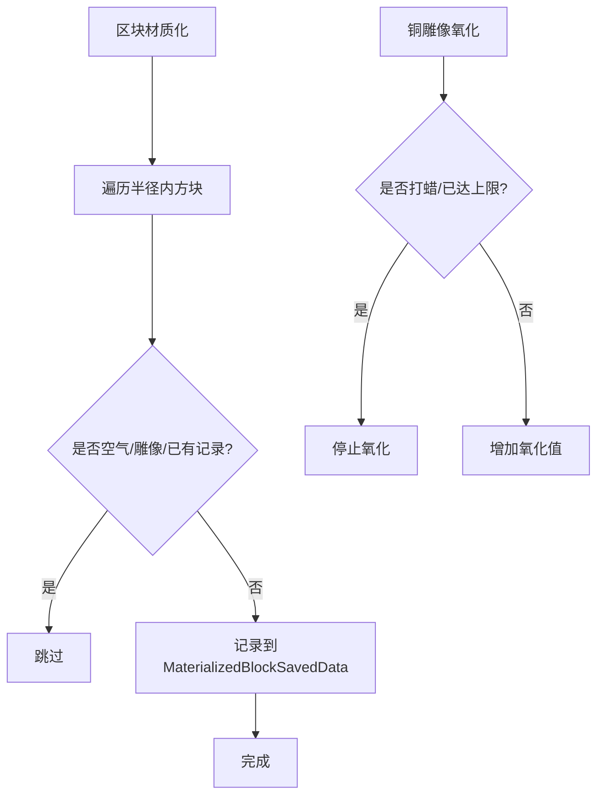
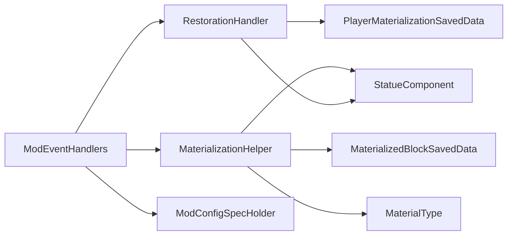

# 游戏事件处理

<cite>
**本文引用的文件**
- [ModEventHandlers.java](file://src/main/java/com/xiong/petrification/handler/ModEventHandlers.java)
- [PetrificationMod.java](file://src/main/java/com/xiong/petrification/PetrificationMod.java)
- [RestorationHandler.java](file://src/main/java/com/xiong/petrification/handler/RestorationHandler.java)
- [MaterializationHelper.java](file://src/main/java/com/xiong/petrification/util/MaterializationHelper.java)
- [StatueBlockEntity.java](file://src/main/java/com/xiong/petrification/block/StatueBlockEntity.java)
- [PlayerMaterializationSavedData.java](file://src/main/java/com/xiong/petrification/data/PlayerMaterializationSavedData.java)
- [MaterializedBlockSavedData.java](file://src/main/java/com/xiong/petrification/data/MaterializedBlockSavedData.java)
- [StatueComponent.java](file://src/main/java/com/xiong/petrification/component/StatueComponent.java)
- [MaterialType.java](file://src/main/java/com/xiong/petrification/component/MaterialType.java)
- [ModConfigSpecHolder.java](file://src/main/java/com/xiong/petrification/ModConfigSpecHolder.java)
</cite>

## 目录
1. [简介](#简介)
2. [项目结构](#项目结构)
3. [核心组件](#核心组件)
4. [架构总览](#架构总览)
5. [详细组件分析](#详细组件分析)
6. [依赖关系分析](#依赖关系分析)
7. [性能考虑](#性能考虑)
8. [故障排查指南](#故障排查指南)
9. [结论](#结论)
10. [附录](#附录)

## 简介
本文件为“石化”模组的游戏事件处理系统提供系统化文档，聚焦于基于Forge事件总线的响应式编程架构。重点解析 ModEventHandlers 中的核心事件处理器，包括：
- 药水命中事件（ProjectileImpactEvent）：药水投掷检测、材质化效果应用与范围计算机制
- 玩家交互事件（PlayerInteractEvent.RightClickBlock）：还原粉使用、打蜡操作与事件拦截
- 玩家登录事件（PlayerLoggedInEvent）：雕像位置同步与数据清理
同时提供事件优先级设置、异步处理策略、错误处理最佳实践，以及调试技巧与监听器实现示例路径。

## 项目结构
该模组采用按功能分层组织：
- 事件总线与处理器：handler/ModEventHandlers.java
- 业务逻辑与工具：handler/RestorationHandler.java, util/MaterializationHelper.java
- 持久化数据：data/PlayerMaterializationSavedData.java, data/MaterializedBlockSavedData.java
- 块与实体：block/StatueBlock.java, block/StatueBlockEntity.java
- 组件与类型：component/StatueComponent.java, component/MaterialType.java
- 配置：ModConfigSpecHolder.java
- 模组入口与注册：PetrificationMod.java

图表来源
- [PetrificationMod.java:27-46](file://src/main/java/com/xiong/petrification/PetrificationMod.java#L27-L46)
- [ModEventHandlers.java:30-119](file://src/main/java/com/xiong/petrification/handler/ModEventHandlers.java#L30-L119)
- [RestorationHandler.java:31-229](file://src/main/java/com/xiong/petrification/handler/RestorationHandler.java#L31-L229)
- [MaterializationHelper.java:33-263](file://src/main/java/com/xiong/petrification/util/MaterializationHelper.java#L33-L263)
- [PlayerMaterializationSavedData.java:22-95](file://src/main/java/com/xiong/petrification/data/PlayerMaterializationSavedData.java#L22-L95)
- [MaterializedBlockSavedData.java:19-86](file://src/main/java/com/xiong/petrification/data/MaterializedBlockSavedData.java#L19-L86)
- [StatueBlockEntity.java:17-88](file://src/main/java/com/xiong/petrification/block/StatueBlockEntity.java#L17-L88)
- [StatueComponent.java:14-256](file://src/main/java/com/xiong/petrification/component/StatueComponent.java#L14-L256)

章节来源
- [PetrificationMod.java:27-46](file://src/main/java/com/xiong/petrification/PetrificationMod.java#L27-L46)
- [ModEventHandlers.java:30-119](file://src/main/java/com/xiong/petrification/handler/ModEventHandlers.java#L30-L119)

## 核心组件
- 事件总线与处理器：通过 @Mod.EventBusSubscriber 自动注册静态事件方法，集中处理游戏事件。
- 材质化工具：负责实体/区域材质化、数据捕获、保存与恢复。
- 还原处理器：处理还原粉对雕像的还原、在线/离线玩家恢复、生物雕像生成与打蜡。
- 持久化数据：存储离线玩家雕像位置与雕像方块材质化信息，支持跨会话恢复。
- 配置：控制药水范围倍率、氧化速率、渲染距离等。

章节来源
- [ModEventHandlers.java:30-119](file://src/main/java/com/xiong/petrification/handler/ModEventHandlers.java#L30-L119)
- [MaterializationHelper.java:33-263](file://src/main/java/com/xiong/petrification/util/MaterializationHelper.java#L33-L263)
- [RestorationHandler.java:31-229](file://src/main/java/com/xiong/petrification/handler/RestorationHandler.java#L31-L229)
- [PlayerMaterializationSavedData.java:22-95](file://src/main/java/com/xiong/petrification/data/PlayerMaterializationSavedData.java#L22-L95)
- [MaterializedBlockSavedData.java:19-86](file://src/main/java/com/xiong/petrification/data/MaterializedBlockSavedData.java#L19-L86)
- [ModConfigSpecHolder.java:8-69](file://src/main/java/com/xiong/petrification/ModConfigSpecHolder.java#L8-L69)

## 架构总览
基于Forge事件总线的响应式架构：
- 事件触发：Forge引擎在特定游戏行为发生时派发事件（如药水落地、玩家右键、玩家登录）。
- 事件监听：ModEventHandlers 中静态方法以 @SubscribeEvent 注解监听事件。
- 业务分发：事件处理器调用 RestorationHandler 与 MaterializationHelper 完成具体逻辑。
- 数据持久化：通过 SavedData 将关键状态写入世界存档，保证重启后一致性。
- 配置驱动：通过 ModConfigSpecHolder 暴露可配置参数，影响事件行为（如药水范围）。

图表来源
- [ModEventHandlers.java:38-119](file://src/main/java/com/xiong/petrification/handler/ModEventHandlers.java#L38-L119)
- [RestorationHandler.java:31-229](file://src/main/java/com/xiong/petrification/handler/RestorationHandler.java#L31-L229)
- [MaterializationHelper.java:55-96](file://src/main/java/com/xiong/petrification/util/MaterializationHelper.java#L55-L96)
- [PlayerMaterializationSavedData.java:70-95](file://src/main/java/com/xiong/petrification/data/PlayerMaterializationSavedData.java#L70-L95)
- [MaterializedBlockSavedData.java:61-86](file://src/main/java/com/xiong/petrification/data/MaterializedBlockSavedData.java#L61-L86)

## 详细组件分析

### 药水命中事件（ProjectileImpactEvent）处理逻辑
- 触发条件：抛射物落地时，检查是否为药水且处于服务端层级。
- 药水检测：从药水物品获取附魔效果列表，识别是否包含材质化效果。
- 范围计算：基础半径乘以配置倍率，分别执行区域实体材质化与方块材质化记录。
- 效果应用：调用 MaterializationHelper.materializeArea 与 materializeBlocks，前者对范围内实体逐一材质化，后者记录方块原始信息以便后续恢复。

图表来源
- [ModEventHandlers.java:45-63](file://src/main/java/com/xiong/petrification/handler/ModEventHandlers.java#L45-L63)
- [MaterializationHelper.java:83-96](file://src/main/java/com/xiong/petrification/util/MaterializationHelper.java#L83-L96)
- [MaterializationHelper.java:234-255](file://src/main/java/com/xiong/petrification/util/MaterializationHelper.java#L234-L255)
- [ModConfigSpecHolder.java:12-14](file://src/main/java/com/xiong/petrification/ModConfigSpecHolder.java#L12-L14)

章节来源
- [ModEventHandlers.java:45-63](file://src/main/java/com/xiong/petrification/handler/ModEventHandlers.java#L45-L63)
- [MaterializationHelper.java:83-96](file://src/main/java/com/xiong/petrification/util/MaterializationHelper.java#L83-L96)
- [MaterializationHelper.java:234-255](file://src/main/java/com/xiong/petrification/util/MaterializationHelper.java#L234-L255)
- [ModConfigSpecHolder.java:12-14](file://src/main/java/com/xiong/petrification/ModConfigSpecHolder.java#L12-L14)

### 玩家交互事件（PlayerInteractEvent.RightClickBlock）实现
- 还原粉使用：当手持还原粉右键方块时，尝试对雕像进行还原；成功则拦截事件并消耗物品。
- 打蜡操作：当手持蜂巢右键铜质雕像时，标记为已打蜡并播放音效；成功则拦截事件并消耗物品。
- 事件拦截：通过 setUseBlock(Result.DENY)、setUseItem(Result.DENY) 与 setCancellationResult(CONSUME) 阻止默认行为。

图表来源
- [ModEventHandlers.java:65-84](file://src/main/java/com/xiong/petrification/handler/ModEventHandlers.java#L65-L84)
- [RestorationHandler.java:209-227](file://src/main/java/com/xiong/petrification/handler/RestorationHandler.java#L209-L227)
- [RestorationHandler.java:184-197](file://src/main/java/com/xiong/petrification/handler/RestorationHandler.java#L184-L197)

章节来源
- [ModEventHandlers.java:65-84](file://src/main/java/com/xiong/petrification/handler/ModEventHandlers.java#L65-L84)
- [RestorationHandler.java:184-227](file://src/main/java/com/xiong/petrification/handler/RestorationHandler.java#L184-L227)

### 玩家登录事件（PlayerLoggedInEvent）数据恢复流程
- 触发时机：玩家进入服务器后。
- 数据恢复：从 PlayerMaterializationSavedData 读取该玩家的雕像位置与雕像数据。
- 同步与清理：将玩家传送到雕像位置附近，应用雕像数据到玩家，并清除雕像方块与备份条目。

图表来源
- [ModEventHandlers.java:86-107](file://src/main/java/com/xiong/petrification/handler/ModEventHandlers.java#L86-L107)
- [PlayerMaterializationSavedData.java:70-95](file://src/main/java/com/xiong/petrification/data/PlayerMaterializationSavedData.java#L70-L95)
- [RestorationHandler.java:169-182](file://src/main/java/com/xiong/petrification/handler/RestorationHandler.java#L169-L182)

章节来源
- [ModEventHandlers.java:86-107](file://src/main/java/com/xiong/petrification/handler/ModEventHandlers.java#L86-L107)
- [PlayerMaterializationSavedData.java:70-95](file://src/main/java/com/xiong/petrification/data/PlayerMaterializationSavedData.java#L70-L95)
- [RestorationHandler.java:169-182](file://src/main/java/com/xiong/petrification/handler/RestorationHandler.java#L169-L182)

### 材质化效果与实体材质化
- 效果应用：MaterializationEffect 在生效时调用 MaterializationHelper.materializeEntity 将实体转化为雕像。
- 权限控制：根据配置允许/禁止创造模式或OP玩家材质化。
- 数据捕获：StatueComponent 完整记录实体姿态、装备、血量、经验等，用于后续恢复。

图表来源
- [MaterializationEffect.java:10-38](file://src/main/java/com/xiong/petrification/effect/MaterializationEffect.java#L10-L38)
- [MaterializationHelper.java:36-81](file://src/main/java/com/xiong/petrification/util/MaterializationHelper.java#L36-L81)
- [StatueComponent.java:14-256](file://src/main/java/com/xiong/petrification/component/StatueComponent.java#L14-L256)

章节来源
- [MaterializationEffect.java:10-38](file://src/main/java/com/xiong/petrification/effect/MaterializationEffect.java#L10-L38)
- [MaterializationHelper.java:36-81](file://src/main/java/com/xiong/petrification/util/MaterializationHelper.java#L36-L81)
- [StatueComponent.java:14-256](file://src/main/java/com/xiong/petrification/component/StatueComponent.java#L14-L256)

### 方块材质化与氧化机制
- 方块材质化记录：MaterializationHelper.materializeBlocks 遍历半径内方块，记录原始方块ID、材质类型、时间戳等信息至 MaterializedBlockSavedData。
- 氧化机制：StatueBlockEntity.serverTick 周期性增加铜雕像氧化值，受配置限制并可被蜂巢打蜡停止。

图表来源
- [MaterializationHelper.java:234-255](file://src/main/java/com/xiong/petrification/util/MaterializationHelper.java#L234-L255)
- [StatueBlockEntity.java:28-50](file://src/main/java/com/xiong/petrification/block/StatueBlockEntity.java#L28-L50)
- [MaterializedBlockSavedData.java:68-80](file://src/main/java/com/xiong/petrification/data/MaterializedBlockSavedData.java#L68-L80)
- [ModConfigSpecHolder.java:28-38](file://src/main/java/com/xiong/petrification/ModConfigSpecHolder.java#L28-L38)

章节来源
- [MaterializationHelper.java:234-255](file://src/main/java/com/xiong/petrification/util/MaterializationHelper.java#L234-L255)
- [StatueBlockEntity.java:28-50](file://src/main/java/com/xiong/petrification/block/StatueBlockEntity.java#L28-L50)
- [MaterializedBlockSavedData.java:68-80](file://src/main/java/com/xiong/petrification/data/MaterializedBlockSavedData.java#L68-L80)
- [ModConfigSpecHolder.java:28-38](file://src/main/java/com/xiong/petrification/ModConfigSpecHolder.java#L28-L38)

## 依赖关系分析
- 事件处理器依赖：
  - RestorationHandler：处理还原与打蜡的业务逻辑
  - MaterializationHelper：材质化与范围计算
  - SavedData：持久化玩家与方块材质化数据
- 组件依赖：
  - StatueComponent：承载雕像数据，被多处读写
  - MaterialType：定义材质类型与显示前缀
- 配置依赖：
  - ModConfigSpecHolder：提供药水范围、氧化速率、渲染距离等

图表来源
- [ModEventHandlers.java:30-119](file://src/main/java/com/xiong/petrification/handler/ModEventHandlers.java#L30-L119)
- [RestorationHandler.java:31-229](file://src/main/java/com/xiong/petrification/handler/RestorationHandler.java#L31-L229)
- [MaterializationHelper.java:33-263](file://src/main/java/com/xiong/petrification/util/MaterializationHelper.java#L33-L263)
- [PlayerMaterializationSavedData.java:22-95](file://src/main/java/com/xiong/petrification/data/PlayerMaterializationSavedData.java#L22-L95)
- [MaterializedBlockSavedData.java:19-86](file://src/main/java/com/xiong/petrification/data/MaterializedBlockSavedData.java#L19-L86)
- [StatueComponent.java:14-256](file://src/main/java/com/xiong/petrification/component/StatueComponent.java#L14-L256)
- [MaterialType.java:9-68](file://src/main/java/com/xiong/petrification/component/MaterialType.java#L9-L68)
- [ModConfigSpecHolder.java:8-69](file://src/main/java/com/xiong/petrification/ModConfigSpecHolder.java#L8-L69)

章节来源
- [ModEventHandlers.java:30-119](file://src/main/java/com/xiong/petrification/handler/ModEventHandlers.java#L30-L119)
- [RestorationHandler.java:31-229](file://src/main/java/com/xiong/petrification/handler/RestorationHandler.java#L31-L229)
- [MaterializationHelper.java:33-263](file://src/main/java/com/xiong/petrification/util/MaterializationHelper.java#L33-L263)

## 性能考虑
- 事件优先级：当前未显式设置优先级，若需调整可在事件监听器上指定优先级以减少冲突或优化顺序。
- 异步处理：事件通常在主线程调度，避免阻塞；复杂计算应拆分或使用任务队列。
- 范围计算：药水命中时的区域扫描与实体排序可能带来开销，建议合理设置半径与配置倍率。
- 数据持久化：SavedData 变更频繁时应尽量减少写入次数，批量更新后再标记脏数据。
- 渲染距离：可通过配置降低雕像渲染距离以提升性能。

[本节为通用指导，不直接分析具体文件]

## 故障排查指南
- 药水未触发材质化：
  - 检查是否为服务端层级与药水类型
  - 确认药水效果列表包含材质化效果
  - 查看配置倍率是否过小导致范围不足
- 还原粉无效：
  - 确认目标方块为雕像且包含有效雕像数据
  - 检查玩家是否在正确层级与服务端执行
- 打蜡失败：
  - 确认雕像材质类型为铜且未被打蜡
  - 检查是否在服务端执行
- 登录未恢复：
  - 检查 PlayerMaterializationSavedData 是否存在该玩家条目
  - 确认雕像方块存在且数据可读
- 日志与调试：
  - 在关键分支添加日志输出（如范围计算、数据读写）
  - 使用调试客户端观察事件触发与返回值

章节来源
- [ModEventHandlers.java:45-119](file://src/main/java/com/xiong/petrification/handler/ModEventHandlers.java#L45-L119)
- [RestorationHandler.java:31-229](file://src/main/java/com/xiong/petrification/handler/RestorationHandler.java#L31-L229)
- [MaterializationHelper.java:33-263](file://src/main/java/com/xiong/petrification/util/MaterializationHelper.java#L33-L263)
- [PlayerMaterializationSavedData.java:70-95](file://src/main/java/com/xiong/petrification/data/PlayerMaterializationSavedData.java#L70-L95)

## 结论
本模组通过Forge事件总线实现了响应式的事件处理架构，围绕 ModEventHandlers 集中管理药水命中、玩家交互与登录事件。借助 RestorationHandler 与 MaterializationHelper 完成复杂的材质化与还原逻辑，并通过 SavedData 保障数据一致性。配合 ModConfigSpecHolder 的可配置项，系统具备良好的扩展性与调优空间。建议在开发中关注事件优先级、异步策略与错误处理，以提升稳定性与性能。

[本节为总结，不直接分析具体文件]

## 附录

### 事件监听器实现示例（路径引用）
- 药水命中事件监听器：[ModEventHandlers.java:45-63](file://src/main/java/com/xiong/petrification/handler/ModEventHandlers.java#L45-L63)
- 玩家右键事件监听器：[ModEventHandlers.java:65-84](file://src/main/java/com/xiong/petrification/handler/ModEventHandlers.java#L65-L84)
- 玩家登录事件监听器：[ModEventHandlers.java:86-107](file://src/main/java/com/xiong/petrification/handler/ModEventHandlers.java#L86-L107)
- 材质化效果应用：[MaterializationEffect.java:22-31](file://src/main/java/com/xiong/petrification/effect/MaterializationEffect.java#L22-L31)
- 方块材质化记录：[MaterializationHelper.java:234-255](file://src/main/java/com/xiong/petrification/util/MaterializationHelper.java#L234-L255)
- 玩家备份数据存取：[PlayerMaterializationSavedData.java:70-95](file://src/main/java/com/xiong/petrification/data/PlayerMaterializationSavedData.java#L70-L95)

### 调试技巧
- 在事件入口处打印事件类型与上下文信息（如层级、实体类型）
- 在范围计算前后记录坐标与半径，验证范围是否符合预期
- 在数据读写前后检查 SavedData 的状态与脏标记
- 使用客户端与服务端日志对比，确保逻辑一致

[本节为通用指导，不直接分析具体文件]