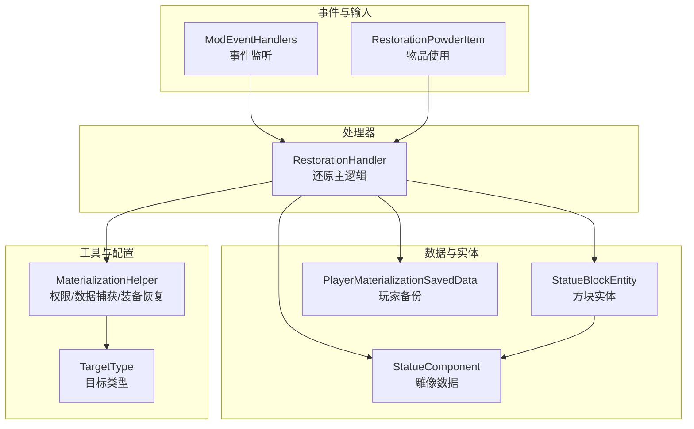
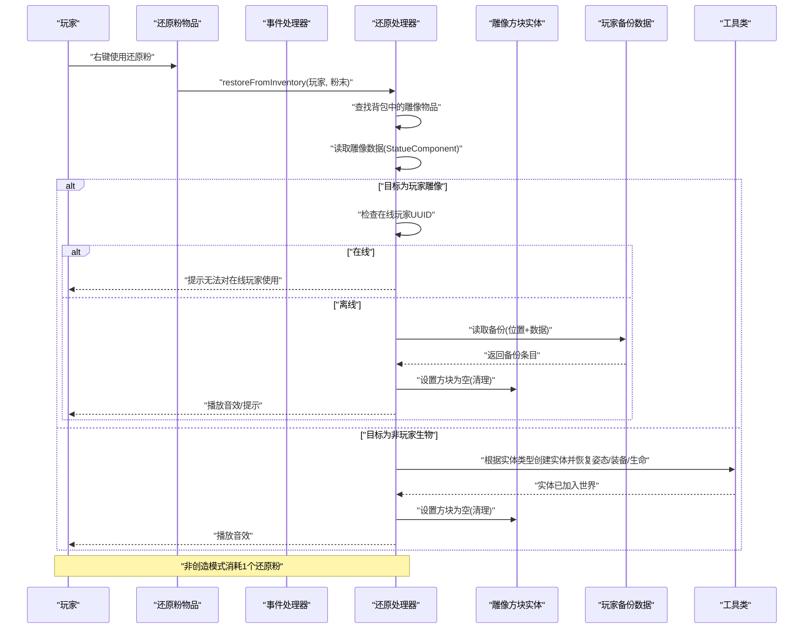
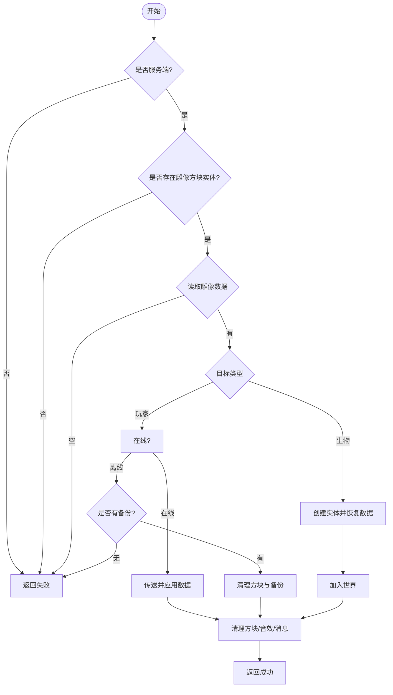
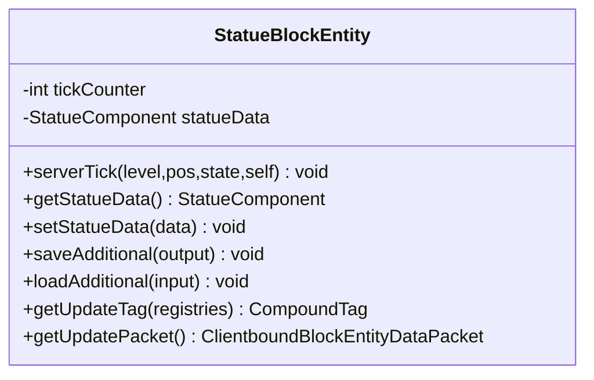
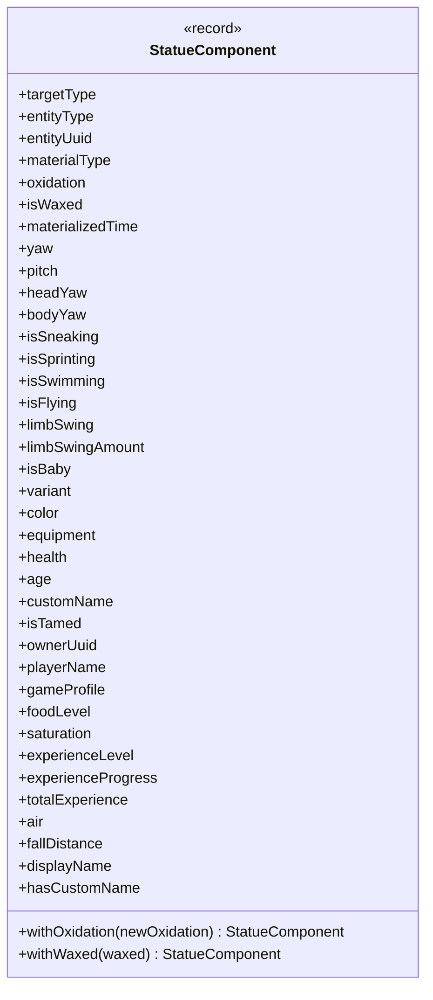
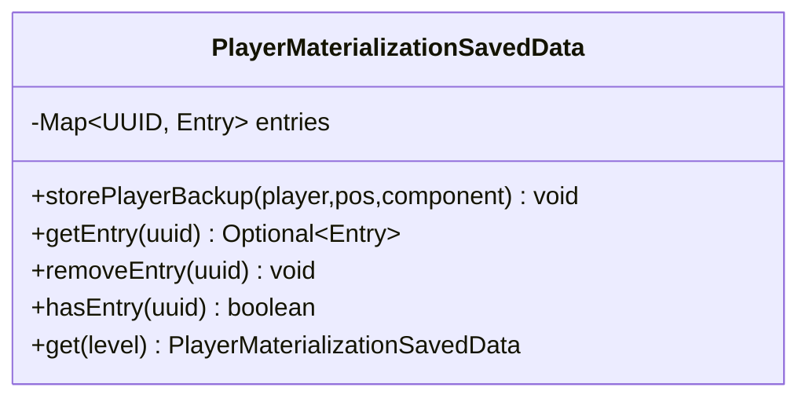
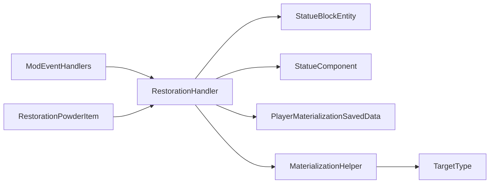

# 还原事件处理

<cite>
**本文引用的文件**
- [RestorationHandler.java](file://src/main/java/com/xiong/petrification/handler/RestorationHandler.java)
- [StatueBlockEntity.java](file://src/main/java/com/xiong/petrification/block/StatueBlockEntity.java)
- [RestorationPowderItem.java](file://src/main/java/com/xiong/petrification/item/RestorationPowderItem.java)
- [StatueComponent.java](file://src/main/java/com/xiong/petrification/component/StatueComponent.java)
- [PlayerMaterializationSavedData.java](file://src/main/java/com/xiong/petrification/data/PlayerMaterializationSavedData.java)
- [MaterializationHelper.java](file://src/main/java/com/xiong/petrification/util/MaterializationHelper.java)
- [ModEventHandlers.java](file://src/main/java/com/xiong/petrification/handler/ModEventHandlers.java)
- [TargetType.java](file://src/main/java/com/xiong/petrification/component/TargetType.java)
</cite>

## 目录
1. [简介](#简介)
2. [项目结构](#项目结构)
3. [核心组件](#核心组件)
4. [架构总览](#架构总览)
5. [详细组件分析](#详细组件分析)
6. [依赖关系分析](#依赖关系分析)
7. [性能考量](#性能考量)
8. [故障排查指南](#故障排查指南)
9. [结论](#结论)
10. [附录](#附录)

## 简介
本文件为“石化模组”的还原事件处理系统提供完整技术文档，聚焦于还原逻辑、数据提取与重建、掉落物生成机制、权限与条件校验、方块实体交互、事件触发时机与执行顺序、异常处理与回滚策略，以及扩展自定义还原逻辑的方法。读者可据此理解从“使用还原粉”到“雕像还原”的全链路流程，并安全地扩展该能力。

## 项目结构
围绕还原系统的核心代码分布在以下模块：
- 处理器层：负责还原主流程、物品交互、状态更新与音效反馈
- 数据层：持久化离线玩家备份、材料类型与目标类型等
- 方块实体层：存储雕像数据、氧化与打蜡状态、服务端tick更新
- 工具层：实体数据捕获与装备恢复、权限检查、粒子与音效
- 事件层：监听右键、药水溅射、玩家登录、方块破坏等事件，驱动还原或相关行为

图表来源
- [ModEventHandlers.java:65-84](file://src/main/java/com/xiong/petrification/handler/ModEventHandlers.java#L65-L84)
- [RestorationPowderItem.java:16-31](file://src/main/java/com/xiong/petrification/item/RestorationPowderItem.java#L16-L31)
- [RestorationHandler.java:34-91](file://src/main/java/com/xiong/petrification/handler/RestorationHandler.java#L34-L91)
- [StatueBlockEntity.java:17-88](file://src/main/java/com/xiong/petrification/block/StatueBlockEntity.java#L17-L88)
- [StatueComponent.java:14-52](file://src/main/java/com/xiong/petrification/component/StatueComponent.java#L14-L52)
- [PlayerMaterializationSavedData.java:22-95](file://src/main/java/com/xiong/petrification/data/PlayerMaterializationSavedData.java#L22-L95)
- [MaterializationHelper.java:36-53](file://src/main/java/com/xiong/petrification/util/MaterializationHelper.java#L36-L53)
- [TargetType.java:6-23](file://src/main/java/com/xiong/petrification/component/TargetType.java#L6-L23)

章节来源
- [ModEventHandlers.java:65-84](file://src/main/java/com/xiong/petrification/handler/ModEventHandlers.java#L65-L84)
- [RestorationPowderItem.java:16-31](file://src/main/java/com/xiong/petrification/item/RestorationPowderItem.java#L16-L31)
- [RestorationHandler.java:34-91](file://src/main/java/com/xiong/petrification/handler/RestorationHandler.java#L34-L91)

## 核心组件
- RestorationHandler：还原主入口，统一处理“在方块上点击使用还原粉”和“背包中使用还原粉”两条路径；区分玩家雕像与非玩家生物雕像；负责播放音效、清理方块、应用玩家数据。
- StatueBlockEntity：雕像方块的数据载体，保存StatueComponent，并在服务端tick中按配置进行铜材质氧化增长（受打蜡保护）。
- StatueComponent：不可变记录对象，封装雕像所有可序列化字段（目标类型、实体类型、姿态、装备、生命值、经验、饥饿、空气、掉落名等），并提供withXxx方法用于派生新状态。
- PlayerMaterializationSavedData：服务器级持久化数据，用于离线玩家雕像的备份与恢复。
- MaterializationHelper：权限校验、实体数据捕获、装备恢复、区域物质化与粒子效果。
- ModEventHandlers：事件总线，将外部输入（右键、药水、登录、破坏）接入还原流程。
- TargetType：枚举，区分“生物雕像”与“玩家雕像”。

章节来源
- [RestorationHandler.java:34-182](file://src/main/java/com/xiong/petrification/handler/RestorationHandler.java#L34-L182)
- [StatueBlockEntity.java:17-88](file://src/main/java/com/xiong/petrification/block/StatueBlockEntity.java#L17-L88)
- [StatueComponent.java:14-256](file://src/main/java/com/xiong/petrification/component/StatueComponent.java#L14-L256)
- [PlayerMaterializationSavedData.java:22-95](file://src/main/java/com/xiong/petrification/data/PlayerMaterializationSavedData.java#L22-L95)
- [MaterializationHelper.java:36-232](file://src/main/java/com/xiong/petrification/util/MaterializationHelper.java#L36-L232)
- [ModEventHandlers.java:38-118](file://src/main/java/com/xiong/petrification/handler/ModEventHandlers.java#L38-L118)
- [TargetType.java:6-23](file://src/main/java/com/xiong/petrification/component/TargetType.java#L6-L23)

## 架构总览
下图展示从“玩家使用还原粉”到“雕像还原完成”的端到端调用链，包括客户端/服务端分支、权限与条件判断、数据读取与写入、音效与消息反馈。

图表来源
- [RestorationPowderItem.java:16-31](file://src/main/java/com/xiong/petrification/item/RestorationPowderItem.java#L16-L31)
- [RestorationHandler.java:55-91](file://src/main/java/com/xiong/petrification/handler/RestorationHandler.java#L55-L91)
- [RestorationHandler.java:103-138](file://src/main/java/com/xiong/petrification/handler/RestorationHandler.java#L103-L138)
- [PlayerMaterializationSavedData.java:77-93](file://src/main/java/com/xiong/petrification/data/PlayerMaterializationSavedData.java#L77-L93)
- [MaterializationHelper.java:211-232](file://src/main/java/com/xiong/petrification/util/MaterializationHelper.java#L211-L232)

## 详细组件分析

### 还原处理器 RestorationHandler
职责与关键点：
- 入口方法
  - restoreBlock：针对“在方块上使用还原粉”的路径，校验服务端、存在雕像方块实体、读取雕像数据，再分派到玩家或非玩家还原。
  - useRestorationPowderOnBlock：包装restoreBlock，并在非创造模式下扣除粉末。
  - restoreFromInventory：针对“背包中使用还原粉”，自动查找背包中的雕像物品，校验数据后在玩家面前生成实体或恢复玩家。
- 玩家雕像还原
  - 若目标玩家在线：传送至雕像位置、应用玩家数据（饥饿、经验、空气、掉落距离、装备）、清理方块、播放音效、发送消息。
  - 若目标玩家离线：从持久化备份中读取位置与数据，清理方块与备份项，播放音效、发送消息。
- 非玩家生物雕像还原
  - 根据实体类型注册表创建实体，设置朝向、奔跑/潜行、生命值、自定义名称、装备，加入世界，清理方块、播放音效。
- 铜雕像打蜡
  - waxCopper/waxCopperItem：仅对铜材质且未打蜡的雕像生效，更新打蜡标记并播放音效。
- 权限与条件
  - 仅在服务端执行；需要存在雕像方块实体与有效雕像数据；在线玩家雕像需UUID匹配；背包路径会检查在线状态避免冲突。
- 失败与回退
  - 不满足条件时直接返回false，不改变世界状态；玩家在线时拒绝背包还原；离线无备份时拒绝方块还原。

图表来源
- [RestorationHandler.java:34-91](file://src/main/java/com/xiong/petrification/handler/RestorationHandler.java#L34-L91)
- [RestorationHandler.java:103-138](file://src/main/java/com/xiong/petrification/handler/RestorationHandler.java#L103-L138)
- [RestorationHandler.java:140-182](file://src/main/java/com/xiong/petrification/handler/RestorationHandler.java#L140-L182)

章节来源
- [RestorationHandler.java:34-227](file://src/main/java/com/xiong/petrification/handler/RestorationHandler.java#L34-L227)

### 雕像方块实体 StatueBlockEntity
职责与关键点：
- 存储雕像数据StatueComponent，支持读写与变更标记。
- 服务端tick：每OXIDATION_INTERVAL刻检查一次，若材质为铜且未打蜡且未达到最大氧化值，则增加氧化度；达到上限或被打蜡则停止。
- 持久化：通过saveAdditional/loadAdditional将雕像数据序列化为NBT，保证重连与存档一致性。
- 网络同步：提供更新包以同步客户端。

图表来源
- [StatueBlockEntity.java:17-88](file://src/main/java/com/xiong/petrification/block/StatueBlockEntity.java#L17-L88)

章节来源
- [StatueBlockEntity.java:17-88](file://src/main/java/com/xiong/petrification/block/StatueBlockEntity.java#L17-L88)

### 雕像数据 StatueComponent
职责与关键点：
- 不可变记录对象，包含目标类型、实体类型、UUID、材质、氧化度、打蜡、时间戳、姿态、动作状态、可选的装备、生命值、年龄、自定义名、驯服信息、玩家专属数据（饥饿、经验、空气、掉落距离等）。
- 通过Codec分组编码/解码，确保NBT/JSON序列化稳定。
- 提供withOxidation/withWaxed等方法派生新实例，便于状态更新。
- 默认构造用于非玩家生物雕像的兜底显示名。

图表来源
- [StatueComponent.java:14-256](file://src/main/java/com/xiong/petrification/component/StatueComponent.java#L14-L256)

章节来源
- [StatueComponent.java:14-256](file://src/main/java/com/xiong/petrification/component/StatueComponent.java#L14-L256)

### 玩家备份数据 PlayerMaterializationSavedData
职责与关键点：
- 服务器级持久化数据，键为UUID，值为“雕像位置+雕像数据”的条目。
- 提供store/get/remove/hasEntry接口，供离线玩家雕像恢复时使用。
- 通过SavedDataType与Codec进行存档读写。

图表来源
- [PlayerMaterializationSavedData.java:22-95](file://src/main/java/com/xiong/petrification/data/PlayerMaterializationSavedData.java#L22-L95)

章节来源
- [PlayerMaterializationSavedData.java:22-95](file://src/main/java/com/xiong/petrification/data/PlayerMaterializationSavedData.java#L22-L95)

### 工具类 MaterializationHelper
职责与关键点：
- canMaterialize：权限检查（创意模式与OP限制由配置控制）。
- captureEntityData：捕获实体数据为StatueComponent，含装备、名称、玩家专属属性、驯服信息等。
- restoreEquipment：将装备标签恢复到实体各槽位。
- materializeArea/materializeBlocks：区域物质化与方块数据记录（与还原系统配合）。
- spawnParticles：播放粒子效果。

章节来源
- [MaterializationHelper.java:36-263](file://src/main/java/com/xiong/petrification/util/MaterializationHelper.java#L36-L263)

### 事件处理器 ModEventHandlers
职责与关键点：
- onRightClickBlock：检测手持是否为还原粉或蜂巢，调用对应还原/打蜡逻辑，并阻止默认行为。
- onPotionSplash：药水命中时触发区域物质化（与还原系统互补）。
- onPlayerLogin：玩家登录时，若有离线备份，将其传送到雕像位置并应用数据，清理方块与备份。
- onBlockBreak：破坏方块时移除对应的方块物质化记录。

章节来源
- [ModEventHandlers.java:38-118](file://src/main/java/com/xiong/petrification/handler/ModEventHandlers.java#L38-L118)

### 物品 RestorationPowderItem
职责与关键流程：
- use：在服务端调用restoreFromInventory，成功后若非创造模式扣除1个还原粉，返回CONSUME；否则PASS。

章节来源
- [RestorationPowderItem.java:16-31](file://src/main/java/com/xiong/petrification/item/RestorationPowderItem.java#L16-L31)

## 依赖关系分析
- 事件与处理器耦合：ModEventHandlers仅作为路由，具体业务集中在RestorationHandler，降低事件层复杂度。
- 数据与实体解耦：StatueComponent作为不可变数据载体，StatueBlockEntity仅持有引用，便于序列化与状态派生。
- 工具复用：MaterializationHelper集中权限、数据捕获与装备恢复，被多处复用。
- 潜在循环：无直接循环依赖；事件→处理器→工具/数据/实体的单向依赖清晰。

图表来源
- [ModEventHandlers.java:65-84](file://src/main/java/com/xiong/petrification/handler/ModEventHandlers.java#L65-L84)
- [RestorationPowderItem.java:16-31](file://src/main/java/com/xiong/petrification/item/RestorationPowderItem.java#L16-L31)
- [RestorationHandler.java:34-91](file://src/main/java/com/xiong/petrification/handler/RestorationHandler.java#L34-L91)
- [MaterializationHelper.java:36-53](file://src/main/java/com/xiong/petrification/util/MaterializationHelper.java#L36-L53)
- [TargetType.java:6-23](file://src/main/java/com/xiong/petrification/component/TargetType.java#L6-L23)

章节来源
- [ModEventHandlers.java:65-84](file://src/main/java/com/xiong/petrification/handler/ModEventHandlers.java#L65-L84)
- [RestorationPowderItem.java:16-31](file://src/main/java/com/xiong/petrification/item/RestorationPowderItem.java#L16-L31)
- [RestorationHandler.java:34-91](file://src/main/java/com/xiong/petrification/handler/RestorationHandler.java#L34-L91)

## 性能考量
- 服务端优先：所有还原逻辑均限制在服务端执行，避免客户端与服务端状态不一致。
- 批量操作谨慎：区域物质化与还原均为单实体/单方块级别操作，避免大范围计算。
- 周期性任务：雕像氧化tick间隔较长（固定周期），减少每刻开销。
- NBT序列化：StatueComponent采用分组Codec，减少冗余字段带来的体积与解析成本。
- 建议：如需大规模还原，可考虑分批调度与节流，避免卡顿。

[本节为通用性能讨论，无需特定文件来源]

## 故障排查指南
常见问题与定位要点：
- 还原无效
  - 检查是否在服务端执行；确认目标位置存在雕像方块实体且有雕像数据。
  - 玩家雕像：确认UUID存在且在线/离线备份可用；在线时会拒绝背包还原。
  - 非玩家生物：确认实体类型注册表存在且可创建。
- 数据未恢复
  - 检查StatueComponent中装备、生命值、经验等Optional字段是否填充。
  - 玩家登录恢复：确认登录事件中备份条目存在并已清理。
- 铜雕像氧化异常
  - 检查是否被打蜡或已达最大氧化值；确认配置开关与速率。
- 权限问题
  - 创意模式与OP限制由配置控制；如不允许，将无法物质化/还原。
- 日志与调试
  - 当前实现未内置结构化日志；可在关键分支添加控制台输出或调试信息（例如进入/退出分支、失败原因）。
  - 建议在事件入口与还原主入口添加最小化日志，记录玩家、坐标、目标类型与结果。

章节来源
- [RestorationHandler.java:34-227](file://src/main/java/com/xiong/petrification/handler/RestorationHandler.java#L34-L227)
- [ModEventHandlers.java:65-118](file://src/main/java/com/xiong/petrification/handler/ModEventHandlers.java#L65-L118)
- [MaterializationHelper.java:36-53](file://src/main/java/com/xiong/petrification/util/MaterializationHelper.java#L36-L53)

## 结论
还原事件处理系统以RestorationHandler为核心，结合StatueBlockEntity与StatueComponent实现雕像数据的持久化与重建，并通过ModEventHandlers将外部输入接入。系统具备完善的权限与条件校验、离线玩家备份恢复、铜材质氧化与打蜡机制，以及与工具类的良好协作。遵循本文档的流程与最佳实践，可安全扩展自定义还原逻辑与新增目标类型。

[本节为总结性内容，无需特定文件来源]

## 附录

### 还原事件触发时机与执行顺序
- 右键方块：事件→检测物品→调用还原/打蜡→可能消耗物品→播放音效→更新方块/数据。
- 背包使用还原粉：物品use→查找雕像→校验数据→在线/离线分支→生成实体或恢复玩家→清理方块→消耗物品。
- 玩家登录：若有离线备份→传送→应用数据→清理方块与备份。
- 药水命中：区域物质化与方块记录（与还原互补）。

章节来源
- [ModEventHandlers.java:45-118](file://src/main/java/com/xiong/petrification/handler/ModEventHandlers.java#L45-L118)
- [RestorationPowderItem.java:16-31](file://src/main/java/com/xiong/petrification/item/RestorationPowderItem.java#L16-L31)
- [RestorationHandler.java:55-91](file://src/main/java/com/xiong/petrification/handler/RestorationHandler.java#L55-L91)

### 还原失败的处理方案与回滚机制
- 失败即早返回：不修改世界状态，不消耗物品（除非成功）。
- 在线玩家雕像：拒绝背包还原，避免重复或冲突。
- 离线无备份：拒绝方块还原，保持现状。
- 回滚：由于原子性设计，失败时无需显式回滚；成功后的清理与音效属于副作用，已在成功分支内完成。

章节来源
- [RestorationHandler.java:34-91](file://src/main/java/com/xiong/petrification/handler/RestorationHandler.java#L34-L91)
- [RestorationHandler.java:103-138](file://src/main/java/com/xiong/petrification/handler/RestorationHandler.java#L103-L138)

### 扩展自定义还原逻辑的建议
- 新增目标类型：在TargetType中添加新枚举，并在StatueComponent中扩展相应字段与Codec。
- 扩展还原分支：在RestorationHandler中根据targetType分派到新方法，实现数据重建与掉落物生成。
- 权限与条件：复用MaterializationHelper.canMaterialize或在其基础上扩展规则。
- 事件接入：在ModEventHandlers中新增事件监听，调用新的还原入口。
- 测试建议：覆盖在线/离线、权限、缺失数据、非法实体类型等边界场景。

[本节为概念性指导，无需特定文件来源]