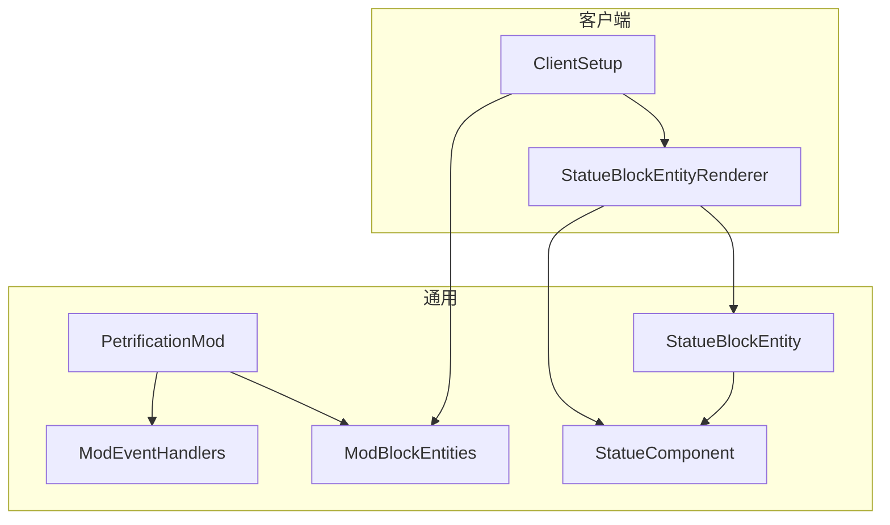
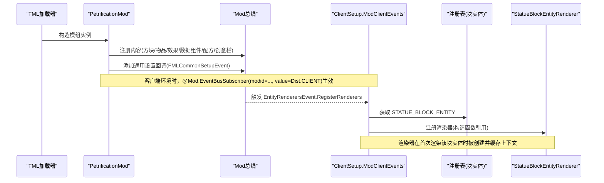
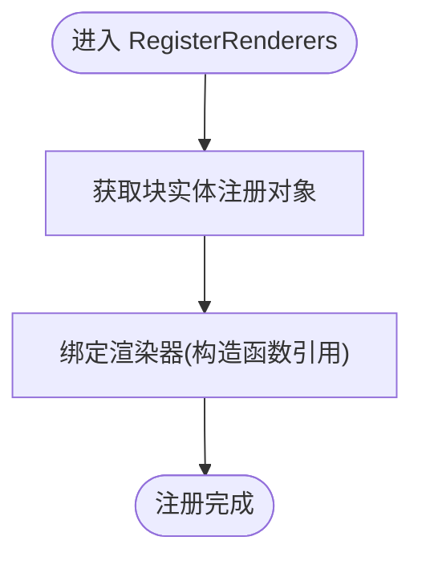
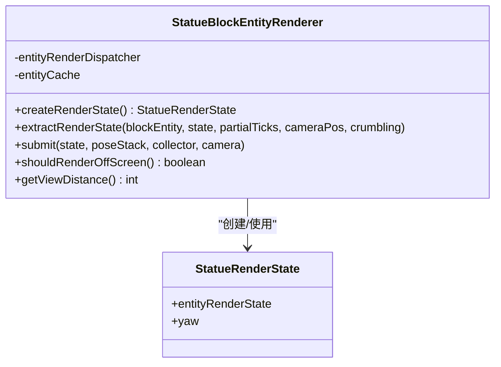
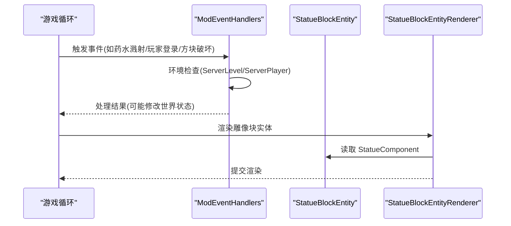
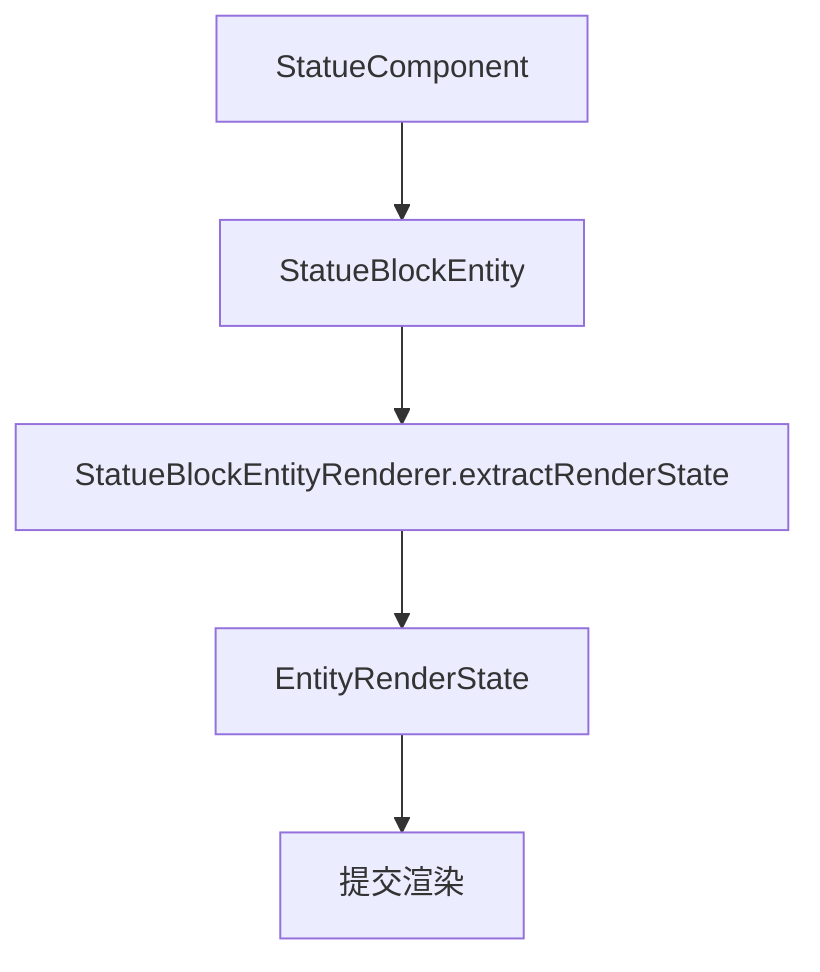
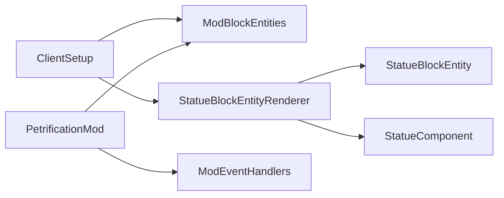

# 客户端初始化

<cite>
**本文引用的文件**
- [ClientSetup.java](file://src/main/java/com/xiong/petrification/client/ClientSetup.java)
- [PetrificationMod.java](file://src/main/java/com/xiong/petrification/PetrificationMod.java)
- [StatueBlockEntityRenderer.java](file://src/main/java/com/xiong/petrification/client/StatueBlockEntityRenderer.java)
- [ModEventHandlers.java](file://src/main/java/com/xiong/petrification/handler/ModEventHandlers.java)
- [ModBlockEntities.java](file://src/main/java/com/xiong/petrification/registry/ModBlockEntities.java)
- [StatueBlockEntity.java](file://src/main/java/com/xiong/petrification/block/StatueBlockEntity.java)
- [StatueComponent.java](file://src/main/java/com/xiong/petrification/component/StatueComponent.java)
</cite>

## 目录
1. [简介](#简介)
2. [项目结构](#项目结构)
3. [核心组件](#核心组件)
4. [架构总览](#架构总览)
5. [详细组件分析](#详细组件分析)
6. [依赖关系分析](#依赖关系分析)
7. [性能考量](#性能考量)
8. [故障排查指南](#故障排查指南)
9. [结论](#结论)
10. [附录](#附录)

## 简介
本文件围绕客户端初始化系统，重点解析 ClientSetup 类的初始化流程、渲染器注册机制、事件订阅与生命周期管理；详细说明 Forge 事件总线的使用方式，尤其是 EntityRenderersEvent 的处理流程；解释客户端/服务器环境检测机制，确保代码仅在正确环境中执行；介绍渲染器注册的最佳实践（延迟注册、资源管理）；并提供客户端特定功能的扩展指南与性能监控方法。

## 项目结构
该模组采用按功能域组织的包结构：
- client：客户端专用逻辑，包含渲染器注册与渲染实现
- handler：通用事件处理器（服务端/客户端均可），用于游戏逻辑交互
- registry：注册表集中管理（方块、物品、效果、数据组件等）
- block/component/data/network/util：领域模型与工具

图表来源
- [ClientSetup.java:13-18](file://src/main/java/com/xiong/petrification/client/ClientSetup.java#L13-L18)
- [StatueBlockEntityRenderer.java:31-37](file://src/main/java/com/xiong/petrification/client/StatueBlockEntityRenderer.java#L31-L37)
- [PetrificationMod.java:27-46](file://src/main/java/com/xiong/petrification/PetrificationMod.java#L27-L46)
- [ModBlockEntities.java:13-25](file://src/main/java/com/xiong/petrification/registry/ModBlockEntities.java#L13-L25)
- [StatueBlockEntity.java:17-26](file://src/main/java/com/xiong/petrification/block/StatueBlockEntity.java#L17-L26)
- [StatueComponent.java:14-52](file://src/main/java/com/xiong/petrification/component/StatueComponent.java#L14-L52)

章节来源
- [ClientSetup.java:1-21](file://src/main/java/com/xiong/petrification/client/ClientSetup.java#L1-L21)
- [PetrificationMod.java:1-53](file://src/main/java/com/xiong/petrification/PetrificationMod.java#L1-L53)

## 核心组件
- ClientSetup：在客户端加载阶段通过 @Mod.EventBusSubscriber 订阅 Mod 总线事件，处理 EntityRenderersEvent.RegisterRenderers，完成块实体渲染器的注册。
- StatueBlockEntityRenderer：实现自定义块实体渲染器，负责从块实体提取渲染状态、构建实体渲染状态并提交到渲染管线。
- PetrificationMod：模组入口，负责注册各类内容、监听通用事件、配置加载与网络初始化。
- ModEventHandlers：通用事件处理器，处理药水溅射、玩家登录、方块破坏等业务事件。
- ModBlockEntities：集中注册块实体类型，供客户端渲染器引用。
- StatueBlockEntity / StatueComponent：块实体与其承载的数据组件，提供序列化、持久化与客户端渲染所需的状态。

章节来源
- [ClientSetup.java:13-18](file://src/main/java/com/xiong/petrification/client/ClientSetup.java#L13-L18)
- [StatueBlockEntityRenderer.java:31-128](file://src/main/java/com/xiong/petrification/client/StatueBlockEntityRenderer.java#L31-L128)
- [PetrificationMod.java:27-51](file://src/main/java/com/xiong/petrification/PetrificationMod.java#L27-L51)
- [ModEventHandlers.java:30-119](file://src/main/java/com/xiong/petrification/handler/ModEventHandlers.java#L30-L119)
- [ModBlockEntities.java:13-25](file://src/main/java/com/xiong/petrification/registry/ModBlockEntities.java#L13-L25)
- [StatueBlockEntity.java:17-88](file://src/main/java/com/xiong/petrification/block/StatueBlockEntity.java#L17-L88)
- [StatueComponent.java:14-256](file://src/main/java/com/xiong/petrification/component/StatueComponent.java#L14-L256)

## 架构总览
客户端初始化与渲染器注册的整体时序如下：

图表来源
- [PetrificationMod.java:27-46](file://src/main/java/com/xiong/petrification/PetrificationMod.java#L27-L46)
- [ClientSetup.java:13-18](file://src/main/java/com/xiong/petrification/client/ClientSetup.java#L13-L18)
- [ModBlockEntities.java:13-25](file://src/main/java/com/xiong/petrification/registry/ModBlockEntities.java#L13-L25)

章节来源
- [PetrificationMod.java:27-51](file://src/main/java/com/xiong/petrification/PetrificationMod.java#L27-L51)
- [ClientSetup.java:13-18](file://src/main/java/com/xiong/petrification/client/ClientSetup.java#L13-L18)

## 详细组件分析

### ClientSetup 与渲染器注册
- 使用 @Mod.EventBusSubscriber(modid = ..., value = Dist.CLIENT, bus = Mod.EventBusSubscriber.Bus.MOD) 将内部类 ModClientEvents 限定为客户端 Mod 总线事件处理器。
- 在 EntityRenderersEvent.RegisterRenderers 中，调用 event.registerBlockEntityRenderer(...) 将块实体类型与渲染器绑定。
- 延迟注册策略：注册发生在渲染器注册事件阶段，此时注册表已可用，且不会阻塞加载主流程。

图表来源
- [ClientSetup.java:13-18](file://src/main/java/com/xiong/petrification/client/ClientSetup.java#L13-L18)
- [ModBlockEntities.java:13-25](file://src/main/java/com/xiong/petrification/registry/ModBlockEntities.java#L13-L25)

章节来源
- [ClientSetup.java:13-18](file://src/main/java/com/xiong/petrification/client/ClientSetup.java#L13-L18)

### StatueBlockEntityRenderer 渲染流程
- 继承 BlockEntityRenderer，实现 createRenderState、extractRenderState、submit 等生命周期方法。
- extractRenderState：
  - 从块实体读取 StatueComponent，校验实体类型是否存在。
  - 使用实体类型创建或复用实体实例，设置姿态、动作状态等。
  - 通过 EntityRenderDispatcher.getRenderer(...) 获取对应实体的渲染器，并创建渲染状态。
- submit：
  - 应用变换矩阵（平移、旋转、缩放）。
  - 提交实体渲染状态到渲染管线。
- 视图距离与离屏渲染：
  - shouldRenderOffScreen() 返回 true，支持小地图/其他离屏渲染场景。
  - getViewDistance() 返回配置项中的雕像渲染距离。

图表来源
- [StatueBlockEntityRenderer.java:31-128](file://src/main/java/com/xiong/petrification/client/StatueBlockEntityRenderer.java#L31-L128)

章节来源
- [StatueBlockEntityRenderer.java:31-128](file://src/main/java/com/xiong/petrification/client/StatueBlockEntityRenderer.java#L31-L128)

### 事件总线与环境检测
- 客户端专用：ClientSetup 的内部类通过 @Mod.EventBusSubscriber(value = Dist.CLIENT) 确保仅在客户端环境执行渲染器注册。
- 通用事件：ModEventHandlers 未指定 Dist，适用于服务端/客户端共享逻辑；其中多处显式检查 ServerLevel/ServerPlayer，确保服务端逻辑仅在服务端运行。
- 生命周期：
  - 模组构造阶段：注册内容、添加通用设置回调、注册配置、注册事件处理器。
  - 通用设置阶段：enqueueWork 注册网络消息。
  - 渲染阶段：注册渲染器后，引擎按需调用渲染器生命周期方法。

图表来源
- [ModEventHandlers.java:45-118](file://src/main/java/com/xiong/petrification/handler/ModEventHandlers.java#L45-L118)
- [StatueBlockEntityRenderer.java:44-113](file://src/main/java/com/xiong/petrification/client/StatueBlockEntityRenderer.java#L44-L113)

章节来源
- [ModEventHandlers.java:30-119](file://src/main/java/com/xiong/petrification/handler/ModEventHandlers.java#L30-L119)
- [PetrificationMod.java:27-51](file://src/main/java/com/xiong/petrification/PetrificationMod.java#L27-L51)

### 数据流与状态传递
- StatueBlockEntity 持有 StatueComponent，负责持久化与更新。
- 客户端渲染器从块实体读取 StatueComponent，映射为实体姿态与动画参数，生成渲染状态并提交渲染。
- 配置项影响渲染行为（如渲染距离）。

图表来源
- [StatueBlockEntity.java:17-88](file://src/main/java/com/xiong/petrification/block/StatueBlockEntity.java#L17-L88)
- [StatueComponent.java:14-256](file://src/main/java/com/xiong/petrification/component/StatueComponent.java#L14-L256)
- [StatueBlockEntityRenderer.java:44-113](file://src/main/java/com/xiong/petrification/client/StatueBlockEntityRenderer.java#L44-L113)

章节来源
- [StatueBlockEntity.java:17-88](file://src/main/java/com/xiong/petrification/block/StatueBlockEntity.java#L17-L88)
- [StatueComponent.java:14-256](file://src/main/java/com/xiong/petrification/component/StatueComponent.java#L14-L256)
- [StatueBlockEntityRenderer.java:44-113](file://src/main/java/com/xiong/petrification/client/StatueBlockEntityRenderer.java#L44-L113)

## 依赖关系分析
- ClientSetup 依赖 Mod 总线与注册表，用于在合适时机注册渲染器。
- StatueBlockEntityRenderer 依赖块实体与数据组件，以及渲染调度器。
- PetrificationMod 作为入口协调注册与事件订阅。
- ModEventHandlers 依赖业务逻辑与配置，处理跨层事件。

图表来源
- [ClientSetup.java:13-18](file://src/main/java/com/xiong/petrification/client/ClientSetup.java#L13-L18)
- [PetrificationMod.java:27-46](file://src/main/java/com/xiong/petrification/PetrificationMod.java#L27-L46)
- [StatueBlockEntityRenderer.java:31-37](file://src/main/java/com/xiong/petrification/client/StatueBlockEntityRenderer.java#L31-L37)
- [StatueBlockEntity.java:17-26](file://src/main/java/com/xiong/petrification/block/StatueBlockEntity.java#L17-L26)
- [StatueComponent.java:14-52](file://src/main/java/com/xiong/petrification/component/StatueComponent.java#L14-L52)

章节来源
- [ClientSetup.java:13-18](file://src/main/java/com/xiong/petrification/client/ClientSetup.java#L13-L18)
- [PetrificationMod.java:27-46](file://src/main/java/com/xiong/petrification/PetrificationMod.java#L27-L46)
- [StatueBlockEntityRenderer.java:31-37](file://src/main/java/com/xiong/petrification/client/StatueBlockEntityRenderer.java#L31-L37)

## 性能考量
- 渲染状态复用：渲染器内部维护实体缓存，避免每帧重复创建实体，降低分配开销。
- 异常隔离：渲染路径捕获异常并静默忽略，防止渲染错误导致崩溃。
- 视距控制：通过配置项限制雕像渲染距离，减少远距离渲染压力。
- 事件节流：服务端事件中对关键逻辑进行必要的环境与类型检查，避免无效计算。
- 建议：
  - 对复杂实体渲染可考虑批量化提交或使用更高效的渲染通道。
  - 对高频事件（如方块破坏）做最小化处理，避免在主线程执行重任务。
  - 利用日志与性能分析工具定位瓶颈（例如渲染耗时、事件处理耗时）。

[本节为通用性能指导，不直接分析具体文件]

## 故障排查指南
- 渲染器未注册：
  - 确认 ClientSetup 的 ModClientEvents 是否被加载（客户端环境）。
  - 确认 ModBlockEntities.STATUE_BLOCK_ENTITY 是否正确注册。
- 渲染异常：
  - 检查 StatueBlockEntityRenderer 的 extractRenderState 与 submit 中的异常捕获分支。
  - 验证 StatueComponent 中的实体类型是否有效。
- 事件未触发：
  - 确认 ModEventHandlers 已通过注解或手动注册方式加入事件总线。
  - 检查服务端/客户端环境判断是否导致逻辑跳过。
- 配置未生效：
  - 确认配置项已在模组构造阶段注册。
  - 检查相关逻辑是否读取了正确的配置字段。

章节来源
- [ClientSetup.java:13-18](file://src/main/java/com/xiong/petrification/client/ClientSetup.java#L13-L18)
- [StatueBlockEntityRenderer.java:83-113](file://src/main/java/com/xiong/petrification/client/StatueBlockEntityRenderer.java#L83-L113)
- [ModEventHandlers.java:45-118](file://src/main/java/com/xiong/petrification/handler/ModEventHandlers.java#L45-L118)
- [PetrificationMod.java:27-51](file://src/main/java/com/xiong/petrification/PetrificationMod.java#L27-L51)

## 结论
该模组的客户端初始化以 ClientSetup 为核心，借助 Forge 事件总线在合适的生命周期阶段注册渲染器，配合 StatueBlockEntityRenderer 实现雕像块实体的可视化。通过 Dist.CLIENT 与显式环境检查，确保客户端与服务端逻辑的正确分离。整体设计遵循延迟注册与资源复用原则，具备良好的可扩展性与稳定性。

[本节为总结性内容，不直接分析具体文件]

## 附录
- 扩展指南（客户端特定功能）：
  - 新增块实体渲染器：在 ClientSetup 的 RegisterRenderers 事件中注册新的块实体与渲染器映射。
  - 新增实体渲染：在 StatueBlockEntityRenderer 中扩展实体类型识别与姿态映射逻辑。
  - 新增事件：在 ModEventHandlers 中添加 @SubscribeEvent 方法，必要时进行环境检查。
- 性能监控方法：
  - 使用 Minecraft/FML 内置日志记录关键节点耗时。
  - 结合外部性能分析工具（如采样器）观察渲染与事件处理热点。
  - 调整配置项（如渲染距离）平衡视觉效果与性能。

[本节为概念性指导，不直接分析具体文件]