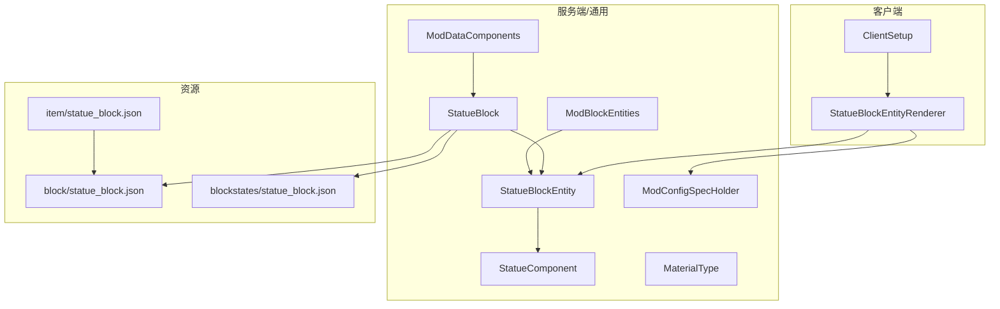
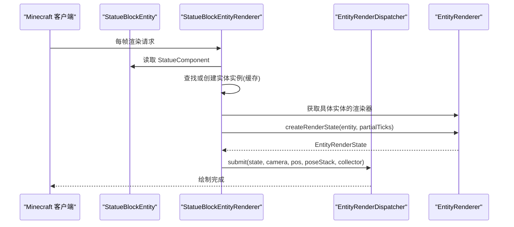
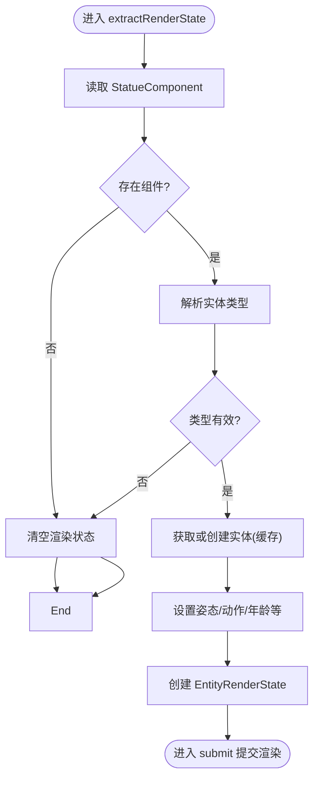
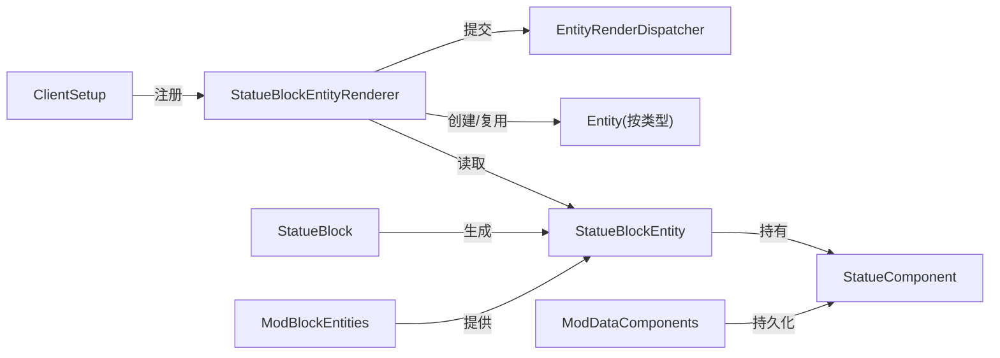

# 客户端渲染

<cite>
**本文引用的文件**
- [StatueBlockEntityRenderer.java](file://src/main/java/com/xiong/petrification/client/StatueBlockEntityRenderer.java)
- [ClientSetup.java](file://src/main/java/com/xiong/petrification/client/ClientSetup.java)
- [StatueBlock.java](file://src/main/java/com/xiong/petrification/block/StatueBlock.java)
- [StatueBlockEntity.java](file://src/main/java/com/xiong/petrification/block/StatueBlockEntity.java)
- [StatueComponent.java](file://src/main/java/com/xiong/petrification/component/StatueComponent.java)
- [MaterialType.java](file://src/main/java/com/xiong/petrification/component/MaterialType.java)
- [ModBlockEntities.java](file://src/main/java/com/xiong/petrification/registry/ModBlockEntities.java)
- [ModDataComponents.java](file://src/main/java/com/xiong/petrification/registry/ModDataComponents.java)
- [statue_block.json（方块模型）](file://src/main/resources/assets/petrification/models/block/statue_block.json)
- [statue_block.json（物品模型）](file://src/main/resources/assets/petrification/models/item/statue_block.json)
- [statue_block.json（方块状态）](file://src/main/resources/assets/petrification/blockstates/statue_block.json)
- [StatueBlockItem.java](file://src/main/java/com/xiong/petrification/item/StatueBlockItem.java)
- [ModConfigSpecHolder.java](file://src/main/java/com/xiong/petrification/ModConfigSpecHolder.java)
</cite>

## 目录
1. [简介](#简介)
2. [项目结构](#项目结构)
3. [核心组件](#核心组件)
4. [架构总览](#架构总览)
5. [详细组件分析](#详细组件分析)
6. [依赖关系分析](#依赖关系分析)
7. [性能考量](#性能考量)
8. [故障排查指南](#故障排查指南)
9. [结论](#结论)
10. [附录](#附录)

## 简介
本文件聚焦于石化模组的客户端渲染系统，围绕 StatueBlockEntityRenderer 的渲染管线、模型与纹理加载机制、客户端初始化流程、JSON 模型编写规范、客户端与服务端数据同步策略、性能优化与调试方法，以及扩展自定义视觉效果进行系统化说明。目标是帮助开发者理解并高效扩展该模组的客户端渲染能力。

## 项目结构
本项目采用按功能域组织的结构：客户端渲染逻辑集中在 client 包；方块与实体数据在 block 与 component 包；资源定义在 resources/assets 下；注册与配置在 registry 与配置类中。

图表来源
- [StatueBlockEntityRenderer.java:31-128](file://src/main/java/com/xiong/petrification/client/StatueBlockEntityRenderer.java#L31-L128)
- [ClientSetup.java:15-24](file://src/main/java/com/xiong/petrification/client/ClientSetup.java#L15-L24)
- [StatueBlock.java:38-152](file://src/main/java/com/xiong/petrification/block/StatueBlock.java#L38-L152)
- [StatueBlockEntity.java:17-87](file://src/main/java/com/xiong/petrification/block/StatueBlockEntity.java#L17-L87)
- [StatueComponent.java:14-255](file://src/main/java/com/xiong/petrification/component/StatueComponent.java#L14-L255)
- [MaterialType.java:9-67](file://src/main/java/com/xiong/petrification/component/MaterialType.java#L9-L67)
- [ModBlockEntities.java:13-26](file://src/main/java/com/xiong/petrification/registry/ModBlockEntities.java#L13-L26)
- [ModDataComponents.java:11-26](file://src/main/java/com/xiong/petrification/registry/ModDataComponents.java#L11-L26)
- [statue_block.json（方块模型）:1-7](file://src/main/resources/assets/petrification/models/block/statue_block.json#L1-L7)
- [statue_block.json（物品模型）:1-4](file://src/main/resources/assets/petrification/models/item/statue_block.json#L1-L4)
- [statue_block.json（方块状态）:1-9](file://src/main/resources/assets/petrification/blockstates/statue_block.json#L1-L9)

章节来源
- [StatueBlockEntityRenderer.java:31-128](file://src/main/java/com/xiong/petrification/client/StatueBlockEntityRenderer.java#L31-L128)
- [ClientSetup.java:15-24](file://src/main/java/com/xiong/petrification/client/ClientSetup.java#L15-L24)
- [StatueBlock.java:38-152](file://src/main/java/com/xiong/petrification/block/StatueBlock.java#L38-L152)
- [StatueBlockEntity.java:17-87](file://src/main/java/com/xiong/petrification/block/StatueBlockEntity.java#L17-L87)
- [StatueComponent.java:14-255](file://src/main/java/com/xiong/petrification/component/StatueComponent.java#L14-L255)
- [MaterialType.java:9-67](file://src/main/java/com/xiong/petrification/component/MaterialType.java#L9-L67)
- [ModBlockEntities.java:13-26](file://src/main/java/com/xiong/petrification/registry/ModBlockEntities.java#L13-L26)
- [ModDataComponents.java:11-26](file://src/main/java/com/xiong/petrification/registry/ModDataComponents.java#L11-L26)
- [statue_block.json（方块模型）:1-7](file://src/main/resources/assets/petrification/models/block/statue_block.json#L1-L7)
- [statue_block.json（物品模型）:1-4](file://src/main/resources/assets/petrification/models/item/statue_block.json#L1-L4)
- [statue_block.json（方块状态）:1-9](file://src/main/resources/assets/petrification/blockstates/statue_block.json#L1-L9)

## 核心组件
- 客户端渲染器：StatueBlockEntityRenderer，负责从 BlockEntity 提取渲染状态并提交实体渲染任务。
- 客户端初始化：ClientSetup，注册 BlockEntity 渲染器。
- 方块与实体：StatueBlock 与 StatueBlockEntity，承载雕像方块与数据生命周期、服务器端氧化计时等。
- 数据载体：StatueComponent，使用 Codec 分组序列化，包含实体类型、姿态、材质、可选属性等。
- 材质类型：MaterialType，定义不同材质及其显示前缀、颜色、对应物品与方块。
- 资源：方块/物品 JSON 模型与方块状态，用于基础可视化占位。
- 配置：ModConfigSpecHolder，提供渲染距离、氧化速率等可调参数。

章节来源
- [StatueBlockEntityRenderer.java:31-128](file://src/main/java/com/xiong/petrification/client/StatueBlockEntityRenderer.java#L31-L128)
- [ClientSetup.java:15-24](file://src/main/java/com/xiong/petrification/client/ClientSetup.java#L15-L24)
- [StatueBlock.java:38-152](file://src/main/java/com/xiong/petrification/block/StatueBlock.java#L38-L152)
- [StatueBlockEntity.java:17-87](file://src/main/java/com/xiong/petrification/block/StatueBlockEntity.java#L17-L87)
- [StatueComponent.java:14-255](file://src/main/java/com/xiong/petrification/component/StatueComponent.java#L14-L255)
- [MaterialType.java:9-67](file://src/main/java/com/xiong/petrification/component/MaterialType.java#L9-L67)
- [ModConfigSpecHolder.java:40-67](file://src/main/java/com/xiong/petrification/ModConfigSpecHolder.java#L40-L67)

## 架构总览
客户端渲染通过 BlockEntity 渲染管线完成：客户端每帧调用 extractRenderState 提取渲染所需状态，再 submit 提交到渲染队列。渲染器内部复用实体缓存，避免重复创建实体对象，降低 GC 压力。

图表来源
- [StatueBlockEntityRenderer.java:44-113](file://src/main/java/com/xiong/petrification/client/StatueBlockEntityRenderer.java#L44-L113)

章节来源
- [StatueBlockEntityRenderer.java:44-113](file://src/main/java/com/xiong/petrification/client/StatueBlockEntityRenderer.java#L44-L113)

## 详细组件分析

### 渲染器 StatueBlockEntityRenderer
- 职责
  - 从 StatueBlockEntity 提取 StatueComponent，构造可提交的渲染状态。
  - 根据实体类型创建或复用实体，设置姿态、动作标志等。
  - 将实体渲染状态提交给渲染调度器，应用位置、旋转与缩放变换。
- 关键点
  - 实体缓存：按 EntityType 缓存实体实例，减少频繁创建开销。
  - 姿态映射：将 yaw/pitch/headYaw/sneaking/sprinting/baby 等状态映射到实体。
  - 错误处理：捕获异常并安全降级，避免渲染崩溃。
  - 视距控制：返回配置的渲染距离，影响渲染判定。
  - 离屏渲染：允许 off-screen 渲染，提升交互体验。

图表来源
- [StatueBlockEntityRenderer.java:44-113](file://src/main/java/com/xiong/petrification/client/StatueBlockEntityRenderer.java#L44-L113)

章节来源
- [StatueBlockEntityRenderer.java:31-128](file://src/main/java/com/xiong/petrification/client/StatueBlockEntityRenderer.java#L31-L128)

### 客户端初始化 ClientSetup
- 职责
  - 在客户端启动时注册 StatueBlockEntity 的渲染器。
  - 通过事件总线订阅渲染器注册事件，确保渲染器正确绑定。
- 要点
  - 使用 DeferredRegister 注册的 BlockEntityType 作为键进行绑定。
  - 仅客户端执行，避免服务端污染。

章节来源
- [ClientSetup.java:15-24](file://src/main/java/com/xiong/petrification/client/ClientSetup.java#L15-L24)
- [ModBlockEntities.java:13-26](file://src/main/java/com/xiong/petrification/registry/ModBlockEntities.java#L13-L26)

### 方块与实体 StatueBlock / StatueBlockEntity
- StatueBlock
  - 渲染形状为不可见，实际视觉由 BlockEntity 渲染器负责。
  - 支持水浸没、方向属性、模拟信号输出（基于材质氧化度）。
  - 掉落物携带 StatueComponent 数据组件。
- StatueBlockEntity
  - 存储 StatueComponent，并在服务器端周期性更新铜材质氧化度。
  - 实现持久化保存/加载，提供更新数据包以同步至客户端。

章节来源
- [StatueBlock.java:38-152](file://src/main/java/com/xiong/petrification/block/StatueBlock.java#L38-L152)
- [StatueBlockEntity.java:17-87](file://src/main/java/com/xiong/petrification/block/StatueBlockEntity.java#L17-L87)

### 数据载体 StatueComponent
- 设计
  - 使用 Codec 分组序列化，将大量字段拆分为多个组，提高可读性与兼容性。
  - 包含实体类型、姿态、材质、可选装备/属性、名称等。
- 用途
  - 作为数据组件存储在物品与方块实体中，跨网络与存档传输。
  - 客户端渲染器据此重建实体渲染状态。

章节来源
- [StatueComponent.java:14-255](file://src/main/java/com/xiong/petrification/component/StatueComponent.java#L14-L255)
- [ModDataComponents.java:11-26](file://src/main/java/com/xiong/petrification/registry/ModDataComponents.java#L11-L26)

### 材质 MaterialType
- 作用
  - 定义不同材质（石、铁、铜、金、钻石、下界合金），提供颜色、前缀、对应物品与方块。
  - 配合模拟信号输出与氧化效果。

章节来源
- [MaterialType.java:9-67](file://src/main/java/com/xiong/petrification/component/MaterialType.java#L9-L67)
- [StatueBlock.java:137-151](file://src/main/java/com/xiong/petrification/block/StatueBlock.java#L137-L151)

### 资源与模型
- 方块模型：cube_all 基类，引用模组纹理。
- 物品模型：继承方块模型，用于手持/悬停展示。
- 方块状态：根据朝向设置模型与旋转。

章节来源
- [statue_block.json（方块模型）:1-7](file://src/main/resources/assets/petrification/models/block/statue_block.json#L1-L7)
- [statue_block.json（物品模型）:1-4](file://src/main/resources/assets/petrification/models/item/statue_block.json#L1-L4)
- [statue_block.json（方块状态）:1-9](file://src/main/resources/assets/petrification/blockstates/statue_block.json#L1-L9)

### 物品放置与数据注入
- StatueBlockItem
  - 放置时若物品含 StatueComponent，则写入方块实体；否则写入默认石材雕像数据。
  - 工具提示显示材质、氧化度、实体类型与自定义名称等信息。

章节来源
- [StatueBlockItem.java:24-82](file://src/main/java/com/xiong/petrification/item/StatueBlockItem.java#L24-L82)

## 依赖关系分析
- 渲染器依赖 BlockEntity 数据与实体渲染调度器。
- 方块实体依赖 StatueComponent 进行数据持久化与同步。
- 客户端初始化依赖注册表中的 BlockEntityType。
- 资源模型与状态决定基础外观，但实际渲染由实体渲染器接管。

图表来源
- [StatueBlockEntityRenderer.java:31-128](file://src/main/java/com/xiong/petrification/client/StatueBlockEntityRenderer.java#L31-L128)
- [StatueBlockEntity.java:17-87](file://src/main/java/com/xiong/petrification/block/StatueBlockEntity.java#L17-L87)
- [StatueBlock.java:38-152](file://src/main/java/com/xiong/petrification/block/StatueBlock.java#L38-L152)
- [ClientSetup.java:15-24](file://src/main/java/com/xiong/petrification/client/ClientSetup.java#L15-L24)
- [ModBlockEntities.java:13-26](file://src/main/java/com/xiong/petrification/registry/ModBlockEntities.java#L13-L26)
- [ModDataComponents.java:11-26](file://src/main/java/com/xiong/petrification/registry/ModDataComponents.java#L11-L26)

章节来源
- [StatueBlockEntityRenderer.java:31-128](file://src/main/java/com/xiong/petrification/client/StatueBlockEntityRenderer.java#L31-L128)
- [StatueBlockEntity.java:17-87](file://src/main/java/com/xiong/petrification/block/StatueBlockEntity.java#L17-L87)
- [StatueBlock.java:38-152](file://src/main/java/com/xiong/petrification/block/StatueBlock.java#L38-L152)
- [ClientSetup.java:15-24](file://src/main/java/com/xiong/petrification/client/ClientSetup.java#L15-L24)
- [ModBlockEntities.java:13-26](file://src/main/java/com/xiong/petrification/registry/ModBlockEntities.java#L13-L26)
- [ModDataComponents.java:11-26](file://src/main/java/com/xiong/petrification/registry/ModDataComponents.java#L11-L26)

## 性能考量
- 实体缓存：按实体类型缓存实体实例，显著减少分配与 GC 压力。
- 渲染距离：通过配置项 statueRenderDistance 控制渲染范围，平衡画质与性能。
- 错误隔离：渲染过程捕获异常，避免单点失败导致整体崩溃。
- 最小可见性：方块本身不可见，仅渲染实体，减少多余几何体。
- 建议
  - 合理设置渲染距离，结合硬件性能调优。
  - 避免在渲染路径中进行昂贵计算，尽量在 extractRenderState 阶段准备轻量状态。
  - 对大型场景考虑批量提交与剔除策略（如视锥剔除已由引擎处理）。

章节来源
- [StatueBlockEntityRenderer.java:64-113](file://src/main/java/com/xiong/petrification/client/StatueBlockEntityRenderer.java#L64-L113)
- [ModConfigSpecHolder.java:40-67](file://src/main/java/com/xiong/petrification/ModConfigSpecHolder.java#L40-L67)

## 故障排查指南
- 渲染不显示
  - 检查是否已注册渲染器（ClientSetup）。
  - 确认 StatueBlockEntity 已正确生成并持有 StatueComponent。
  - 查看日志中是否有渲染异常被静默忽略。
- 实体姿态不正确
  - 核对 StatueComponent 的姿态字段是否与期望一致。
  - 确认 extractRenderState 中姿态映射逻辑未被覆盖。
- 性能问题
  - 调整 statueRenderDistance。
  - 检查是否存在过多雕像同时渲染。
- 数据不同步
  - 确认 StatueBlockEntity 的 getUpdatePacket 与 save/load 逻辑正常。
  - 验证物品放置时是否正确写入 StatueComponent。

章节来源
- [ClientSetup.java:15-24](file://src/main/java/com/xiong/petrification/client/ClientSetup.java#L15-L24)
- [StatueBlockEntity.java:62-87](file://src/main/java/com/xiong/petrification/block/StatueBlockEntity.java#L62-L87)
- [StatueBlockEntityRenderer.java:83-113](file://src/main/java/com/xiong/petrification/client/StatueBlockEntityRenderer.java#L83-L113)
- [StatueBlockItem.java:29-40](file://src/main/java/com/xiong/petrification/item/StatueBlockItem.java#L29-L40)

## 结论
该模组的客户端渲染系统以 StatueBlockEntityRenderer 为核心，通过高效的实体缓存与状态提取机制，将服务端 StatueComponent 数据转化为可视化的实体渲染。配合清晰的客户端初始化流程、完善的 JSON 模型与状态定义、以及可配置的性能参数，实现了稳定且可扩展的渲染管线。后续可通过扩展 StatueComponent 与自定义实体渲染器，进一步丰富视觉效果与交互体验。

## 附录

### JSON 模型编写规范
- 方块模型
  - 使用标准基类（如 cube_all），指定 all 纹理指向模组资源。
  - 如需多面或复杂结构，可使用组合模型或自定义几何体。
- 物品模型
  - 通常继承方块模型，保持放置与手持一致的外观。
- 方块状态
  - 根据方向属性切换模型与旋转，确保放置方向正确。
- 动画与变体
  - 可在模型中使用 animation 标签或外部动画库（如 Blockbench 导出）实现简单动画。
  - 变体可通过 blockstates 中的 variants 与条件表达式实现。

章节来源
- [statue_block.json（方块模型）:1-7](file://src/main/resources/assets/petrification/models/block/statue_block.json#L1-L7)
- [statue_block.json（物品模型）:1-4](file://src/main/resources/assets/petrification/models/item/statue_block.json#L1-L4)
- [statue_block.json（方块状态）:1-9](file://src/main/resources/assets/petrification/blockstates/statue_block.json#L1-L9)

### 客户端服务器数据同步机制
- 服务器端
  - StatueBlockEntity 周期性更新铜材质氧化度，并通过 setChanged 标记脏数据。
  - 提供 getUpdatePacket 以向客户端发送更新。
- 客户端
  - 渲染器每帧读取 StatueComponent，构建渲染状态并提交渲染。
  - 物品放置时将 StatueComponent 写入方块实体，保证初始状态一致。
- 建议
  - 对于高频变化数据，采用增量同步以减少带宽。
  - 对关键状态（如材质、姿态）确保全量同步，避免不一致。

章节来源
- [StatueBlockEntity.java:28-50](file://src/main/java/com/xiong/petrification/block/StatueBlockEntity.java#L28-L50)
- [StatueBlockEntity.java:76-87](file://src/main/java/com/xiong/petrification/block/StatueBlockEntity.java#L76-L87)
- [StatueBlockItem.java:29-40](file://src/main/java/com/xiong/petrification/item/StatueBlockItem.java#L29-L40)

### 渲染性能优化技巧
- 启用实体缓存，避免重复创建实体。
- 合理设置渲染距离，降低远端雕像渲染开销。
- 在 extractRenderState 中只做必要计算，避免阻塞渲染线程。
- 利用引擎的视锥剔除与批处理机制，减少绘制调用。

章节来源
- [StatueBlockEntityRenderer.java:64-113](file://src/main/java/com/xiong/petrification/client/StatueBlockEntityRenderer.java#L64-L113)
- [ModConfigSpecHolder.java:40-67](file://src/main/java/com/xiong/petrification/ModConfigSpecHolder.java#L40-L67)

### 内存管理策略
- 实体缓存按类型复用，降低分配频率。
- 使用轻量级状态对象（EntityRenderState）传递渲染信息。
- 避免在渲染路径中创建临时大对象，必要时复用缓冲区。

章节来源
- [StatueBlockEntityRenderer.java:33-67](file://src/main/java/com/xiong/petrification/client/StatueBlockEntityRenderer.java#L33-L67)

### 调试工具使用方法
- 观察渲染距离与视距设置，逐步调整至最佳性能。
- 在渲染器中添加日志，跟踪 StatueComponent 读取与实体创建过程。
- 使用游戏内 F3 调试界面检查方块实体是否存在及数据是否正确。
- 通过物品提示确认 StatueComponent 内容是否符合预期。

章节来源
- [StatueBlockEntityRenderer.java:44-113](file://src/main/java/com/xiong/petrification/client/StatueBlockEntityRenderer.java#L44-L113)
- [StatueBlockItem.java:47-72](file://src/main/java/com/xiong/petrification/item/StatueBlockItem.java#L47-L72)

### 渲染器扩展示例与自定义视觉效果指导
- 扩展思路
  - 自定义 StatueComponent 字段（如特效开关、粒子参数），在渲染器中读取并应用。
  - 替换或叠加实体渲染器，实现特殊材质或着色效果。
  - 在 submit 阶段添加额外绘制（如光环、粒子），增强视觉表现。
- 实施步骤
  - 在 StatueComponent 中新增字段并完善 Codec 分组。
  - 在 StatueBlockEntityRenderer 中读取新字段并应用到渲染管线。
  - 如需自定义着色，可结合 Minecraft 的着色器系统与资源包。
- 注意事项
  - 保持向后兼容，新增字段应为可选。
  - 避免在渲染路径中进行重计算，提前准备状态。
  - 测试不同实体类型的渲染兼容性。

章节来源
- [StatueComponent.java:14-255](file://src/main/java/com/xiong/petrification/component/StatueComponent.java#L14-L255)
- [StatueBlockEntityRenderer.java:44-113](file://src/main/java/com/xiong/petrification/client/StatueBlockEntityRenderer.java#L44-L113)