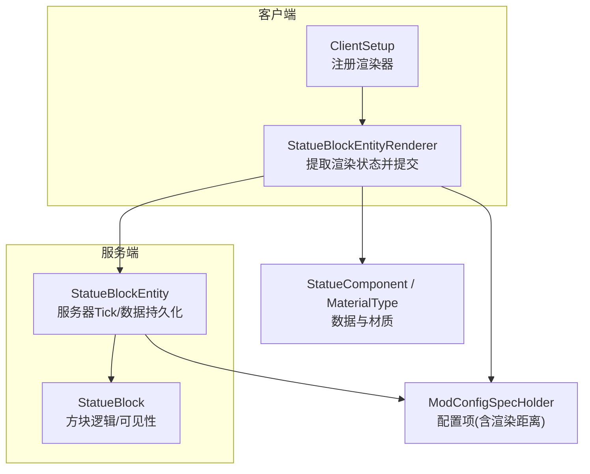
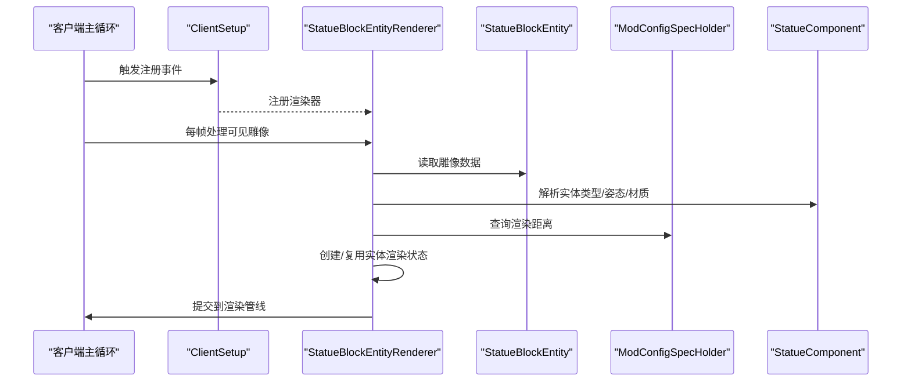
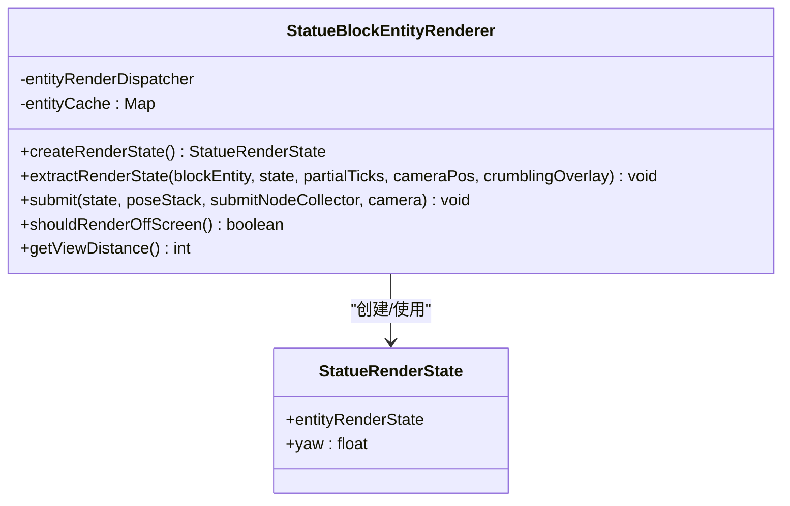
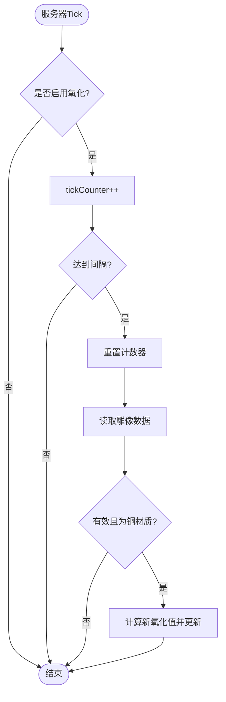
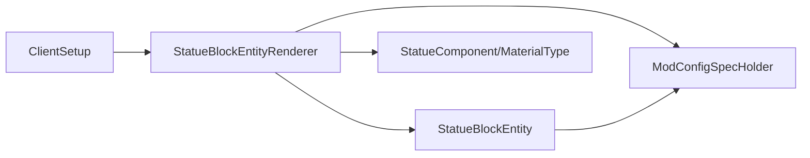

# 性能优化

<cite>
**本文引用的文件**
- [StatueBlockEntityRenderer.java](file://src/main/java/com/xiong/petrification/client/StatueBlockEntityRenderer.java)
- [ClientSetup.java](file://src/main/java/com/xiong/petrification/client/ClientSetup.java)
- [StatueBlock.java](file://src/main/java/com/xiong/petrification/block/StatueBlock.java)
- [StatueBlockEntity.java](file://src/main/java/com/xiong/petrification/block/StatueBlockEntity.java)
- [ModConfigSpecHolder.java](file://src/main/java/com/xiong/petrification/ModConfigSpecHolder.java)
- [StatueComponent.java](file://src/main/java/com/xiong/petrification/component/StatueComponent.java)
- [MaterialType.java](file://src/main/java/com/xiong/petrification/component/MaterialType.java)
- [Minecraft+26.2模组完整思路.md](file://Minecraft+26.2模组完整思路.md)
</cite>

## 目录
1. [简介](#简介)
2. [项目结构](#项目结构)
3. [核心组件](#核心组件)
4. [架构总览](#架构总览)
5. [详细组件分析](#详细组件分析)
6. [依赖关系分析](#依赖关系分析)
7. [性能考量](#性能考量)
8. [故障排查指南](#故障排查指南)
9. [结论](#结论)
10. [附录](#附录)

## 简介
本指南面向客户端渲染性能优化，围绕本模组的雕像方块实体渲染路径，系统性地阐述如何识别与定位渲染瓶颈（帧率监控、GPU使用分析、内存泄漏检测），并给出可落地的优化策略：批量渲染、绘制调用减少、LOD细节层次、异步加载与资源预加载。同时提供性能测试方法与基准测试工具使用建议，以及常见问题诊断与解决方案。

## 项目结构
本项目为基于Forge的Minecraft模组，包含服务端与客户端代码。与渲染性能直接相关的核心位于客户端包中，负责注册与执行雕像方块实体的渲染；服务端负责数据更新（如氧化）与状态同步。配置项集中管理，包括渲染距离等性能相关参数。

图表来源
- [ClientSetup.java:13-18](file://src/main/java/com/xiong/petrification/client/ClientSetup.java#L13-L18)
- [StatueBlockEntityRenderer.java:31-128](file://src/main/java/com/xiong/petrification/client/StatueBlockEntityRenderer.java#L31-L128)
- [StatueBlockEntity.java:17-88](file://src/main/java/com/xiong/petrification/block/StatueBlockEntity.java#L17-L88)
- [StatueBlock.java:38-153](file://src/main/java/com/xiong/petrification/block/StatueBlock.java#L38-L153)
- [ModConfigSpecHolder.java:8-69](file://src/main/java/com/xiong/petrification/ModConfigSpecHolder.java#L8-L69)
- [StatueComponent.java:14-256](file://src/main/java/com/xiong/petrification/component/StatueComponent.java#L14-L256)
- [MaterialType.java:9-68](file://src/main/java/com/xiong/petrification/component/MaterialType.java#L9-L68)

章节来源
- [ClientSetup.java:13-18](file://src/main/java/com/xiong/petrification/client/ClientSetup.java#L13-L18)
- [StatueBlockEntityRenderer.java:31-128](file://src/main/java/com/xiong/petrification/client/StatueBlockEntityRenderer.java#L31-L128)
- [StatueBlockEntity.java:17-88](file://src/main/java/com/xiong/petrification/block/StatueBlockEntity.java#L17-L88)
- [StatueBlock.java:38-153](file://src/main/java/com/xiong/petrification/block/StatueBlock.java#L38-L153)
- [ModConfigSpecHolder.java:8-69](file://src/main/java/com/xiong/petrification/ModConfigSpecHolder.java#L8-L69)
- [StatueComponent.java:14-256](file://src/main/java/com/xiong/petrification/component/StatueComponent.java#L14-L256)
- [MaterialType.java:9-68](file://src/main/java/com/xiong/petrification/component/MaterialType.java#L9-L68)

## 核心组件
- 客户端渲染入口：通过事件总线在客户端注册雕像方块实体渲染器，将渲染器与对应的方块实体类型绑定。
- 渲染器：实现方块实体渲染接口，负责从方块实体中提取渲染所需的状态，构建实体渲染状态，并通过调度器提交到渲染管线。
- 方块与方块实体：方块定义交互与可见性，方块实体维护雕像数据并在服务端进行周期性更新（如氧化）。
- 配置：提供渲染距离等性能相关开关与阈值，直接影响剔除与渲染范围。
- 数据模型：雕像数据记录实体类型、姿态、材质、氧化程度等；材质枚举提供颜色与关联物品/方块。

章节来源
- [ClientSetup.java:13-18](file://src/main/java/com/xiong/petrification/client/ClientSetup.java#L13-L18)
- [StatueBlockEntityRenderer.java:31-128](file://src/main/java/com/xiong/petrification/client/StatueBlockEntityRenderer.java#L31-L128)
- [StatueBlock.java:38-153](file://src/main/java/com/xiong/petrification/block/StatueBlock.java#L38-L153)
- [StatueBlockEntity.java:17-88](file://src/main/java/com/xiong/petrification/block/StatueBlockEntity.java#L17-L88)
- [ModConfigSpecHolder.java:8-69](file://src/main/java/com/xiong/petrification/ModConfigSpecHolder.java#L8-L69)
- [StatueComponent.java:14-256](file://src/main/java/com/xiong/petrification/component/StatueComponent.java#L14-L256)
- [MaterialType.java:9-68](file://src/main/java/com/xiong/petrification/component/MaterialType.java#L9-L68)

## 架构总览
下图展示了从客户端注册到实际提交的渲染流程，以及与配置和数据模型的交互。

图表来源
- [ClientSetup.java:13-18](file://src/main/java/com/xiong/petrification/client/ClientSetup.java#L13-L18)
- [StatueBlockEntityRenderer.java:31-128](file://src/main/java/com/xiong/petrification/client/StatueBlockEntityRenderer.java#L31-L128)
- [StatueBlockEntity.java:17-88](file://src/main/java/com/xiong/petrification/block/StatueBlockEntity.java#L17-L88)
- [ModConfigSpecHolder.java:8-69](file://src/main/java/com/xiong/petrification/ModConfigSpecHolder.java#L8-L69)
- [StatueComponent.java:14-256](file://src/main/java/com/xiong/petrification/component/StatueComponent.java#L14-L256)

## 详细组件分析

### 渲染器 StatueBlockEntityRenderer
- 职责：从方块实体提取渲染状态，缓存实体实例，设置姿态与动画状态，生成实体渲染状态并提交到渲染管线。
- 关键优化点：
  - 实体缓存：按实体类型缓存已创建的实体对象，避免重复创建带来的开销。
  - 渲染状态提取：仅在必要时创建实体渲染状态，异常时安全降级为空状态。
  - 视图距离控制：通过配置项限制渲染距离，减少远处雕像的渲染压力。
  - 离屏渲染：允许离屏渲染以支持某些显示需求。

图表来源
- [StatueBlockEntityRenderer.java:31-128](file://src/main/java/com/xiong/petrification/client/StatueBlockEntityRenderer.java#L31-L128)

章节来源
- [StatueBlockEntityRenderer.java:31-128](file://src/main/java/com/xiong/petrification/client/StatueBlockEntityRenderer.java#L31-L128)

### 方块与方块实体
- 方块：定义渲染形状为不可见，仅作为载体；提供交互与掉落逻辑。
- 方块实体：在服务端周期更新雕像数据（如铜材质氧化），保存/加载数据，并提供更新包给客户端。

图表来源
- [StatueBlockEntity.java:28-50](file://src/main/java/com/xiong/petrification/block/StatueBlockEntity.java#L28-L50)
- [ModConfigSpecHolder.java:28-38](file://src/main/java/com/xiong/petrification/ModConfigSpecHolder.java#L28-L38)

章节来源
- [StatueBlock.java:38-153](file://src/main/java/com/xiong/petrification/block/StatueBlock.java#L38-L153)
- [StatueBlockEntity.java:17-88](file://src/main/java/com/xiong/petrification/block/StatueBlockEntity.java#L17-L88)

### 配置 ModConfigSpecHolder
- 提供性能相关配置项，尤其是雕像渲染距离，用于控制剔除范围，降低远距离渲染成本。
- 其他配置项包括氧化速率、最大氧化值、是否启用氧化等，间接影响渲染外观与更新频率。

章节来源
- [ModConfigSpecHolder.java:8-69](file://src/main/java/com/xiong/petrification/ModConfigSpecHolder.java#L8-L69)

### 数据模型 StatueComponent 与 MaterialType
- StatueComponent：封装雕像的完整数据，包括实体类型、姿态、材质、氧化程度、皮肤信息等，用于序列化与传输。
- MaterialType：定义材质种类、颜色及关联物品/方块，便于着色或材质选择。

章节来源
- [StatueComponent.java:14-256](file://src/main/java/com/xiong/petrification/component/StatueComponent.java#L14-L256)
- [MaterialType.java:9-68](file://src/main/java/com/xiong/petrification/component/MaterialType.java#L9-L68)

## 依赖关系分析
- 客户端注册依赖事件总线，将渲染器与方块实体类型绑定。
- 渲染器依赖实体渲染调度器与相机状态，提交渲染任务。
- 方块实体依赖配置项控制行为（如氧化），并在服务端Tick中更新数据。
- 数据模型被渲染器与服务端共同消费，保证一致性与正确性。

图表来源
- [ClientSetup.java:13-18](file://src/main/java/com/xiong/petrification/client/ClientSetup.java#L13-L18)
- [StatueBlockEntityRenderer.java:31-128](file://src/main/java/com/xiong/petrification/client/StatueBlockEntityRenderer.java#L31-L128)
- [StatueBlockEntity.java:17-88](file://src/main/java/com/xiong/petrification/block/StatueBlockEntity.java#L17-L88)
- [ModConfigSpecHolder.java:8-69](file://src/main/java/com/xiong/petrification/ModConfigSpecHolder.java#L8-L69)
- [StatueComponent.java:14-256](file://src/main/java/com/xiong/petrification/component/StatueComponent.java#L14-L256)
- [MaterialType.java:9-68](file://src/main/java/com/xiong/petrification/component/MaterialType.java#L9-L68)

章节来源
- [ClientSetup.java:13-18](file://src/main/java/com/xiong/petrification/client/ClientSetup.java#L13-L18)
- [StatueBlockEntityRenderer.java:31-128](file://src/main/java/com/xiong/petrification/client/StatueBlockEntityRenderer.java#L31-L128)
- [StatueBlockEntity.java:17-88](file://src/main/java/com/xiong/petrification/block/StatueBlockEntity.java#L17-L88)
- [ModConfigSpecHolder.java:8-69](file://src/main/java/com/xiong/petrification/ModConfigSpecHolder.java#L8-L69)
- [StatueComponent.java:14-256](file://src/main/java/com/xiong/petrification/component/StatueComponent.java#L14-L256)
- [MaterialType.java:9-68](file://src/main/java/com/xiong/petrification/component/MaterialType.java#L9-L68)

## 性能考量
本节聚焦于客户端渲染性能优化的实践方法，结合本模组的渲染路径与通用优化策略。

- 渲染瓶颈识别
  - 帧率监控：观察游戏内帧率波动，定位卡顿时段；结合渲染统计查看绘制调用次数与顶点数。
  - GPU使用分析：使用外部工具（如NVIDIA Nsight Graphics、Intel GPA、AMD Radeon GPU Profiler）分析着色器占用、纹理带宽、批处理效率。
  - 内存泄漏检测：关注实体缓存与渲染状态的生命周期，避免长期持有引用导致内存增长；定期采样堆内存，定位未释放对象。

- 批量渲染与绘制调用减少
  - 模型缓存：对相同类型的雕像实体进行缓存复用，减少创建与初始化开销。
  - 实例化渲染：当存在大量同类型雕像时，考虑使用实例化渲染技术合并绘制调用，显著降低CPU侧开销。
  - 纹理绑定优化：尽量复用纹理图集，减少切换；对玩家皮肤等资源采用异步加载与缓存。
  - 视锥体与遮挡剔除：利用引擎提供的剔除机制，结合配置项中的渲染距离，减少不必要的渲染。

- LOD（细节层次）系统
  - 根据距离自动切换模型精度：近距离使用高保真模型，中距离使用简化网格，远距离使用低多边形或平面贴图。
  - 名称标签与装饰层延迟渲染：仅在近距或需要时渲染，降低整体负载。

- 异步加载与资源预加载
  - 玩家皮肤与复杂纹理异步加载，避免阻塞主线程；在后台线程完成解码与上传。
  - 预加载策略：在进入高负载区域前，提前加载常用资源，平滑过渡。

- 性能测试与基准测试
  - 场景设计：构造不同密度与距离的雕像场景，测量帧率、绘制调用、GPU占用。
  - 工具建议：使用内置调试界面与第三方Profiler；记录关键指标（FPS、Draw Calls、Triangles、Shader Time、Memory Usage）。
  - 对比实验：开启/关闭LOD、实例化渲染、异步加载等特性，量化收益。

章节来源
- [Minecraft+26.2模组完整思路.md:238-315](file://Minecraft+26.2模组完整思路.md#L238-L315)
- [Minecraft+26.2模组完整思路.md:788-815](file://Minecraft+26.2模组完整思路.md#L788-L815)
- [StatueBlockEntityRenderer.java:31-128](file://src/main/java/com/xiong/petrification/client/StatueBlockEntityRenderer.java#L31-L128)
- [ModConfigSpecHolder.java:40-43](file://src/main/java/com/xiong/petrification/ModConfigSpecHolder.java#L40-L43)

## 故障排查指南
- 渲染异常与崩溃
  - 现象：雕像不显示或渲染时报错。
  - 排查：检查实体类型是否存在、姿态数据是否合法；确认渲染器异常分支是否正确降级为空状态。
  - 参考：渲染器在异常时置空渲染状态，避免中断主循环。

- 性能回退
  - 现象：大量雕像导致帧率下降。
  - 排查：确认实体缓存是否生效；检查渲染距离配置是否过大；评估是否需要引入实例化渲染与LOD。
  - 参考：配置项中的渲染距离直接影响剔除范围；文档建议实例化渲染与LOD提升显著。

- 内存增长
  - 现象：长时间运行后内存持续上升。
  - 排查：检查实体缓存是否无限增长；确认渲染状态与临时对象及时释放；使用内存分析工具定位泄漏点。

章节来源
- [StatueBlockEntityRenderer.java:83-90](file://src/main/java/com/xiong/petrification/client/StatueBlockEntityRenderer.java#L83-L90)
- [StatueBlockEntityRenderer.java:95-113](file://src/main/java/com/xiong/petrification/client/StatueBlockEntityRenderer.java#L95-L113)
- [ModConfigSpecHolder.java:40-43](file://src/main/java/com/xiong/petrification/ModConfigSpecHolder.java#L40-L43)
- [Minecraft+26.2模组完整思路.md:788-815](file://Minecraft+26.2模组完整思路.md#L788-L815)

## 结论
本模组在客户端渲染方面已具备基础的性能优化点：实体缓存、渲染距离控制、异常安全降级。为进一步优化，建议引入实例化渲染、LOD系统与异步资源加载，并结合性能测试工具进行量化评估与调优。通过合理的剔除策略与绘制调用合并，可在大规模雕像场景中显著提升帧率与稳定性。

## 附录
- 术语说明
  - 绘制调用（Draw Call）：CPU向GPU提交一次渲染指令的过程，频繁切换会显著增加开销。
  - 实例化渲染：同一几何体多次绘制时使用单次提交，减少CPU侧调用。
  - LOD：根据距离动态调整模型复杂度，平衡画质与性能。
  - 异步加载：在后台线程加载资源，避免阻塞主线程。

- 实用建议
  - 优先优化高频路径：确保实体缓存命中率高，减少重复创建。
  - 合理设置渲染距离：根据设备性能调整配置项，避免过远渲染造成浪费。
  - 渐进式引入高级特性：先验证基础优化效果，再逐步加入实例化渲染与LOD。