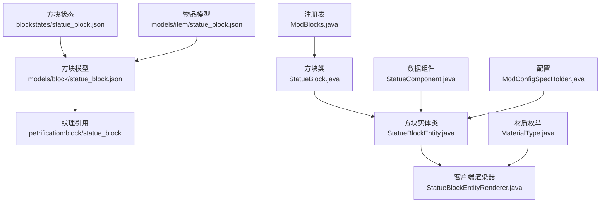
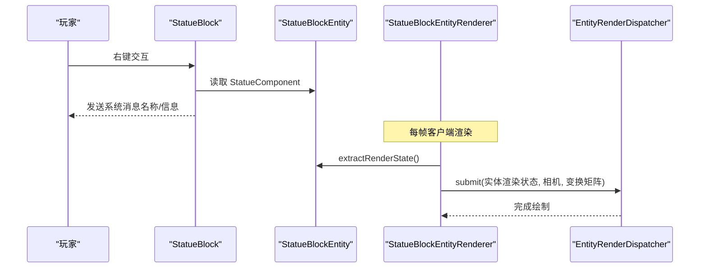
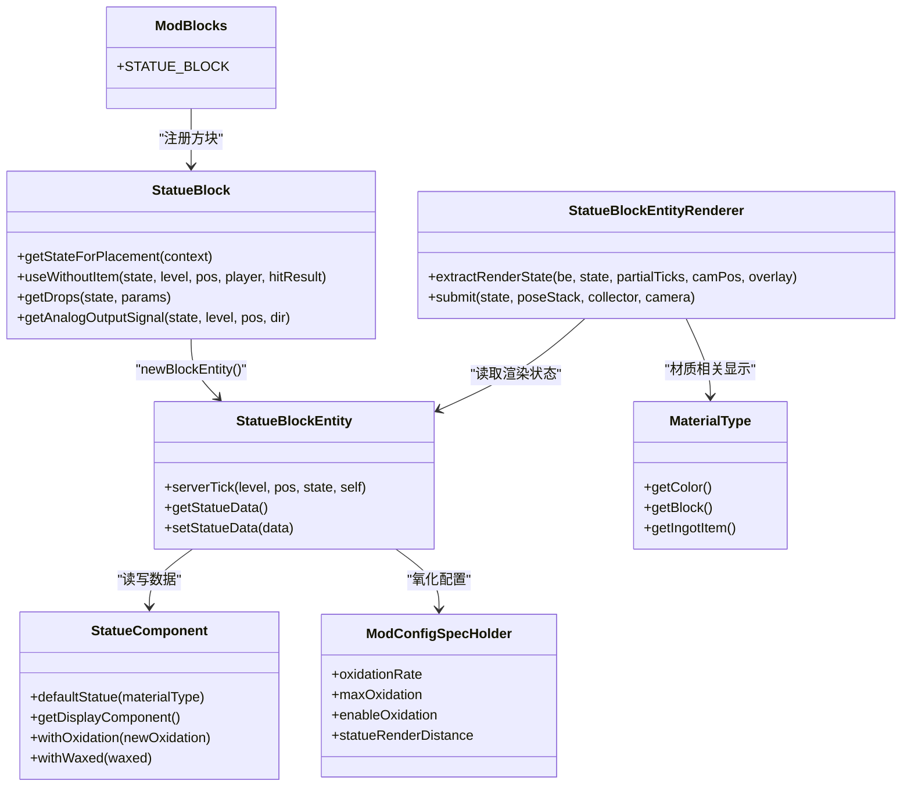

# 模型管理

<cite>
**本文引用的文件**
- [statue_block.json（方块模型）](file://src/main/resources/assets/petrification/models/block/statue_block.json)
- [statue_block.json（物品模型）](file://src/main/resources/assets/petrification/models/item/statue_block.json)
- [statue_block.json（方块状态）](file://src/main/resources/assets/petrification/blockstates/statue_block.json)
- [StatueBlock.java](file://src/main/java/com/xiong/petrification/block/StatueBlock.java)
- [StatueBlockEntity.java](file://src/main/java/com/xiong/petrification/block/StatueBlockEntity.java)
- [StatueBlockEntityRenderer.java](file://src/main/java/com/xiong/petrification/client/StatueBlockEntityRenderer.java)
- [MaterialType.java](file://src/main/java/com/xiong/petrification/component/MaterialType.java)
- [StatueComponent.java](file://src/main/java/com/xiong/petrification/component/StatueComponent.java)
- [ModBlocks.java](file://src/main/java/com/xiong/petrification/registry/ModBlocks.java)
- [ModConfigSpecHolder.java](file://src/main/java/com/xiong/petrification/ModConfigSpecHolder.java)
- [restoration_powder.json（物品模型）](file://src/main/resources/assets/petrification/models/item/restoration_powder.json)
- [Minecraft+26.2模组完整思路.md](file://Minecraft+26.2模组完整思路.md)
</cite>

## 目录
1. [简介](#简介)
2. [项目结构](#项目结构)
3. [核心组件](#核心组件)
4. [架构总览](#架构总览)
5. [详细组件分析](#详细组件分析)
6. [依赖关系分析](#依赖关系分析)
7. [性能与优化](#性能与优化)
8. [故障排查指南](#故障排查指南)
9. [结论](#结论)
10. [附录：自定义模型创建教程与调试工具](#附录自定义模型创建教程与调试工具)

## 简介
本文件围绕“石化雕像”模组的模型管理系统展开，重点说明 JSON 模型的编写规范、blockstates 条件渲染逻辑、材质与方向的处理方式，并结合实际代码解释雕像的渲染流程。由于该模组采用“实体渲染器在方块位置渲染生物”的方式实现雕像展示，因此并未使用复杂的多面体 JSON 模型；但文档仍会给出多面体模型的标准写法与最佳实践，便于扩展或替换为更复杂的几何体。同时提供模型优化技巧、内存管理与调试方法，帮助开发者高效构建与维护模型资源。

## 项目结构
本项目将模型资源与 Java 逻辑分离：
- 资源层：assets/petrification/models 与 blockstates 定义方块与物品的可视化表现。
- 逻辑层：Java 类负责方块行为、数据持久化、客户端渲染调度与配置参数控制。

图表来源
- [statue_block.json（方块状态）:1-9](file://src/main/resources/assets/petrification/blockstates/statue_block.json#L1-L9)
- [statue_block.json（方块模型）:1-7](file://src/main/resources/assets/petrification/models/block/statue_block.json#L1-L7)
- [statue_block.json（物品模型）:1-4](file://src/main/resources/assets/petrification/models/item/statue_block.json#L1-L4)
- [StatueBlock.java:38-153](file://src/main/java/com/xiong/petrification/block/StatueBlock.java#L38-L153)
- [StatueBlockEntity.java:1-88](file://src/main/java/com/xiong/petrification/block/StatueBlockEntity.java#L1-L88)
- [StatueBlockEntityRenderer.java:31-129](file://src/main/java/com/xiong/petrification/client/StatueBlockEntityRenderer.java#L31-L129)
- [MaterialType.java:9-68](file://src/main/java/com/xiong/petrification/component/MaterialType.java#L9-L68)
- [StatueComponent.java:14-256](file://src/main/java/com/xiong/petrification/component/StatueComponent.java#L14-L256)
- [ModBlocks.java:16-35](file://src/main/java/com/xiong/petrification/registry/ModBlocks.java#L16-L35)
- [ModConfigSpecHolder.java:8-69](file://src/main/java/com/xiong/petrification/ModConfigSpecHolder.java#L8-L69)

章节来源
- [statue_block.json（方块状态）:1-9](file://src/main/resources/assets/petrification/blockstates/statue_block.json#L1-L9)
- [statue_block.json（方块模型）:1-7](file://src/main/resources/assets/petrification/models/block/statue_block.json#L1-L7)
- [statue_block.json（物品模型）:1-4](file://src/main/resources/assets/petrification/models/item/statue_block.json#L1-L4)
- [StatueBlock.java:38-153](file://src/main/java/com/xiong/petrification/block/StatueBlock.java#L38-L153)
- [StatueBlockEntity.java:1-88](file://src/main/java/com/xiong/petrification/block/StatueBlockEntity.java#L1-L88)
- [StatueBlockEntityRenderer.java:31-129](file://src/main/java/com/xiong/petrification/client/StatueBlockEntityRenderer.java#L31-L129)
- [MaterialType.java:9-68](file://src/main/java/com/xiong/petrification/component/MaterialType.java#L9-L68)
- [StatueComponent.java:14-256](file://src/main/java/com/xiong/petrification/component/StatueComponent.java#L14-L256)
- [ModBlocks.java:16-35](file://src/main/java/com/xiong/petrification/registry/ModBlocks.java#L16-L35)
- [ModConfigSpecHolder.java:8-69](file://src/main/java/com/xiong/petrification/ModConfigSpecHolder.java#L8-L69)

## 核心组件
- 方块与状态
  - StatueBlock：定义方块的属性、放置时的朝向与水浸状态、交互行为、掉落物携带的数据组件等。
  - blockstates/statue_block.json：根据 facing 方向选择模型并应用旋转，实现不同方向的显示效果。
- 数据与材质
  - StatueComponent：以数据组件形式存储雕像的实体类型、材质类型、姿态、装备、外观等大量字段，并通过 Codec 分组序列化。
  - MaterialType：枚举定义了石头、铁、铜、金、钻石、下界合金等材质及其颜色、对应物品与方块。
- 渲染管线
  - StatueBlockEntity：承载雕像数据，并在服务端定时更新铜材质的氧化进度。
  - StatueBlockEntityRenderer：在客户端从 BlockEntity 提取渲染状态，缓存实体实例，设置姿态后提交到渲染管线。
- 配置
  - ModConfigSpecHolder：提供氧化速率、最大氧化值、是否启用氧化、渲染距离等运行时可调参数。

章节来源
- [StatueBlock.java:38-153](file://src/main/java/com/xiong/petrification/block/StatueBlock.java#L38-L153)
- [statue_block.json（方块状态）:1-9](file://src/main/resources/assets/petrification/blockstates/statue_block.json#L1-L9)
- [StatueComponent.java:14-256](file://src/main/java/com/xiong/petrification/component/StatueComponent.java#L14-L256)
- [MaterialType.java:9-68](file://src/main/java/com/xiong/petrification/component/MaterialType.java#L9-L68)
- [StatueBlockEntity.java:1-88](file://src/main/java/com/xiong/petrification/block/StatueBlockEntity.java#L1-L88)
- [StatueBlockEntityRenderer.java:31-129](file://src/main/java/com/xiong/petrification/client/StatueBlockEntityRenderer.java#L31-L129)
- [ModConfigSpecHolder.java:8-69](file://src/main/java/com/xiong/petrification/ModConfigSpecHolder.java#L8-L69)

## 架构总览
该模组采用“方块作为容器 + 实体渲染器”的模式：方块本身不可见（RenderShape.INVISIBLE），真正的视觉呈现由客户端渲染器在方块位置渲染一个实体，并根据 StatueComponent 中的姿态、材质等信息进行着色与动画保持。

图表来源
- [StatueBlock.java:103-121](file://src/main/java/com/xiong/petrification/block/StatueBlock.java#L103-L121)
- [StatueBlockEntityRenderer.java:44-113](file://src/main/java/com/xiong/petrification/client/StatueBlockEntityRenderer.java#L44-L113)

章节来源
- [StatueBlock.java:84-121](file://src/main/java/com/xiong/petrification/block/StatueBlock.java#L84-L121)
- [StatueBlockEntityRenderer.java:44-113](file://src/main/java/com/xiong/petrification/client/StatueBlockEntityRenderer.java#L44-L113)

## 详细组件分析

### JSON 模型编写规范（方块、物品、状态）
- 方块模型
  - 当前 statue_block 方块模型继承自基础立方体模板，通过 textures.all 指定纹理路径。
  - 适用于简单立方体场景；如需复杂几何体可改用 multi-part 或直接使用多面体模型。
- 物品模型
  - 物品模型直接引用方块模型，确保手持与放置时视觉一致。
- 方块状态
  - 使用 variants 按 facing 方向映射模型与旋转角度，实现四向显示。

章节来源
- [statue_block.json（方块模型）:1-7](file://src/main/resources/assets/petrification/models/block/statue_block.json#L1-L7)
- [statue_block.json（物品模型）:1-4](file://src/main/resources/assets/petrification/models/item/statue_block.json#L1-L4)
- [statue_block.json（方块状态）:1-9](file://src/main/resources/assets/petrification/blockstates/statue_block.json#L1-L9)

### statue_block.json 复杂结构与扩展建议
- 当前实现为简单立方体，未使用多面体。若需复杂结构，推荐以下做法：
  - 多面体模型：使用 vertices、faces、uv、texture 等键定义几何与 UV 映射。
  - 材质引用机制：通过 textures 命名空间绑定纹理路径，避免硬编码。
  - 组合模型：使用 parent 引用多个子模型，配合 transforms 定位与缩放。
- 注意：当前渲染管线并不依赖方块模型几何，而是渲染实体；因此即使替换为复杂方块模型，也不会改变雕像的实际显示。

章节来源
- [statue_block.json（方块模型）:1-7](file://src/main/resources/assets/petrification/models/block/statue_block.json#L1-L7)
- [Minecraft+26.2模组完整思路.md:238-310](file://Minecraft+26.2模组完整思路.md#L238-L310)

### blockstates 条件渲染与方向处理
- 通过 variants 中面向 north/south/west/east 的不同条目，分别设置模型与 y 轴旋转，实现四向显示。
- 若需要更多状态（如材质切换），可在 blockstates 中使用 conditionals（例如 material=stone|iron...）并映射到不同模型或覆盖层。

章节来源
- [statue_block.json（方块状态）:1-9](file://src/main/resources/assets/petrification/blockstates/statue_block.json#L1-L9)

### 材质与方向对显示的影响
- 材质影响
  - MaterialType 提供颜色与对应物品/方块，用于 UI 显示与可能的着色计算。
  - 铜材质支持氧化进度，影响外观颜色与红石信号输出。
- 方向影响
  - blockstates 根据 facing 设置模型旋转；实体渲染器根据 StatueComponent 的 yaw/pitch/headYaw 设置实体朝向。

章节来源
- [MaterialType.java:9-68](file://src/main/java/com/xiong/petrification/component/MaterialType.java#L9-L68)
- [statue_block.json（方块状态）:1-9](file://src/main/resources/assets/petrification/blockstates/statue_block.json#L1-L9)
- [StatueBlockEntityRenderer.java:74-89](file://src/main/java/com/xiong/petrification/client/StatueBlockEntityRenderer.java#L74-L89)

### 数据组件与序列化
- StatueComponent 使用 RecordCodecBuilder 将大量字段分组序列化，保证 NBT/JSON 兼容性与可读性。
- 包含基础标识、材质特有字段、姿态/动作、装备、生物/玩家特有数据等。

章节来源
- [StatueComponent.java:14-256](file://src/main/java/com/xiong/petrification/component/StatueComponent.java#L14-L256)

### 服务端氧化逻辑
- 服务端周期性增加铜材质的氧化值，受配置限制（最大氧化值、是否启用）。
- 氧化值可用于红石信号输出与外观变化。

章节来源
- [StatueBlockEntity.java:28-50](file://src/main/java/com/xiong/petrification/block/StatueBlockEntity.java#L28-L50)
- [StatueBlock.java:137-151](file://src/main/java/com/xiong/petrification/block/StatueBlock.java#L137-L151)
- [ModConfigSpecHolder.java:28-53](file://src/main/java/com/xiong/petrification/ModConfigSpecHolder.java#L28-L53)

### 客户端渲染流程
- 渲染器从 BlockEntity 提取 StatueComponent，获取实体类型并缓存实体实例。
- 设置实体的姿态与状态（蹲伏、冲刺、游泳、飞行、幼年等），然后提交到渲染管线。
- 支持离屏渲染与可配置的渲染距离。

章节来源
- [StatueBlockEntityRenderer.java:44-123](file://src/main/java/com/xiong/petrification/client/StatueBlockEntityRenderer.java#L44-L123)

## 依赖关系分析

图表来源
- [StatueBlock.java:38-153](file://src/main/java/com/xiong/petrification/block/StatueBlock.java#L38-L153)
- [StatueBlockEntity.java:1-88](file://src/main/java/com/xiong/petrification/block/StatueBlockEntity.java#L1-L88)
- [StatueBlockEntityRenderer.java:31-129](file://src/main/java/com/xiong/petrification/client/StatueBlockEntityRenderer.java#L31-L129)
- [StatueComponent.java:14-256](file://src/main/java/com/xiong/petrification/component/StatueComponent.java#L14-L256)
- [MaterialType.java:9-68](file://src/main/java/com/xiong/petrification/component/MaterialType.java#L9-L68)
- [ModBlocks.java:16-35](file://src/main/java/com/xiong/petrification/registry/ModBlocks.java#L16-L35)
- [ModConfigSpecHolder.java:8-69](file://src/main/java/com/xiong/petrification/ModConfigSpecHolder.java#L8-L69)

章节来源
- [StatueBlock.java:38-153](file://src/main/java/com/xiong/petrification/block/StatueBlock.java#L38-L153)
- [StatueBlockEntity.java:1-88](file://src/main/java/com/xiong/petrification/block/StatueBlockEntity.java#L1-L88)
- [StatueBlockEntityRenderer.java:31-129](file://src/main/java/com/xiong/petrification/client/StatueBlockEntityRenderer.java#L31-L129)
- [StatueComponent.java:14-256](file://src/main/java/com/xiong/petrification/component/StatueComponent.java#L14-L256)
- [MaterialType.java:9-68](file://src/main/java/com/xiong/petrification/component/MaterialType.java#L9-L68)
- [ModBlocks.java:16-35](file://src/main/java/com/xiong/petrification/registry/ModBlocks.java#L16-L35)
- [ModConfigSpecHolder.java:8-69](file://src/main/java/com/xiong/petrification/ModConfigSpecHolder.java#L8-L69)

## 性能与优化
- 模型与渲染
  - 实体缓存：渲染器维护 Map<EntityType<?>, Entity> 缓存实体实例，避免重复创建。
  - 渲染距离：通过配置项 statueRenderDistance 控制雕像可见范围，减少远处渲染开销。
  - 剔除优化：仅渲染可见区域，结合视锥体与遮挡剔除降低负载。
- 数据存储
  - 批量更新：氧化更新使用间隔计数，避免每 tick 都计算。
  - 惰性加载：仅在需要时加载实体与皮肤资源。
- 纹理与图集
  - 使用统一的纹理命名空间与路径，便于打包进纹理图集，减少纹理切换成本。
- 内存管理
  - 合理设置渲染距离与 LOD，避免过多雕像同时渲染导致内存峰值。
  - 区块卸载时清理缓存，释放不再使用的实体与资源。

章节来源
- [StatueBlockEntityRenderer.java:31-123](file://src/main/java/com/xiong/petrification/client/StatueBlockEntityRenderer.java#L31-L123)
- [ModConfigSpecHolder.java:40-53](file://src/main/java/com/xiong/petrification/ModConfigSpecHolder.java#L40-L53)
- [StatueBlockEntity.java:28-50](file://src/main/java/com/xiong/petrification/block/StatueBlockEntity.java#L28-L50)
- [Minecraft+26.2模组完整思路.md:788-815](file://Minecraft+26.2模组完整思路.md#L788-L815)

## 故障排查指南
- 雕像不显示
  - 检查 StatueBlock.getRenderShape 是否为 INVISIBLE（预期行为），确认渲染器是否正确注册。
  - 确认 StatueComponent 中存在有效的 entityType，否则渲染器会跳过渲染。
- 方向错误
  - 核对 blockstates 中 facing 与旋转角度是否匹配。
  - 检查 StatueComponent 的 yaw/pitch/headYaw 是否正确设置。
- 氧化异常
  - 确认 enableOxidation 与 maxOxidation 配置是否正确。
  - 检查 isWaxed 是否阻止了氧化增长。
- 性能问题
  - 调整 statueRenderDistance 降低渲染距离。
  - 减少同屏雕像数量或使用 LOD。

章节来源
- [StatueBlock.java:84-87](file://src/main/java/com/xiong/petrification/block/StatueBlock.java#L84-L87)
- [StatueBlockEntityRenderer.java:56-89](file://src/main/java/com/xiong/petrification/client/StatueBlockEntityRenderer.java#L56-L89)
- [statue_block.json（方块状态）:1-9](file://src/main/resources/assets/petrification/blockstates/statue_block.json#L1-L9)
- [StatueBlockEntity.java:28-50](file://src/main/java/com/xiong/petrification/block/StatueBlockEntity.java#L28-L50)
- [ModConfigSpecHolder.java:28-53](file://src/main/java/com/xiong/petrification/ModConfigSpecHolder.java#L28-L53)

## 结论
该模组通过“方块容器 + 实体渲染器”的架构实现了灵活的雕像展示，避免了复杂 JSON 几何的限制，同时借助数据组件与配置系统提供了丰富的材质与外观控制能力。对于需要复杂几何的场景，仍可引入多面体模型或组合模型；但在当前渲染管线下，应以实体渲染为主。通过合理的缓存、剔除与配置调优，可以在大规模雕像场景中保持良好的性能。

## 附录：自定义模型创建教程与调试工具

### 自定义方块模型（多面体）步骤
- 新建 models/block/your_model.json，使用多面体语法定义顶点、面、UV 与纹理引用。
- 在 blockstates/your_block.json 中声明 variants，指向你的模型，并按方向设置旋转。
- 在 assets/petrification/textures 中添加对应纹理，确保路径与模型中的 texture 引用一致。
- 若需要组合多个模型，使用 parent 引用与 transforms 进行定位与缩放。

提示：当前雕像渲染不依赖方块模型几何，因此上述步骤主要用于装饰性或替代方案。

### 自定义物品模型
- 在 models/item/your_item.json 中引用生成的纹理或父模型。
- 示例参考 restoration_powder.json 的结构。

章节来源
- [restoration_powder.json:1-7](file://src/main/resources/assets/petrification/models/item/restoration_powder.json#L1-L7)

### 调试工具与方法
- 游戏内调试
  - 使用 /give 命令放置方块，观察 blockstates 的方向映射是否正确。
  - 使用 F3 查看坐标与状态，确认 facing 与旋转。
  - 使用 /effect 或指令修改 StatueComponent 中的姿态与材质，验证渲染效果。
- 日志与断点
  - 在 StatueBlockEntityRenderer.extractRenderState 与 submit 处设置断点，检查实体状态与变换矩阵。
  - 在服务端 StatuesBlockEntity.serverTick 设置断点，验证氧化更新逻辑。
- 性能分析
  - 使用内置性能面板统计渲染调用次数与耗时，调整 statueRenderDistance 与雕像密度。

章节来源
- [StatueBlockEntityRenderer.java:44-113](file://src/main/java/com/xiong/petrification/client/StatueBlockEntityRenderer.java#L44-L113)
- [StatueBlockEntity.java:28-50](file://src/main/java/com/xiong/petrification/block/StatueBlockEntity.java#L28-L50)
- [ModConfigSpecHolder.java:40-53](file://src/main/java/com/xiong/petrification/ModConfigSpecHolder.java#L40-L53)