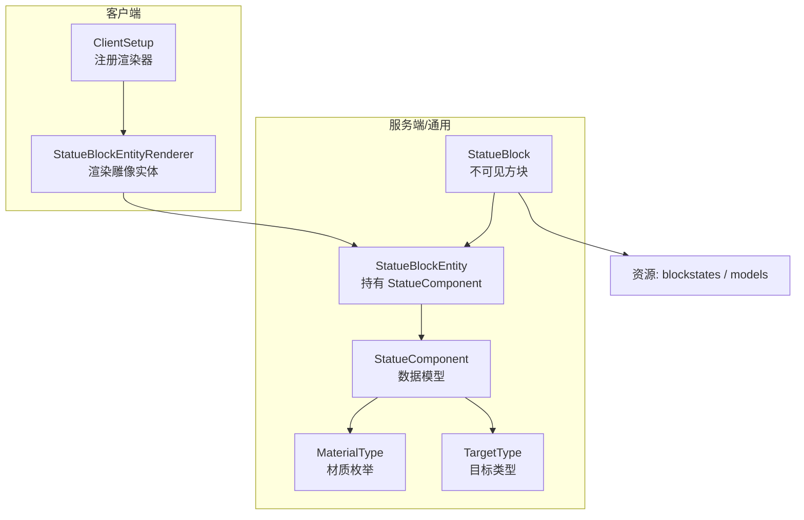
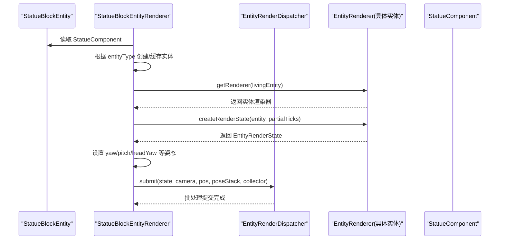
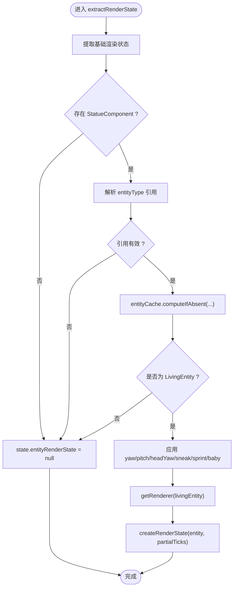
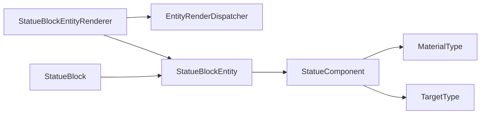

# 渲染器实现

<cite>
**本文引用的文件**
- [StatueBlockEntityRenderer.java](file://src/main/java/com/xiong/petrification/client/StatueBlockEntityRenderer.java)
- [StatueBlockEntity.java](file://src/main/java/com/xiong/petrification/block/StatueBlockEntity.java)
- [StatueBlock.java](file://src/main/java/com/xiong/petrification/block/StatueBlock.java)
- [StatueComponent.java](file://src/main/java/com/xiong/petrification/component/StatueComponent.java)
- [MaterialType.java](file://src/main/java/com/xiong/petrification/component/MaterialType.java)
- [TargetType.java](file://src/main/java/com/xiong/petrification/component/TargetType.java)
- [ClientSetup.java](file://src/main/java/com/xiong/petrification/client/ClientSetup.java)
- [ModBlockEntities.java](file://src/main/java/com/xiong/petrification/registry/ModBlockEntities.java)
- [statue_block.json（方块模型）](file://src/main/resources/assets/petrification/models/block/statue_block.json)
- [statue_block.json（方块状态）](file://src/main/resources/assets/petrification/blockstates/statue_block.json)
</cite>

## 目录
1. [简介](#简介)
2. [项目结构](#项目结构)
3. [核心组件](#核心组件)
4. [架构总览](#架构总览)
5. [详细组件分析](#详细组件分析)
6. [依赖关系分析](#依赖关系分析)
7. [性能考虑](#性能考虑)
8. [故障排查指南](#故障排查指南)
9. [结论](#结论)
10. [附录：扩展与自定义示例](#附录：扩展与自定义示例)

## 简介
本技术文档聚焦于雕像方块实体渲染器的实现，围绕 StatueBlockEntityRenderer 类展开，系统阐述其渲染管线初始化、模型绑定与绘制流程；解释如何依据 StatueComponent 数据动态加载不同材质纹理、处理方向性显示与旋转效果；总结渲染性能优化策略（批处理、纹理缓存、LOD），并提供扩展示例（发光、粒子、动画过渡）以及调试技巧与常见问题解决方案。

## 项目结构
该模组将“雕像”抽象为可持久化的方块实体，客户端通过专用 BlockEntityRenderer 将对应实体以缩放后的形式渲染在方块位置。关键组织方式如下：
- 客户端注册：ClientSetup 在 Mod 事件总线中注册雕像方块的 BlockEntityRenderer。
- 方块与实体：StatueBlock 提供不可见渲染形状并创建 StatueBlockEntity；后者负责服务端氧化等逻辑与数据同步。
- 数据模型：StatueComponent 记录雕像的实体类型、姿态、材质、装备、外观等大量可选字段，并通过 Codec 进行序列化。
- 材质枚举：MaterialType 定义多种材质及其显示前缀、颜色、关联物品与方块。
- 资源：blockstates 与 models 定义了方块的基础模型与朝向变体（实际渲染由实体渲染器接管）。

图表来源
- [ClientSetup.java:13-18](file://src/main/java/com/xiong/petrification/client/ClientSetup.java#L13-L18)
- [StatueBlockEntityRenderer.java:31-37](file://src/main/java/com/xiong/petrification/client/StatueBlockEntityRenderer.java#L31-L37)
- [StatueBlock.java:85-93](file://src/main/java/com/xiong/petrification/block/StatueBlock.java#L85-L93)
- [StatueBlockEntity.java:17-26](file://src/main/java/com/xiong/petrification/block/StatueBlockEntity.java#L17-L26)
- [StatueComponent.java:14-52](file://src/main/java/com/xiong/petrification/component/StatueComponent.java#L14-L52)
- [MaterialType.java:9-15](file://src/main/java/com/xiong/petrification/component/MaterialType.java#L9-L15)
- [TargetType.java:6-8](file://src/main/java/com/xiong/petrification/component/TargetType.java#L6-L8)

章节来源
- [ClientSetup.java:13-18](file://src/main/java/com/xiong/petrification/client/ClientSetup.java#L13-L18)
- [StatueBlock.java:85-93](file://src/main/java/com/xiong/petrification/block/StatueBlock.java#L85-L93)
- [StatueBlockEntity.java:17-26](file://src/main/java/com/xiong/petrification/block/StatueBlockEntity.java#L17-L26)
- [StatueComponent.java:14-52](file://src/main/java/com/xiong/petrification/component/StatueComponent.java#L14-L52)
- [MaterialType.java:9-15](file://src/main/java/com/xiong/petrification/component/MaterialType.java#L9-L15)
- [TargetType.java:6-8](file://src/main/java/com/xiong/petrification/component/TargetType.java#L6-L8)

## 核心组件
- StatueBlockEntityRenderer：实现 BlockEntityRenderer，负责从 StatueBlockEntity 提取渲染状态、构建变换矩阵并提交给 EntityRenderDispatcher 完成最终绘制。
- StatueBlockEntity：承载 StatueComponent，维护服务端氧化计时与数据持久化。
- StatueComponent：包含实体类型、姿态、材质、装备、外观等丰富字段，支持 NBT/Codec 序列化。
- MaterialType：材质枚举，提供名称、颜色、关联物品与方块，用于 UI 或后续材质映射。
- TargetType：目标类型（生物/玩家），影响雕像生成与行为。
- ClientSetup/ModBlockEntities：客户端注册与方块实体类型注册。

章节来源
- [StatueBlockEntityRenderer.java:31-128](file://src/main/java/com/xiong/petrification/client/StatueBlockEntityRenderer.java#L31-L128)
- [StatueBlockEntity.java:17-88](file://src/main/java/com/xiong/petrification/block/StatueBlockEntity.java#L17-L88)
- [StatueComponent.java:14-256](file://src/main/java/com/xiong/petrification/component/StatueComponent.java#L14-L256)
- [MaterialType.java:9-68](file://src/main/java/com/xiong/petrification/component/MaterialType.java#L9-L68)
- [TargetType.java:6-23](file://src/main/java/com/xiong/petrification/component/TargetType.java#L6-L23)
- [ClientSetup.java:13-18](file://src/main/java/com/xiong/petrification/client/ClientSetup.java#L13-L18)
- [ModBlockEntities.java:13-26](file://src/main/java/com/xiong/petrification/registry/ModBlockEntities.java#L13-L26)

## 架构总览
渲染流程分为三个阶段：
1) 渲染状态提取：extractRenderState 从 StatueBlockEntity 读取 StatueComponent，根据 entityType 创建或复用实体实例，设置姿态与状态，并调用对应 EntityRenderer 的 createRenderState 生成可提交的状态对象。
2) 提交绘制：submit 对 PoseStack 进行平移、旋转与缩放，然后使用 EntityRenderDispatcher.submit 将渲染任务加入批处理节点收集器。
3) 可见性与距离：shouldRenderOffScreen 返回 true 允许离屏渲染；getViewDistance 返回配置的距离阈值。

图表来源
- [StatueBlockEntityRenderer.java:44-113](file://src/main/java/com/xiong/petrification/client/StatueBlockEntityRenderer.java#L44-L113)
- [StatueBlockEntity.java:52-60](file://src/main/java/com/xiong/petrification/block/StatueBlockEntity.java#L52-L60)
- [StatueComponent.java:14-52](file://src/main/java/com/xiong/petrification/component/StatueComponent.java#L14-L52)

## 详细组件分析

### StatueBlockEntityRenderer：渲染管线与绘制流程
- 渲染状态提取（extractRenderState）
  - 基础状态提取：调用 BlockEntityRenderState.extractBase 填充通用信息。
  - 数据校验：若 StatueComponent 为空或 entityRef 不存在，则跳过渲染。
  - 实体创建与缓存：使用 entityCache 按 EntityType 缓存实体，避免重复创建开销。
  - 姿态与状态设置：将 StatueComponent 中的 yaw、pitch、headYaw、sneaking、sprinting、baby 等应用到 LivingEntity。
  - 渲染状态生成：通过 EntityRenderDispatcher.getRenderer 获取具体实体的渲染器，并调用 createRenderState 生成可提交的渲染状态。
- 提交绘制（submit）
  - 变换矩阵：translate(0.5, 0, 0.5) 将原点移至方块中心；mulPose 绕 Y 轴旋转以对齐朝向；scale(0.5, 0.5, 0.5) 将实体缩放到合适尺寸。
  - 提交渲染：调用 EntityRenderDispatcher.submit 将渲染任务加入批处理节点收集器。
  - 异常保护：捕获异常并静默忽略，保证渲染稳定性。
- 可见性与视距
  - shouldRenderOffScreen 返回 true，允许离屏渲染。
  - getViewDistance 返回配置项 statueRenderDistance，控制渲染距离。

图表来源
- [StatueBlockEntityRenderer.java:44-90](file://src/main/java/com/xiong/petrification/client/StatueBlockEntityRenderer.java#L44-L90)

章节来源
- [StatueBlockEntityRenderer.java:31-128](file://src/main/java/com/xiong/petrification/client/StatueBlockEntityRenderer.java#L31-L128)

### StatueBlockEntity：数据持有与服务端逻辑
- 数据存取：getStatueData/setStatueData 管理 StatueComponent，并在变更时标记块实体已改变以触发同步。
- 服务端 Tick：周期性检查是否启用氧化、是否为铜材质、是否上蜡或达到最大氧化度，满足条件则更新氧化值。
- 持久化：saveAdditional/loadAdditional 使用 StatueComponent.CODEC 进行读写。

章节来源
- [StatueBlockEntity.java:17-88](file://src/main/java/com/xiong/petrification/block/StatueBlockEntity.java#L17-L88)

### StatueComponent：数据模型与序列化
- 字段分组：将 37 个字段拆分为四组（A/B/C/D），再通过 Pair1/Pair2/Combined 组合，最后 xmap 到 StatueComponent。
- 序列化：CODEC 支持 NBT/JSON 存储，便于跨世界保存与传输。
- 辅助方法：defaultStatue 提供默认雕像；withOxidation/withWaxed 用于不可变更新；getDisplayComponent 提供显示名称。

章节来源
- [StatueComponent.java:14-256](file://src/main/java/com/xiong/petrification/component/StatueComponent.java#L14-L256)

### MaterialType 与 TargetType：材质与目标类型
- MaterialType：定义石头、铁、铜、金、钻石、下界合金等材质，提供颜色、物品与方块引用，以及显示前缀。
- TargetType：区分生物与玩家两种目标类型，用于雕像生成与行为差异。

章节来源
- [MaterialType.java:9-68](file://src/main/java/com/xiong/petrification/component/MaterialType.java#L9-L68)
- [TargetType.java:6-23](file://src/main/java/com/xiong/petrification/component/TargetType.java#L6-L23)

### 客户端注册与方块模型
- 客户端注册：ClientSetup 在 Mod 事件总线中注册 StatueBlockEntityRenderer。
- 方块实体类型：ModBlockEntities 注册 StatueBlockEntity 并绑定到 StatueBlock。
- 方块模型：blockstates 定义朝向变体，models 指向一个通用立方体模型（实际渲染由实体渲染器接管，方块本身为不可见）。

章节来源
- [ClientSetup.java:13-18](file://src/main/java/com/xiong/petrification/client/ClientSetup.java#L13-L18)
- [ModBlockEntities.java:13-26](file://src/main/java/com/xiong/petrification/registry/ModBlockEntities.java#L13-L26)
- [statue_block.json（方块状态）:1-9](file://src/main/resources/assets/petrification/blockstates/statue_block.json#L1-L9)
- [statue_block.json（方块模型）:1-7](file://src/main/resources/assets/petrification/models/block/statue_block.json#L1-L7)

## 依赖关系分析
- 渲染器依赖：
  - EntityRenderDispatcher：用于获取具体实体渲染器并提交渲染任务。
  - StatueBlockEntity：提供 StatueComponent 数据。
  - StatueComponent：决定实体类型、姿态、材质等。
- 方块与实体：
  - StatueBlock：创建 StatueBlockEntity，提供不可见渲染形状。
  - StatueBlockEntity：持有 StatueComponent，执行服务端氧化逻辑。
- 资源：
  - blockstates/models：定义方块外观与朝向（实际渲染由实体渲染器接管）。

图表来源
- [StatueBlockEntityRenderer.java:31-128](file://src/main/java/com/xiong/petrification/client/StatueBlockEntityRenderer.java#L31-L128)
- [StatueBlockEntity.java:17-88](file://src/main/java/com/xiong/petrification/block/StatueBlockEntity.java#L17-L88)
- [StatueComponent.java:14-256](file://src/main/java/com/xiong/petrification/component/StatueComponent.java#L14-L256)
- [MaterialType.java:9-68](file://src/main/java/com/xiong/petrification/component/MaterialType.java#L9-L68)
- [TargetType.java:6-23](file://src/main/java/com/xiong/petrification/component/TargetType.java#L6-L23)

章节来源
- [StatueBlockEntityRenderer.java:31-128](file://src/main/java/com/xiong/petrification/client/StatueBlockEntityRenderer.java#L31-L128)
- [StatueBlockEntity.java:17-88](file://src/main/java/com/xiong/petrification/block/StatueBlockEntity.java#L17-L88)
- [StatueComponent.java:14-256](file://src/main/java/com/xiong/petrification/component/StatueComponent.java#L14-L256)

## 性能考虑
- 批处理渲染：通过 EntityRenderDispatcher.submit 将渲染任务加入 SubmitNodeCollector，利用引擎批处理能力减少绘制调用。
- 纹理与实体缓存：
  - 实体缓存：entityCache 按 EntityType 缓存实体实例，避免每帧重复创建。
  - 纹理缓存：具体纹理由底层 EntityRenderer 与资源系统管理，当前实现未直接操作纹理缓存。
- 视距与离屏渲染：
  - shouldRenderOffScreen 返回 true，确保雕像在相机外仍可正确计算与提交。
  - getViewDistance 返回配置项 statueRenderDistance，控制渲染距离。
- LOD 系统：当前实现未内置 LOD；如需可按距离切换简化模型或降低细节。
- 姿态更新频率：姿态与状态在 extractRenderState 中每帧更新，适合静态雕像；若需动画，可在 StatueComponent 中增加动画进度字段并在渲染时插值。

[本节为通用性能讨论，不直接分析具体代码行]

## 故障排查指南
- 渲染失败或无输出
  - 检查 StatueComponent 是否存在且包含有效的 entityType；若为空或无效，渲染将被跳过。
  - 确认 StatueBlockEntityRenderer 已在客户端正确注册（ClientSetup 中 registerBlockEntityRenderer）。
  - 查看 getViewDistance 配置是否过小导致雕像被剔除。
- 实体类型错误
  - 若 entityType 无法解析为有效实体引用，extractRenderState 会返回空渲染状态。
- 姿态不正确
  - 确认 StatueComponent 中的 yaw、pitch、headYaw 是否正确设置；submit 中会基于这些角度进行旋转。
- 异常静默忽略
  - submit 中捕获异常并忽略，若出现崩溃或异常，请检查上层实体渲染器与资源路径。

章节来源
- [StatueBlockEntityRenderer.java:44-113](file://src/main/java/com/xiong/petrification/client/StatueBlockEntityRenderer.java#L44-L113)
- [ClientSetup.java:13-18](file://src/main/java/com/xiong/petrification/client/ClientSetup.java#L13-L18)

## 结论
StatueBlockEntityRenderer 通过复用 Minecraft 的实体渲染管线，将 StatueComponent 描述的雕像数据转化为可渲染的实体状态，并以缩放与旋转的方式呈现于方块位置。其设计简洁高效，借助批处理与实体缓存提升性能。当前实现未直接处理材质纹理的动态切换与复杂动画，但可通过扩展 StatueComponent 与渲染器逻辑轻松实现。

[本节为总结性内容，不直接分析具体代码行]

## 附录：扩展与自定义示例

### 动态材质纹理
- 思路：在 StatueComponent 中新增 textureVariant 或 materialTexture 字段；在渲染前根据材质类型选择对应的纹理路径，并通过自定义 EntityRenderer 或覆盖贴图映射实现。
- 注意：当前实现依赖标准实体渲染器，若需完全自定义纹理映射，建议封装一层中间渲染器或使用自定义模型层。

### 发光效果
- 思路：在 submit 阶段，结合光源系统或自定义着色器为雕像添加自发光；或在 StatueComponent 中增加发光强度字段，在渲染时调整光照参数。
- 注意：需确保不影响其他实体的光照计算。

### 粒子特效
- 思路：在 StatueBlockEntity 的 tick 或渲染回调中，根据 StatueComponent 的特效标志位生成粒子（如铜材质氧化时的微粒）。
- 注意：控制粒子数量与生命周期，避免性能瓶颈。

### 动画过渡
- 思路：在 StatueComponent 中增加动画进度与关键帧；在渲染时根据 partialTicks 插值姿态或切换模型层，实现平滑过渡。
- 注意：保持与游戏帧率无关的动画速度，使用 delta time 计算。

### 渲染调试技巧
- 打印 StatueComponent 关键字段（entityType、yaw、pitch、materialType）以验证数据流。
- 临时增大 getViewDistance 或关闭离屏剔除，观察雕像是否出现在预期位置。
- 在 submit 前后记录 PoseStack 状态，确认变换矩阵是否符合预期。

[本节为概念性指导，不直接分析具体代码行]