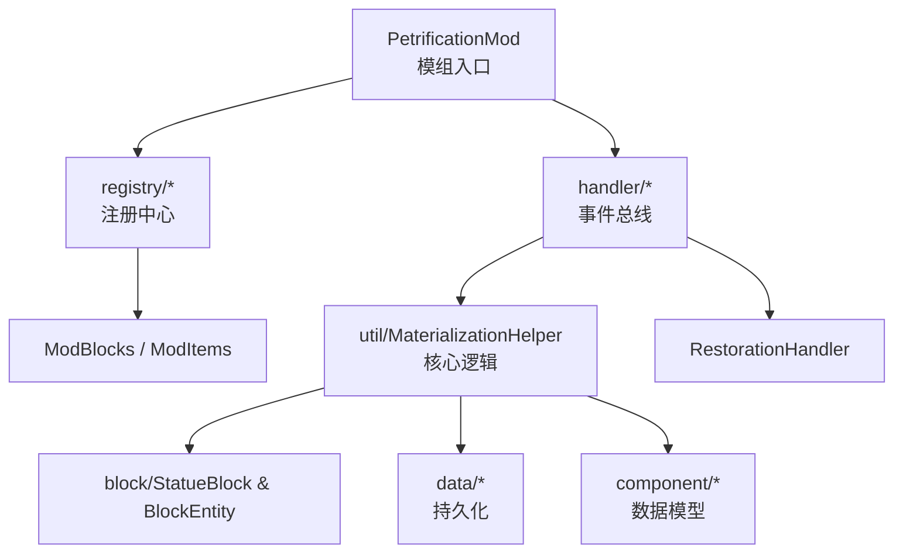
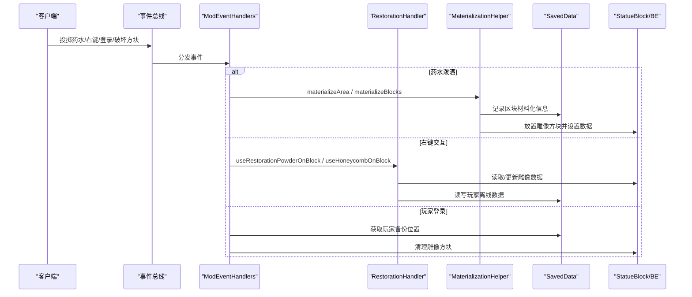
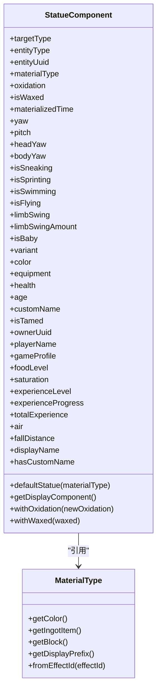
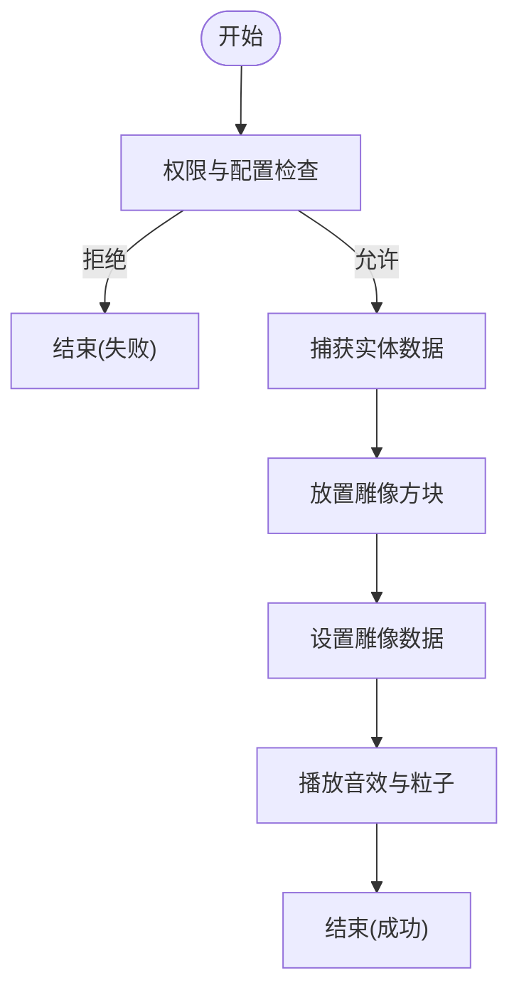
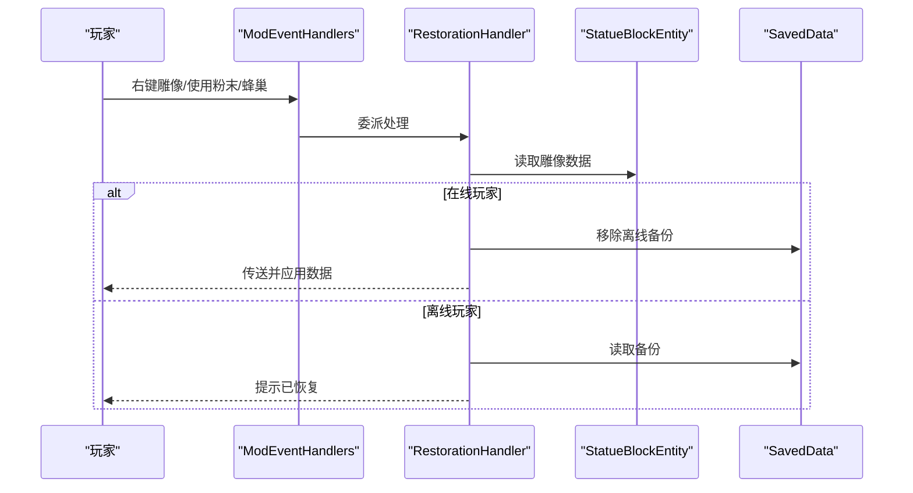
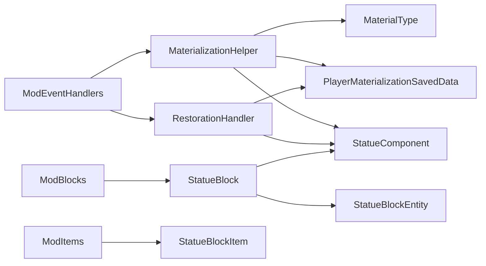

# 代码规范与约定

<cite>
**本文引用的文件**
- [PetrificationMod.java](file://src/main/java/com/xiong/petrification/PetrificationMod.java)
- [StatueBlock.java](file://src/main/java/com/xiong/petrification/block/StatueBlock.java)
- [StatueComponent.java](file://src/main/java/com/xiong/petrification/component/StatueComponent.java)
- [MaterialType.java](file://src/main/java/com/xiong/petrification/component/MaterialType.java)
- [ModEventHandlers.java](file://src/main/java/com/xiong/petrification/handler/ModEventHandlers.java)
- [RestorationHandler.java](file://src/main/java/com/xiong/petrification/handler/RestorationHandler.java)
- [MaterializationHelper.java](file://src/main/java/com/xiong/petrification/util/MaterializationHelper.java)
- [PlayerMaterializationSavedData.java](file://src/main/java/com/xiong/petrification/data/PlayerMaterializationSavedData.java)
- [ModBlocks.java](file://src/main/java/com/xiong/petrification/registry/ModBlocks.java)
- [ModItems.java](file://src/main/java/com/xiong/petrification/registry/ModItems.java)
</cite>

## 目录
1. [简介](#简介)
2. [项目结构](#项目结构)
3. [核心组件](#核心组件)
4. [架构总览](#架构总览)
5. [详细组件分析](#详细组件分析)
6. [依赖关系分析](#依赖关系分析)
7. [性能考量](#性能考量)
8. [故障排查指南](#故障排查指南)
9. [结论](#结论)
10. [附录：编码规范与检查清单](#附录编码规范与检查清单)

## 简介
本规范面向“石化”Minecraft Forge 模组，目标是为 Java 代码制定统一的命名、注释、包结构与模块职责划分标准，并给出可操作的代码审查清单与质量保证流程。文档基于仓库现有实现提炼最佳实践，同时提供反模式警示与优化建议，确保新贡献者能快速上手并保持风格一致。

## 项目结构
- 包组织遵循功能域划分：block、client、component、data、effect、handler、item、network、registry、util 等，职责清晰、边界明确。
- 注册中心集中在 registry 包，统一通过 DeferredRegister 管理块、物品、效果、数据组件等。
- 事件处理集中在 handler 包，使用 @Mod.EventBusSubscriber 集中订阅事件，内部再委派给具体业务处理器。
- 工具方法集中在 util 包，避免在业务类中散落重复逻辑。
- 持久化数据集中在 data 包，使用 SavedData + Codec 进行序列化与版本兼容。

**图表来源**
- [PetrificationMod.java:22-51](file://src/main/java/com/xiong/petrification/PetrificationMod.java#L22-L51)
- [ModBlocks.java:16-33](file://src/main/java/com/xiong/petrification/registry/ModBlocks.java#L16-L33)
- [ModItems.java:12-30](file://src/main/java/com/xiong/petrification/registry/ModItems.java#L12-L30)
- [ModEventHandlers.java:30-119](file://src/main/java/com/xiong/petrification/handler/ModEventHandlers.java#L30-L119)
- [MaterializationHelper.java:33-263](file://src/main/java/com/xiong/petrification/util/MaterializationHelper.java#L33-L263)
- [StatueBlock.java:38-153](file://src/main/java/com/xiong/petrification/block/StatueBlock.java#L38-L153)
- [PlayerMaterializationSavedData.java:22-95](file://src/main/java/com/xiong/petrification/data/PlayerMaterializationSavedData.java#L22-L95)
- [StatueComponent.java:14-256](file://src/main/java/com/xiong/petrification/component/StatueComponent.java#L14-L256)

**章节来源**
- [PetrificationMod.java:22-51](file://src/main/java/com/xiong/petrification/PetrificationMod.java#L22-L51)
- [ModBlocks.java:16-33](file://src/main/java/com/xiong/petrification/registry/ModBlocks.java#L16-L33)
- [ModItems.java:12-30](file://src/main/java/com/xiong/petrification/registry/ModItems.java#L12-L30)
- [ModEventHandlers.java:30-119](file://src/main/java/com/xiong/petrification/handler/ModEventHandlers.java#L30-L119)

## 核心组件
- 模组入口 PetrificationMod：负责注册所有资源、事件监听器与网络初始化，集中启动流程。
- 事件处理器 ModEventHandlers：统一订阅游戏事件（药水泼洒、右键交互、玩家登录、方块破坏），并委派到 RestorationHandler 与 MaterializationHelper。
- 核心逻辑 MaterializationHelper：实体/区域石化、数据捕获与恢复、粒子与音效、权限校验。
- 数据模型 StatueComponent：不可变记录对象，承载雕像状态，采用分组 Codec 以适配序列化限制。
- 类型枚举 MaterialType：材质类型定义，包含颜色、对应物品与方块、显示前缀等。
- 持久化 PlayerMaterializationSavedData：玩家离线石化数据的存储与读取，使用 SavedData + Codec。
- 注册中心 ModBlocks/ModItems：通过 DeferredRegister 注册块与物品，保持注册逻辑集中且可测试。

**章节来源**
- [StatueComponent.java:14-256](file://src/main/java/com/xiong/petrification/component/StatueComponent.java#L14-L256)
- [MaterialType.java:9-68](file://src/main/java/com/xiong/petrification/component/MaterialType.java#L9-L68)
- [MaterializationHelper.java:33-263](file://src/main/java/com/xiong/petrification/util/MaterializationHelper.java#L33-L263)
- [PlayerMaterializationSavedData.java:22-95](file://src/main/java/com/xiong/petrification/data/PlayerMaterializationSavedData.java#L22-L95)
- [ModBlocks.java:16-33](file://src/main/java/com/xiong/petrification/registry/ModBlocks.java#L16-L33)
- [ModItems.java:12-30](file://src/main/java/com/xiong/petrification/registry/ModItems.java#L12-L30)

## 架构总览
下图展示了从事件触发到核心逻辑执行的数据流与调用链。

**图表来源**
- [ModEventHandlers.java:38-119](file://src/main/java/com/xiong/petrification/handler/ModEventHandlers.java#L38-L119)
- [MaterializationHelper.java:55-96](file://src/main/java/com/xiong/petrification/util/MaterializationHelper.java#L55-L96)
- [RestorationHandler.java:34-229](file://src/main/java/com/xiong/petrification/handler/RestorationHandler.java#L34-L229)
- [PlayerMaterializationSavedData.java:70-95](file://src/main/java/com/xiong/petrification/data/PlayerMaterializationSavedData.java#L70-L95)
- [StatueBlock.java:89-153](file://src/main/java/com/xiong/petrification/block/StatueBlock.java#L89-L153)

## 详细组件分析

### 组件：StatueComponent（数据模型）
- 设计要点
  - 使用 record 表达不可变数据结构，字段按语义分组为 GroupA/B/C/D，并通过 xmap 组合 Codec，规避序列化字段数量限制。
  - 提供 withXxx 方法返回新实例，保证不可变性。
  - 提供 defaultStatue 工厂方法与 getDisplayComponent 展示逻辑。
- 复杂度与性能
  - 构造与转换涉及多次 Optional 与 Codec 编解码，建议在批量操作时缓存结果或减少重复解析。
- 错误处理
  - 对缺失字段使用 Optional 与默认值，避免空指针；Codec 层应保证向后兼容。

**图表来源**
- [StatueComponent.java:14-256](file://src/main/java/com/xiong/petrification/component/StatueComponent.java#L14-L256)
- [MaterialType.java:9-68](file://src/main/java/com/xiong/petrification/component/MaterialType.java#L9-L68)

**章节来源**
- [StatueComponent.java:14-256](file://src/main/java/com/xiong/petrification/component/StatueComponent.java#L14-L256)

### 组件：MaterializationHelper（核心逻辑）
- 关键流程
  - canMaterialize：权限与配置校验，防止创意模式或高权限滥用。
  - materializeEntity：捕获实体数据、断开玩家连接、放置雕像、播放音效与粒子。
  - materializeArea：按半径收集实体并按优先级排序后逐个石化。
  - captureEntityData：将实体状态序列化为 StatueComponent，包括装备、自定义名、驯服信息等。
  - restoreEquipment：从 NBT 恢复装备槽位。
  - materializeBlocks：记录区域内非空气与非雕像方块的材料化信息，供后续恢复。
- 性能与并发
  - 区域扫描使用 AABB 过滤，注意大半径时的性能开销；可在未来引入分层或增量计算。
  - 粒子与音效仅在服务端触发，避免客户端重复。

**图表来源**
- [MaterializationHelper.java:36-81](file://src/main/java/com/xiong/petrification/util/MaterializationHelper.java#L36-L81)

**章节来源**
- [MaterializationHelper.java:36-263](file://src/main/java/com/xiong/petrification/util/MaterializationHelper.java#L36-L263)

### 组件：RestorationHandler（恢复逻辑）
- 职责
  - 根据雕像数据类型（玩家/生物）选择不同恢复路径。
  - 支持从背包中的雕像物品直接恢复，或在方块处恢复。
  - 铜材质雕像的打蜡保护机制。
- 交互点
  - 与 ModEventHandlers 协作处理右键事件。
  - 与 PlayerMaterializationSavedData 协作处理离线玩家恢复。

**图表来源**
- [ModEventHandlers.java:65-84](file://src/main/java/com/xiong/petrification/handler/ModEventHandlers.java#L65-L84)
- [RestorationHandler.java:34-229](file://src/main/java/com/xiong/petrification/handler/RestorationHandler.java#L34-L229)
- [PlayerMaterializationSavedData.java:70-95](file://src/main/java/com/xiong/petrification/data/PlayerMaterializationSavedData.java#L70-L95)

**章节来源**
- [RestorationHandler.java:34-229](file://src/main/java/com/xiong/petrification/handler/RestorationHandler.java#L34-L229)
- [ModEventHandlers.java:65-84](file://src/main/java/com/xiong/petrification/handler/ModEventHandlers.java#L65-L84)

### 组件：StatueBlock（方块与实体）
- 行为
  - 支持水logged、方向属性、模拟信号输出（用于铜材质氧化度）。
  - 与 StatueBlockEntity 配合存储雕像数据。
  - 掉落物携带雕像数据组件。
- 渲染
  - 方块本身不可见，由客户端渲染器负责可视化。

**章节来源**
- [StatueBlock.java:38-153](file://src/main/java/com/xiong/petrification/block/StatueBlock.java#L38-L153)

### 组件：注册中心（ModBlocks/ModItems）
- 使用 DeferredRegister 集中注册，便于生命周期管理与测试。
- 通过 BusGroup 注入注册回调，符合 Forge 新版本 API。

**章节来源**
- [ModBlocks.java:16-33](file://src/main/java/com/xiong/petrification/registry/ModBlocks.java#L16-L33)
- [ModItems.java:12-30](file://src/main/java/com/xiong/petrification/registry/ModItems.java#L12-L30)

## 依赖关系分析
- 低耦合
  - handler 仅依赖 util 与 component，不直接操作底层世界状态。
  - util 通过 registry 获取块与物品，避免硬编码。
- 潜在循环
  - 当前未发现循环依赖；若新增跨包强引用需评估解耦方案。
- 外部依赖
  - 主要依赖 Minecraft/Forge API 与 Mojang 序列化库。

**图表来源**
- [ModEventHandlers.java:30-119](file://src/main/java/com/xiong/petrification/handler/ModEventHandlers.java#L30-L119)
- [MaterializationHelper.java:33-263](file://src/main/java/com/xiong/petrification/util/MaterializationHelper.java#L33-L263)
- [RestorationHandler.java:31-229](file://src/main/java/com/xiong/petrification/handler/RestorationHandler.java#L31-L229)
- [StatueBlock.java:38-153](file://src/main/java/com/xiong/petrification/block/StatueBlock.java#L38-L153)
- [ModBlocks.java:16-33](file://src/main/java/com/xiong/petrification/registry/ModBlocks.java#L16-L33)
- [ModItems.java:12-30](file://src/main/java/com/xiong/petrification/registry/ModItems.java#L12-L30)

**章节来源**
- [ModEventHandlers.java:30-119](file://src/main/java/com/xiong/petrification/handler/ModEventHandlers.java#L30-L119)
- [MaterializationHelper.java:33-263](file://src/main/java/com/xiong/petrification/util/MaterializationHelper.java#L33-L263)
- [RestorationHandler.java:31-229](file://src/main/java/com/xiong/petrification/handler/RestorationHandler.java#L31-L229)

## 性能考量
- 区域石化范围控制：大半径扫描会带来显著性能压力，建议限制最大半径或分片处理。
- 序列化成本：StatueComponent 的 Codec 编解码较复杂，应避免频繁重建；必要时缓存常用对象。
- 事件节流：高频事件（如大量药水泼洒）需考虑节流与批处理。
- 客户端与服务端一致性：所有世界状态变更必须在服务端执行，客户端仅做视觉反馈。

[本节为通用指导，无需特定文件来源]

## 故障排查指南
- 权限问题
  - 创意模式或高权限被阻止石化：检查 canMaterialize 的配置项与权限等级判断。
- 数据丢失
  - 玩家登录后未恢复：确认 SavedData 是否写入与读取成功，以及雕像方块是否被正确清理。
- 交互无效
  - 右键无反应：检查事件是否被拦截，以及 RestorationHandler 的条件分支是否正确。
- 序列化异常
  - 旧存档加载失败：确保 Codec 向后兼容，必要时提供迁移逻辑。

**章节来源**
- [MaterializationHelper.java:36-53](file://src/main/java/com/xiong/petrification/util/MaterializationHelper.java#L36-L53)
- [PlayerMaterializationSavedData.java:70-95](file://src/main/java/com/xiong/petrification/data/PlayerMaterializationSavedData.java#L70-L95)
- [ModEventHandlers.java:65-119](file://src/main/java/com/xiong/petrification/handler/ModEventHandlers.java#L65-L119)

## 结论
本项目在包划分、注册中心、事件驱动与数据模型方面具备良好基础。通过统一命名、注释与审查流程，可进一步提升可维护性与扩展性。建议在新功能开发中严格遵循本规范，并在合并前完成自动化检查与人工审查。

[本节为总结性内容，无需特定文件来源]

## 附录：编码规范与检查清单

### 命名约定
- 包命名
  - 全小写，域名倒序：com.xiong.petrification.*
  - 子包按职责划分：block、client、component、data、effect、handler、item、network、registry、util
- 类命名
  - 大驼峰，名词为主：StatueBlock、MaterializationHelper、RestorationHandler
  - 注册类以 Mod 前缀：ModBlocks、ModItems、ModEffects
- 方法命名
  - 动词开头，语义清晰：materializeEntity、restoreBlock、useRestorationPowderOnBlock
  - 布尔方法以 is/has/can 开头：isWaxed、hasEntry、canMaterialize
- 变量命名
  - 局部变量小驼峰：serverLevel、statueComponent
  - 常量全大写+下划线：MODID、DATA_ID
- 枚举与类型
  - 枚举名单数且表意明确：MaterialType
  - 标识符使用命名空间限定：Identifier.fromNamespaceAndPath(...)

### 注释规范
- 类注释
  - 说明类的职责、使用场景与注意事项（例如：StatueComponent 描述其作为不可变数据载体与序列化策略）。
- 方法注释
  - 参数含义、返回值、异常与副作用（例如：materializeEntity 说明权限检查、世界状态变更与音效粒子）。
- 复杂逻辑注释
  - 对多分支、算法或性能敏感逻辑添加行内注释，解释决策依据（例如：区域实体排序优先级、Codec 分组原因）。

### 文件组织结构原则
- 单一职责
  - 每个包聚焦一类功能：registry 只负责注册，handler 只处理事件，util 只提供工具方法。
- 依赖管理
  - 通过接口或静态工厂降低耦合；避免在 util 中直接持有世界实例。
- 配置与常量
  - 配置项集中管理（如 ModConfigSpecHolder），常量集中声明（如 MODID、DATA_ID）。

### 示例与反模式
- 正例
  - 使用 DeferredRegister 注册资源，避免分散注册。
  - 使用 record 表达不可变数据，并提供 withXxx 方法生成新实例。
  - 事件处理中只做轻量判断，复杂逻辑委派给专用处理器。
- 反模式
  - 在事件回调中直接修改世界状态而不做权限校验。
  - 在客户端执行世界状态变更。
  - 在热路径中进行昂贵的序列化或字符串拼接。

### 代码审查检查清单
- 命名与可读性
  - 是否符合命名约定？变量与方法名是否自解释？
- 设计与职责
  - 是否遵循单一职责？是否存在跨包强耦合？
- 安全性与权限
  - 是否进行必要的权限与配置检查？
- 数据一致性
  - 是否在服务端执行世界状态变更？SavedData 是否正确读写？
- 性能
  - 是否存在不必要的循环或重复计算？是否可批处理或缓存？
- 可维护性
  - 是否有足够的注释？复杂逻辑是否可测试？
- 兼容性
  - Codec 是否向后兼容？是否考虑旧存档迁移？

### 质量保证流程
- 本地检查
  - 运行构建与单元测试，确保编译通过。
  - 使用静态分析工具检查代码风格与潜在问题。
- 提交前自检
  - 对照检查清单逐项核对。
  - 补充必要注释与日志。
- 合并审查
  - 至少一名其他开发者审查。
  - 关注性能、安全与兼容性风险。
- 发布前验证
  - 在测试环境完整验证核心流程（石化、恢复、权限、持久化）。
  - 记录已知限制与已知问题。

[本节为通用指导，无需特定文件来源]