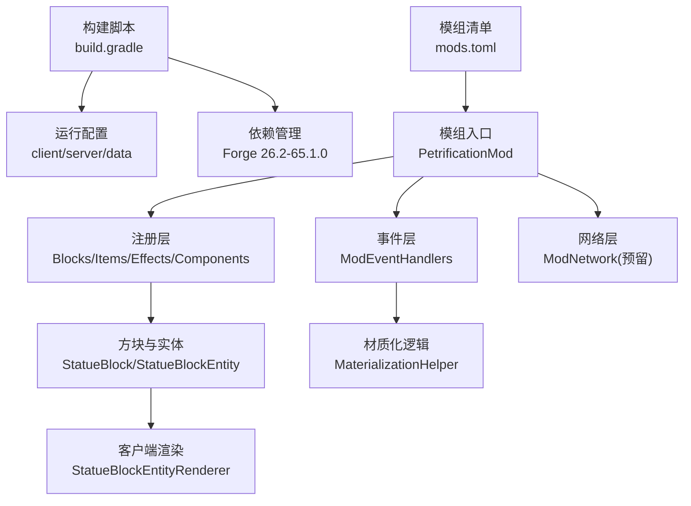
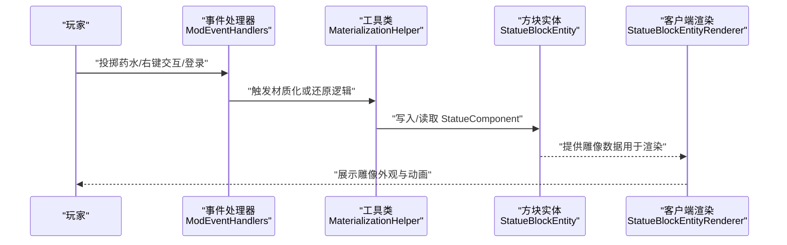
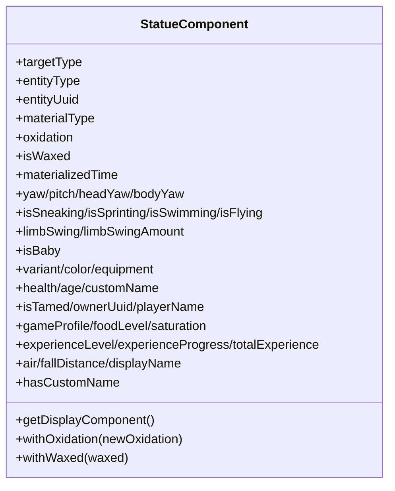
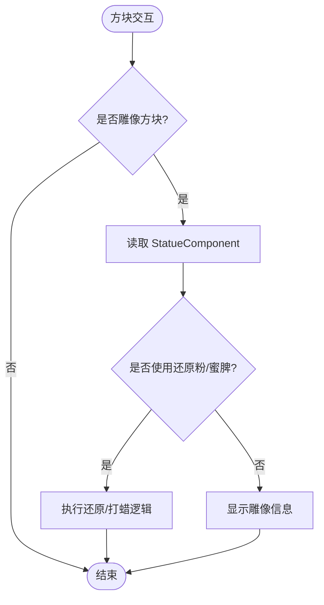
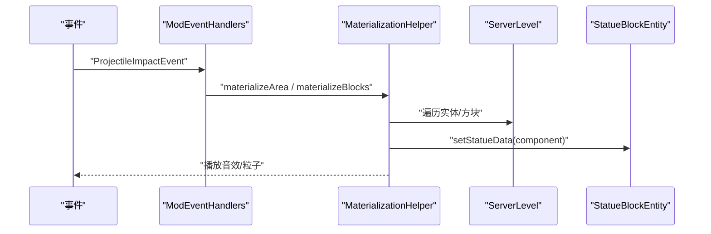
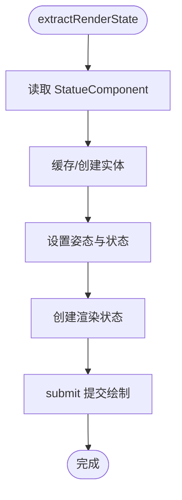
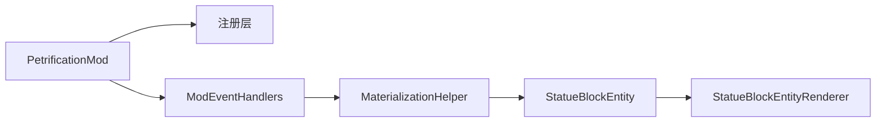

# 开发指南

<cite>
**本文引用的文件**
- [build.gradle](file://build.gradle)
- [gradle.properties](file://gradle.properties)
- [settings.gradle](file://settings.gradle)
- [mods.toml](file://src/main/resources/META-INF/mods.toml)
- [PetrificationMod.java](file://src/main/java/com/xiong/petrification/PetrificationMod.java)
- [StatueComponent.java](file://src/main/java/com/xiong/petrification/component/StatueComponent.java)
- [StatueBlock.java](file://src/main/java/com/xiong/petrification/block/StatueBlock.java)
- [StatueBlockEntity.java](file://src/main/java/com/xiong/petrification/block/StatueBlockEntity.java)
- [ModEventHandlers.java](file://src/main/java/com/xiong/petrification/handler/ModEventHandlers.java)
- [MaterializationHelper.java](file://src/main/java/com/xiong/petrification/util/MaterializationHelper.java)
- [ClientSetup.java](file://src/main/java/com/xiong/petrification/client/ClientSetup.java)
- [StatueBlockEntityRenderer.java](file://src/main/java/com/xiong/petrification/client/StatueBlockEntityRenderer.java)
- [MaterializationEffect.java](file://src/main/java/com/xiong/petrification/effect/MaterializationEffect.java)
- [ModNetwork.java](file://src/main/java/com/xiong/petrification/network/ModNetwork.java)
</cite>

## 目录
1. [简介](#简介)
2. [项目结构](#项目结构)
3. [核心组件](#核心组件)
4. [架构总览](#架构总览)
5. [详细组件分析](#详细组件分析)
6. [依赖关系分析](#依赖关系分析)
7. [性能考虑](#性能考虑)
8. [故障排除指南](#故障排除指南)
9. [结论](#结论)
10. [附录](#附录)

## 简介
本指南面向Minecraft 26.2 + Forge 65.x的“石化”模组开发者，覆盖从环境搭建、代码规范、调试测试到性能优化与发布流程的全链路实践。基于仓库现有实现，重点围绕数据组件驱动的雕像系统、事件驱动的材质化流程、客户端渲染与服务器逻辑解耦等关键路径进行说明，帮助你在稳定版本上高效扩展与迭代。

## 项目结构
- 构建与运行
  - Gradle插件与任务：启用Forge Gradle插件，配置client/server/data运行目标，统一UTF-8编译编码。
  - 仓库源：声明Mojang与Forge Maven仓库，引入Forge依赖与注解处理器。
  - 属性优化：开启Gradle缓存、并行与配置缓存，合并源码集。
- 模组元信息
  - mods.toml定义模组ID、版本、显示名、作者、描述及依赖（Forge与Minecraft版本范围）。
- 源码组织
  - 包分层清晰：block、client、component、data、effect、handler、item、network、registry、util等。
  - 资源目录：assets语言与模型、data配方与掉落表、pack元数据。

**图表来源**
- [build.gradle:5-56](file://build.gradle#L5-L56)
- [mods.toml:1-28](file://src/main/resources/META-INF/mods.toml#L1-L28)
- [PetrificationMod.java:22-51](file://src/main/java/com/xiong/petrification/PetrificationMod.java#L22-L51)

**章节来源**
- [build.gradle:5-63](file://build.gradle#L5-L63)
- [gradle.properties:1-10](file://gradle.properties#L1-L10)
- [settings.gradle:1-6](file://settings.gradle#L1-L6)
- [mods.toml:1-28](file://src/main/resources/META-INF/mods.toml#L1-L28)

## 核心组件
- 模组主类与生命周期
  - 在构造中集中注册数据组件、方块、物品、效果、药水、创造栏；订阅通用初始化事件以注册网络；注册事件处理器。
- 数据组件（StatueComponent）
  - 使用Codec将大量字段分组序列化，支持持久化与跨端同步；提供默认值、显示名称生成与不可变更新方法。
- 方块与方块实体
  - StatueBlock负责状态、交互、掉落与红石信号；StatueBlockEntity承载雕像数据并在服务端按配置周期性氧化。
- 事件与材质化
  - ModEventHandlers监听药水命中、右键交互、玩家登录、方块破坏等事件，调用MaterializationHelper执行材质化与还原。
- 客户端渲染
  - ClientSetup注册渲染器；StatueBlockEntityRenderer根据组件数据动态创建并渲染实体模型，应用姿态与缩放。

**章节来源**
- [PetrificationMod.java:22-51](file://src/main/java/com/xiong/petrification/PetrificationMod.java#L22-L51)
- [StatueComponent.java:14-192](file://src/main/java/com/xiong/petrification/component/StatueComponent.java#L14-L192)
- [StatueBlock.java:38-153](file://src/main/java/com/xiong/petrification/block/StatueBlock.java#L38-L153)
- [StatueBlockEntity.java:17-88](file://src/main/java/com/xiong/petrification/block/StatueBlockEntity.java#L17-L88)
- [ModEventHandlers.java:30-119](file://src/main/java/com/xiong/petrification/handler/ModEventHandlers.java#L30-L119)
- [MaterializationHelper.java:33-263](file://src/main/java/com/xiong/petrification/util/MaterializationHelper.java#L33-L263)
- [ClientSetup.java:10-21](file://src/main/java/com/xiong/petrification/client/ClientSetup.java#L10-L21)
- [StatueBlockEntityRenderer.java:30-130](file://src/main/java/com/xiong/petrification/client/StatueBlockEntityRenderer.java#L30-L130)

## 架构总览
整体采用“注册层 + 事件层 + 数据组件 + 渲染层”的分层架构：
- 注册层：集中初始化所有可注册对象，保证加载顺序可控。
- 事件层：通过Forge事件总线处理游戏内交互与状态变更。
- 数据组件：作为唯一的数据载体，贯穿世界存储、物品NBT与网络传输。
- 渲染层：仅读取组件数据进行可视化，避免与服务端逻辑耦合。

**图表来源**
- [ModEventHandlers.java:38-119](file://src/main/java/com/xiong/petrification/handler/ModEventHandlers.java#L38-L119)
- [MaterializationHelper.java:55-96](file://src/main/java/com/xiong/petrification/util/MaterializationHelper.java#L55-L96)
- [StatueBlockEntity.java:28-50](file://src/main/java/com/xiong/petrification/block/StatueBlockEntity.java#L28-L50)
- [StatueBlockEntityRenderer.java:44-113](file://src/main/java/com/xiong/petrification/client/StatueBlockEntityRenderer.java#L44-L113)

## 详细组件分析

### 数据组件 StatueComponent
- 设计要点
  - 使用Record与Codec分组序列化，降低NBT体积并提升可读性。
  - 提供不可变更新方法（如withOxidation、withWaxed），便于线程安全与状态快照。
  - 默认值与可选字段分离，确保向后兼容。
- 复杂度与性能
  - 序列化分四组，减少单次编解码负担；Optional字段按需写入，节省空间。
  - 获取显示名称与默认实例为O(1)。

**图表来源**
- [StatueComponent.java:14-192](file://src/main/java/com/xiong/petrification/component/StatueComponent.java#L14-L192)

**章节来源**
- [StatueComponent.java:14-256](file://src/main/java/com/xiong/petrification/component/StatueComponent.java#L14-L256)

### 方块与方块实体 StatueBlock / StatueBlockEntity
- 职责划分
  - StatueBlock：定义状态、放置行为、交互、掉落与红石输出（铜材质氧化进度映射为比较器信号）。
  - StatueBlockEntity：持有雕像数据，服务端Tick按配置周期增加铜氧化度，读写NBT持久化。
- 数据流
  - 挖掘时从BlockEntity读取组件并附加到掉落物品；放置时从物品恢复至新BlockEntity。

**图表来源**
- [StatueBlock.java:103-151](file://src/main/java/com/xiong/petrification/block/StatueBlock.java#L103-L151)
- [StatueBlockEntity.java:28-50](file://src/main/java/com/xiong/petrification/block/StatueBlockEntity.java#L28-L50)

**章节来源**
- [StatueBlock.java:38-153](file://src/main/java/com/xiong/petrification/block/StatueBlock.java#L38-L153)
- [StatueBlockEntity.java:17-88](file://src/main/java/com/xiong/petrification/block/StatueBlockEntity.java#L17-L88)

### 事件与材质化 ModEventHandlers / MaterializationHelper
- 事件处理
  - 药水命中：检测含材质化效果的喷溅药水，计算范围并对范围内实体与方块执行材质化。
  - 右键交互：使用还原粉或蜜脾对雕像方块执行还原或打蜡。
  - 玩家登录：若存在离线材质化备份，传送并恢复数据，清理雕像方块。
  - 方块破坏：清理已材质化方块的持久化记录。
- 材质化流程
  - 权限校验（配置项控制创造/OP）→ 捕获实体数据 → 生成雕像方块 → 写入组件 → 播放音效粒子 → 移除原实体（玩家则断开连接）。

**图表来源**
- [ModEventHandlers.java:45-84](file://src/main/java/com/xiong/petrification/handler/ModEventHandlers.java#L45-L84)
- [MaterializationHelper.java:83-96](file://src/main/java/com/xiong/petrification/util/MaterializationHelper.java#L83-L96)
- [MaterializationHelper.java:55-81](file://src/main/java/com/xiong/petrification/util/MaterializationHelper.java#L55-L81)

**章节来源**
- [ModEventHandlers.java:30-119](file://src/main/java/com/xiong/petrification/handler/ModEventHandlers.java#L30-L119)
- [MaterializationHelper.java:33-263](file://src/main/java/com/xiong/petrification/util/MaterializationHelper.java#L33-L263)

### 客户端渲染 ClientSetup / StatueBlockEntityRenderer
- 渲染管线
  - 注册BlockEntity渲染器；提取渲染状态（姿态、动画参数）；提交绘制节点。
  - 使用实体渲染调度器复用模型，避免重复创建；支持离屏渲染与自定义视距。
- 性能要点
  - 实体类型缓存；异常静默忽略防止渲染崩溃；比例缩放适配雕像尺寸。

**图表来源**
- [ClientSetup.java:13-19](file://src/main/java/com/xiong/petrification/client/ClientSetup.java#L13-L19)
- [StatueBlockEntityRenderer.java:44-113](file://src/main/java/com/xiong/petrification/client/StatueBlockEntityRenderer.java#L44-L113)

**章节来源**
- [ClientSetup.java:10-21](file://src/main/java/com/xiong/petrification/client/ClientSetup.java#L10-L21)
- [StatueBlockEntityRenderer.java:30-130](file://src/main/java/com/xiong/petrification/client/StatueBlockEntityRenderer.java#L30-L130)

### 效果与网络 MaterializationEffect / ModNetwork
- 效果：瞬时生效，直接调用材质化工具类完成实体转化。
- 网络：预留注册点，可扩展数据包以实现多人同步（当前为空实现）。

**章节来源**
- [MaterializationEffect.java:10-38](file://src/main/java/com/xiong/petrification/effect/MaterializationEffect.java#L10-L38)
- [ModNetwork.java:1-10](file://src/main/java/com/xiong/petrification/network/ModNetwork.java#L1-L10)

## 依赖关系分析
- 外部依赖
  - Minecraft 26.2与Forge 65.x，通过Gradle与mods.toml声明。
- 内部依赖
  - 主类依赖注册模块与事件模块；事件模块依赖工具类；渲染模块依赖方块实体数据。
- 潜在循环
  - 当前分层清晰，未见循环依赖；建议保持“事件→工具→数据→渲染”单向依赖。

**图表来源**
- [PetrificationMod.java:22-51](file://src/main/java/com/xiong/petrification/PetrificationMod.java#L22-L51)
- [ModEventHandlers.java:30-119](file://src/main/java/com/xiong/petrification/handler/ModEventHandlers.java#L30-L119)
- [MaterializationHelper.java:33-263](file://src/main/java/com/xiong/petrification/util/MaterializationHelper.java#L33-L263)
- [StatueBlockEntity.java:17-88](file://src/main/java/com/xiong/petrification/block/StatueBlockEntity.java#L17-L88)
- [StatueBlockEntityRenderer.java:30-130](file://src/main/java/com/xiong/petrification/client/StatueBlockEntityRenderer.java#L30-L130)

**章节来源**
- [build.gradle:46-56](file://build.gradle#L46-L56)
- [mods.toml:15-28](file://src/main/resources/META-INF/mods.toml#L15-L28)

## 性能考虑
- 渲染优化
  - 实体渲染状态缓存与复用，避免每帧重建模型。
  - 合理设置渲染距离与LOD策略（可通过配置扩展）。
  - 异常静默处理，防止渲染错误导致卡顿或崩溃。
- 内存管理
  - 数据组件分组序列化，减少NBT体积与GC压力。
  - 仅在必要时保存可选字段，避免冗余数据。
- 网络通信
  - 当前网络层预留，后续可按需实现增量同步与批量更新，减少带宽占用。
- 服务器Tick
  - 铜氧化按固定间隔更新，避免每tick全量扫描；可结合区块加载状态进一步优化。

[本节为通用指导，不直接分析具体文件]

## 故障排除指南
- 常见问题定位
  - 药水未生效：检查事件是否被拦截、药水效果是否正确注入、范围计算是否符合预期。
  - 雕像无法渲染：确认BlockEntity数据是否存在、客户端渲染器是否注册、实体类型是否可解析。
  - 氧化不工作：检查配置开关与最大氧化值、是否为铜材质且未打蜡。
  - 玩家离线还原失败：核对登录事件是否触发、备份数据是否存在、位置合法性。
- 日志与断点
  - 在主类初始化与事件处理器关键分支添加日志，观察数据流转。
  - 在材质化工具类与渲染器处设置断点，逐步验证状态变化。
- 单元测试建议
  - 针对StatueComponent编解码进行边界用例测试（空字段、最大值、非法值）。
  - 模拟药水命中事件，断言雕像生成与数据写入结果。
  - 验证氧化逻辑在不同配置下的收敛性与上限保护。

**章节来源**
- [ModEventHandlers.java:45-119](file://src/main/java/com/xiong/petrification/handler/ModEventHandlers.java#L45-L119)
- [StatueBlockEntityRenderer.java:44-113](file://src/main/java/com/xiong/petrification/client/StatueBlockEntityRenderer.java#L44-L113)
- [StatueBlockEntity.java:28-50](file://src/main/java/com/xiong/petrification/block/StatueBlockEntity.java#L28-L50)
- [MaterializationHelper.java:55-96](file://src/main/java/com/xiong/petrification/util/MaterializationHelper.java#L55-L96)

## 结论
本模组以数据组件为核心，实现了“零实体注册、单一方块通用、数据驱动渲染”的设计目标。通过清晰的注册层、事件层与渲染层分工，配合稳健的序列化与权限控制，提供了完整的材质化闭环。建议在后续迭代中完善网络同步、扩展LOD与着色器特效，并持续优化性能与可维护性。

[本节为总结性内容，不直接分析具体文件]

## 附录
- 开发环境搭建
  - 安装Java 25与Gradle，克隆仓库后执行Gradle任务生成IDE工程。
  - 使用内置client/server运行目标快速启动游戏与服务器。
  - 启用Forge GameTest命名空间以便编写与运行测试。
- 代码规范与命名约定
  - Java编码标准：遵循官方风格，合理使用Record与Optional，避免可变状态扩散。
  - 注释格式：公共API与复杂逻辑添加Javadoc；关键分支添加行内注释说明意图。
  - 文件组织：按功能分包（block/client/component等），保持单一职责与低耦合。
- 调试与测试
  - 日志分析：在关键路径打印上下文信息（坐标、UUID、材质类型等）。
  - 断点调试：在事件处理器、工具类与渲染器设置断点，逐步验证数据流。
  - 单元测试：覆盖编解码、权限判断、氧化逻辑与渲染状态提取。
- 版本管理与发布
  - Git工作流：特性分支开发，Pull Request评审后合并至主干；标签标记版本。
  - 构建脚本：统一版本号与依赖范围；使用data任务生成资源。
  - 打包发布：导出JAR并附带mods.toml与资源；发布前进行多端兼容性测试。

[本节为通用指导，不直接分析具体文件]