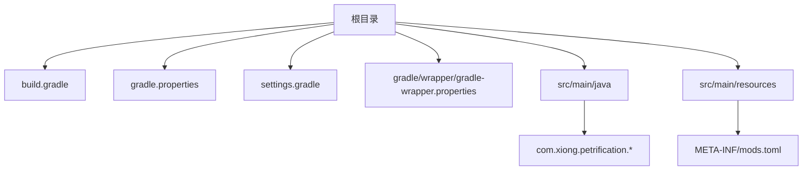
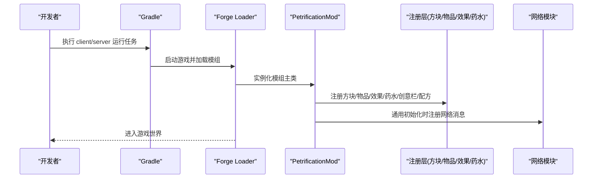
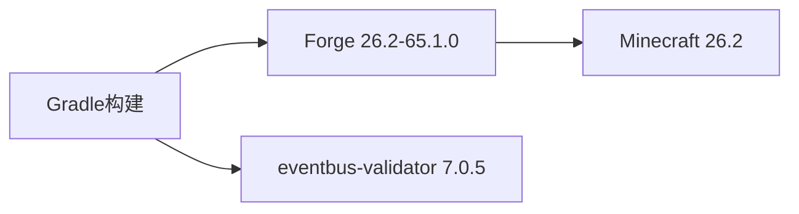

# 开发环境搭建

<cite>
**本文引用的文件**
- [build.gradle](file://build.gradle)
- [gradle.properties](file://gradle.properties)
- [settings.gradle](file://settings.gradle)
- [gradle-wrapper.properties](file://gradle/wrapper/gradle-wrapper.properties)
- [mods.toml](file://src/main/resources/META-INF/mods.toml)
- [PetrificationMod.java](file://src/main/java/com/xiong/petrification/PetrificationMod.java)
- [StatueBlock.java](file://src/main/java/com/xiong/petrification/block/StatueBlock.java)
- [ModBlocks.java](file://src/main/java/com/xiong/petrification/registry/ModBlocks.java)
</cite>

## 目录
1. [简介](#简介)
2. [项目结构](#项目结构)
3. [核心组件](#核心组件)
4. [架构总览](#架构总览)
5. [详细组件分析](#详细组件分析)
6. [依赖关系分析](#依赖关系分析)
7. [性能注意事项](#性能注意事项)
8. [故障排除指南](#故障排除指南)
9. [结论](#结论)
10. [附录](#附录)

## 简介
本指南面向Minecraft 26.2 + Forge 65.x.x的“石化”模组（petrification）开发者，提供从零开始的完整开发环境搭建说明。内容覆盖：
- Java 25环境的安装与配置（JDK下载、环境变量、IDE集成）
- Gradle构建系统配置（build.gradle结构、依赖管理、任务配置）
- Forge开发环境设置（MDK初始化、运行配置、调试准备）
- IDE（IntelliJ IDEA、Eclipse）具体配置步骤（插件、代码补全、调试器）
- 常见问题与排错方法

## 项目结构
该仓库是一个标准的Forge Mod工作区，使用Gradle进行构建，资源位于src/main/resources，Java源码位于src/main/java。关键配置文件包括：
- build.gradle：定义Java工具链版本、Forge运行配置、仓库与依赖、编译选项等
- gradle.properties：启用Gradle缓存、并行、配置缓存等优化
- settings.gradle：声明根项目名称与工具链解析插件
- gradle-wrapper.properties：指定Gradle发行版版本
- mods.toml：Forge模组元数据（模组ID、版本、依赖范围等）

图表来源
- [build.gradle:1-63](file://build.gradle#L1-L63)
- [gradle.properties:1-10](file://gradle.properties#L1-L10)
- [settings.gradle:1-6](file://settings.gradle#L1-L6)
- [gradle-wrapper.properties:1-7](file://gradle/wrapper/gradle-wrapper.properties#L1-L7)
- [mods.toml:1-28](file://src/main/resources/META-INF/mods.toml#L1-L28)

章节来源
- [build.gradle:1-63](file://build.gradle#L1-L63)
- [gradle.properties:1-10](file://gradle.properties#L1-L10)
- [settings.gradle:1-6](file://settings.gradle#L1-L6)
- [gradle-wrapper.properties:1-7](file://gradle/wrapper/gradle-wrapper.properties#L1-L7)
- [mods.toml:1-28](file://src/main/resources/META-INF/mods.toml#L1-L28)

## 核心组件
- Java 25工具链：通过Gradle强制使用Java 25作为语言级别，确保与Minecraft 26.1+一致
- Forge运行配置：内置client/server/gameTestServer/data等多套运行配置，便于本地测试与数据生成
- 模组注册入口：主类在构造中完成各类注册（方块、物品、效果、药水、创意栏、配方、网络等），并在通用初始化阶段注册网络
- 雕像方块：实现方向性、可水浸、不可见渲染（由块实体渲染）、模拟信号输出（用于铜材质氧化进度）

章节来源
- [build.gradle:15-43](file://build.gradle#L15-L43)
- [PetrificationMod.java:22-51](file://src/main/java/com/xiong/petrification/PetrificationMod.java#L22-L51)
- [StatueBlock.java:38-152](file://src/main/java/com/xiong/petrification/block/StatueBlock.java#L38-L152)

## 架构总览
下图展示了从Gradle到Forge运行的整体流程，以及模组主类的初始化顺序。

图表来源
- [build.gradle:21-43](file://build.gradle#L21-L43)
- [PetrificationMod.java:27-51](file://src/main/java/com/xiong/petrification/PetrificationMod.java#L27-L51)

## 详细组件分析

### Java 25环境与IDE集成
- 要求：使用Java 25作为语言级别，确保与Minecraft 26.1+一致
- 建议：
  - 安装JDK 25（Oracle或OpenJDK均可）
  - 设置JAVA_HOME指向JDK 25安装目录
  - 在IDE中将Project SDK设置为JDK 25
  - 将Gradle Toolchain与IDE编译器均指向Java 25

章节来源
- [build.gradle:15-16](file://build.gradle#L15-L16)

### Gradle构建系统与任务
- 构建脚本要点：
  - 启用idea/eclipse插件，便于IDE导入
  - 引入net.minecraftforge.gradle以支持Forge运行与数据生成
  - 配置sourceSets包含生成的资源目录
  - 配置minecraft.runs：client/server/gameTestServer/data
  - 配置repositories：Minecraft Mavenizer、Forge Maven、Maven Central
  - 依赖forge版本为26.2-65.1.0，并启用eventbus校验注解处理器
  - 统一Java编译编码为UTF-8

- 常用任务：
  - gradlew runClient：启动客户端
  - gradlew runServer：启动服务器
  - gradlew gameTestServer：运行游戏测试服务器
  - gradlew data：生成资源（模型、语言、配方等）

章节来源
- [build.gradle:5-62](file://build.gradle#L5-L62)

### Forge开发环境设置（MDK）
- 项目已基于MDK结构组织，无需额外初始化
- 运行配置：
  - client：默认工作目录run，启用事件总线严格检查，注册测试命名空间
  - server：附加--nogui参数
  - gameTestServer：用于游戏测试
  - data：工作目录run-data，输出到src/generated/resources，并从现有资源合并

- 调试：
  - 在IDE中直接运行Gradle任务即可触发断点调试
  - 如需远程调试，可在运行配置中添加JVM参数（例如-agentlib:jdwp）

章节来源
- [build.gradle:21-43](file://build.gradle#L21-L43)

### 模组主类与注册流程
- 主类职责：
  - 在构造中注册数据组件、方块、物品、块实体、效果、药水、创意栏
  - 注册配方处理
  - 监听通用初始化事件，注册网络消息
  - 注册配置

- 运行时顺序：
  - 先完成所有注册
  - 再在通用初始化阶段注册网络

章节来源
- [PetrificationMod.java:27-51](file://src/main/java/com/xiong/petrification/PetrificationMod.java#L27-L51)

### 雕像方块与块实体
- 雕像方块特性：
  - 方向性（水平朝向）
  - 可水浸
  - 渲染形状为不可见（实际渲染由块实体渲染器负责）
  - 模拟信号输出：当材质类型为铜时，输出强度与氧化进度成正比

- 交互行为：
  - 右键显示信息（来自数据组件）
  - 挖掘掉落带数据组件的物品

章节来源
- [StatueBlock.java:38-152](file://src/main/java/com/xiong/petrification/block/StatueBlock.java#L38-L152)
- [ModBlocks.java:16-33](file://src/main/java/com/xiong/petrification/registry/ModBlocks.java#L16-L33)

### 资源与数据
- mods.toml定义了模组ID、版本、显示名、作者、描述及依赖范围（Forge与Minecraft）
- 资源目录包含语言、模型、方块状态、数据包（标签、战利品表、配方）

章节来源
- [mods.toml:1-28](file://src/main/resources/META-INF/mods.toml#L1-L28)

## 依赖关系分析
- 外部依赖：
  - net.minecraftforge:forge:26.2-65.1.0
  - annotationProcessor: net.minecraftforge:eventbus-validator:7.0.5

- 仓库来源：
  - Minecraft Mavenizer
  - Forge Maven
  - Maven Central

图表来源
- [build.gradle:46-56](file://build.gradle#L46-L56)

章节来源
- [build.gradle:46-56](file://build.gradle#L46-L56)

## 性能注意事项
- 启用Gradle缓存与并行构建，提升构建速度
- 使用UTF-8编码避免字符集问题
- 雕像方块使用块实体渲染，注意渲染距离与LOD策略（如后续扩展）
- 铜材质氧化进度通过模拟信号输出，可用于红石联动

章节来源
- [gradle.properties:1-9](file://gradle.properties#L1-L9)
- [build.gradle:58-62](file://build.gradle#L58-L62)
- [StatueBlock.java:137-151](file://src/main/java/com/xiong/petrification/block/StatueBlock.java#L137-L151)

## 故障排除指南
- 无法找到Java 25：
  - 确认已安装JDK 25，并将JAVA_HOME指向正确路径
  - 在IDE中设置Project SDK为Java 25
  - 检查Gradle Toolchain是否匹配Java 25

- 构建失败或依赖下载异常：
  - 清理Gradle缓存后重试
  - 检查网络是否能访问Maven Central与Forge/Minecraft仓库
  - 确认gradle-wrapper.properties中的Gradle版本可用

- 运行时报错或模组未加载：
  - 检查mods.toml中的modId、版本范围是否与目标Minecraft/Forge版本匹配
  - 查看控制台日志，定位错误堆栈
  - 使用gameTestServer验证基础功能

- 中文乱码或资源不生效：
  - 确保Java编译编码为UTF-8（已在构建脚本中设置）
  - 重新执行data任务生成资源，并刷新IDE索引

章节来源
- [build.gradle:15-16](file://build.gradle#L15-L16)
- [build.gradle:58-62](file://build.gradle#L58-L62)
- [mods.toml:1-28](file://src/main/resources/META-INF/mods.toml#L1-L28)

## 结论
本指南提供了针对Minecraft 26.2 + Forge 65.x.x“石化”模组的完整开发环境搭建方案，涵盖Java 25环境、Gradle构建、Forge运行配置、IDE集成与常见问题排查。按照本文步骤操作，可快速建立稳定可靠的开发环境，并高效推进模组功能开发与调试。

## 附录

### IntelliJ IDEA配置步骤
- 导入项目：
  - 打开IDEA，选择“Open”，选择项目根目录
  - IDEA会自动识别Gradle项目并导入
- 设置SDK：
  - File > Project Structure > Project：设置SDK为Java 25
  - Modules：确保Language Level为Java 25
- 运行配置：
  - Run/Debug Configurations > Gradle：添加runClient/runServer任务
  - Working Directory：保持默认或使用脚本配置的目录
- 插件建议：
  - Forge/Gradle相关插件（IDEA通常内置支持）
  - 可选：Lombok（若使用）、CodeGlance等

### Eclipse配置步骤
- 导入项目：
  - File > Import > Existing Gradle Project
  - 选择项目根目录并导入
- 设置JDK：
  - Window > Preferences > Java > Installed JREs：添加JDK 25并设为默认
  - Project Facets：将Dynamic Web Module与Java版本调整为兼容配置
- 运行配置：
  - Run Configurations > Gradle Build：添加runClient/runServer任务
- 插件建议：
  - Eclipse Forge Tools（如有）
  - 其他常用插件（如Checkstyle、SonarLint）

### 常见Gradle任务参考
- 启动客户端：gradlew runClient
- 启动服务器：gradlew runServer
- 运行游戏测试：gradlew gameTestServer
- 生成资源：gradlew data

章节来源
- [build.gradle:21-43](file://build.gradle#L21-L43)