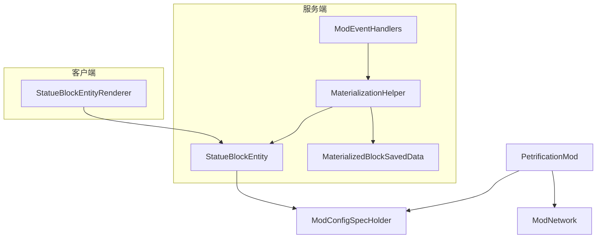
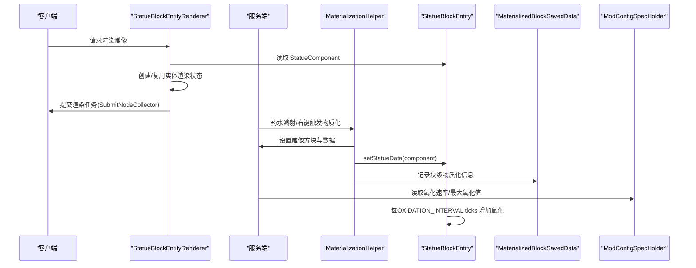
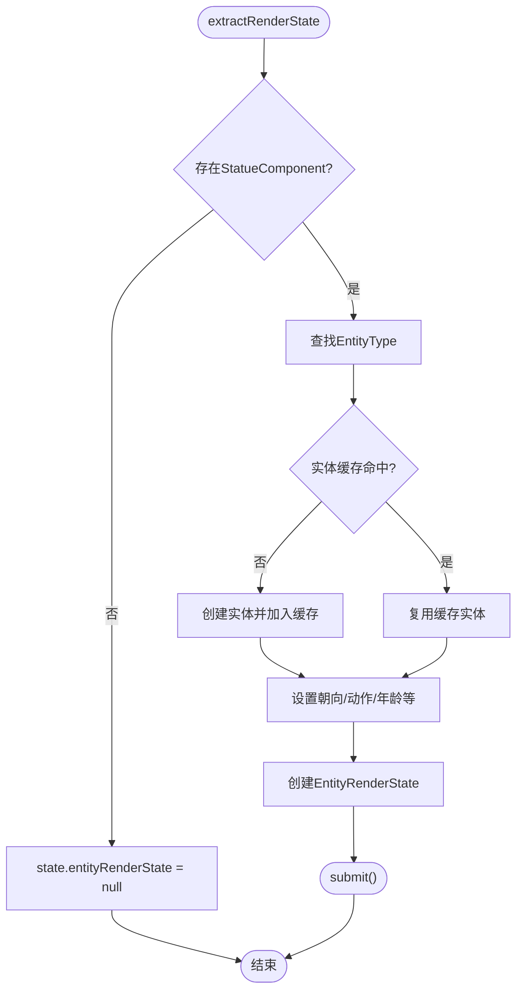
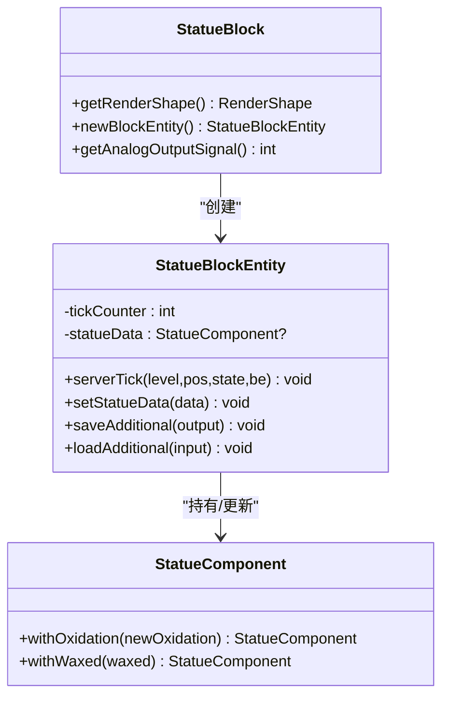
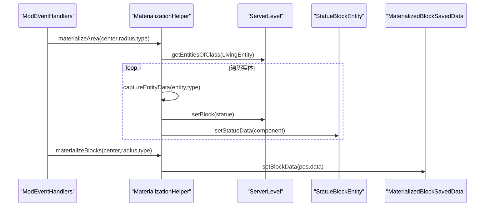
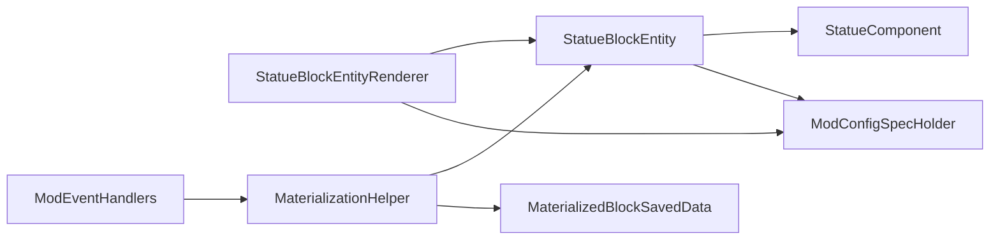

# 性能优化

<cite>
**本文引用的文件**
- [PetrificationMod.java](file://src/main/java/com/xiong/petrification/PetrificationMod.java)
- [StatueBlockEntityRenderer.java](file://src/main/java/com/xiong/petrification/client/StatueBlockEntityRenderer.java)
- [StatueBlock.java](file://src/main/java/com/xiong/petrification/block/StatueBlock.java)
- [StatueBlockEntity.java](file://src/main/java/com/xiong/petrification/block/StatueBlockEntity.java)
- [StatueComponent.java](file://src/main/java/com/xiong/petrification/component/StatueComponent.java)
- [MaterializationHelper.java](file://src/main/java/com/xiong/petrification/util/MaterializationHelper.java)
- [ModEventHandlers.java](file://src/main/java/com/xiong/petrification/handler/ModEventHandlers.java)
- [MaterializedBlockSavedData.java](file://src/main/java/com/xiong/petrification/data/MaterializedBlockSavedData.java)
- [ModNetwork.java](file://src/main/java/com/xiong/petrification/network/ModNetwork.java)
- [ModConfigSpecHolder.java](file://src/main/java/com/xiong/petrification/ModConfigSpecHolder.java)
</cite>

## 目录
1. [简介](#简介)
2. [项目结构](#项目结构)
3. [核心组件](#核心组件)
4. [架构总览](#架构总览)
5. [详细组件分析](#详细组件分析)
6. [依赖关系分析](#依赖关系分析)
7. [性能考量与优化建议](#性能考量与优化建议)
8. [故障排查指南](#故障排查指南)
9. [结论](#结论)
10. [附录：基准测试与监控](#附录：基准测试与监控)

## 简介
本文件面向Minecraft石化模组的性能优化，聚焦以下方面：
- 渲染优化：自定义渲染器调优、批处理提交、视距与LOD策略
- 内存管理：对象池、GC压力缓解与大对象处理
- 网络通信：数据包压缩、增量更新、连接池管理
- 数据持久化：NBT序列化优化、异步加载与缓存策略
- 性能监控与基准测试：定位瓶颈、量化改进

## 项目结构
模组采用分层组织：客户端渲染、服务端逻辑、数据持久化、事件处理、配置与注册。关键路径包括：
- 客户端渲染管线：StatueBlockEntityRenderer 负责实体雕像的渲染状态提取与提交
- 服务端逻辑：StatueBlockEntity 维护雕像数据与氧化计时；MaterializationHelper 负责实体/区域物质化
- 数据持久化：MaterializedBlockSavedData 以 SavedData 形式存储块级物质化信息
- 事件与交互：ModEventHandlers 监听药水溅射、玩家登录、方块破坏等事件
- 配置：ModConfigSpecHolder 提供运行时可调参数（如氧化速率、渲染距离）

图表来源
- [StatueBlockEntityRenderer.java:31-123](file://src/main/java/com/xiong/petrification/client/StatueBlockEntityRenderer.java#L31-L123)
- [StatueBlockEntity.java:17-88](file://src/main/java/com/xiong/petrification/block/StatueBlockEntity.java#L17-L88)
- [MaterializationHelper.java:55-96](file://src/main/java/com/xiong/petrification/util/MaterializationHelper.java#L55-L96)
- [ModEventHandlers.java:45-123](file://src/main/java/com/xiong/petrification/handler/ModEventHandlers.java#L45-L123)
- [MaterializedBlockSavedData.java:19-85](file://src/main/java/com/xiong/petrification/data/MaterializedBlockSavedData.java#L19-L85)
- [ModConfigSpecHolder.java:8-67](file://src/main/java/com/xiong/petrification/ModConfigSpecHolder.java#L8-L67)
- [PetrificationMod.java:22-51](file://src/main/java/com/xiong/petrification/PetrificationMod.java#L22-L51)

章节来源
- [PetrificationMod.java:22-51](file://src/main/java/com/xiong/petrification/PetrificationMod.java#L22-L51)

## 核心组件
- 渲染器 StatueBlockEntityRenderer：将实体渲染为半尺寸雕像，使用实体渲染调度器提交渲染任务，支持离屏渲染与可配置视距
- 方块与实体 StatueBlock / StatueBlockEntity：不可见渲染形状，持有 StatueComponent 并周期性执行氧化逻辑
- 数据模型 StatueComponent：通过分组合式编解码器高效序列化/反序列化大量字段
- 物质化流程 MaterializationHelper：捕获实体/区域数据，写入 SavedData 或 BlockEntity，播放音效与粒子
- 事件处理器 ModEventHandlers：药水溅射触发物质化、玩家登录恢复位置、方块破坏清理记录
- 配置 ModConfigSpecHolder：提供氧化速率、最大氧化值、渲染距离等运行时开关与阈值
- 网络 ModNetwork：预留多端同步扩展点

章节来源
- [StatueBlockEntityRenderer.java:31-123](file://src/main/java/com/xiong/petrification/client/StatueBlockEntityRenderer.java#L31-L123)
- [StatueBlock.java:38-153](file://src/main/java/com/xiong/petrification/block/StatueBlock.java#L38-L153)
- [StatueBlockEntity.java:17-88](file://src/main/java/com/xiong/petrification/block/StatueBlockEntity.java#L17-L88)
- [StatueComponent.java:14-148](file://src/main/java/com/xiong/petrification/component/StatueComponent.java#L14-L148)
- [MaterializationHelper.java:55-263](file://src/main/java/com/xiong/petrification/util/MaterializationHelper.java#L55-L263)
- [ModEventHandlers.java:38-123](file://src/main/java/com/xiong/petrification/handler/ModEventHandlers.java#L38-L123)
- [ModConfigSpecHolder.java:8-67](file://src/main/java/com/xiong/petrification/ModConfigSpecHolder.java#L8-L67)
- [ModNetwork.java:3-9](file://src/main/java/com/xiong/petrification/network/ModNetwork.java#L3-L9)

## 架构总览
下图展示从事件到渲染的关键调用链与数据流：

图表来源
- [StatueBlockEntityRenderer.java:44-123](file://src/main/java/com/xiong/petrification/client/StatueBlockEntityRenderer.java#L44-L123)
- [MaterializationHelper.java:55-96](file://src/main/java/com/xiong/petrification/util/MaterializationHelper.java#L55-L96)
- [StatueBlockEntity.java:28-50](file://src/main/java/com/xiong/petrification/block/StatueBlockEntity.java#L28-L50)
- [MaterializedBlockSavedData.java:61-85](file://src/main/java/com/xiong/petrification/data/MaterializedBlockSavedData.java#L61-L85)
- [ModConfigSpecHolder.java:28-53](file://src/main/java/com/xiong/petrification/ModConfigSpecHolder.java#L28-L53)

## 详细组件分析

### 渲染器 StatueBlockEntityRenderer
- 渲染状态提取：从 BlockEntity 中获取 StatueComponent，查找对应 EntityType，复用实体实例缓存，生成 EntityRenderState
- 提交渲染：调整姿态与缩放后，通过 EntityRenderDispatcher.submit 提交至 SubmitNodeCollector，实现批处理提交
- 视距控制：getViewDistance 返回配置项 statueRenderDistance，便于按性能需求调节
- 离屏渲染：shouldRenderOffScreen 返回 true，提升非正对视角下的可见性

图表来源
- [StatueBlockEntityRenderer.java:44-123](file://src/main/java/com/xiong/petrification/client/StatueBlockEntityRenderer.java#L44-L123)

章节来源
- [StatueBlockEntityRenderer.java:31-123](file://src/main/java/com/xiong/petrification/client/StatueBlockEntityRenderer.java#L31-L123)

### 方块与实体 StatueBlock / StatueBlockEntity
- 渲染形状：getRenderShape 返回 INVISIBLE，由 BlockEntity 负责实际渲染
- 服务器Tick：每 OXIDATION_INTERVAL ticks 检查并增加铜材质雕像的氧化值，受 enableOxidation、maxOxidation、oxidationRate 控制
- 数据持久化：saveAdditional/loadAdditional 使用 StatueComponent.CODEC 进行序列化/反序列化
- 信号输出：模拟铜氧化程度作为红石信号强度

图表来源
- [StatueBlock.java:38-153](file://src/main/java/com/xiong/petrification/block/StatueBlock.java#L38-L153)
- [StatueBlockEntity.java:17-88](file://src/main/java/com/xiong/petrification/block/StatueBlockEntity.java#L17-L88)
- [StatueComponent.java:14-256](file://src/main/java/com/xiong/petrification/component/StatueComponent.java#L14-L256)

章节来源
- [StatueBlock.java:38-153](file://src/main/java/com/xiong/petrification/block/StatueBlock.java#L38-L153)
- [StatueBlockEntity.java:17-88](file://src/main/java/com/xiong/petrification/block/StatueBlockEntity.java#L17-L88)

### 数据模型 StatueComponent
- 设计要点：将37个字段拆分为4组（A/B/C/D），再两两组合，最终合并为 Combined，降低单次编解码负担
- 优势：减少Codec链深度，提高NBT读写效率，利于大对象序列化与网络传输

章节来源
- [StatueComponent.java:14-148](file://src/main/java/com/xiong/petrification/component/StatueComponent.java#L14-L148)

### 物质化流程 MaterializationHelper
- 实体物质化：捕获实体数据为 StatueComponent，设置雕像方块与数据，必要时断开玩家连接并保存备份
- 区域物质化：计算包围盒，筛选实体并按优先级排序（玩家优先），逐个物质化
- 块级物质化：遍历半径内方块，跳过空气与已有雕像，记录原始方块ID、材质类型、时间戳等到 SavedData
- 装备还原：根据装备NBT恢复主手/副手/护具槽位

图表来源
- [ModEventHandlers.java:45-63](file://src/main/java/com/xiong/petrification/handler/ModEventHandlers.java#L45-L63)
- [MaterializationHelper.java:83-96](file://src/main/java/com/xiong/petrification/util/MaterializationHelper.java#L83-L96)
- [MaterializationHelper.java:234-255](file://src/main/java/com/xiong/petrification/util/MaterializationHelper.java#L234-L255)

章节来源
- [MaterializationHelper.java:55-263](file://src/main/java/com/xiong/petrification/util/MaterializationHelper.java#L55-L263)
- [ModEventHandlers.java:45-123](file://src/main/java/com/xiong/petrification/handler/ModEventHandlers.java#L45-L123)

### 数据持久化 MaterializedBlockSavedData
- 使用 SavedData 在服务器世界层持久化块级物质化映射
- 通过 Codec 将 Map<BlockPos, BlockMaterializationData> 序列化为 NBT
- 提供 set/get/remove 接口并在变更时标记脏数据

章节来源
- [MaterializedBlockSavedData.java:19-85](file://src/main/java/com/xiong/petrification/data/MaterializedBlockSavedData.java#L19-L85)

### 网络通信 ModNetwork
- 当前为占位实现，预留 register 扩展点用于多端同步
- 建议后续扩展：增量更新、数据包压缩、连接池管理

章节来源
- [ModNetwork.java:3-9](file://src/main/java/com/xiong/petrification/network/ModNetwork.java#L3-L9)

## 依赖关系分析
- 渲染器依赖 BlockEntity 与实体渲染调度器，通过 SubmitNodeCollector 提交渲染任务
- 服务端逻辑依赖配置项控制行为（氧化速率、最大氧化值、渲染距离）
- 事件处理器驱动物质化流程，间接影响 SavedData 与 BlockEntity 的状态
- 数据模型 StatueComponent 被多处引用，承担核心状态承载

图表来源
- [StatueBlockEntityRenderer.java:31-123](file://src/main/java/com/xiong/petrification/client/StatueBlockEntityRenderer.java#L31-L123)
- [StatueBlockEntity.java:17-88](file://src/main/java/com/xiong/petrification/block/StatueBlockEntity.java#L17-L88)
- [StatueComponent.java:14-256](file://src/main/java/com/xiong/petrification/component/StatueComponent.java#L14-L256)
- [ModEventHandlers.java:45-123](file://src/main/java/com/xiong/petrification/handler/ModEventHandlers.java#L45-L123)
- [MaterializationHelper.java:55-263](file://src/main/java/com/xiong/petrification/util/MaterializationHelper.java#L55-L263)
- [MaterializedBlockSavedData.java:19-85](file://src/main/java/com/xiong/petrification/data/MaterializedBlockSavedData.java#L19-L85)
- [ModConfigSpecHolder.java:8-67](file://src/main/java/com/xiong/petrification/ModConfigSpecHolder.java#L8-L67)

## 性能考量与优化建议

### 渲染优化
- 批处理渲染
  - 利用 SubmitNodeCollector 提交渲染任务，避免逐帧重复构建几何体
  - 复用实体渲染状态，减少每帧分配
  - 参考：[StatueBlockEntityRenderer.java:92-113](file://src/main/java/com/xiong/petrification/client/StatueBlockEntityRenderer.java#L92-L113)
- 视距与LOD
  - 通过 getViewDistance 返回配置的 statueRenderDistance 控制渲染范围
  - 建议引入LOD：远距离仅渲染简化网格或纹理贴图，近距启用完整动画
  - 参考：[StatueBlockEntityRenderer.java:120-123](file://src/main/java/com/xiong/petrification/client/StatueBlockEntityRenderer.java#L120-L123)
- 离屏渲染
  - shouldRenderOffScreen 返回 true，确保非正对视角仍可见，但需评估额外开销
  - 参考：[StatueBlockEntityRenderer.java:115-118](file://src/main/java/com/xiong/petrification/client/StatueBlockEntityRenderer.java#L115-L118)

章节来源
- [StatueBlockEntityRenderer.java:92-123](file://src/main/java/com/xiong/petrification/client/StatueBlockEntityRenderer.java#L92-L123)

### 内存管理
- 对象池
  - 实体缓存 entityCache 已复用 EntityType 对应的实体实例，减少频繁创建销毁
  - 建议进一步池化临时对象（如Vec3、PoseStack副本）以降低GC压力
  - 参考：[StatueBlockEntityRenderer.java:33-67](file://src/main/java/com/xiong/petrification/client/StatueBlockEntityRenderer.java#L33-L67)
- GC优化
  - 避免在高频路径中创建大型对象（如CompoundTag、List）
  - 使用 Optional 包裹可选字段，减少空指针分支判断成本
  - 参考：[StatueComponent.java:14-148](file://src/main/java/com/xiong/petrification/component/StatueComponent.java#L14-L148)
- 大对象处理
  - StatueComponent 包含大量字段，已采用分组Codec优化序列化
  - 建议在网络传输时按需发送增量字段，而非全量快照
  - 参考：[StatueComponent.java:81-148](file://src/main/java/com/xiong/petrification/component/StatueComponent.java#L81-L148)

章节来源
- [StatueBlockEntityRenderer.java:33-67](file://src/main/java/com/xiong/petrification/client/StatueBlockEntityRenderer.java#L33-L67)
- [StatueComponent.java:81-148](file://src/main/java/com/xiong/petrification/component/StatueComponent.java#L81-L148)

### 网络通信优化
- 数据包压缩
  - 当前未实现网络包，建议后续对 StatueComponent 增量字段进行压缩（如Zstd/LZ4）
  - 仅在变化时发送差异字段，减少带宽占用
  - 参考：[ModNetwork.java:6-8](file://src/main/java/com/xiong/petrification/network/ModNetwork.java#L6-L8)
- 增量更新
  - 基于 StatueComponent.withOxidation 等不可变更新方法，只传输变化字段
  - 结合版本号或时间戳，客户端丢弃旧包
  - 参考：[StatueComponent.java:236-254](file://src/main/java/com/xiong/petrification/component/StatueComponent.java#L236-L254)
- 连接池管理
  - 在多玩家场景下，限制并发消息队列长度，避免拥塞
  - 使用背压机制，客户端丢包或延迟重传

章节来源
- [ModNetwork.java:6-8](file://src/main/java/com/xiong/petrification/network/ModNetwork.java#L6-L8)
- [StatueComponent.java:236-254](file://src/main/java/com/xiong/petrification/component/StatueComponent.java#L236-L254)

### 数据持久化优化
- NBT数据压缩
  - 对 StatueComponent 与 BlockMaterializationData 使用压缩Codec或外部压缩库
  - 定期合并小段数据，减少磁盘IO次数
  - 参考：[StatueComponent.java:81-148](file://src/main/java/com/xiong/petrification/component/StatueComponent.java#L81-L148)
- 异步加载
  - 将 SavedData 的读写移至后台线程，避免阻塞主线程
  - 使用 CompletableFuture 或工作队列，批量写入
  - 参考：[MaterializedBlockSavedData.java:61-85](file://src/main/java/com/xiong/petrification/data/MaterializedBlockSavedData.java#L61-L85)
- 缓存策略
  - 对热点区块的 StatueComponent 建立本地缓存，过期策略基于游戏时间或距离
  - 使用LRU缓存，限制最大条目数，防止内存泄漏
  - 参考：[StatueBlockEntityRenderer.java:33-67](file://src/main/java/com/xiong/petrification/client/StatueBlockEntityRenderer.java#L33-L67)

章节来源
- [MaterializedBlockSavedData.java:61-85](file://src/main/java/com/xiong/petrification/data/MaterializedBlockSavedData.java#L61-L85)
- [StatueComponent.java:81-148](file://src/main/java/com/xiong/petrification/component/StatueComponent.java#L81-L148)

## 故障排查指南
- 渲染异常
  - 若实体渲染失败，renderer 会静默忽略异常，检查 EntityType 是否存在与组件是否有效
  - 参考：[StatueBlockEntityRenderer.java:83-110](file://src/main/java/com/xiong/petrification/client/StatueBlockEntityRenderer.java#L83-L110)
- 氧化不生效
  - 确认 enableOxidation 为真，且材料类型为铜；检查 tickCounter 与 OXIDATION_INTERVAL
  - 参考：[StatueBlockEntity.java:28-50](file://src/main/java/com/xiong/petrification/block/StatueBlockEntity.java#L28-L50)
- 物质化范围过大
  - 调整 potionRangeMultiplier 与 radius 计算，避免过多实体/方块处理
  - 参考：[ModEventHandlers.java:45-63](file://src/main/java/com/xiong/petrification/handler/ModEventHandlers.java#L45-L63)
- 数据不一致
  - 检查 SavedData 的 setDirty 调用与客户端同步逻辑
  - 参考：[MaterializedBlockSavedData.java:68-80](file://src/main/java/com/xiong/petrification/data/MaterializedBlockSavedData.java#L68-L80)

章节来源
- [StatueBlockEntityRenderer.java:83-110](file://src/main/java/com/xiong/petrification/client/StatueBlockEntityRenderer.java#L83-L110)
- [StatueBlockEntity.java:28-50](file://src/main/java/com/xiong/petrification/block/StatueBlockEntity.java#L28-L50)
- [ModEventHandlers.java:45-63](file://src/main/java/com/xiong/petrification/handler/ModEventHandlers.java#L45-L63)
- [MaterializedBlockSavedData.java:68-80](file://src/main/java/com/xiong/petrification/data/MaterializedBlockSavedData.java#L68-L80)

## 结论
该模组在渲染、数据序列化与事件驱动方面具备良好基础。通过引入LOD、对象池、增量网络包与异步持久化，可显著提升性能与可扩展性。建议优先优化渲染批处理与内存分配，其次完善网络与持久化链路，最后建立完善的监控与基准测试体系。

## 附录：基准测试与监控
- 渲染基准
  - 统计每帧渲染提交次数、GPU调用次数、视距切换对FPS的影响
  - 工具：F3调试面板、第三方性能分析器（如VisualVM、JFR）
- 内存基准
  - 监控堆大小、GC频率与停顿时间，识别热点对象
  - 工具：JProfiler、Async Profiler
- 网络基准
  - 测量数据包大小、往返延迟、丢包率，验证压缩与增量效果
  - 工具：Wireshark、Netty监控
- 持久化基准
  - 评估SavedData读写耗时、磁盘IO峰值，验证异步与压缩收益
  - 工具：I/O监控、日志分析

[本节为通用指导，不直接分析具体文件]