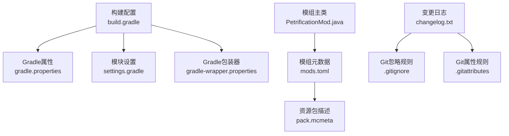
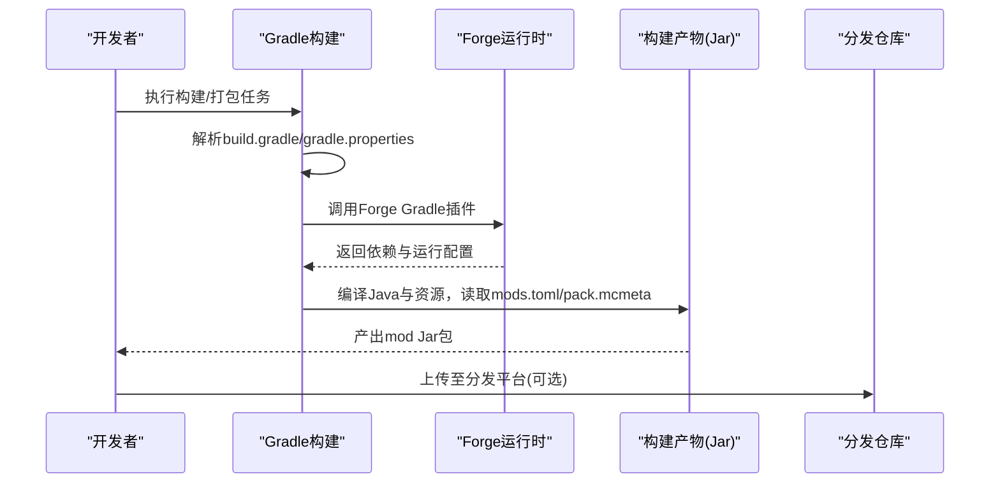
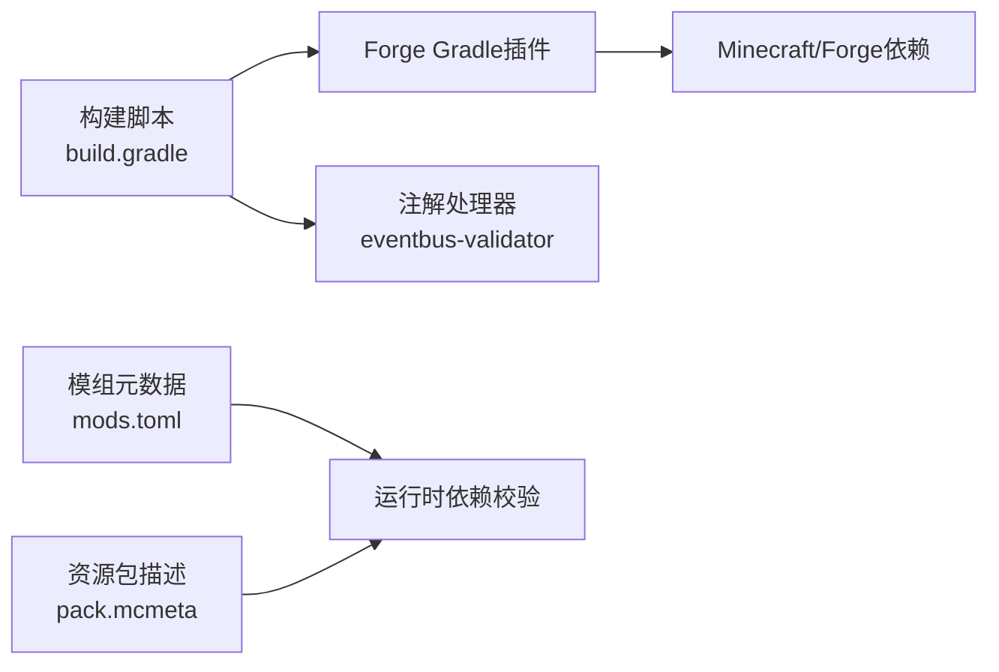

# 版本管理与发布

<cite>
**本文引用的文件**
- [build.gradle](file://build.gradle)
- [gradle.properties](file://gradle.properties)
- [settings.gradle](file://settings.gradle)
- [gradle-wrapper.properties](file://gradle/wrapper/gradle-wrapper.properties)
- [mods.toml](file://src/main/resources/META-INF/mods.toml)
- [pack.mcmeta](file://src/main/resources/pack.mcmeta)
- [PetrificationMod.java](file://src/main/java/com/xiong/petrification/PetrificationMod.java)
- [changelog.txt](file://changelog.txt)
- [.gitignore](file://.gitignore)
- [.gitattributes](file://.gitattributes)
</cite>

## 目录
1. [简介](#简介)
2. [项目结构](#项目结构)
3. [核心组件](#核心组件)
4. [架构总览](#架构总览)
5. [详细组件分析](#详细组件分析)
6. [依赖分析](#依赖分析)
7. [性能考虑](#性能考虑)
8. [故障排查指南](#故障排查指南)
9. [结论](#结论)
10. [附录](#附录)

## 简介
本文件面向“版本管理与发布”目标，围绕该Forge模组仓库的构建与发布配置进行系统化说明。内容涵盖：
- Git工作流建议（分支策略、提交规范、合并流程）
- 构建脚本配置（版本号管理、依赖锁定、产物输出）
- 模组打包与发布（资源打包、元数据配置、分发平台上传）
- 变更日志维护（版本标记、更新记录、问题跟踪）
- 自动化发布与持续集成（CI/CD）建议，提升效率与一致性

## 项目结构
该仓库采用标准Gradle + Forge MDK结构，关键路径与职责如下：
- 构建与依赖：build.gradle、gradle.properties、settings.gradle、gradle-wrapper.properties
- 模组元数据：src/main/resources/META-INF/mods.toml、src/main/resources/pack.mcmeta
- 主入口类：src/main/java/com/xiong/petrification/PetrificationMod.java
- 变更日志：changelog.txt
- Git相关：.gitignore、.gitattributes

图表来源
- [build.gradle:1-63](file://build.gradle#L1-L63)
- [gradle.properties:1-10](file://gradle.properties#L1-L10)
- [settings.gradle:1-6](file://settings.gradle#L1-L6)
- [gradle-wrapper.properties:1-7](file://gradle/wrapper/gradle-wrapper.properties#L1-L7)
- [mods.toml:1-28](file://src/main/resources/META-INF/mods.toml#L1-L28)
- [pack.mcmeta:1-10](file://src/main/resources/pack.mcmeta#L1-L10)
- [PetrificationMod.java:1-53](file://src/main/java/com/xiong/petrification/PetrificationMod.java#L1-L53)
- [changelog.txt:1-24](file://changelog.txt#L1-L24)
- [.gitignore:1-27](file://.gitignore#L1-L27)
- [.gitattributes:1-6](file://.gitattributes#L1-L6)

章节来源
- [build.gradle:1-63](file://build.gradle#L1-L63)
- [gradle.properties:1-10](file://gradle.properties#L1-L10)
- [settings.gradle:1-6](file://settings.gradle#L1-L6)
- [gradle-wrapper.properties:1-7](file://gradle/wrapper/gradle-wrapper.properties#L1-L7)
- [mods.toml:1-28](file://src/main/resources/META-INF/mods.toml#L1-L28)
- [pack.mcmeta:1-10](file://src/main/resources/pack.mcmeta#L1-L10)
- [PetrificationMod.java:1-53](file://src/main/java/com/xiong/petrification/PetrificationMod.java#L1-L53)
- [changelog.txt:1-24](file://changelog.txt#L1-L24)
- [.gitignore:1-27](file://.gitignore#L1-L27)
- [.gitattributes:1-6](file://.gitattributes#L1-L6)

## 核心组件
- 构建系统与任务
  - 使用Gradle与Forge Gradle插件定义Java编译、运行环境、数据生成与仓库源。
  - 通过minecraft.runs注册client/server/data等运行配置，便于本地调试与数据生成。
- 版本与分组
  - 在构建脚本中声明version与group，作为Maven坐标与产物命名基础。
- 模组元数据
  - mods.toml声明模组ID、显示名、作者、描述、依赖范围等；pack.mcmeta描述资源包格式。
- 主入口与初始化
  - PetrificationMod负责注册各类注册表、事件处理器、网络与配置加载。
- 变更日志
  - changelog.txt用于记录版本迭代与修复项，便于发布说明与审计。

章节来源
- [build.gradle:5-56](file://build.gradle#L5-L56)
- [mods.toml:1-28](file://src/main/resources/META-INF/mods.toml#L1-L28)
- [pack.mcmeta:1-10](file://src/main/resources/pack.mcmeta#L1-L10)
- [PetrificationMod.java:22-51](file://src/main/java/com/xiong/petrification/PetrificationMod.java#L22-L51)
- [changelog.txt:1-24](file://changelog.txt#L1-L24)

## 架构总览
下图展示从代码到可分发包的关键路径：源码与资源经Gradle编译与处理，读取mods.toml与pack.mcmeta生成最终Jar包，并可通过CI自动发布。

图表来源
- [build.gradle:15-56](file://build.gradle#L15-L56)
- [mods.toml:1-28](file://src/main/resources/META-INF/mods.toml#L1-L28)
- [pack.mcmeta:1-10](file://src/main/resources/pack.mcmeta#L1-L10)

## 详细组件分析

### 构建脚本与版本管理
- 版本与分组
  - version与group在构建脚本中集中声明，便于统一管理与CI参数化注入。
- Java工具链
  - 指定语言级别以匹配目标Minecraft/Forge要求，确保跨平台一致编译。
- 运行配置
  - 通过minecraft.runs注册client/server/data等任务，支持本地测试与数据生成。
- 仓库与依赖
  - 配置Mojang与Forge官方仓库，声明Forge依赖与注解处理器，保证依赖稳定与可复现。
- 编码与兼容性
  - 强制UTF-8编码，避免跨平台字符集差异导致的构建不一致。

优化建议
- 将version与group抽取到gradle.properties或环境变量，便于CI动态覆盖。
- 为data任务增加缓存与增量构建，缩短数据生成时间。
- 使用固定版本的Gradle Wrapper，避免上游变更影响构建。

章节来源
- [build.gradle:5-63](file://build.gradle#L5-L63)
- [gradle-wrapper.properties:1-7](file://gradle/wrapper/gradle-wrapper.properties#L1-L7)

### 模组元数据与资源打包
- mods.toml
  - 声明模组ID、版本、显示名、作者、描述、许可证及依赖范围（Forge与Minecraft）。
- pack.mcmeta
  - 描述资源包格式范围，确保与客户端/服务器兼容。
- 资源组织
  - assets下包含模型、语言、方块状态等；data下包含标签、配方、战利品表等。

注意事项
- 版本字段应与构建脚本保持一致，避免发布后信息不一致。
- 依赖范围需与目标Minecraft/Forge版本严格匹配，防止运行时不兼容。

章节来源
- [mods.toml:1-28](file://src/main/resources/META-INF/mods.toml#L1-L28)
- [pack.mcmeta:1-10](file://src/main/resources/pack.mcmeta#L1-L10)

### 主入口与初始化流程
- 注册顺序
  - 在构造阶段注册数据组件、方块、物品、实体、效果、药水、创造标签等。
  - 在公共初始化事件中注册网络与日志信息。
- 配置加载
  - 通过FMLCommonSetupEvent注册通用配置，确保服务端与客户端一致。

章节来源
- [PetrificationMod.java:22-51](file://src/main/java/com/xiong/petrification/PetrificationMod.java#L22-L51)

### 变更日志维护方法
- 版本标记
  - 建议在每次发布前打Tag（如v1.0.0），并在changelog.txt中记录对应版本的变更摘要。
- 更新记录
  - 按版本分段记录新增功能、修复缺陷、破坏性变更与已知问题。
- 问题跟踪
  - 将Issue编号与提交关联，便于回溯与审计。

章节来源
- [changelog.txt:1-24](file://changelog.txt#L1-L24)

### Git工作流建议（分支策略、提交规范、合并流程）
- 分支策略
  - main：受保护的发布分支，仅允许通过PR合并。
  - develop：集成开发分支，日常功能合并处。
  - feature/*：功能分支，基于develop创建，完成后合并回develop。
  - hotfix/*：紧急修复分支，基于main创建，完成后同时合并回main与develop。
- 提交规范
  - 使用约定式提交（如feat/fix/chore/docs），便于自动生成变更日志与版本语义化。
- 合并流程
  - 所有变更通过Pull Request评审，至少一名Reviewer批准后方可合并。
  - 合并前需通过CI检查（构建、测试、静态检查）。

[本节为概念性指导，不直接分析具体文件]

### 构建产物与发布流程
- 构建产物
  - 通过Gradle构建生成mod Jar包，内含编译后的class与资源，遵循mods.toml与pack.mcmeta描述。
- 资源打包
  - 资源位于src/main/resources，由Gradle自动纳入构建产物。
- 元数据配置
  - mods.toml与pack.mcmeta决定模组识别与资源包行为，需与版本严格对齐。
- 分发平台上传
  - 可将生成的Jar上传至CurseForge、Modrinth等平台，或通过内部仓库共享。

章节来源
- [build.gradle:15-56](file://build.gradle#L15-L56)
- [mods.toml:1-28](file://src/main/resources/META-INF/mods.toml#L1-L28)
- [pack.mcmeta:1-10](file://src/main/resources/pack.mcmeta#L1-L10)

### 持续集成与自动化发布（建议）
- CI流水线建议
  - 触发条件：push到main/develop、创建Tag、打开PR。
  - 步骤：安装JDK、拉取依赖、构建、运行测试、生成变更日志、打包Jar、上传制品。
- 自动化发布
  - 当检测到发布Tag时，自动执行发布任务，生成发布说明并上传至分发平台。
- 缓存与加速
  - 缓存Gradle依赖与构建缓存，减少重复构建时间。

[本节为概念性指导，不直接分析具体文件]

## 依赖分析
下图展示构建期与运行期的主要依赖关系：

图表来源
- [build.gradle:46-56](file://build.gradle#L46-L56)
- [mods.toml:15-28](file://src/main/resources/META-INF/mods.toml#L15-L28)
- [pack.mcmeta:1-10](file://src/main/resources/pack.mcmeta#L1-L10)

章节来源
- [build.gradle:46-56](file://build.gradle#L46-L56)
- [mods.toml:15-28](file://src/main/resources/META-INF/mods.toml#L15-L28)
- [pack.mcmeta:1-10](file://src/main/resources/pack.mcmeta#L1-L10)

## 性能考虑
- 构建性能
  - 启用Gradle并行与配置缓存，减少构建时间。
  - 使用Wrapper固定Gradle版本，避免升级带来的不稳定。
- 资源与数据生成
  - 合理使用data任务增量生成，避免全量重建。
- 运行时性能
  - 保持依赖版本与Minecraft/Forge匹配，避免不必要的兼容层开销。

章节来源
- [gradle.properties:1-10](file://gradle.properties#L1-L10)
- [gradle-wrapper.properties:1-7](file://gradle/wrapper/gradle-wrapper.properties#L1-L7)
- [build.gradle:15-56](file://build.gradle#L15-L56)

## 故障排查指南
- 构建失败
  - 检查Java版本与工具链配置是否匹配目标Minecraft/Forge要求。
  - 确认Gradle Wrapper版本与仓库可达性。
- 运行时崩溃
  - 核对mods.toml中的依赖范围是否与目标Minecraft/Forge一致。
  - 查看日志定位初始化阶段的错误（如注册表冲突、网络未注册）。
- 资源缺失
  - 确认assets与data路径正确，pack.mcmeta格式范围兼容。
- 版本不一致
  - 确保构建脚本version与mods.toml中的version同步。

章节来源
- [build.gradle:15-56](file://build.gradle#L15-L56)
- [mods.toml:1-28](file://src/main/resources/META-INF/mods.toml#L1-L28)
- [pack.mcmeta:1-10](file://src/main/resources/pack.mcmeta#L1-L10)
- [PetrificationMod.java:22-51](file://src/main/java/com/xiong/petrification/PetrificationMod.java#L22-L51)

## 结论
本仓库已具备清晰的构建与发布基础：通过Gradle与Forge插件完成编译与打包，mods.toml与pack.mcmeta提供稳定的元数据描述，changelog.txt支持版本追踪。建议在此基础上完善Git工作流、引入CI自动化与标准化发布流程，以提升团队协作效率与发布质量。

## 附录
- Git忽略与属性
  - .gitignore排除IDE与构建产物，避免污染仓库。
  - .gitattributes统一生成文件的换行符，减少无关差异。

章节来源
- [.gitignore:1-27](file://.gitignore#L1-L27)
- [.gitattributes:1-6](file://.gitattributes#L1-L6)