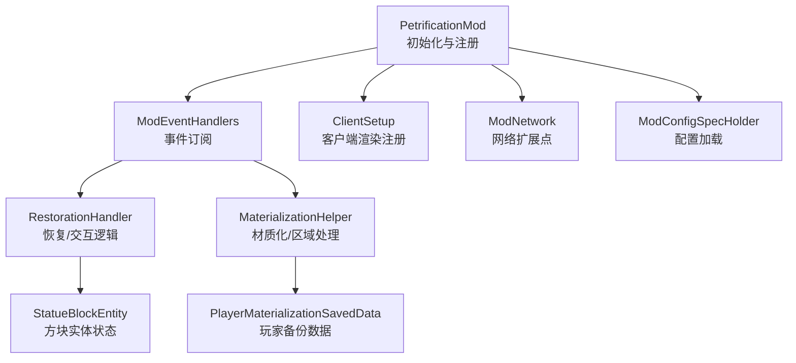
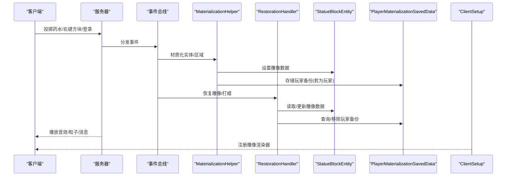
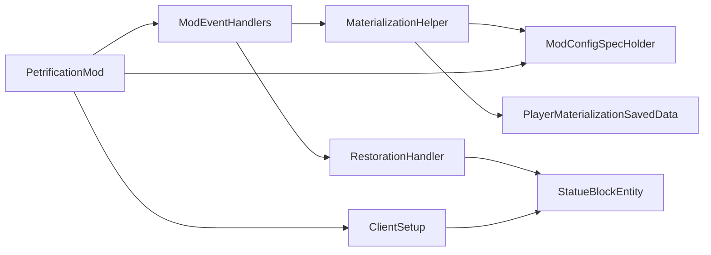

# 调试与测试

<cite>
**本文引用的文件**
- [PetrificationMod.java](file://src/main/java/com/xiong/petrification/PetrificationMod.java)
- [ModEventHandlers.java](file://src/main/java/com/xiong/petrification/handler/ModEventHandlers.java)
- [RestorationHandler.java](file://src/main/java/com/xiong/petrification/handler/RestorationHandler.java)
- [MaterializationHelper.java](file://src/main/java/com/xiong/petrification/util/MaterializationHelper.java)
- [StatueBlockEntity.java](file://src/main/java/com/xiong/petrification/block/StatueBlockEntity.java)
- [PlayerMaterializationSavedData.java](file://src/main/java/com/xiong/petrification/data/PlayerMaterializationSavedData.java)
- [ClientSetup.java](file://src/main/java/com/xiong/petrification/client/ClientSetup.java)
- [ModNetwork.java](file://src/main/java/com/xiong/petrification/network/ModNetwork.java)
- [ModConfigSpecHolder.java](file://src/main/java/com/xiong/petrification/ModConfigSpecHolder.java)
- [StatueComponent.java](file://src/main/java/com/xiong/petrification/component/StatueComponent.java)
- [build.gradle](file://build.gradle)
- [mods.toml](file://src/main/resources/META-INF/mods.toml)
</cite>

## 目录
1. [简介](#简介)
2. [项目结构](#项目结构)
3. [核心组件](#核心组件)
4. [架构总览](#架构总览)
5. [详细组件分析](#详细组件分析)
6. [依赖关系分析](#依赖关系分析)
7. [性能考量](#性能考量)
8. [故障排查指南](#故障排查指南)
9. [结论](#结论)
10. [附录](#附录)

## 简介
本指南面向开发与测试该“石化”模组的工程师，聚焦以下目标：
- 日志系统的使用：如何设置日志级别、输出关键信息、追踪错误。
- 断点调试技巧：IDE 调试器配置、条件断点、变量监视。
- 单元测试编写方法：用例设计、模拟对象、测试数据准备。
- 性能分析工具：内存使用监控、渲染性能分析、网络通信优化。
- 常见调试场景与解决方案：事件处理问题、数据同步问题、渲染异常。

本指南基于仓库中的实际代码进行分析，所有技术细节均来源于源码与构建配置。

## 项目结构
本项目为 Minecraft Forge 模组（版本 26.2），采用模块化包组织：
- 主入口与生命周期：PetrificationMod
- 事件处理：ModEventHandlers
- 业务逻辑：RestorationHandler、MaterializationHelper
- 方块实体与客户端渲染：StatueBlockEntity、ClientSetup
- 持久化数据：PlayerMaterializationSavedData
- 网络扩展点：ModNetwork
- 配置：ModConfigSpecHolder
- 数据模型：StatueComponent
- 构建与运行：build.gradle、mods.toml

图表来源
- [PetrificationMod.java:22-51](file://src/main/java/com/xiong/petrification/PetrificationMod.java#L22-L51)
- [ModEventHandlers.java:30-118](file://src/main/java/com/xiong/petrification/handler/ModEventHandlers.java#L30-L118)
- [RestorationHandler.java:31-229](file://src/main/java/com/xiong/petrification/handler/RestorationHandler.java#L31-L229)
- [MaterializationHelper.java:33-263](file://src/main/java/com/xiong/petrification/util/MaterializationHelper.java#L33-L263)
- [StatueBlockEntity.java:17-88](file://src/main/java/com/xiong/petrification/block/StatueBlockEntity.java#L17-L88)
- [PlayerMaterializationSavedData.java:22-95](file://src/main/java/com/xiong/petrification/data/PlayerMaterializationSavedData.java#L22-L95)
- [ClientSetup.java:10-21](file://src/main/java/com/xiong/petrification/client/ClientSetup.java#L10-L21)
- [ModNetwork.java:3-10](file://src/main/java/com/xiong/petrification/network/ModNetwork.java#L3-L10)
- [ModConfigSpecHolder.java:8-69](file://src/main/java/com/xiong/petrification/ModConfigSpecHolder.java#L8-L69)

章节来源
- [build.gradle:21-44](file://build.gradle#L21-L44)
- [mods.toml:5-28](file://src/main/resources/META-INF/mods.toml#L5-L28)

## 核心组件
- 日志与初始化：主类通过 SLF4J Logger 输出初始化信息，并在通用设置阶段执行网络注册。
- 事件总线：通过 @SubscribeEvent 订阅药水溅射、右键方块、玩家登录、方块破坏等事件。
- 材质化与恢复：将实体或区块转化为雕像并保存状态；支持从雕像恢复实体或玩家。
- 客户端渲染：注册方块实体渲染器以在客户端正确显示雕像。
- 配置系统：提供药水范围倍率、氧化速率、渲染距离等可调参数。
- 数据持久化：使用 SavedData 存储离线玩家的雕像位置与数据。

章节来源
- [PetrificationMod.java:22-51](file://src/main/java/com/xiong/petrification/PetrificationMod.java#L22-L51)
- [ModEventHandlers.java:38-118](file://src/main/java/com/xiong/petrification/handler/ModEventHandlers.java#L38-L118)
- [MaterializationHelper.java:55-96](file://src/main/java/com/xiong/petrification/util/MaterializationHelper.java#L55-L96)
- [RestorationHandler.java:34-167](file://src/main/java/com/xiong/petrification/handler/RestorationHandler.java#L34-L167)
- [ClientSetup.java:13-19](file://src/main/java/com/xiong/petrification/client/ClientSetup.java#L13-L19)
- [ModConfigSpecHolder.java:12-69](file://src/main/java/com/xiong/petrification/ModConfigSpecHolder.java#L12-L69)
- [PlayerMaterializationSavedData.java:70-95](file://src/main/java/com/xiong/petrification/data/PlayerMaterializationSavedData.java#L70-L95)

## 架构总览
下图展示了从事件触发到业务处理、再到数据持久化的完整流程，以及客户端渲染的参与点。

图表来源
- [ModEventHandlers.java:45-118](file://src/main/java/com/xiong/petrification/handler/ModEventHandlers.java#L45-L118)
- [MaterializationHelper.java:55-96](file://src/main/java/com/xiong/petrification/util/MaterializationHelper.java#L55-L96)
- [RestorationHandler.java:34-167](file://src/main/java/com/xiong/petrification/handler/RestorationHandler.java#L34-L167)
- [PlayerMaterializationSavedData.java:70-95](file://src/main/java/com/xiong/petrification/data/PlayerMaterializationSavedData.java#L70-L95)
- [ClientSetup.java:13-19](file://src/main/java/com/xiong/petrification/client/ClientSetup.java#L13-L19)

## 详细组件分析

### 日志系统与错误追踪
- 日志记录点：
  - 模组初始化完成时输出信息日志，便于确认加载顺序与启动成功。
- 建议的日志策略：
  - 在事件处理器中，对关键分支（如药水类型判断、权限检查、玩家在线/离线）增加调试日志，包含上下文信息（坐标、UUID、材料类型）。
  - 在材质化/恢复路径中，记录失败原因（例如缺少雕像数据、实体类型解析失败）。
  - 在客户端渲染注册处，记录是否成功绑定渲染器。
- 日志级别建议：
  - 信息级：初始化、配置加载、主要功能调用。
  - 调试级：事件分支、数据读写、网络包发送/接收。
  - 错误级：异常捕获、非法输入、资源缺失。
- 错误追踪要点：
  - 利用堆栈跟踪定位异常来源。
  - 对异步或跨线程操作（如服务端 tick）确保日志线程安全。
  - 结合配置项（如药水范围倍率、氧化速率）进行可复现性验证。

章节来源
- [PetrificationMod.java:22-51](file://src/main/java/com/xiong/petrification/PetrificationMod.java#L22-L51)
- [ModEventHandlers.java:45-118](file://src/main/java/com/xiong/petrification/handler/ModEventHandlers.java#L45-L118)
- [MaterializationHelper.java:36-96](file://src/main/java/com/xiong/petrification/util/MaterializationHelper.java#L36-L96)
- [RestorationHandler.java:34-167](file://src/main/java/com/xiong/petrification/handler/RestorationHandler.java#L34-L167)

### 断点调试技巧
- IDE 调试器配置：
  - 使用 Gradle 的 client/server 运行配置进行调试。
  - 启用严格运行时检查（已在构建脚本中设置），有助于尽早发现事件总线误用。
- 条件断点：
  - 在事件处理器中针对特定药水类型、玩家 UUID、坐标范围设置条件断点。
  - 在材质化/恢复函数入口处按材料类型或目标类型过滤。
- 变量监视：
  - 观察 StatueComponent 字段（如 materialType、oxidation、equipment）变化。
  - 监控 PlayerMaterializationSavedData 的 entries 映射，确认备份与清理逻辑。
  - 检查 ModConfigSpecHolder 的配置值是否与预期一致。

章节来源
- [build.gradle:21-44](file://build.gradle#L21-L44)
- [ModEventHandlers.java:45-118](file://src/main/java/com/xiong/petrification/handler/ModEventHandlers.java#L45-L118)
- [MaterializationHelper.java:55-96](file://src/main/java/com/xiong/petrification/util/MaterializationHelper.java#L55-L96)
- [RestorationHandler.java:34-167](file://src/main/java/com/xiong/petrification/handler/RestorationHandler.java#L34-L167)
- [PlayerMaterializationSavedData.java:70-95](file://src/main/java/com/xiong/petrification/data/PlayerMaterializationSavedData.java#L70-L95)
- [ModConfigSpecHolder.java:46-69](file://src/main/java/com/xiong/petrification/ModConfigSpecHolder.java#L46-L69)

### 单元测试编写方法
- 测试目标与范围：
  - 材质化权限检查：验证创造模式与 OP 玩家的限制是否符合配置。
  - 区域材质化：验证半径范围内实体选择与排序（玩家优先）。
  - 装备序列化/反序列化：验证装备 NBT 编码与还原的正确性。
  - 雕像数据编解码：验证 StatueComponent 的复杂 Codec 分组组合。
- 测试用例设计：
  - 边界条件：半径为 0、最大半径、空列表、无雕像数据。
  - 异常路径：实体类型不存在、NBT 解析失败、配置值越界。
- 模拟对象使用：
  - 模拟 ServerLevel、LivingEntity、Player、BlockEntity 等，避免真实世界状态影响。
  - 使用 Stub 返回固定 NBT、UUID、坐标等，保证可重复性。
- 测试数据准备：
  - 构造不同 MaterialType 的 StatueComponent，覆盖铜氧化、打蜡等场景。
  - 准备多种装备标签（主手、副手、护甲），验证恢复逻辑。

章节来源
- [MaterializationHelper.java:36-96](file://src/main/java/com/xiong/petrification/util/MaterializationHelper.java#L36-L96)
- [MaterializationHelper.java:188-232](file://src/main/java/com/xiong/petrification/util/MaterializationHelper.java#L188-L232)
- [StatueComponent.java:81-148](file://src/main/java/com/xiong/petrification/component/StatueComponent.java#L81-L148)
- [ModConfigSpecHolder.java:12-69](file://src/main/java/com/xiong/petrification/ModConfigSpecHolder.java#L12-L69)

### 性能分析工具的使用
- 内存使用监控：
  - 关注 StatueComponent 的装备 NBT 大小，避免过大导致内存压力。
  - 监控 SavedData 的 entries 映射增长，防止内存泄漏。
- 渲染性能分析：
  - 调整雕像渲染距离配置，减少远端渲染开销。
  - 验证客户端渲染器是否正确注册，避免重复创建或无效绘制。
- 网络通信优化：
  - 当前网络扩展点为空，建议在需要时实现轻量数据包，仅传输必要状态（如雕像位置、材料类型）。
  - 避免频繁全量同步，采用增量更新与变更通知。

章节来源
- [ModConfigSpecHolder.java:40-69](file://src/main/java/com/xiong/petrification/ModConfigSpecHolder.java#L40-L69)
- [ClientSetup.java:13-19](file://src/main/java/com/xiong/petrification/client/ClientSetup.java#L13-L19)
- [ModNetwork.java:3-10](file://src/main/java/com/xiong/petrification/network/ModNetwork.java#L3-L10)
- [PlayerMaterializationSavedData.java:70-95](file://src/main/java/com/xiong/petrification/data/PlayerMaterializationSavedData.java#L70-L95)

## 依赖关系分析
- 模块耦合：
  - 事件处理器依赖 MaterializationHelper 与 RestorationHandler，形成事件到业务的桥梁。
  - 材质化工具依赖配置与数据持久化，体现配置驱动与状态管理。
  - 客户端渲染依赖方块实体注册，确保视觉一致性。
- 外部依赖：
  - Forge 事件总线、Minecraft 实体/方块 API、SLF4J 日志。
- 潜在循环依赖：
  - 当前结构清晰，未见直接循环引用；注意未来扩展时保持单向依赖。

图表来源
- [ModEventHandlers.java:45-118](file://src/main/java/com/xiong/petrification/handler/ModEventHandlers.java#L45-L118)
- [MaterializationHelper.java:36-96](file://src/main/java/com/xiong/petrification/util/MaterializationHelper.java#L36-L96)
- [RestorationHandler.java:34-167](file://src/main/java/com/xiong/petrification/handler/RestorationHandler.java#L34-L167)
- [ClientSetup.java:13-19](file://src/main/java/com/xiong/petrification/client/ClientSetup.java#L13-L19)
- [PetrificationMod.java:22-51](file://src/main/java/com/xiong/petrification/PetrificationMod.java#L22-L51)
- [ModConfigSpecHolder.java:46-69](file://src/main/java/com/xiong/petrification/ModConfigSpecHolder.java#L46-L69)
- [PlayerMaterializationSavedData.java:70-95](file://src/main/java/com/xiong/petrification/data/PlayerMaterializationSavedData.java#L70-L95)

章节来源
- [build.gradle:53-56](file://build.gradle#L53-L56)
- [mods.toml:15-28](file://src/main/resources/META-INF/mods.toml#L15-L28)

## 性能考量
- 配置调优：
  - 药水范围倍率影响材质化区域大小，需平衡效果与性能。
  - 氧化速率与最大氧化值影响雕像外观变化频率，过高可能导致频繁状态更新。
  - 雕像渲染距离直接影响客户端渲染负载。
- 算法复杂度：
  - 区域材质化遍历 AABB 内方块，时间复杂度与半径平方成正比，需注意大半径场景。
  - 实体排序优先玩家，保证关键实体先处理，提升用户体验。
- 内存与 IO：
  - 装备 NBT 序列化可能产生较大数据，建议限制装备数量或压缩。
  - SavedData 写入应合并多次变更，减少磁盘 IO。

章节来源
- [MaterializationHelper.java:83-96](file://src/main/java/com/xiong/petrification/util/MaterializationHelper.java#L83-L96)
- [MaterializationHelper.java:234-255](file://src/main/java/com/xiong/petrification/util/MaterializationHelper.java#L234-L255)
- [ModConfigSpecHolder.java:12-69](file://src/main/java/com/xiong/petrification/ModConfigSpecHolder.java#L12-L69)

## 故障排查指南
- 事件处理问题：
  - 现象：药水未触发材质化或恢复失败。
  - 排查：检查事件订阅是否生效、药水类型判断分支、权限检查逻辑。
  - 参考路径：[ModEventHandlers.java:45-63](file://src/main/java/com/xiong/petrification/handler/ModEventHandlers.java#L45-L63)
- 数据同步问题：
  - 现象：玩家离线后无法恢复或数据丢失。
  - 排查：确认 PlayerMaterializationSavedData 的存储与清理逻辑，检查 UUID 匹配。
  - 参考路径：[PlayerMaterializationSavedData.java:70-95](file://src/main/java/com/xiong/petrification/data/PlayerMaterializationSavedData.java#L70-L95)
- 渲染异常：
  - 现象：雕像在客户端不显示或显示错误。
  - 排查：确认客户端渲染器注册、方块实体数据同步、渲染距离配置。
  - 参考路径：[ClientSetup.java:13-19](file://src/main/java/com/xiong/petrification/client/ClientSetup.java#L13-L19)
- 配置相关问题：
  - 现象：行为不符合预期（如允许创造模式材质化）。
  - 排查：检查 ModConfigSpecHolder 的值加载与默认值。
  - 参考路径：[ModConfigSpecHolder.java:46-69](file://src/main/java/com/xiong/petrification/ModConfigSpecHolder.java#L46-L69)

章节来源
- [ModEventHandlers.java:45-118](file://src/main/java/com/xiong/petrification/handler/ModEventHandlers.java#L45-L118)
- [PlayerMaterializationSavedData.java:70-95](file://src/main/java/com/xiong/petrification/data/PlayerMaterializationSavedData.java#L70-L95)
- [ClientSetup.java:13-19](file://src/main/java/com/xiong/petrification/client/ClientSetup.java#L13-L19)
- [ModConfigSpecHolder.java:46-69](file://src/main/java/com/xiong/petrification/ModConfigSpecHolder.java#L46-L69)

## 结论
本模组通过事件驱动与工具类协作实现了实体与区块的材质化与恢复，具备完善的配置系统与数据持久化能力。调试与测试应围绕事件流、数据编解码、客户端渲染展开，结合日志、断点与性能分析工具，快速定位问题并优化体验。建议在后续迭代中完善网络通信与测试覆盖率，以提升稳定性与可维护性。

## 附录
- 构建与运行：
  - 使用 Gradle 的 client/server 任务启动游戏与服务端。
  - 启用严格运行时检查，便于早期发现问题。
- 配置项说明：
  - 药水范围倍率、创造模式与 OP 玩家限制、雕像硬度、氧化速率与最大值、渲染距离等。
- 数据模型：
  - StatueComponent 包含实体基础信息、姿态、可选数据、玩家相关状态等，采用分组 Codec 进行序列化。

章节来源
- [build.gradle:21-44](file://build.gradle#L21-L44)
- [ModConfigSpecHolder.java:12-69](file://src/main/java/com/xiong/petrification/ModConfigSpecHolder.java#L12-L69)
- [StatueComponent.java:81-148](file://src/main/java/com/xiong/petrification/component/StatueComponent.java#L81-L148)