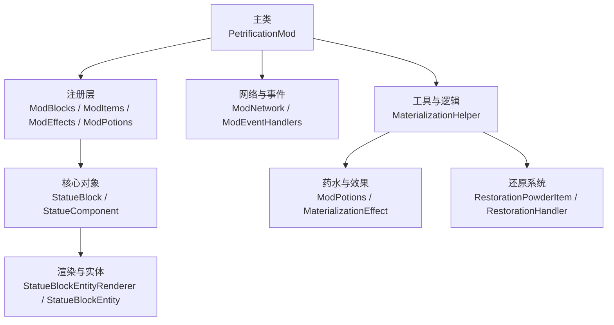
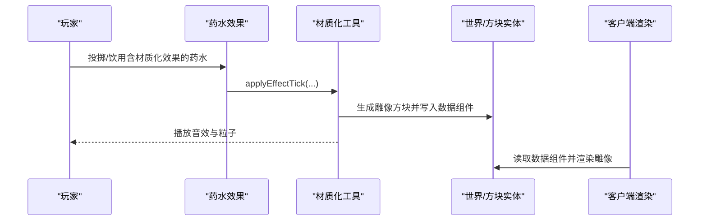
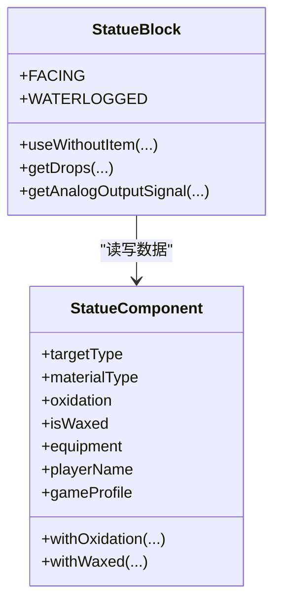
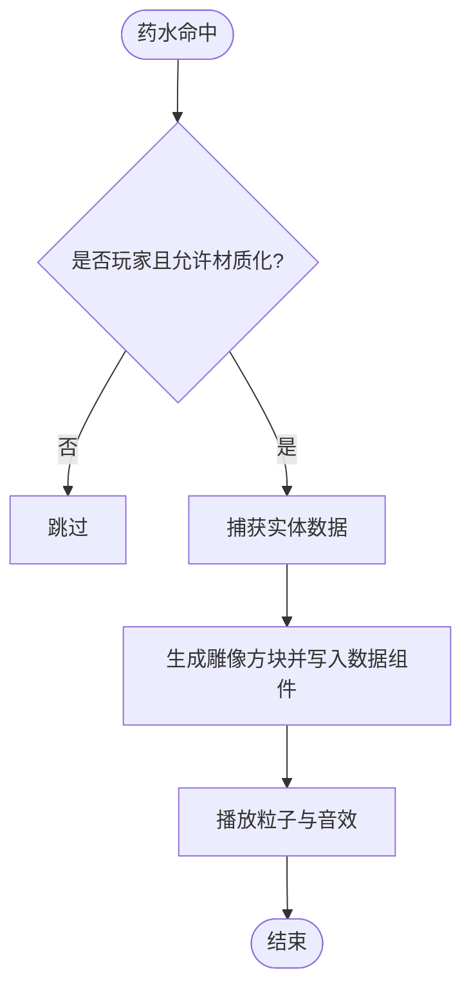
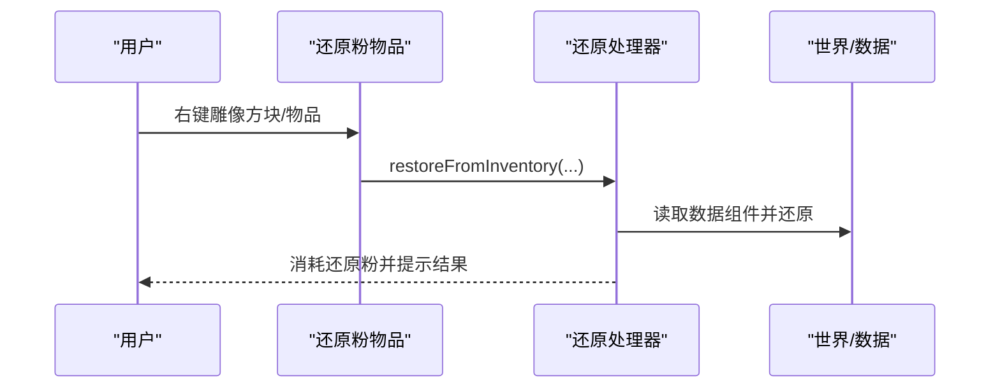
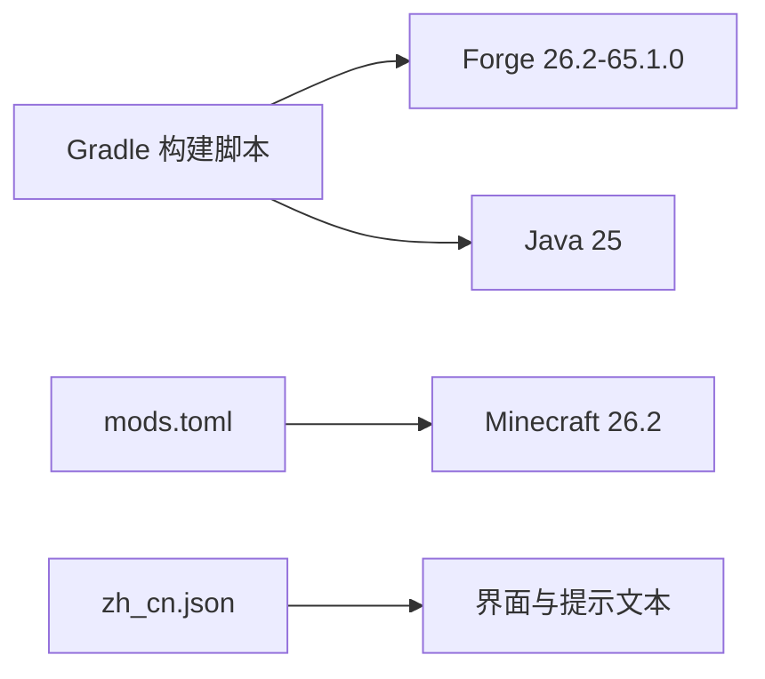

# 快速开始

<cite>
**本文引用的文件**
- [PetrificationMod.java](file://src/main/java/com/xiong/petrification/PetrificationMod.java)
- [build.gradle](file://build.gradle)
- [gradle.properties](file://gradle.properties)
- [mods.toml](file://src/main/resources/META-INF/mods.toml)
- [StatueBlock.java](file://src/main/java/com/xiong/petrification/block/StatueBlock.java)
- [StatueComponent.java](file://src/main/java/com/xiong/petrification/component/StatueComponent.java)
- [MaterializationEffect.java](file://src/main/java/com/xiong/petrification/effect/MaterializationEffect.java)
- [RestorationPowderItem.java](file://src/main/java/com/xiong/petrification/item/RestorationPowderItem.java)
- [MaterializationHelper.java](file://src/main/java/com/xiong/petrification/util/MaterializationHelper.java)
- [ModPotions.java](file://src/main/java/com/xiong/petrification/registry/ModPotions.java)
- [restoration_powder.json](file://src/main/resources/data/petrification/recipe/restoration_powder.json)
- [statue_compose.json](file://src/main/resources/data/petrification/recipe/statue_compose.json)
- [zh_cn.json](file://src/main/resources/assets/petrification/lang/zh_cn.json)
</cite>

## 目录
1. [简介](#简介)
2. [项目结构](#项目结构)
3. [核心组件](#核心组件)
4. [架构总览](#架构总览)
5. [详细组件分析](#详细组件分析)
6. [依赖关系分析](#依赖关系分析)
7. [性能注意事项](#性能注意事项)
8. [故障排除指南](#故障排除指南)
9. [结论](#结论)
10. [附录：开发环境搭建与第一个雕像教程](#附录开发环境搭建与第一个雕像教程)

## 简介
本快速开始指南面向首次接触“石化”模组的玩家与开发者，目标是帮助你：
- 在本地搭建完整的 Forge + Gradle 开发环境
- 理解模组的核心机制（药水材质化、雕像方块、还原粉）
- 完成从获取药水到制作并收集第一个雕像的完整流程
- 掌握基础使用方法与常见问题排查
- 为进阶用户提供配置与性能调优建议

## 项目结构
该模组基于 Minecraft 26.2 与 Forge 65.x，采用数据组件系统存储雕像信息，并通过单一通用雕像方块承载不同材质与目标类型。关键入口与注册逻辑集中在主类与各 Registry 中；交互与处理逻辑分布在事件处理器、工具类与物品/效果实现中。

图表来源
- [PetrificationMod.java:25-63](file://src/main/java/com/xiong/petrification/PetrificationMod.java#L25-L63)
- [StatueBlock.java:38-152](file://src/main/java/com/xiong/petrification/block/StatueBlock.java#L38-L152)
- [MaterializationHelper.java:33-263](file://src/main/java/com/xiong/petrification/util/MaterializationHelper.java#L33-L263)
- [ModPotions.java:12-33](file://src/main/java/com/xiong/petrification/registry/ModPotions.java#L12-L33)
- [MaterializationEffect.java:10-37](file://src/main/java/com/xiong/petrification/effect/MaterializationEffect.java#L10-L37)
- [RestorationPowderItem.java:11-32](file://src/main/java/com/xiong/petrification/item/RestorationPowderItem.java#L11-L32)

章节来源
- [PetrificationMod.java:25-63](file://src/main/java/com/xiong/petrification/PetrificationMod.java#L25-L63)
- [build.gradle:1-63](file://build.gradle#L1-L63)
- [mods.toml:1-28](file://src/main/resources/META-INF/mods.toml#L1-L28)

## 核心组件
- 雕像方块与方块实体：用于承载雕像数据并在世界中进行渲染与更新
- 数据组件：以类型安全的数据组件记录材质类型、目标类型、姿态、装备等全部信息
- 药水与效果：通过瞬时效果触发材质化逻辑
- 还原粉：将雕像还原为生物或玩家
- 辅助工具：统一处理材质化、区域影响、方块覆层、粒子与音效

章节来源
- [StatueBlock.java:38-152](file://src/main/java/com/xiong/petrification/block/StatueBlock.java#L38-L152)
- [StatueComponent.java:14-256](file://src/main/java/com/xiong/petrification/component/StatueComponent.java#L14-L256)
- [MaterializationEffect.java:10-37](file://src/main/java/com/xiong/petrification/effect/MaterializationEffect.java#L10-L37)
- [RestorationPowderItem.java:11-32](file://src/main/java/com/xiong/petrification/item/RestorationPowderItem.java#L11-L32)
- [MaterializationHelper.java:33-263](file://src/main/java/com/xiong/petrification/util/MaterializationHelper.java#L33-L263)

## 架构总览
模组启动时完成所有注册与初始化，随后通过事件与数据包驱动游戏内行为。核心流程包括：
- 药水命中 → 应用瞬时效果 → 调用工具类进行材质化
- 生成雕像方块 → 写入数据组件 → 客户端渲染对应模型
- 挖掘掉落带数据的雕像物品 → 放置恢复数据 → 使用还原粉还原

图表来源
- [MaterializationEffect.java:22-31](file://src/main/java/com/xiong/petrification/effect/MaterializationEffect.java#L22-L31)
- [MaterializationHelper.java:55-81](file://src/main/java/com/xiong/petrification/util/MaterializationHelper.java#L55-L81)
- [StatueBlock.java:89-121](file://src/main/java/com/xiong/petrification/block/StatueBlock.java#L89-L121)

## 详细组件分析

### 雕像方块与数据组件
- 雕像方块提供方向属性、可含水、不可见渲染形状，实际由方块实体负责渲染与数据管理
- 数据组件包含目标类型、材质类型、姿态、装备、玩家状态等大量字段，支持序列化与持久化
- 挖掘掉落时自动将数据组件附加到雕像物品上；右键显示名称等信息；铜材质支持模拟信号输出表示氧化进度

图表来源
- [StatueBlock.java:38-152](file://src/main/java/com/xiong/petrification/block/StatueBlock.java#L38-L152)
- [StatueComponent.java:14-256](file://src/main/java/com/xiong/petrification/component/StatueComponent.java#L14-L256)

章节来源
- [StatueBlock.java:38-152](file://src/main/java/com/xiong/petrification/block/StatueBlock.java#L38-L152)
- [StatueComponent.java:14-256](file://src/main/java/com/xiong/petrification/component/StatueComponent.java#L14-L256)

### 药水与材质化效果
- 每种材质对应一个瞬时效果，命中后直接触发材质化
- 工具类根据目标类型（玩家/生物/方块）执行相应逻辑，并播放音效与粒子

图表来源
- [MaterializationEffect.java:22-31](file://src/main/java/com/xiong/petrification/effect/MaterializationEffect.java#L22-L31)
- [MaterializationHelper.java:36-81](file://src/main/java/com/xiong/petrification/util/MaterializationHelper.java#L36-L81)

章节来源
- [ModPotions.java:12-33](file://src/main/java/com/xiong/petrification/registry/ModPotions.java#L12-L33)
- [MaterializationEffect.java:10-37](file://src/main/java/com/xiong/petrification/effect/MaterializationEffect.java#L10-L37)
- [MaterializationHelper.java:36-81](file://src/main/java/com/xiong/petrification/util/MaterializationHelper.java#L36-L81)

### 还原系统与配方
- 还原粉可通过合成获得，右键雕像方块或物品触发还原
- 还原逻辑会检查目标类型并恢复生物或玩家数据，同时消耗还原粉

图表来源
- [RestorationPowderItem.java:16-31](file://src/main/java/com/xiong/petrification/item/RestorationPowderItem.java#L16-L31)
- [restoration_powder.json:1-18](file://src/main/resources/data/petrification/recipe/restoration_powder.json#L1-L18)

章节来源
- [RestorationPowderItem.java:11-32](file://src/main/java/com/xiong/petrification/item/RestorationPowderItem.java#L11-L32)
- [restoration_powder.json:1-18](file://src/main/resources/data/petrification/recipe/restoration_powder.json#L1-L18)

## 依赖关系分析
- 构建与运行依赖 Forge 26.2-65.1.0，Java 工具链为 Java 25
- 模组元数据声明了 Forge 与 Minecraft 的版本范围
- 资源与语言包提供中文本地化文本

图表来源
- [build.gradle:15-56](file://build.gradle#L15-L56)
- [mods.toml:1-28](file://src/main/resources/META-INF/mods.toml#L1-L28)
- [zh_cn.json:1-35](file://src/main/resources/assets/petrification/lang/zh_cn.json#L1-L35)

章节来源
- [build.gradle:1-63](file://build.gradle#L1-L63)
- [gradle.properties:1-10](file://gradle.properties#L1-L10)
- [mods.toml:1-28](file://src/main/resources/META-INF/mods.toml#L1-L28)

## 性能注意事项
- 模型缓存与实例化渲染：减少重复模型创建与绘制开销
- LOD 与剔除：远距离雕像使用简化模型或剔除，降低渲染压力
- 异步皮肤加载：避免阻塞主线程
- 氧化更新频率：服务器 Tick 中周期性更新铜材质氧化值，可按需调整

[本节为通用性能建议，不直接分析具体文件]

## 故障排除指南
- 无法被材质化的玩家：创造模式或高权限 OP 默认免疫，可在配置中调整
- 雕像无法还原：确认持有还原粉且目标为雕像方块/物品；在线玩家物品可能受保护
- 氧化不生效：确认材质类型为铜且未打蜡；检查服务器 Tick 更新逻辑
- 渲染异常：确认客户端已正确加载着色器与模型缓存；尝试关闭高级图形选项

章节来源
- [MaterializationHelper.java:36-53](file://src/main/java/com/xiong/petrification/util/MaterializationHelper.java#L36-L53)
- [RestorationPowderItem.java:16-31](file://src/main/java/com/xiong/petrification/item/RestorationPowderItem.java#L16-L31)
- [StatueBlock.java:137-151](file://src/main/java/com/xiong/petrification/block/StatueBlock.java#L137-L151)

## 结论
本模组通过数据组件与单一雕像方块实现了灵活的材质化玩法，配合药水与还原粉形成完整闭环。新手可通过简单步骤体验从药水到雕像的全过程；开发者则可基于现有架构扩展更多材质、配方与渲染特效。

[本节为总结性内容，不直接分析具体文件]

## 附录：开发环境搭建与第一个雕像教程

### 开发环境搭建
- 安装 JDK 25 与支持的 IDE（推荐 IntelliJ IDEA）
- 克隆仓库并使用 Gradle 导入工程
- 配置 Forge 运行环境（client/server/gameTestServer/data）
- 使用 Gradle 任务生成资源与数据

章节来源
- [build.gradle:15-43](file://build.gradle#L15-L43)
- [gradle.properties:1-10](file://gradle.properties#L1-L10)

### 第一个雕像制作教程（从药水到收集）
- 准备材料：酿造台、粗制药水、对应材质的锭/块（如铜锭）
- 酿造药水：粗制药水 + 对应材质锭/块 → 获得对应材质化药水
- 投掷技巧：对生物或玩家投掷喷溅/滞留药水，注意范围与优先级（玩家优先于生物）
- 观察效果：命中后播放粒子与音效，原地生成雕像方块
- 收集雕像：用镐挖掘雕像方块，掉落带数据组件的雕像物品
- 放置与展示：右键地面放置雕像，查看名称与信息
- 还原操作：手持还原粉右键雕像方块/物品，成功还原为目标生物/玩家

章节来源
- [ModPotions.java:12-33](file://src/main/java/com/xiong/petrification/registry/ModPotions.java#L12-L33)
- [MaterializationHelper.java:83-96](file://src/main/java/com/xiong/petrification/util/MaterializationHelper.java#L83-L96)
- [StatueBlock.java:123-135](file://src/main/java/com/xiong/petrification/block/StatueBlock.java#L123-L135)
- [restoration_powder.json:1-18](file://src/main/resources/data/petrification/recipe/restoration_powder.json#L1-L18)

### 基本使用方法
- 药水的获取：通过酿造台将粗制药水与对应材质锭/块合成
- 投掷技巧：使用喷溅药水扩大影响范围；滞留药水持续作用一段时间
- 雕像的收集：使用镐挖掘雕像方块，掉落物携带完整数据组件
- 还原过程：使用还原粉右键雕像方块或物品，按目标类型恢复生物或玩家

章节来源
- [MaterializationEffect.java:22-31](file://src/main/java/com/xiong/petrification/effect/MaterializationEffect.java#L22-L31)
- [MaterializationHelper.java:55-81](file://src/main/java/com/xiong/petrification/util/MaterializationHelper.java#L55-L81)
- [RestorationPowderItem.java:16-31](file://src/main/java/com/xiong/petrification/item/RestorationPowderItem.java#L16-L31)

### 常见问题与解决方案
- 玩家免疫材质化：检查是否为创造模式或高权限 OP，必要时调整配置
- 雕像氧化不变化：确认材质类型为铜且未打蜡；服务器 Tick 正常更新
- 多人游戏同步问题：确保数据包与区块同步正常；登录/登出事件处理玩家状态

章节来源
- [MaterializationHelper.java:36-53](file://src/main/java/com/xiong/petrification/util/MaterializationHelper.java#L36-L53)
- [StatueBlock.java:137-151](file://src/main/java/com/xiong/petrification/block/StatueBlock.java#L137-L151)

### 高级配置与性能调优（开发者）
- 配置文件：通过 Forge Config API 调整药水范围、材质化权限、雕像硬度、氧化速度、渲染距离等
- 渲染优化：启用模型缓存、LOD、实例化渲染；异步加载玩家皮肤
- 网络同步：确保 BlockEntity 数据、物品数据组件与世界持久化数据正确同步

章节来源
- [PetrificationMod.java:46-53](file://src/main/java/com/xiong/petrification/PetrificationMod.java#L46-L53)
- [build.gradle:15-56](file://build.gradle#L15-L56)