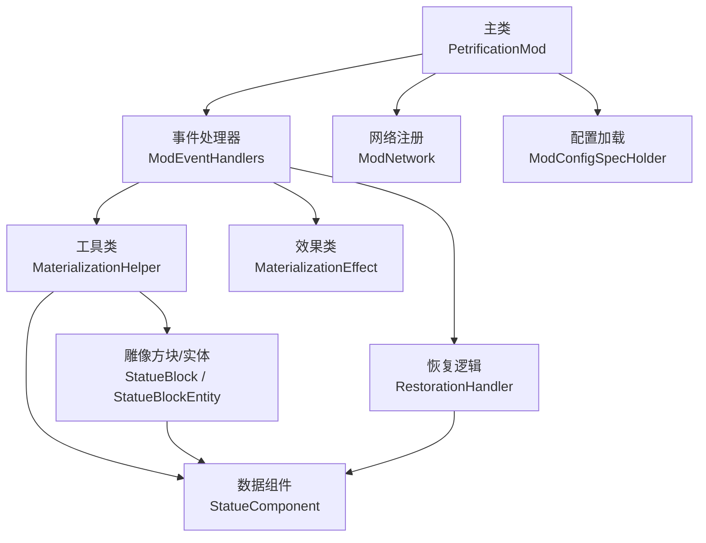
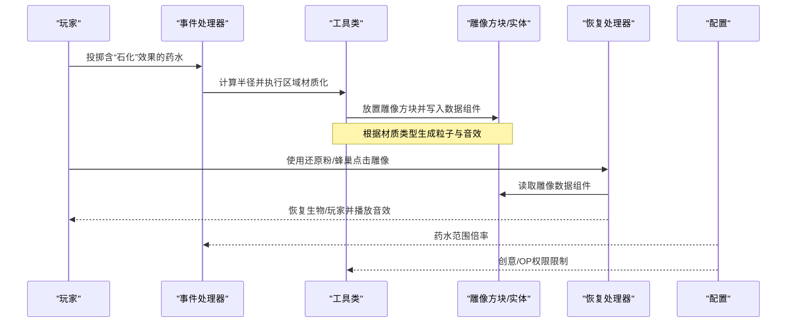
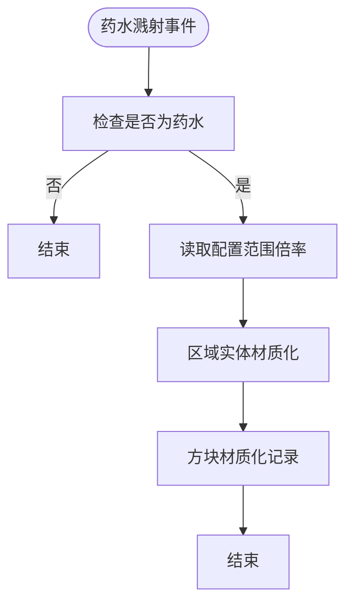
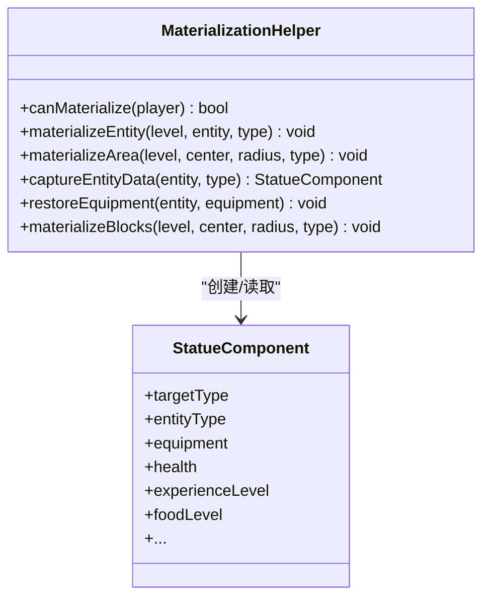
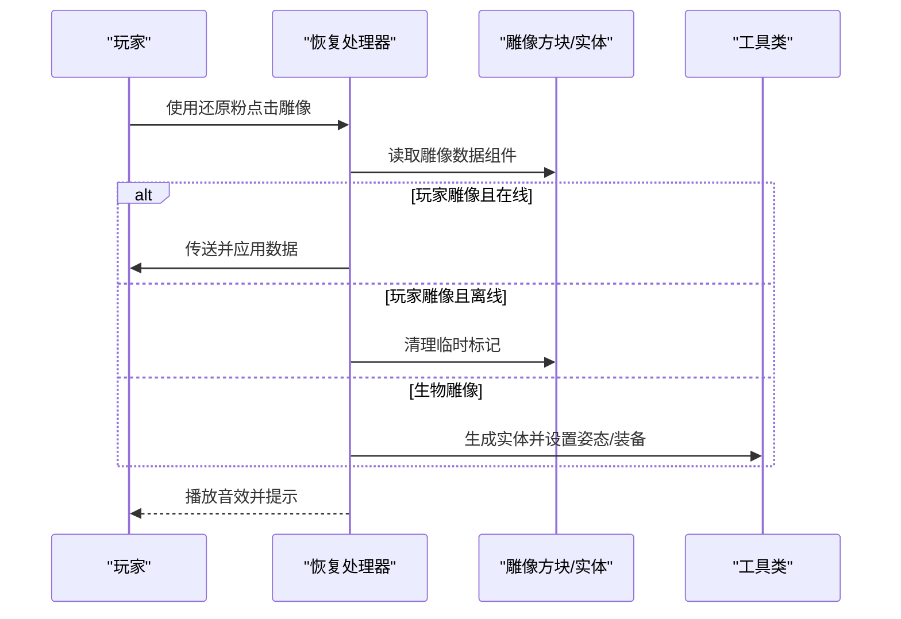
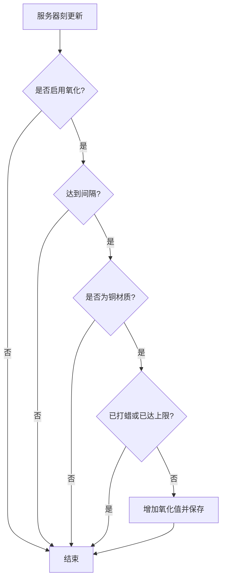
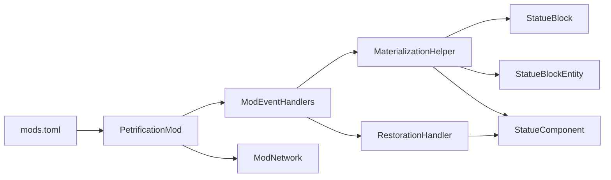

# 故障排除

<cite>
**本文引用的文件**
- [PetrificationMod.java](file://src/main/java/com/xiong/petrification/PetrificationMod.java)
- [mods.toml](file://src/main/resources/META-INF/mods.toml)
- [ModEventHandlers.java](file://src/main/java/com/xiong/petrification/handler/ModEventHandlers.java)
- [MaterializationHelper.java](file://src/main/java/com/xiong/petrification/util/MaterializationHelper.java)
- [RestorationHandler.java](file://src/main/java/com/xiong/petrification/handler/RestorationHandler.java)
- [StatueBlock.java](file://src/main/java/com/xiong/petrification/block/StatueBlock.java)
- [StatueBlockEntity.java](file://src/main/java/com/xiong/petrification/block/StatueBlockEntity.java)
- [StatueComponent.java](file://src/main/java/com/xiong/petrification/component/StatueComponent.java)
- [MaterializationEffect.java](file://src/main/java/com/xiong/petrification/effect/MaterializationEffect.java)
- [ModNetwork.java](file://src/main/java/com/xiong/petrification/network/ModNetwork.java)
- [ModConfigSpecHolder.java](file://src/main/java/com/xiong/petrification/ModConfigSpecHolder.java)
- [zh_cn.json](file://src/main/resources/assets/petrification/lang/zh_cn.json)
</cite>

## 目录
1. [简介](#简介)
2. [项目结构](#项目结构)
3. [核心组件](#核心组件)
4. [架构总览](#架构总览)
5. [详细组件分析](#详细组件分析)
6. [依赖关系分析](#依赖关系分析)
7. [性能注意事项](#性能注意事项)
8. [故障排除指南](#故障排除指南)
9. [结论](#结论)
10. [附录](#附录)

## 简介
本指南面向Minecraft石化模组的玩家与服务器管理员，聚焦安装问题、运行错误、兼容性问题、日志分析与调试步骤、性能优化（内存泄漏检测、渲染卡顿、网络延迟）、服务端/客户端特定问题、与其他模组冲突检测与解决，以及自助工具与资源。内容基于代码实现与配置项，确保实用性与可操作性。

## 项目结构
该模组采用分层组织：主类负责注册与初始化；事件处理器监听药水溅射、交互等事件；工具类负责实体/方块材质化与数据捕获；方块与方块实体承载雕像状态并处理氧化逻辑；组件记录雕像的完整数据；效果类在药水生效时触发材质化；网络层预留多端同步扩展点；配置文件提供可调参数。

图表来源
- [PetrificationMod.java:27-50](file://src/main/java/com/xiong/petrification/PetrificationMod.java#L27-L50)
- [ModEventHandlers.java:38-118](file://src/main/java/com/xiong/petrification/handler/ModEventHandlers.java#L38-L118)
- [MaterializationHelper.java:55-96](file://src/main/java/com/xiong/petrification/util/MaterializationHelper.java#L55-L96)
- [RestorationHandler.java:34-91](file://src/main/java/com/xiong/petrification/handler/RestorationHandler.java#L34-L91)
- [StatueBlock.java:38-151](file://src/main/java/com/xiong/petrification/block/StatueBlock.java#L38-L151)
- [StatueBlockEntity.java:17-88](file://src/main/java/com/xiong/petrification/block/StatueBlockEntity.java#L17-L88)
- [StatueComponent.java:14-192](file://src/main/java/com/xiong/petrification/component/StatueComponent.java#L14-L192)
- [MaterializationEffect.java:10-37](file://src/main/java/com/xiong/petrification/effect/MaterializationEffect.java#L10-L37)

章节来源
- [PetrificationMod.java:22-51](file://src/main/java/com/xiong/petrification/PetrificationMod.java#L22-L51)
- [mods.toml:1-28](file://src/main/resources/META-INF/mods.toml#L1-L28)

## 核心组件
- 主类：完成注册、事件总线订阅、网络注册与配置加载。
- 事件处理器：监听药水溅射、右键交互、玩家登录、方块破坏等事件，驱动材质化与恢复流程。
- 工具类：权限校验、实体/区域材质化、数据捕获与装备还原、方块材质化记录。
- 恢复处理器：从雕像或物品栏恢复生物/玩家，支持在线/离线玩家与打蜡操作。
- 雕像方块/实体：存储雕像数据，周期性氧化更新，提供红石信号输出。
- 数据组件：以Codec分组序列化雕像全部属性，保证持久化与跨版本兼容。
- 效果类：瞬时效果在应用时触发实体材质化。
- 网络层：预留Packet注册接口，用于未来多端同步扩展。
- 配置：药水范围倍率、创意/OP权限控制、雕像硬度、氧化速率与上限、渲染距离等。

章节来源
- [ModEventHandlers.java:38-118](file://src/main/java/com/xiong/petrification/handler/ModEventHandlers.java#L38-L118)
- [MaterializationHelper.java:36-96](file://src/main/java/com/xiong/petrification/util/MaterializationHelper.java#L36-L96)
- [RestorationHandler.java:34-229](file://src/main/java/com/xiong/petrification/handler/RestorationHandler.java#L34-L229)
- [StatueBlock.java:38-151](file://src/main/java/com/xiong/petrification/block/StatueBlock.java#L38-L151)
- [StatueBlockEntity.java:17-88](file://src/main/java/com/xiong/petrification/block/StatueBlockEntity.java#L17-L88)
- [StatueComponent.java:14-192](file://src/main/java/com/xiong/petrification/component/StatueComponent.java#L14-L192)
- [MaterializationEffect.java:10-37](file://src/main/java/com/xiong/petrification/effect/MaterializationEffect.java#L10-L37)
- [ModConfigSpecHolder.java:12-67](file://src/main/java/com/xiong/petrification/ModConfigSpecHolder.java#L12-L67)

## 架构总览
下图展示从药水溅射到雕像生成与恢复的核心调用链，以及配置对行为的影响。

图表来源
- [ModEventHandlers.java:45-84](file://src/main/java/com/xiong/petrification/handler/ModEventHandlers.java#L45-L84)
- [MaterializationHelper.java:83-96](file://src/main/java/com/xiong/petrification/util/MaterializationHelper.java#L83-L96)
- [RestorationHandler.java:209-227](file://src/main/java/com/xiong/petrification/handler/RestorationHandler.java#L209-L227)
- [ModConfigSpecHolder.java:12-43](file://src/main/java/com/xiong/petrification/ModConfigSpecHolder.java#L12-L43)

## 详细组件分析

### 事件处理器（ModEventHandlers）
- 药水溅射：检测是否包含自定义效果，按配置范围进行区域与方块材质化。
- 右键交互：识别还原粉与蜂巢，分别调用恢复与打蜡逻辑。
- 玩家登录：若存在离线玩家雕像备份，则传送并应用数据，清理临时标记。
- 方块破坏：清理材质化方块的持久化记录。

图表来源
- [ModEventHandlers.java:45-63](file://src/main/java/com/xiong/petrification/handler/ModEventHandlers.java#L45-L63)
- [ModConfigSpecHolder.java:12-14](file://src/main/java/com/xiong/petrification/ModConfigSpecHolder.java#L12-L14)

章节来源
- [ModEventHandlers.java:38-118](file://src/main/java/com/xiong/petrification/handler/ModEventHandlers.java#L38-L118)

### 工具类（MaterializationHelper）
- 权限校验：阻止创意模式或高权限玩家被材质化（可配置）。
- 实体材质化：保存数据、断开玩家连接、放置雕像、播放音效与粒子。
- 区域材质化：按优先级排序实体（玩家优先），逐个材质化。
- 数据捕获：保存装备、名称、状态、经验、饥饿、飞行等。
- 装备还原：解析NBT并恢复至目标实体。
- 方块材质化：记录范围内非空气/非雕像方块以便后续恢复。

图表来源
- [MaterializationHelper.java:36-96](file://src/main/java/com/xiong/petrification/util/MaterializationHelper.java#L36-L96)
- [StatueComponent.java:14-192](file://src/main/java/com/xiong/petrification/component/StatueComponent.java#L14-L192)

章节来源
- [MaterializationHelper.java:36-263](file://src/main/java/com/xiong/petrification/util/MaterializationHelper.java#L36-L263)

### 恢复处理器（RestorationHandler）
- 从雕像方块恢复：区分玩家与生物，在线玩家直接传送并应用数据；离线玩家清理临时数据。
- 从物品栏恢复：搜索雕像物品，避免在线玩家被重复恢复，生成实体并播放音效。
- 打蜡：锁定铜雕像氧化进度，防止继续变化。

图表来源
- [RestorationHandler.java:34-138](file://src/main/java/com/xiong/petrification/handler/RestorationHandler.java#L34-L138)
- [RestorationHandler.java:184-207](file://src/main/java/com/xiong/petrification/handler/RestorationHandler.java#L184-L207)

章节来源
- [RestorationHandler.java:34-229](file://src/main/java/com/xiong/petrification/handler/RestorationHandler.java#L34-L229)

### 雕像方块与实体（StatueBlock / StatueBlockEntity）
- 方块：不可见渲染形状，持有方块实体；支持水浸没、红石信号输出（铜材质氧化程度）。
- 实体：每200刻检查一次氧化进度，受配置开关与上限控制；保存/加载数据组件。

图表来源
- [StatueBlockEntity.java:28-50](file://src/main/java/com/xiong/petrification/block/StatueBlockEntity.java#L28-L50)
- [StatueBlock.java:142-151](file://src/main/java/com/xiong/petrification/block/StatueBlock.java#L142-L151)

章节来源
- [StatueBlock.java:38-151](file://src/main/java/com/xiong/petrification/block/StatueBlock.java#L38-L151)
- [StatueBlockEntity.java:17-88](file://src/main/java/com/xiong/petrification/block/StatueBlockEntity.java#L17-L88)

### 数据组件（StatueComponent）
- 使用Codec将37个字段分四组序列化，保证NBT读写稳定与兼容。
- 提供默认雕像构造与显示文本生成。

章节来源
- [StatueComponent.java:14-256](file://src/main/java/com/xiong/petrification/component/StatueComponent.java#L14-L256)

### 效果类（MaterializationEffect）
- 瞬时效果：仅在持续时间为1时应用，调用工具类进行实体材质化。

章节来源
- [MaterializationEffect.java:10-37](file://src/main/java/com/xiong/petrification/effect/MaterializationEffect.java#L10-L37)

### 网络层（ModNetwork）
- 当前为占位实现，预留Packet注册接口，便于未来多端同步扩展。

章节来源
- [ModNetwork.java:1-10](file://src/main/java/com/xiong/petrification/network/ModNetwork.java#L1-L10)

## 依赖关系分析
- 模组元数据声明Forge与Minecraft版本范围，确保环境兼容。
- 主类在启动阶段注册所有子系统，并在通用准备阶段注册网络。
- 事件处理器依赖工具类、恢复处理器、数据组件与配置。
- 工具类依赖方块、实体、数据组件与注册表。
- 恢复处理器依赖工具类、数据组件与注册表。

图表来源
- [mods.toml:1-28](file://src/main/resources/META-INF/mods.toml#L1-L28)
- [PetrificationMod.java:27-50](file://src/main/java/com/xiong/petrification/PetrificationMod.java#L27-L50)
- [ModEventHandlers.java:38-118](file://src/main/java/com/xiong/petrification/handler/ModEventHandlers.java#L38-L118)
- [MaterializationHelper.java:36-96](file://src/main/java/com/xiong/petrification/util/MaterializationHelper.java#L36-L96)
- [RestorationHandler.java:34-91](file://src/main/java/com/xiong/petrification/handler/RestorationHandler.java#L34-L91)

章节来源
- [mods.toml:1-28](file://src/main/resources/META-INF/mods.toml#L1-L28)
- [PetrificationMod.java:22-51](file://src/main/java/com/xiong/petrification/PetrificationMod.java#L22-L51)

## 性能注意事项
- 药水范围：通过配置调整范围倍率，避免大范围同时材质化导致卡顿。
- 氧化更新：每200刻批量检查，减少频繁计算；可关闭氧化以提升性能。
- 渲染距离：可通过配置调整雕像渲染距离，降低远处雕像渲染压力。
- 权限限制：禁用创意/OP材质化可减少意外大规模材质化带来的负载。
- 区块卸载：破坏方块时清理材质化记录，避免无效数据累积。

章节来源
- [ModConfigSpecHolder.java:12-43](file://src/main/java/com/xiong/petrification/ModConfigSpecHolder.java#L12-L43)
- [StatueBlockEntity.java:28-50](file://src/main/java/com/xiong/petrification/block/StatueBlockEntity.java#L28-L50)
- [ModEventHandlers.java:109-118](file://src/main/java/com/xiong/petrification/handler/ModEventHandlers.java#L109-L118)

## 故障排除指南

### 安装问题
- 无法加载模组
  - 检查模组元数据中的Forge与Minecraft版本范围是否与你的环境匹配。
  - 确认已安装对应版本的Forge，且未混用不兼容的加载器。
  - 查看游戏启动日志中是否有版本不匹配的报错。
- 缺少依赖或冲突
  - 确认仅加载官方或兼容的Forge版本。
  - 若出现其他模组冲突，尝试逐一禁用排查。

章节来源
- [mods.toml:1-28](file://src/main/resources/META-INF/mods.toml#L1-L28)

### 运行错误
- 药水无效或未触发材质化
  - 确认药水包含自定义效果；事件处理器会检测效果并触发材质化。
  - 检查配置中的药水范围倍率是否过低。
  - 查看服务器日志中是否有权限拒绝（创意/OP）导致的跳过。
- 玩家被石化后无法返回
  - 在线玩家会被断开连接；需重新登录或使用还原粉恢复。
  - 离线玩家会在下次登录时被传送回原位置并应用数据。
- 雕像无法恢复
  - 确认目标为雕像方块或物品栏中存在雕像物品。
  - 在线玩家的雕像物品无法直接恢复，需使用方块上的雕像。
  - 检查是否误删了材质化方块的持久化记录。

章节来源
- [ModEventHandlers.java:45-84](file://src/main/java/com/xiong/petrification/handler/ModEventHandlers.java#L45-L84)
- [MaterializationHelper.java:55-96](file://src/main/java/com/xiong/petrification/util/MaterializationHelper.java#L55-L96)
- [RestorationHandler.java:55-138](file://src/main/java/com/xiong/petrification/handler/RestorationHandler.java#L55-L138)

### 兼容性问题
- 与其他修改实体行为的模组冲突
  - 某些模组可能拦截实体创建或修改装备，导致雕像恢复异常。
  - 建议逐一禁用可疑模组定位冲突源。
- 数据包与语言包
  - 确认数据包与语言包正确加载；中文本地化键值应存在。
  - 若显示英文或乱码，检查资源包优先级与命名空间。

章节来源
- [zh_cn.json:1-63](file://src/main/resources/assets/petrification/lang/zh_cn.json#L1-L63)

### 日志分析与错误代码
- 关键日志位置
  - 主类初始化成功日志：模组已加载。
  - 事件触发日志：药水溅射、交互、登录、破坏等。
  - 权限拒绝日志：创意/OP材质化被阻止。
- 常见错误含义
  - 版本不匹配：Forge或Minecraft版本超出范围。
  - 权限拒绝：配置禁止创意/OP材质化。
  - 数据缺失：雕像数据组件为空或损坏，导致无法恢复。
- 调试步骤
  - 开启详细日志级别，观察事件触发顺序。
  - 使用命令生成世界报告与崩溃报告，上传至社区获取帮助。
  - 逐步缩小范围：单玩家测试、最小数据包、无其他模组环境。

章节来源
- [PetrificationMod.java:48-51](file://src/main/java/com/xiong/petrification/PetrificationMod.java#L48-L51)
- [ModEventHandlers.java:38-118](file://src/main/java/com/xiong/petrification/handler/ModEventHandlers.java#L38-L118)
- [MaterializationHelper.java:36-53](file://src/main/java/com/xiong/petrification/util/MaterializationHelper.java#L36-L53)

### 性能问题诊断与优化
- 内存泄漏检测
  - 关注长时间运行后内存增长，可能是雕像数据缓存未释放。
  - 破坏方块时应清理材质化记录；检查是否存在未清理的引用。
- 渲染卡顿
  - 调整雕像渲染距离配置，减少远距离渲染。
  - 大量雕像时考虑降低药水范围或分批材质化。
- 网络延迟优化
  - 当前网络层为占位实现；如需多端同步，建议扩展Packet以减少冗余数据。
  - 服务器端尽量集中处理材质化逻辑，避免客户端重复计算。

章节来源
- [ModConfigSpecHolder.java:40-43](file://src/main/java/com/xiong/petrification/ModConfigSpecHolder.java#L40-L43)
- [ModNetwork.java:6-8](file://src/main/java/com/xiong/petrification/network/ModNetwork.java#L6-L8)
- [ModEventHandlers.java:109-118](file://src/main/java/com/xiong/petrification/handler/ModEventHandlers.java#L109-L118)

### 服务器端与客户端特定问题
- 服务器端
  - 权限控制：通过配置禁用创意/OP材质化，防止滥用。
  - 氧化更新：可关闭氧化功能以降低服务器负载。
  - 数据一致性：确保玩家登录时正确应用离线雕像数据。
- 客户端
  - 语言显示：确认中文语言包加载；如显示异常，检查资源包优先级。
  - 渲染表现：调整渲染距离与画质设置，平衡流畅度与视觉效果。

章节来源
- [ModConfigSpecHolder.java:12-43](file://src/main/java/com/xiong/petrification/ModConfigSpecHolder.java#L12-L43)
- [zh_cn.json:1-63](file://src/main/resources/assets/petrification/lang/zh_cn.json#L1-L63)

### 与其他模组的冲突检测与解决
- 实体修改类模组
  - 若雕像恢复后装备或状态异常，可能与实体修改模组冲突。
  - 解决方案：禁用冲突模组或调整其配置，确保不覆盖雕像数据。
- 数据包/配方冲突
  - 若合成或分解配方失效，检查数据包命名空间与优先级。
  - 解决方案：调整数据包加载顺序或重命名冲突键值。

章节来源
- [RestorationHandler.java:140-162](file://src/main/java/com/xiong/petrification/handler/RestorationHandler.java#L140-L162)

### 自助工具与资源
- 日志上传服务
  - 使用MC Crash Report或第三方日志上传平台，附上完整日志与复现步骤。
- 社区支持渠道
  - 加入模组作者社区或论坛，提交问题与反馈。
- 已知问题列表
  - 关注更新日志与Issue列表，了解已知限制与修复计划。

[本节为通用指导，无需具体文件来源]

## 结论
本指南基于模组源码与配置，系统梳理了安装、运行、兼容、日志、性能与冲突等常见问题及解决方案。通过合理配置与调试步骤，大多数问题可快速定位与解决。建议在复杂环境中逐步隔离变量，结合日志与社区资源高效排障。

## 附录
- 常用配置项说明
  - 药水范围倍率：影响材质化半径，过大可能导致性能下降。
  - 创意/OP权限：建议在生产环境禁用，防止滥用。
  - 氧化速率与上限：控制铜雕像外观变化速度。
  - 雕像渲染距离：平衡视觉与性能。
- 本地化键值
  - 中文语言包提供界面与消息翻译；如缺失，将回退至英文或显示键名。

章节来源
- [ModConfigSpecHolder.java:12-43](file://src/main/java/com/xiong/petrification/ModConfigSpecHolder.java#L12-L43)
- [zh_cn.json:1-63](file://src/main/resources/assets/petrification/lang/zh_cn.json#L1-L63)