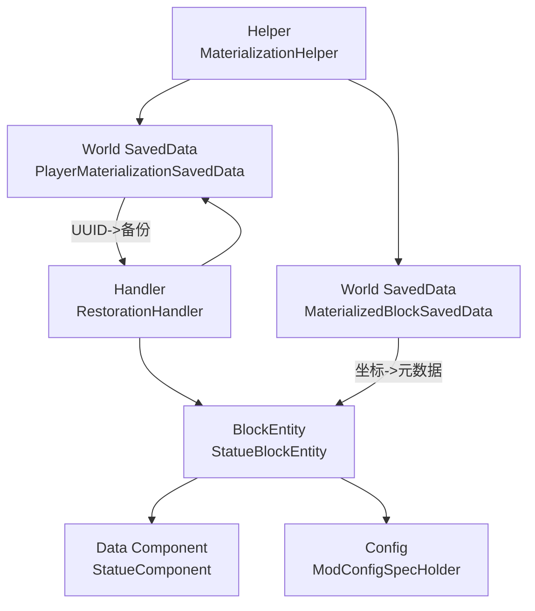
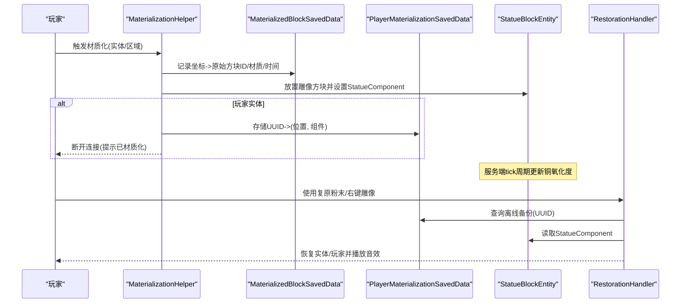
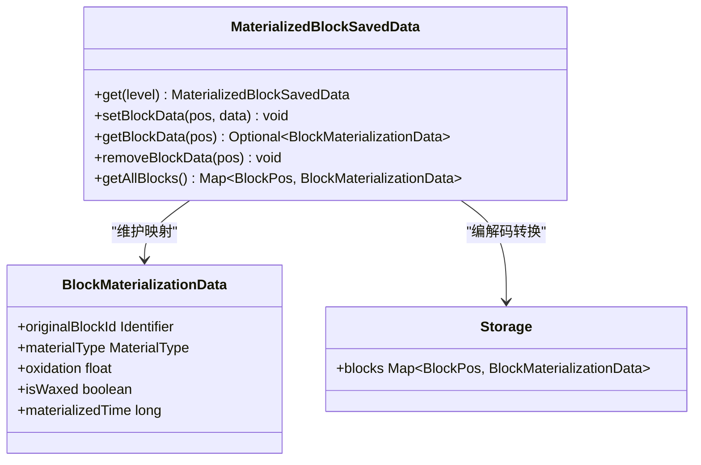
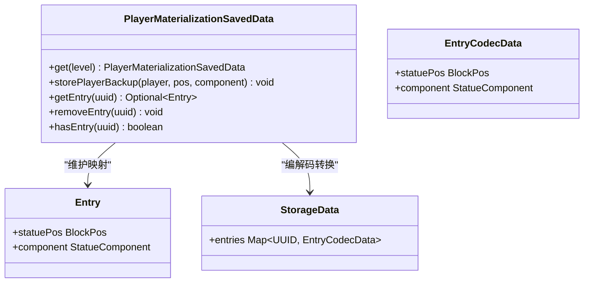
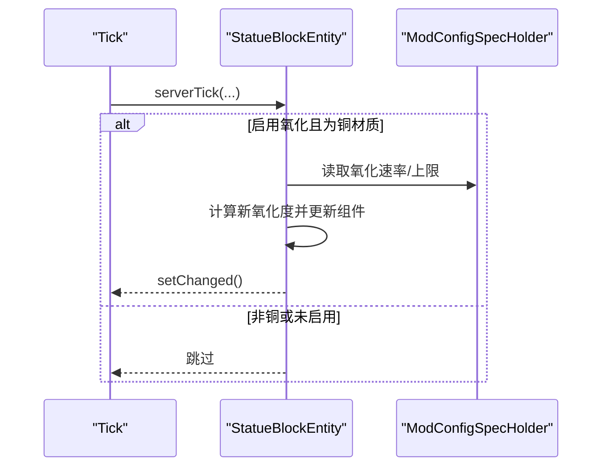
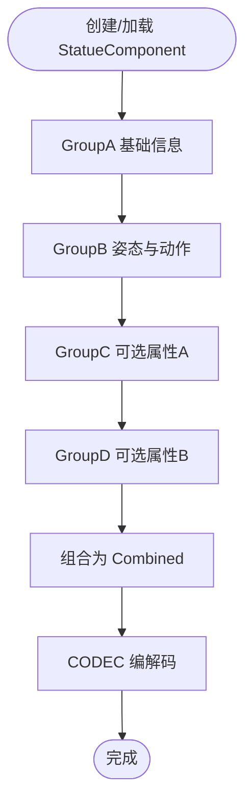
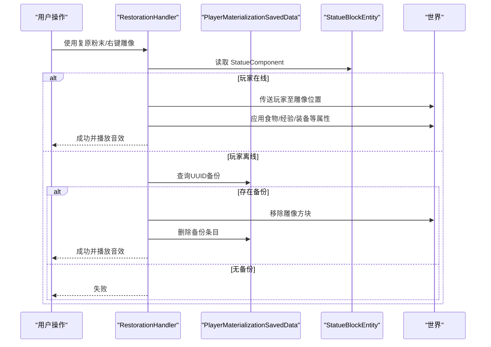
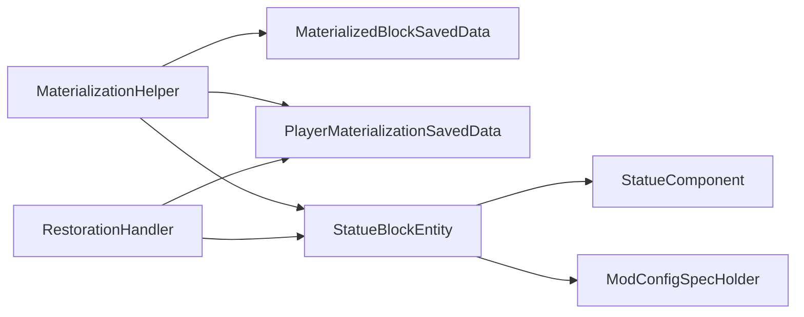

# 持久化数据存储

<cite>
**本文引用的文件**
- [MaterializedBlockSavedData.java](file://src/main/java/com/xiong/petrification/data/MaterializedBlockSavedData.java)
- [PlayerMaterializationSavedData.java](file://src/main/java/com/xiong/petrification/data/PlayerMaterializationSavedData.java)
- [StatueBlockEntity.java](file://src/main/java/com/xiong/petrification/block/StatueBlockEntity.java)
- [StatueBlock.java](file://src/main/java/com/xiong/petrification/block/StatueBlock.java)
- [StatueComponent.java](file://src/main/java/com/xiong/petrification/component/StatueComponent.java)
- [MaterialType.java](file://src/main/java/com/xiong/petrification/component/MaterialType.java)
- [MaterializationHelper.java](file://src/main/java/com/xiong/petrification/util/MaterializationHelper.java)
- [RestorationHandler.java](file://src/main/java/com/xiong/petrification/handler/RestorationHandler.java)
- [ModNetwork.java](file://src/main/java/com/xiong/petrification/network/ModNetwork.java)
- [ModConfigSpecHolder.java](file://src/main/java/com/xiong/petrification/ModConfigSpecHolder.java)
- [PetrificationMod.java](file://src/main/java/com/xiong/petrification/PetrificationMod.java)
</cite>

## 目录
1. [简介](#简介)
2. [项目结构](#项目结构)
3. [核心组件](#核心组件)
4. [架构总览](#架构总览)
5. [详细组件分析](#详细组件分析)
6. [依赖关系分析](#依赖关系分析)
7. [性能与内存管理](#性能与内存管理)
8. [故障排除指南](#故障排除指南)
9. [结论](#结论)
10. [附录：使用示例](#附录使用示例)

## 简介
本文件面向“石化”模组的持久化数据存储系统，聚焦以下目标：
- 解释方块数据类 MaterializedBlockSavedData 的实现：雕像方块的元数据存储、位置映射与版本兼容。
- 解释玩家数据类 PlayerMaterializationSavedData 的功能：玩家材质化历史、统计信息与个性化设置。
- 说明数据的读写机制：NBT/Codec 序列化、数据迁移方案、备份恢复流程。
- 阐述数据同步策略：客户端/服务器间的数据传输协议与网络优化（当前为扩展点）。
- 提供数据清理机制、内存管理与性能监控方法。
- 给出具体使用示例与故障排除建议。

## 项目结构
该存储系统由“世界级 SavedData + 区块实体 BlockEntity + 数据组件 Component”三部分构成：
- 世界级 SavedData：用于跨存档持久化的键值型存储（按坐标或玩家UUID索引）。
- 区块实体 StatueBlockEntity：每个雕像方块持有 StatueComponent，负责本地状态与周期性氧化更新。
- 数据组件 StatueComponent：通过 Codec 分组编码，承载雕像的完整元数据（材质、姿态、装备、玩家属性等）。

图表来源
- [MaterializedBlockSavedData.java:19-85](file://src/main/java/com/xiong/petrification/data/MaterializedBlockSavedData.java#L19-L85)
- [PlayerMaterializationSavedData.java:22-94](file://src/main/java/com/xiong/petrification/data/PlayerMaterializationSavedData.java#L22-L94)
- [StatueBlockEntity.java:17-87](file://src/main/java/com/xiong/petrification/block/StatueBlockEntity.java#L17-L87)
- [StatueComponent.java:14-192](file://src/main/java/com/xiong/petrification/component/StatueComponent.java#L14-L192)
- [MaterializationHelper.java:55-81](file://src/main/java/com/xiong/petrification/util/MaterializationHelper.java#L55-L81)
- [RestorationHandler.java:34-137](file://src/main/java/com/xiong/petrification/handler/RestorationHandler.java#L34-L137)
- [ModConfigSpecHolder.java:28-38](file://src/main/java/com/xiong/petrification/ModConfigSpecHolder.java#L28-L38)

章节来源
- [PetrificationMod.java:27-50](file://src/main/java/com/xiong/petrification/PetrificationMod.java#L27-L50)

## 核心组件
- MaterializedBlockSavedData：以坐标为键，记录被材质化的原始方块ID、材质类型、氧化度、是否打蜡、材质化时间；提供 get/set/remove 接口并标记脏数据。
- PlayerMaterializationSavedData：以玩家UUID为键，记录其雕像位置与 StatueComponent 快照，支持存储、查询、删除与存在性检查。
- StatueBlockEntity：持有 StatueComponent，实现服务端 tick 驱动的铜材质氧化增长，并通过 Codec 进行 NBT 持久化。
- StatueComponent：将大量字段拆分为四组，通过 Codec 组合编码，保证向后兼容与可扩展性。
- MaterializationHelper：材质化入口，捕获实体/方块数据，写入 SavedData，生成雕像方块与粒子效果。
- RestorationHandler：从雕像恢复实体或玩家，读取 SavedData 中的离线备份，应用玩家属性与装备。

章节来源
- [MaterializedBlockSavedData.java:19-85](file://src/main/java/com/xiong/petrification/data/MaterializedBlockSavedData.java#L19-L85)
- [PlayerMaterializationSavedData.java:22-94](file://src/main/java/com/xiong/petrification/data/PlayerMaterializationSavedData.java#L22-L94)
- [StatueBlockEntity.java:17-87](file://src/main/java/com/xiong/petrification/block/StatueBlockEntity.java#L17-L87)
- [StatueComponent.java:14-192](file://src/main/java/com/xiong/petrification/component/StatueComponent.java#L14-L192)
- [MaterializationHelper.java:55-81](file://src/main/java/com/xiong/petrification/util/MaterializationHelper.java#L55-L81)
- [RestorationHandler.java:34-137](file://src/main/java/com/xiong/petrification/handler/RestorationHandler.java#L34-L137)

## 架构总览
整体数据流围绕“材质化 -> 持久化 -> 渲染/交互 -> 恢复”展开：
- 材质化时，MaterializationHelper 捕获实体/方块信息，写入两个 SavedData（方块坐标映射、玩家备份），并在世界放置 StatueBlockEntity，附带 StatueComponent。
- 运行时，StatueBlockEntity 每固定刻数尝试增加铜材质的氧化度（受配置控制），同时通过 BlockState 模拟信号输出。
- 恢复时，RestorationHandler 根据雕像内 StatueComponent 决定恢复路径：在线玩家直接传送并应用属性；离线玩家则依据 PlayerMaterializationSavedData 的备份执行恢复。

图表来源
- [MaterializationHelper.java:55-81](file://src/main/java/com/xiong/petrification/util/MaterializationHelper.java#L55-L81)
- [MaterializedBlockSavedData.java:61-85](file://src/main/java/com/xiong/petrification/data/MaterializedBlockSavedData.java#L61-L85)
- [PlayerMaterializationSavedData.java:70-94](file://src/main/java/com/xiong/petrification/data/PlayerMaterializationSavedData.java#L70-L94)
- [StatueBlockEntity.java:28-50](file://src/main/java/com/xiong/petrification/block/StatueBlockEntity.java#L28-L50)
- [RestorationHandler.java:34-137](file://src/main/java/com/xiong/petrification/handler/RestorationHandler.java#L34-L137)

## 详细组件分析

### 方块数据类：MaterializedBlockSavedData
- 数据结构
  - 内部记录 BlockMaterializationData：包含 originalBlockId、materialType、oxidation、isWaxed、materializedTime。
  - 存储层 Storage 使用 Map<BlockPos, BlockMaterializationData> 作为键值对。
- 序列化与版本兼容
  - 使用 Mojang Codec 定义 BlockMaterializationData 与 Storage 的编解码。
  - 通过 SavedDataType 注册 TYPE，绑定 DataFixTypes.LEVEL，使世界数据修复在加载时生效。
  - xmap 在加载时将 Storage 转换为实例，保存时再转回 Storage，确保新旧格式兼容。
- 访问接口
  - setBlockData/getBlockData/removeBlockData 均调用 setDirty() 标记脏数据，触发世界保存。
  - getAllBlocks 暴露只读视图供调试或批量处理。

图表来源
- [MaterializedBlockSavedData.java:19-85](file://src/main/java/com/xiong/petrification/data/MaterializedBlockSavedData.java#L19-L85)

章节来源
- [MaterializedBlockSavedData.java:19-85](file://src/main/java/com/xiong/petrification/data/MaterializedBlockSavedData.java#L19-L85)

### 玩家数据类：PlayerMaterializationSavedData
- 数据结构
  - Entry：包含 statuePos 与 StatueComponent，表示某玩家的雕像快照。
  - StorageData：Map<UUID, EntryCodecData>，EntryCodecData 是 Entry 的编解码中间态。
- 序列化与版本兼容
  - 使用 Codec 分别定义 EntryCodecData 与 StorageData，并通过 xmap 在加载/保存时转换。
  - 同样绑定 DataFixTypes.LEVEL，支持世界数据修复。
- 访问接口
  - storePlayerBackup/removeEntry/hasEntry/getEntry 提供完整的生命周期管理。
  - 每次修改后调用 setDirty() 标记脏数据。

图表来源
- [PlayerMaterializationSavedData.java:22-94](file://src/main/java/com/xiong/petrification/data/PlayerMaterializationSavedData.java#L22-L94)

章节来源
- [PlayerMaterializationSavedData.java:22-94](file://src/main/java/com/xiong/petrification/data/PlayerMaterializationSavedData.java#L22-L94)

### 雕像方块与实体：StatueBlock 与 StatueBlockEntity
- StatueBlock
  - 继承 BaseEntityBlock，实现 SimpleWaterloggedBlock。
  - 提供 useWithoutItem 显示雕像信息；getDrops 将 StatueComponent 写入掉落物数据组件。
  - 模拟红石信号输出：当材质为铜时，基于氧化度输出信号强度。
- StatueBlockEntity
  - 持有 StatueComponent，服务端 tick 中按配置周期增加铜材质氧化度。
  - saveAdditional/loadAdditional 使用 StatueComponent.CODEC 进行 NBT 持久化。
  - getUpdatePacket 返回块实体数据包，用于客户端同步。

图表来源
- [StatueBlockEntity.java:28-50](file://src/main/java/com/xiong/petrification/block/StatueBlockEntity.java#L28-L50)
- [ModConfigSpecHolder.java:28-38](file://src/main/java/com/xiong/petrification/ModConfigSpecHolder.java#L28-L38)

章节来源
- [StatueBlock.java:89-151](file://src/main/java/com/xiong/petrification/block/StatueBlock.java#L89-L151)
- [StatueBlockEntity.java:17-87](file://src/main/java/com/xiong/petrification/block/StatueBlockEntity.java#L17-L87)

### 数据组件：StatueComponent
- 设计要点
  - 将37个字段划分为四组（A/B/C/D），再通过 Pair1/Pair2/Combined 组合，最终形成 CODEC。
  - 所有可选字段使用 optionalFieldOf，保证旧存档缺失字段时的兼容性。
  - 提供 defaultStatue 工厂方法与 withOxidation/withWaxed 不可变更新方法。
- 用途
  - 作为 BlockEntity 的持久化内容、物品数据组件、SavedData 的备份内容。

图表来源
- [StatueComponent.java:55-192](file://src/main/java/com/xiong/petrification/component/StatueComponent.java#L55-L192)

章节来源
- [StatueComponent.java:14-256](file://src/main/java/com/xiong/petrification/component/StatueComponent.java#L14-L256)

### 材质化与恢复流程
- 材质化
  - MaterializationHelper.materializeEntity：捕获实体数据，写入 PlayerMaterializationSavedData（若为玩家），放置雕像方块并设置 StatueComponent。
  - MaterializationHelper.materializeBlocks：扫描区域，将未被材质化的方块记录到 MaterializedBlockSavedData。
- 恢复
  - RestorationHandler.restoreBlock：判断目标类型，在线玩家直接传送并应用属性；离线玩家依据 PlayerMaterializationSavedData 的备份执行恢复。
  - 生物实体恢复：根据 StatueComponent 重建实体并应用装备、名称、健康值等。

图表来源
- [RestorationHandler.java:34-137](file://src/main/java/com/xiong/petrification/handler/RestorationHandler.java#L34-L137)
- [PlayerMaterializationSavedData.java:70-94](file://src/main/java/com/xiong/petrification/data/PlayerMaterializationSavedData.java#L70-L94)

章节来源
- [MaterializationHelper.java:55-81](file://src/main/java/com/xiong/petrification/util/MaterializationHelper.java#L55-L81)
- [RestorationHandler.java:103-162](file://src/main/java/com/xiong/petrification/handler/RestorationHandler.java#L103-L162)

## 依赖关系分析
- 模块耦合
  - MaterializationHelper 强依赖两个 SavedData 与 StatueBlockEntity。
  - RestorationHandler 依赖 StatueBlockEntity、PlayerMaterializationSavedData 与 MaterializationHelper。
  - StatueBlockEntity 依赖 StatueComponent 与 ModConfigSpecHolder。
- 外部依赖
  - 使用 Mojang Codec 进行序列化，避免手写 NBT 解析。
  - 使用 Forge ConfigSpec 管理运行期配置（如氧化速率、最大氧化度、是否启用氧化等）。
- 潜在循环
  - 当前未发现循环依赖；各模块职责清晰，单向依赖。

图表来源
- [MaterializationHelper.java:55-81](file://src/main/java/com/xiong/petrification/util/MaterializationHelper.java#L55-L81)
- [RestorationHandler.java:34-137](file://src/main/java/com/xiong/petrification/handler/RestorationHandler.java#L34-L137)
- [StatueBlockEntity.java:28-50](file://src/main/java/com/xiong/petrification/block/StatueBlockEntity.java#L28-L50)

章节来源
- [MaterializationHelper.java:55-81](file://src/main/java/com/xiong/petrification/util/MaterializationHelper.java#L55-L81)
- [RestorationHandler.java:34-137](file://src/main/java/com/xiong/petrification/handler/RestorationHandler.java#L34-L137)
- [StatueBlockEntity.java:28-50](file://src/main/java/com/xiong/petrification/block/StatueBlockEntity.java#L28-L50)

## 性能与内存管理
- 序列化与存储
  - 使用 Codec 分组编码 StatueComponent，降低单次序列化体积与复杂度，提升加载/保存效率。
  - SavedData 仅在 setDirty() 后标记脏数据，减少不必要的磁盘写入。
- 运行时开销
  - 氧化逻辑每 OXIDATION_INTERVAL 刻执行一次，避免每刻计算带来的 CPU 压力。
  - 铜材质氧化受配置开关与上限限制，防止无限增长。
- 内存占用
  - MaterializedBlockSavedData 使用 HashMap<BlockPos, ...>，在大范围材质化时可能增长较快；建议结合区域半径限制与定期清理策略。
  - PlayerMaterializationSavedData 仅存储玩家离线备份，随恢复自动删除，避免长期累积。
- 监控建议
  - 可通过日志记录材质化/恢复次数与耗时。
  - 监控 SavedData 大小变化，评估是否需要分片或归档策略。

[本节为通用指导，不直接分析具体文件]

## 故障排除指南
- 雕像无法恢复
  - 检查 StatueBlockEntity 是否存在 StatueComponent；若无，则无法恢复。
  - 玩家在线时，会直接传送而非消耗雕像；确认目标玩家是否在线。
  - 离线恢复依赖 PlayerMaterializationSavedData 的备份；若不存在，将无法恢复。
- 铜材质氧化异常
  - 确认 ModConfigSpecHolder.enableOxidation 是否为 true。
  - 检查 oxidationRate 与 maxOxidation 配置是否正确。
  - 若雕像被打蜡（isWaxed=true），将阻止氧化。
- 数据丢失或不一致
  - 确认 SavedData 是否被正确标记 dirty（setDirty）；未标记可能导致未保存。
  - 检查 World 数据修复是否启用（DataFixTypes.LEVEL），确保旧格式兼容。
- 网络同步问题
  - 当前 ModNetwork.register 为空，未实现自定义数据包；如需多端同步，需扩展网络层。

章节来源
- [RestorationHandler.java:34-137](file://src/main/java/com/xiong/petrification/handler/RestorationHandler.java#L34-L137)
- [StatueBlockEntity.java:28-50](file://src/main/java/com/xiong/petrification/block/StatueBlockEntity.java#L28-L50)
- [ModNetwork.java:6-8](file://src/main/java/com/xiong/petrification/network/ModNetwork.java#L6-L8)

## 结论
该持久化系统通过 SavedData 与 BlockEntity 的组合，实现了雕像方块的元数据存储、玩家离线备份与恢复、以及铜材质氧化的动态演化。Codec 分组编码确保了数据结构的向后兼容与可扩展性。当前网络层为扩展点，可根据需要添加客户端/服务器间的数据同步。建议在大规模材质化场景下关注内存与性能，并结合配置项进行调优。

[本节为总结，不直接分析具体文件]

## 附录：使用示例
- 材质化单个实体
  - 调用 MaterializationHelper.materializeEntity(level, entity, materialType)。
  - 若为目标玩家，将被断开连接并生成雕像；同时写入 PlayerMaterializationSavedData。
  - 参考路径：[MaterializationHelper.java:55-81](file://src/main/java/com/xiong/petrification/util/MaterializationHelper.java#L55-L81)
- 材质化区域方块
  - 调用 MaterializationHelper.materializeBlocks(level, center, radius, materialType)。
  - 将区域内未被材质化的方块记录到 MaterializedBlockSavedData。
  - 参考路径：[MaterializationHelper.java:234-255](file://src/main/java/com/xiong/petrification/util/MaterializationHelper.java#L234-L255)
- 恢复雕像
  - 使用 RestorationHandler.useRestorationPowderOnBlock 或右键雕像。
  - 在线玩家直接传送并应用属性；离线玩家依据备份恢复。
  - 参考路径：[RestorationHandler.java:209-217](file://src/main/java/com/xiong/petrification/handler/RestorationHandler.java#L209-L217)、[RestorationHandler.java:103-137](file://src/main/java/com/xiong/petrification/handler/RestorationHandler.java#L103-L137)
- 查看/编辑雕像信息
  - 右键 StatueBlock 可显示 StatueComponent 的展示信息。
  - 参考路径：[StatueBlock.java:103-121](file://src/main/java/com/xiong/petrification/block/StatueBlock.java#L103-L121)
- 打蜡铜雕像
  - 使用 RestorationHandler.waxCopper 或对应物品操作，阻止后续氧化。
  - 参考路径：[RestorationHandler.java:184-207](file://src/main/java/com/xiong/petrification/handler/RestorationHandler.java#L184-L207)

[本节为使用指引，不直接分析具体文件]