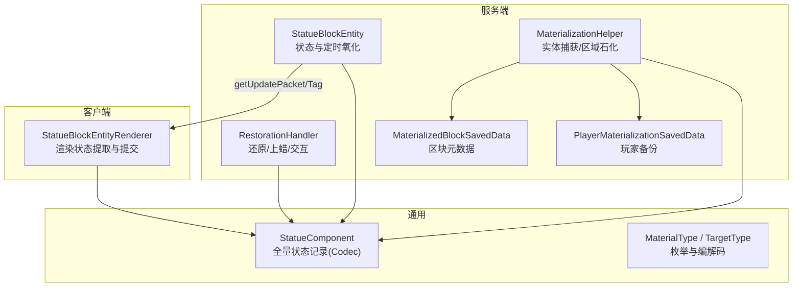
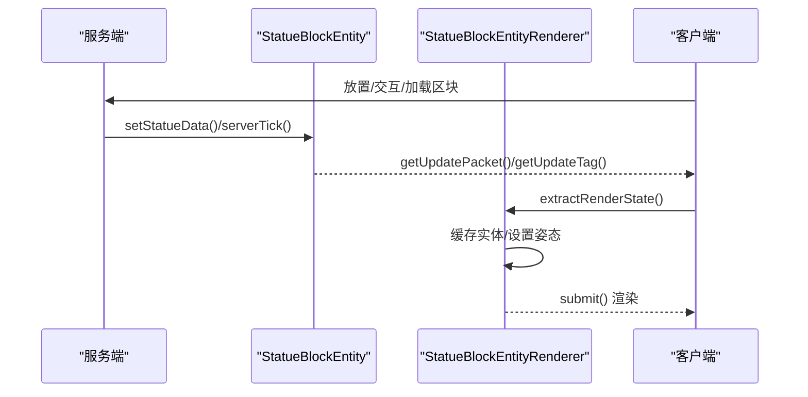
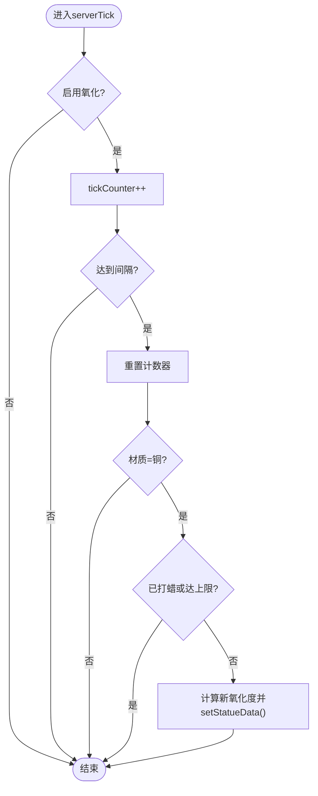
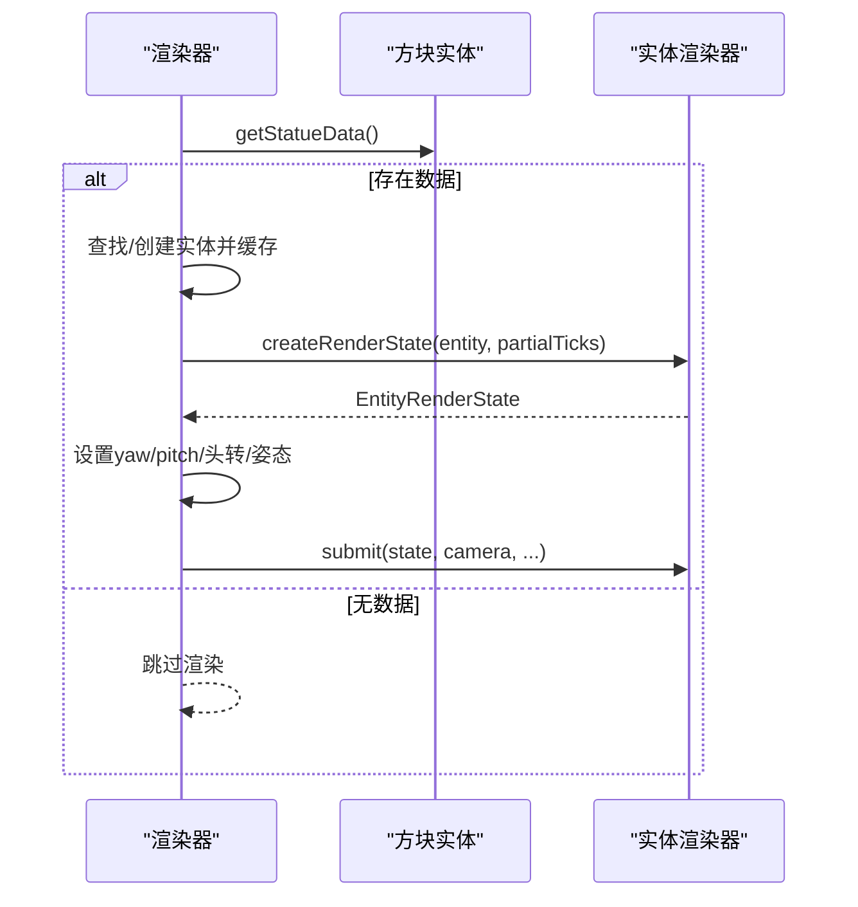
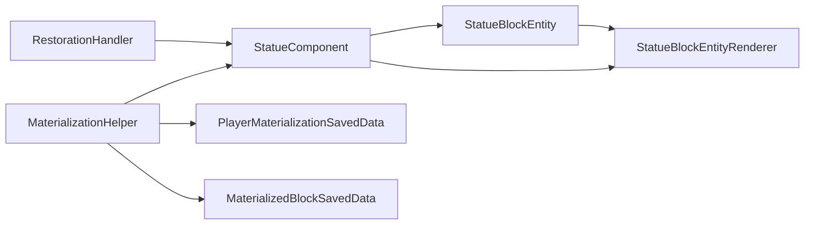

# 数据同步机制

<cite>
**本文引用的文件**
- [ModNetwork.java](file://src/main/java/com/xiong/petrification/network/ModNetwork.java)
- [StatueBlockEntity.java](file://src/main/java/com/xiong/petrification/block/StatueBlockEntity.java)
- [StatueComponent.java](file://src/main/java/com/xiong/petrification/component/StatueComponent.java)
- [StatueBlock.java](file://src/main/java/com/xiong/petrification/block/StatueBlock.java)
- [StatueBlockEntityRenderer.java](file://src/main/java/com/xiong/petrification/client/StatueBlockEntityRenderer.java)
- [MaterialType.java](file://src/main/java/com/xiong/petrification/component/MaterialType.java)
- [TargetType.java](file://src/main/java/com/xiong/petrification/component/TargetType.java)
- [RestorationHandler.java](file://src/main/java/com/xiong/petrification/handler/RestorationHandler.java)
- [MaterializationHelper.java](file://src/main/java/com/xiong/petrification/util/MaterializationHelper.java)
- [PlayerMaterializationSavedData.java](file://src/main/java/com/xiong/petrification/data/PlayerMaterializationSavedData.java)
- [MaterializedBlockSavedData.java](file://src/main/java/com/xiong/petrification/data/MaterializedBlockSavedData.java)
- [ModEventHandlers.java](file://src/main/java/com/xiong/petrification/handler/ModEventHandlers.java)
</cite>

## 目录
1. [简介](#简介)
2. [项目结构](#项目结构)
3. [核心组件](#核心组件)
4. [架构总览](#架构总览)
5. [详细组件分析](#详细组件分析)
6. [依赖关系分析](#依赖关系分析)
7. [性能考虑](#性能考虑)
8. [故障排查指南](#故障排查指南)
9. [结论](#结论)
10. [附录](#附录)

## 简介
本文件聚焦于石化模组的数据同步机制，围绕客户端与服务器之间的数据一致性、雕像实体状态更新、渲染参数同步与实时刷新进行系统化说明。当前代码库已提供完整的数据持久化、服务端逻辑与客户端渲染链路；网络层预留扩展点，便于后续实现高效的多玩家数据包同步。文档同时给出优化策略（压缩、批量、增量）、一致性保障（冲突解决、回滚、完整性校验）以及调试与排错建议，并附带通信示例与常见问题解决方案。

## 项目结构
本项目采用按功能域划分的模块化组织方式：
- block：方块与方块实体（雕像）定义与生命周期
- component：数据载体（雕像状态）与枚举类型
- client：客户端渲染器与显示逻辑
- handler：事件处理与交互逻辑
- data：世界级持久化数据（区块与玩家备份）
- network：网络层（预留注册入口）
- util：工具方法（实体捕获、恢复等）

图表来源
- [StatueBlockEntity.java:28-86](file://src/main/java/com/xiong/petrification/block/StatueBlockEntity.java#L28-L86)
- [StatueBlockEntityRenderer.java:45-123](file://src/main/java/com/xiong/petrification/client/StatueBlockEntityRenderer.java#L45-L123)
- [MaterializationHelper.java:55-96](file://src/main/java/com/xiong/petrification/util/MaterializationHelper.java#L55-L96)
- [RestorationHandler.java:34-229](file://src/main/java/com/xiong/petrification/handler/RestorationHandler.java#L34-L229)
- [PlayerMaterializationSavedData.java:22-95](file://src/main/java/com/xiong/petrification/data/PlayerMaterializationSavedData.java#L22-L95)
- [MaterializedBlockSavedData.java:19-86](file://src/main/java/com/xiong/petrification/data/MaterializedBlockSavedData.java#L19-L86)
- [StatueComponent.java:14-148](file://src/main/java/com/xiong/petrification/component/StatueComponent.java#L14-L148)

章节来源
- [StatueBlock.java:89-101](file://src/main/java/com/xiong/petrification/block/StatueBlock.java#L89-L101)
- [StatueBlockEntity.java:28-86](file://src/main/java/com/xiong/petrification/block/StatueBlockEntity.java#L28-L86)
- [StatueBlockEntityRenderer.java:45-123](file://src/main/java/com/xiong/petrification/client/StatueBlockEntityRenderer.java#L45-L123)

## 核心组件
- StatueComponent：雕像的完整状态记录，包含目标类型、实体类型、材质、氧化度、姿态、装备、玩家属性等，并通过Codec分组序列化，支持NBT与网络传输。
- StatueBlockEntity：服务端方块实体，负责状态存储、周期性氧化、更新包生成。
- StatueBlockEntityRenderer：客户端渲染器，从方块实体提取渲染状态，缓存实体实例并按姿态与材质渲染。
- MaterializationHelper：将实体或区域转化为雕像，捕获状态并写入持久化数据。
- RestorationHandler：处理还原、上蜡、物品栏使用等交互，应用玩家数据。
- SavedData：持久化区块与玩家信息，保证重连与重启后的一致性。

章节来源
- [StatueComponent.java:14-148](file://src/main/java/com/xiong/petrification/component/StatueComponent.java#L14-L148)
- [StatueBlockEntity.java:28-86](file://src/main/java/com/xiong/petrification/block/StatueBlockEntity.java#L28-L86)
- [StatueBlockEntityRenderer.java:45-123](file://src/main/java/com/xiong/petrification/client/StatueBlockEntityRenderer.java#L45-L123)
- [MaterializationHelper.java:55-96](file://src/main/java/com/xiong/petrification/util/MaterializationHelper.java#L55-L96)
- [RestorationHandler.java:34-229](file://src/main/java/com/xiong/petrification/handler/RestorationHandler.java#L34-L229)
- [PlayerMaterializationSavedData.java:22-95](file://src/main/java/com/xiong/petrification/data/PlayerMaterializationSavedData.java#L22-L95)
- [MaterializedBlockSavedData.java:19-86](file://src/main/java/com/xiong/petrification/data/MaterializedBlockSavedData.java#L19-L86)

## 架构总览
整体数据流遵循“服务端权威 + 客户端渲染”的模式：
- 服务端在方块实体中维护StatueComponent，并在tick中执行氧化逻辑。
- 客户端通过方块实体的更新包获取最新状态，渲染器据此创建/复用实体并设置姿态。
- 交互（如还原、上蜡）在服务端完成，必要时触发音效、粒子与广播。
- 网络层预留接口，可在未来按需发送增量消息以优化带宽。

图表来源
- [StatueBlockEntity.java:28-86](file://src/main/java/com/xiong/petrification/block/StatueBlockEntity.java#L28-L86)
- [StatueBlockEntityRenderer.java:45-123](file://src/main/java/com/xiong/petrification/client/StatueBlockEntityRenderer.java#L45-L123)

## 详细组件分析

### 雕像状态与数据模型（StatueComponent）
- 设计要点
  - 使用record与Codec分组序列化，降低NBT/网络负载，提高可读性与兼容性。
  - 字段覆盖基础信息、姿态、可选数据（装备、玩家属性等），支持向后兼容。
  - 提供withXxx方法生成新实例，确保不可变性与线程安全。
- 复杂度
  - 序列化/反序列化时间复杂度O(n)，n为字段数；分组编码减少冗余。
- 优化点
  - 对高频更新字段（如姿态）可考虑增量协议（见“网络优化策略”）。
  - 大型装备NBT可通过外部引用或分片传输降低单次包大小。

章节来源
- [StatueComponent.java:14-148](file://src/main/java/com/xiong/petrification/component/StatueComponent.java#L14-L148)
- [StatueComponent.java:194-254](file://src/main/java/com/xiong/petrification/component/StatueComponent.java#L194-L254)

### 服务端方块实体（StatueBlockEntity）
- 职责
  - 保存/加载StatueComponent到NBT。
  - 服务端tick中按配置周期增加铜材质雕像的氧化度。
  - 提供更新包给客户端（getUpdatePacket/getUpdateTag）。
- 关键流程
  - serverTick：检查是否启用氧化、是否为铜材质、是否已打蜡或达到上限，满足条件则更新氧化度并标记变更。
  - setChanged：通知引擎进行块更新与可能的同步。
- 性能
  - 每OXIDATION_INTERVAL ticks执行一次，避免每tick计算开销。

图表来源
- [StatueBlockEntity.java:28-50](file://src/main/java/com/xiong/petrification/block/StatueBlockEntity.java#L28-L50)

章节来源
- [StatueBlockEntity.java:28-86](file://src/main/java/com/xiong/petrification/block/StatueBlockEntity.java#L28-L86)

### 客户端渲染器（StatueBlockEntityRenderer）
- 职责
  - 从方块实体提取渲染状态，缓存实体实例，设置姿态与动画相关字段。
  - 提交渲染任务，处理异常静默忽略以保证稳定性。
- 关键点
  - 使用entityCache减少重复创建开销。
  - 视图距离由配置控制，避免远距离渲染浪费。
  - shouldRenderOffScreen返回true，支持视锥外预取。

图表来源
- [StatueBlockEntityRenderer.java:45-123](file://src/main/java/com/xiong/petrification/client/StatueBlockEntityRenderer.java#L45-L123)

章节来源
- [StatueBlockEntityRenderer.java:45-123](file://src/main/java/com/xiong/petrification/client/StatueBlockEntityRenderer.java#L45-L123)

### 交互与还原（RestorationHandler）
- 职责
  - 处理方块还原、物品还原、上蜡等操作。
  - 对玩家雕像进行在线/离线分支处理，应用玩家数据（饥饿、经验、空气、掉落距离、装备等）。
- 一致性
  - 所有修改在服务端执行，确保权威一致。
  - 通过音效与系统消息反馈结果。

章节来源
- [RestorationHandler.java:34-229](file://src/main/java/com/xiong/petrification/handler/RestorationHandler.java#L34-L229)

### 实体捕获与区域石化（MaterializationHelper）
- 职责
  - 将实体或区域转换为雕像，捕获状态并写入持久化数据。
  - 对玩家断开连接并记录备份，以便后续还原。
  - 记录区块原始信息用于后续恢复。
- 性能
  - 区域扫描限制半径，避免大范围计算。
  - 优先处理玩家实体，提升体验。

章节来源
- [MaterializationHelper.java:55-96](file://src/main/java/com/xiong/petrification/util/MaterializationHelper.java#L55-L96)
- [MaterializationHelper.java:98-209](file://src/main/java/com/xiong/petrification/util/MaterializationHelper.java#L98-L209)
- [MaterializationHelper.java:234-261](file://src/main/java/com/xiong/petrification/util/MaterializationHelper.java#L234-L261)

### 持久化数据（SavedData）
- PlayerMaterializationSavedData：记录玩家雕像位置与状态，用于离线还原。
- MaterializedBlockSavedData：记录被石化的区块原始信息与材质，便于恢复。

章节来源
- [PlayerMaterializationSavedData.java:22-95](file://src/main/java/com/xiong/petrification/data/PlayerMaterializationSavedData.java#L22-L95)
- [MaterializedBlockSavedData.java:19-86](file://src/main/java/com/xiong/petrification/data/MaterializedBlockSavedData.java#L19-L86)

## 依赖关系分析
- 低耦合高内聚
  - StatueComponent作为纯数据载体，被服务端与客户端共同消费，解耦业务与展示。
  - Renderer仅依赖StatueComponent与实体渲染API，不感知服务端逻辑。
- 潜在循环依赖
  - 当前未发现循环导入；模块边界清晰。
- 外部依赖
  - Minecraft网络与渲染API、Forge事件总线、NBT/Codec序列化。

图表来源
- [StatueComponent.java:14-148](file://src/main/java/com/xiong/petrification/component/StatueComponent.java#L14-L148)
- [StatueBlockEntity.java:28-86](file://src/main/java/com/xiong/petrification/block/StatueBlockEntity.java#L28-L86)
- [StatueBlockEntityRenderer.java:45-123](file://src/main/java/com/xiong/petrification/client/StatueBlockEntityRenderer.java#L45-L123)
- [MaterializationHelper.java:55-96](file://src/main/java/com/xiong/petrification/util/MaterializationHelper.java#L55-L96)
- [RestorationHandler.java:34-229](file://src/main/java/com/xiong/petrification/handler/RestorationHandler.java#L34-L229)

## 性能考虑
- 数据包压缩
  - 当前未启用自定义压缩；可在网络层引入Zstd/LZ4压缩，针对StatueComponent的NBT或JSON表示进行压缩后再发送。
- 批量传输
  - 将多个雕像的状态合并为单条消息（例如每tick收集变化列表），减少握手次数。
- 增量更新
  - 对比前后StatueComponent，仅发送变化的字段组（如pose或optA/optB），降低带宽。
  - 对频繁更新的姿态字段可采用差值编码（delta encoding）。
- 渲染优化
  - 使用实体缓存避免重复创建。
  - 合理设置渲染距离，关闭视锥外渲染。
- 服务端节流
  - 氧化逻辑按固定间隔执行，避免每tick计算。
  - 区域石化限制半径与优先级，避免卡顿。

[本节为通用指导，不直接分析具体文件]

## 故障排查指南
- 常见问题
  - 客户端不显示雕像：检查StatueComponent是否存在、实体类型是否有效、渲染器是否抛出异常。
  - 氧化不生效：确认配置启用、材质为铜、未打蜡且未达上限。
  - 玩家离线还原失败：检查玩家备份是否存在、UUID是否正确。
  - 区块恢复异常：核对SavedData中的原始区块ID与材质。
- 调试建议
  - 在服务端打印StatueComponent关键字段（材质、氧化度、姿态）。
  - 在客户端渲染器中输出缓存命中情况与异常堆栈。
  - 使用游戏内命令或日志观察getUpdatePacket调用频率。
- 错误处理
  - 渲染器捕获异常并静默忽略，避免崩溃；可添加计数统计。
  - 交互失败时播放音效与系统消息提示用户。

章节来源
- [StatueBlockEntityRenderer.java:83-110](file://src/main/java/com/xiong/petrification/client/StatueBlockEntityRenderer.java#L83-L110)
- [StatueBlockEntity.java:28-50](file://src/main/java/com/xiong/petrification/block/StatueBlockEntity.java#L28-L50)
- [RestorationHandler.java:103-138](file://src/main/java/com/xiong/petrification/handler/RestorationHandler.java#L103-L138)

## 结论
该模组已具备完善的数据模型、服务端逻辑与客户端渲染链路，能够正确实现雕像状态的持久化与可视化。网络层预留扩展点，便于后续实现高效的多玩家同步。通过引入压缩、批量与增量更新，可进一步提升性能与带宽利用率。配合完善的错误处理与调试手段，可保障多玩家环境下的稳定运行。

[本节为总结性内容，不直接分析具体文件]

## 附录

### 网络通信示例（概念）
- 全量同步
  - 当玩家首次进入雕像附近或雕像状态发生显著变化时，服务端发送完整StatueComponent至客户端。
- 增量同步
  - 每tick比较新旧StatueComponent，仅发送变化的字段组（如pose或optA/optB）。
- 批量同步
  - 将同一区域内的多个雕像状态合并为一条消息，减少网络往返。

[本节为概念性说明，不直接分析具体文件]

### 数据一致性保证
- 冲突解决
  - 服务端权威：所有状态变更在服务端执行，客户端仅做渲染与本地缓存。
  - 版本戳：可为StatueComponent加入版本号或时间戳，客户端丢弃过期数据。
- 回滚机制
  - 基于SavedData的快照：在重大操作前保存副本，失败时回滚。
- 完整性验证
  - Codec校验：反序列化失败时丢弃数据并记录日志。
  - 范围检查：对数值字段（如氧化度、角度）进行边界校验。

[本节为概念性说明，不直接分析具体文件]

### 网络调试工具与监控
- 服务端
  - 统计getUpdatePacket调用次数与StatueComponent大小。
  - 记录氧化更新频率与耗时。
- 客户端
  - 统计渲染器缓存命中率与异常次数。
  - 监控帧率与渲染耗时。
- 日志
  - 统一日志格式，包含时间戳、模块名、关键参数。

[本节为通用指导，不直接分析具体文件]