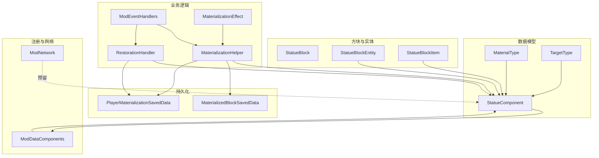
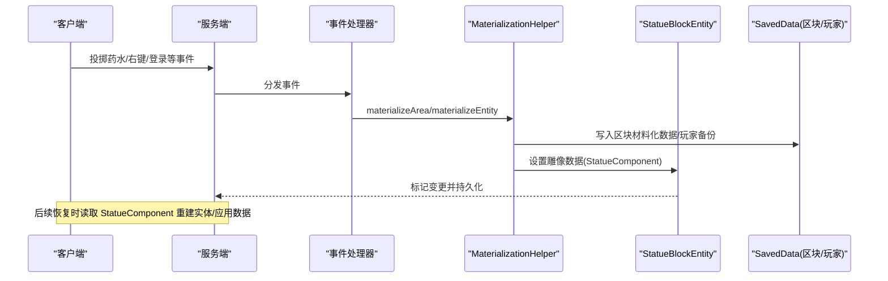
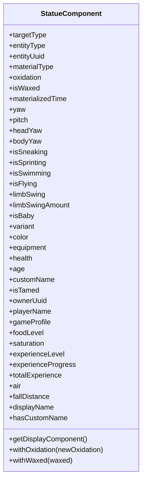
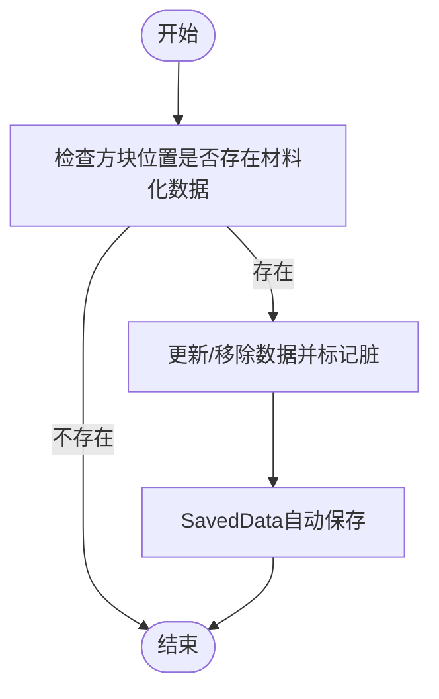
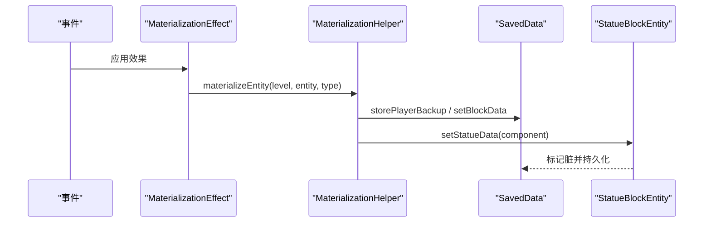
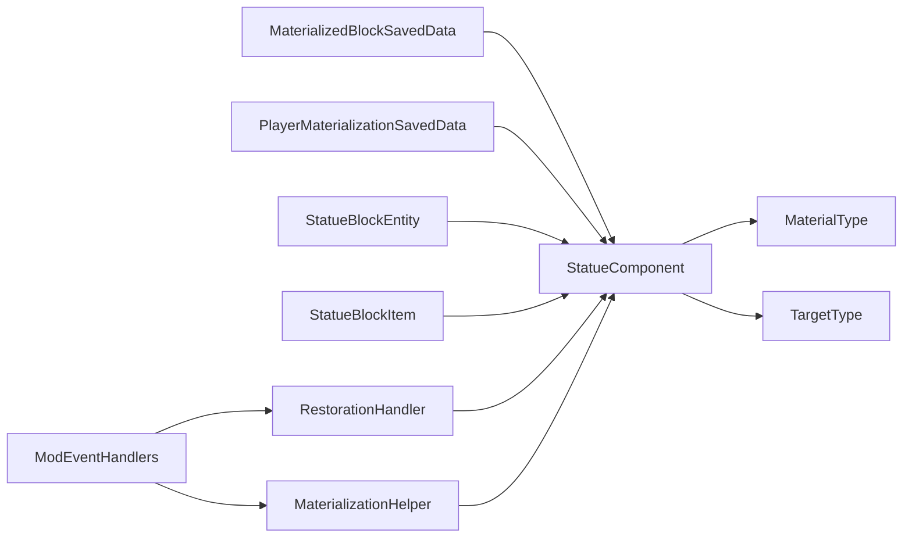

# 数据管理

<cite>
**本文引用的文件**
- [StatueComponent.java](file://src/main/java/com/xiong/petrification/component/StatueComponent.java)
- [MaterialType.java](file://src/main/java/com/xiong/petrification/component/MaterialType.java)
- [TargetType.java](file://src/main/java/com/xiong/petrification/component/TargetType.java)
- [ModDataComponents.java](file://src/main/java/com/xiong/petrification/registry/ModDataComponents.java)
- [MaterializedBlockSavedData.java](file://src/main/java/com/xiong/petrification/data/MaterializedBlockSavedData.java)
- [PlayerMaterializationSavedData.java](file://src/main/java/com/xiong/petrification/data/PlayerMaterializationSavedData.java)
- [StatueBlockEntity.java](file://src/main/java/com/xiong/petrification/block/StatueBlockEntity.java)
- [StatueBlock.java](file://src/main/java/com/xiong/petrification/block/StatueBlock.java)
- [StatueBlockItem.java](file://src/main/java/com/xiong/petrification/item/StatueBlockItem.java)
- [RestorationHandler.java](file://src/main/java/com/xiong/petrification/handler/RestorationHandler.java)
- [MaterializationHelper.java](file://src/main/java/com/xiong/petrification/util/MaterializationHelper.java)
- [ModEventHandlers.java](file://src/main/java/com/xiong/petrification/handler/ModEventHandlers.java)
- [MaterializationEffect.java](file://src/main/java/com/xiong/petrification/effect/MaterializationEffect.java)
- [ModNetwork.java](file://src/main/java/com/xiong/petrification/network/ModNetwork.java)
</cite>

## 目录
1. [简介](#简介)
2. [项目结构](#项目结构)
3. [核心组件](#核心组件)
4. [架构总览](#架构总览)
5. [详细组件分析](#详细组件分析)
6. [依赖关系分析](#依赖关系分析)
7. [性能考虑](#性能考虑)
8. [故障排查指南](#故障排查指南)
9. [结论](#结论)
10. [附录：API使用示例与最佳实践](#附录api使用示例与最佳实践)

## 简介
本模组实现“石化”能力，将生物或玩家转化为可持久化的雕像。其数据管理的核心围绕以下方面：
- 数据组件系统：以 StatueComponent 为核心，统一描述雕像的实体信息、姿态、材料属性、状态及可选数据。
- 持久化存储：通过 SavedData 机制分别记录“区块级材料化块”和“玩家材料化备份”，确保世界重启后数据不丢失。
- 注册表系统：在 Forge 注册表中声明并启用 DataComponentType，使组件可随物品/方块实体序列化与网络同步。
- 数据同步：当前提供基础网络接口占位，支持未来扩展客户端-服务器间的数据传输协议与优化策略。
- 迁移与恢复：基于 Codec 的序列化设计天然支持版本兼容；配合 SavedData 提供备份/恢复流程。
- 性能优化：分组合式编解码、按需保存、周期性氧化更新、区域扫描限制等。

## 项目结构
本项目采用按功能域组织代码的结构，关键目录与职责如下：
- component：定义数据组件与枚举类型（StatueComponent、MaterialType、TargetType）。
- data：实现世界级持久化数据（MaterializedBlockSavedData、PlayerMaterializationSavedData）。
- block/item：实现雕像方块、方块实体、雕像物品及其交互逻辑。
- handler：事件处理器，处理药水溅射、右键交互、登录恢复、破坏清理等。
- util：工具类，封装实体捕获、区域材料化、装备还原等复杂逻辑。
- registry：注册表入口，集中注册数据组件等。
- network：网络层占位，预留数据包扩展点。
- effect：效果类，触发实体材料化。

图表来源
- [StatueComponent.java:14-52](file://src/main/java/com/xiong/petrification/component/StatueComponent.java#L14-L52)
- [MaterialType.java:9-68](file://src/main/java/com/xiong/petrification/component/MaterialType.java#L9-L68)
- [TargetType.java:6-23](file://src/main/java/com/xiong/petrification/component/TargetType.java#L6-L23)
- [MaterializedBlockSavedData.java:19-86](file://src/main/java/com/xiong/petrification/data/MaterializedBlockSavedData.java#L19-L86)
- [PlayerMaterializationSavedData.java:22-95](file://src/main/java/com/xiong/petrification/data/PlayerMaterializationSavedData.java#L22-L95)
- [StatueBlock.java:38-153](file://src/main/java/com/xiong/petrification/block/StatueBlock.java#L38-L153)
- [StatueBlockEntity.java:17-88](file://src/main/java/com/xiong/petrification/block/StatueBlockEntity.java#L17-L88)
- [StatueBlockItem.java:24-83](file://src/main/java/com/xiong/petrification/item/StatueBlockItem.java#L24-L83)
- [MaterializationHelper.java:33-263](file://src/main/java/com/xiong/petrification/util/MaterializationHelper.java#L33-L263)
- [RestorationHandler.java:31-229](file://src/main/java/com/xiong/petrification/handler/RestorationHandler.java#L31-L229)
- [ModEventHandlers.java:30-120](file://src/main/java/com/xiong/petrification/handler/ModEventHandlers.java#L30-L120)
- [MaterializationEffect.java:10-38](file://src/main/java/com/xiong/petrification/effect/MaterializationEffect.java#L10-L38)
- [ModDataComponents.java:11-27](file://src/main/java/com/xiong/petrification/registry/ModDataComponents.java#L11-L27)
- [ModNetwork.java:3-10](file://src/main/java/com/xiong/petrification/network/ModNetwork.java#L3-L10)

章节来源
- [StatueComponent.java:14-52](file://src/main/java/com/xiong/petrification/component/StatueComponent.java#L14-L52)
- [MaterializedBlockSavedData.java:19-86](file://src/main/java/com/xiong/petrification/data/MaterializedBlockSavedData.java#L19-L86)
- [PlayerMaterializationSavedData.java:22-95](file://src/main/java/com/xiong/petrification/data/PlayerMaterializationSavedData.java#L22-L95)
- [StatueBlockEntity.java:17-88](file://src/main/java/com/xiong/petrification/block/StatueBlockEntity.java#L17-L88)
- [StatueBlock.java:38-153](file://src/main/java/com/xiong/petrification/block/StatueBlock.java#L38-L153)
- [StatueBlockItem.java:24-83](file://src/main/java/com/xiong/petrification/item/StatueBlockItem.java#L24-L83)
- [MaterializationHelper.java:33-263](file://src/main/java/com/xiong/petrification/util/MaterializationHelper.java#L33-L263)
- [RestorationHandler.java:31-229](file://src/main/java/com/xiong/petrification/handler/RestorationHandler.java#L31-L229)
- [ModEventHandlers.java:30-120](file://src/main/java/com/xiong/petrification/handler/ModEventHandlers.java#L30-L120)
- [MaterializationEffect.java:10-38](file://src/main/java/com/xiong/petrification/effect/MaterializationEffect.java#L10-L38)
- [ModDataComponents.java:11-27](file://src/main/java/com/xiong/petrification/registry/ModDataComponents.java#L11-L27)
- [ModNetwork.java:3-10](file://src/main/java/com/xiong/petrification/network/ModNetwork.java#L3-L10)

## 核心组件
- StatueComponent：以 record 形式定义 37 个字段，分为四组并通过 Codec 链式组合，支持 NBT/JSON 序列化、默认值、可选字段、显示名生成、不可变更新方法等。
- MaterialType：枚举，定义材料种类、颜色、对应物品与方块、显示前缀等。
- TargetType：枚举，区分目标类型为生物或玩家。

章节来源
- [StatueComponent.java:14-52](file://src/main/java/com/xiong/petrification/component/StatueComponent.java#L14-L52)
- [MaterialType.java:9-68](file://src/main/java/com/xiong/petrification/component/MaterialType.java#L9-L68)
- [TargetType.java:6-23](file://src/main/java/com/xiong/petrification/component/TargetType.java#L6-L23)

## 架构总览
整体数据流从事件触发到实体捕获、数据存储、方块实体更新、以及恢复流程，形成闭环。

图表来源
- [ModEventHandlers.java:45-107](file://src/main/java/com/xiong/petrification/handler/ModEventHandlers.java#L45-L107)
- [MaterializationHelper.java:55-81](file://src/main/java/com/xiong/petrification/util/MaterializationHelper.java#L55-L81)
- [MaterializedBlockSavedData.java:61-84](file://src/main/java/com/xiong/petrification/data/MaterializedBlockSavedData.java#L61-L84)
- [PlayerMaterializationSavedData.java:70-93](file://src/main/java/com/xiong/petrification/data/PlayerMaterializationSavedData.java#L70-L93)
- [StatueBlockEntity.java:28-60](file://src/main/java/com/xiong/petrification/block/StatueBlockEntity.java#L28-L60)

## 详细组件分析

### 数据组件系统：StatueComponent
- 字段分组与Codec：
  - GroupA（基础信息）：targetType、entityType、entityUuid、materialType、oxidation、isWaxed、materializedTime。
  - GroupB（姿态与动画）：yaw、pitch、headYaw、bodyYaw、isSneaking、isSprinting、isSwimming、isFlying、limbSwing、limbSwingAmount。
  - GroupC（可选数据1）：isBaby、variant、color、equipment、health、age、customName、isTamed、ownerUuid、playerName。
  - GroupD（可选数据2）：gameProfile、foodLevel、saturation、experienceLevel、experienceProgress、totalExperience、air、fallDistance、displayName、hasCustomName。
  - 通过 Pair1/Pair2/Combined 组合，最终得到 CODEC，用于持久化与网络编码。
- 验证规则与默认值：
  - 多数可选字段使用 optionalFieldOf 提供默认值，避免旧版本数据缺失导致解析失败。
  - oxidation 非负，isWaxed 布尔默认 false，materializedTime 默认 0。
- 不可变更新：
  - withOxidation、withWaxed 返回新实例，保证线程安全与一致性。
- 显示名称：
  - getDisplayComponent 优先使用 displayName，否则回退为翻译键。

图表来源
- [StatueComponent.java:14-52](file://src/main/java/com/xiong/petrification/component/StatueComponent.java#L14-L52)
- [StatueComponent.java:81-148](file://src/main/java/com/xiong/petrification/component/StatueComponent.java#L81-L148)
- [StatueComponent.java:194-254](file://src/main/java/com/xiong/petrification/component/StatueComponent.java#L194-L254)

章节来源
- [StatueComponent.java:14-52](file://src/main/java/com/xiong/petrification/component/StatueComponent.java#L14-L52)
- [StatueComponent.java:81-148](file://src/main/java/com/xiong/petrification/component/StatueComponent.java#L81-L148)
- [StatueComponent.java:194-254](file://src/main/java/com/xiong/petrification/component/StatueComponent.java#L194-L254)

### 持久化数据：MaterializedBlockSavedData 与 PlayerMaterializationSavedData
- MaterializedBlockSavedData：
  - 存储每个被材料化的方块位置与其原始方块ID、材料类型、氧化度、是否打蜡、材料化时间。
  - 使用 SavedDataType 与 Codec 进行序列化和数据修复（DataFixTypes.LEVEL）。
  - 提供 set/get/remove 接口，并在修改时调用 setDirty() 标记脏数据。
- PlayerMaterializationSavedData：
  - 以玩家 UUID 为键，存储其雕像位置与 StatueComponent 快照。
  - 用于离线恢复与登录时传送至雕像位置并应用公共数据。
  - 同样使用 SavedDataType 与 Codec 进行持久化。

图表来源
- [MaterializedBlockSavedData.java:22-84](file://src/main/java/com/xiong/petrification/data/MaterializedBlockSavedData.java#L22-L84)
- [PlayerMaterializationSavedData.java:26-93](file://src/main/java/com/xiong/petrification/data/PlayerMaterializationSavedData.java#L26-L93)

章节来源
- [MaterializedBlockSavedData.java:19-86](file://src/main/java/com/xiong/petrification/data/MaterializedBlockSavedData.java#L19-L86)
- [PlayerMaterializationSavedData.java:22-95](file://src/main/java/com/xiong/petrification/data/PlayerMaterializationSavedData.java#L22-L95)

### 注册表系统：数据组件注册
- ModDataComponents 使用 DeferredRegister 注册 DataComponentType<StatueComponent>，配置 persistent 与 cacheEncoding，确保组件可持久化且编码缓存以提升性能。
- 注册时机由外部模块总线组驱动。

章节来源
- [ModDataComponents.java:11-27](file://src/main/java/com/xiong/petrification/registry/ModDataComponents.java#L11-L27)

### 数据同步机制
- 当前网络层 ModNetwork.register 为占位实现，未包含具体数据包。
- 建议扩展方向：
  - 客户端请求雕像详情（如点击雕像），服务端发送 StatueComponent 快照。
  - 服务端广播雕像状态变化（如氧化度更新、打蜡状态）。
  - 使用批量打包减少网络负载，结合缓存编码提升效率。
  - 对大对象（如 equipment/gameProfile）进行增量同步或懒加载。

章节来源
- [ModNetwork.java:3-10](file://src/main/java/com/xiong/petrification/network/ModNetwork.java#L3-L10)

### 方块实体与生命周期
- StatueBlockEntity：
  - 持有 StatueComponent 引用，周期性 tick 更新铜材质氧化度（受配置控制）。
  - 通过 saveAdditional/loadAdditional 使用 StatueComponent.CODEC 进行持久化。
  - 提供 getUpdatePacket 用于客户端同步。
- StatueBlock：
  - 创建 StatueBlockEntity，提供 ticker 绑定服务端 tick。
  - 右键显示组件显示名；掉落时携带 StatueComponent 到物品。
  - 模拟信号输出反映铜材质氧化度。

章节来源
- [StatueBlockEntity.java:17-88](file://src/main/java/com/xiong/petrification/block/StatueBlockEntity.java#L17-L88)
- [StatueBlock.java:38-153](file://src/main/java/com/xiong/petrification/block/StatueBlock.java#L38-L153)

### 工具与事件：材料化与恢复
- MaterializationHelper：
  - captureEntityData：捕获实体数据构建 StatueComponent，包括装备、玩家特有数据、驯养信息等。
  - materializeEntity：放置雕像方块、设置组件、断开玩家连接（若为玩家）、播放音效与粒子。
  - materializeArea：按半径扫描实体并排序（玩家优先），逐个材料化。
  - materializeBlocks：按半径扫描方块，记录原始方块ID与材料化元数据到 SavedData。
  - restoreEquipment：从装备标签恢复实体装备。
- RestorationHandler：
  - restoreBlock：根据组件目标类型选择恢复路径（玩家/生物）。
  - restoreFromInventory：从背包中的雕像物品恢复实体或玩家。
  - applyPlayerData：应用玩家公共数据（饥饿、经验、空气、掉落距离、装备）。
  - waxCopper/waxCopperItem：对铜材质雕像打蜡，阻止进一步氧化。
- ModEventHandlers：
  - 药水溅射触发区域材料化。
  - 右键使用恢复粉/蜂巢处理雕像方块。
  - 玩家登录时传送至雕像位置并应用公共数据，清理残留方块。
- MaterializationEffect：
  - 即时效果，在单次 tick 内调用 materializeEntity。

图表来源
- [MaterializationEffect.java:22-31](file://src/main/java/com/xiong/petrification/effect/MaterializationEffect.java#L22-L31)
- [MaterializationHelper.java:55-81](file://src/main/java/com/xiong/petrification/util/MaterializationHelper.java#L55-L81)
- [MaterializedBlockSavedData.java:61-84](file://src/main/java/com/xiong/petrification/data/MaterializedBlockSavedData.java#L61-L84)
- [PlayerMaterializationSavedData.java:70-93](file://src/main/java/com/xiong/petrification/data/PlayerMaterializationSavedData.java#L70-L93)
- [StatueBlockEntity.java:28-60](file://src/main/java/com/xiong/petrification/block/StatueBlockEntity.java#L28-L60)

章节来源
- [MaterializationHelper.java:33-263](file://src/main/java/com/xiong/petrification/util/MaterializationHelper.java#L33-L263)
- [RestorationHandler.java:31-229](file://src/main/java/com/xiong/petrification/handler/RestorationHandler.java#L31-L229)
- [ModEventHandlers.java:30-120](file://src/main/java/com/xiong/petrification/handler/ModEventHandlers.java#L30-L120)
- [MaterializationEffect.java:10-38](file://src/main/java/com/xiong/petrification/effect/MaterializationEffect.java#L10-L38)

## 依赖关系分析
- 组件依赖：
  - StatueComponent 依赖 MaterialType、TargetType 的 Codec。
  - 持久化数据依赖 StatueComponent.CODEC 与 BlockPos/UUID 的 Codec。
- 运行时依赖：
  - 事件处理器依赖 MaterializationHelper 与 SavedData。
  - 方块实体依赖 StatueComponent 的持久化与更新。
  - 物品与方块交互依赖注册的数据组件类型。

图表来源
- [StatueComponent.java:14-52](file://src/main/java/com/xiong/petrification/component/StatueComponent.java#L14-L52)
- [MaterializedBlockSavedData.java:19-86](file://src/main/java/com/xiong/petrification/data/MaterializedBlockSavedData.java#L19-L86)
- [PlayerMaterializationSavedData.java:22-95](file://src/main/java/com/xiong/petrification/data/PlayerMaterializationSavedData.java#L22-L95)
- [StatueBlockEntity.java:17-88](file://src/main/java/com/xiong/petrification/block/StatueBlockEntity.java#L17-L88)
- [StatueBlockItem.java:24-83](file://src/main/java/com/xiong/petrification/item/StatueBlockItem.java#L24-L83)
- [RestorationHandler.java:31-229](file://src/main/java/com/xiong/petrification/handler/RestorationHandler.java#L31-L229)
- [MaterializationHelper.java:33-263](file://src/main/java/com/xiong/petrification/util/MaterializationHelper.java#L33-L263)
- [ModEventHandlers.java:30-120](file://src/main/java/com/xiong/petrification/handler/ModEventHandlers.java#L30-L120)

章节来源
- [StatueComponent.java:14-52](file://src/main/java/com/xiong/petrification/component/StatueComponent.java#L14-L52)
- [MaterializedBlockSavedData.java:19-86](file://src/main/java/com/xiong/petrification/data/MaterializedBlockSavedData.java#L19-L86)
- [PlayerMaterializationSavedData.java:22-95](file://src/main/java/com/xiong/petrification/data/PlayerMaterializationSavedData.java#L22-L95)
- [StatueBlockEntity.java:17-88](file://src/main/java/com/xiong/petrification/block/StatueBlockEntity.java#L17-L88)
- [StatueBlockItem.java:24-83](file://src/main/java/com/xiong/petrification/item/StatueBlockItem.java#L24-L83)
- [RestorationHandler.java:31-229](file://src/main/java/com/xiong/petrification/handler/RestorationHandler.java#L31-L229)
- [MaterializationHelper.java:33-263](file://src/main/java/com/xiong/petrification/util/MaterializationHelper.java#L33-L263)
- [ModEventHandlers.java:30-120](file://src/main/java/com/xiong/petrification/handler/ModEventHandlers.java#L30-L120)

## 性能考虑
- 分组合式编解码：StatueComponent 将 37 个字段拆分为 4 组，降低单次编解码复杂度，提高可读性与维护性。
- 缓存编码：注册数据组件时启用 cacheEncoding，减少重复序列化开销。
- 周期性更新：雕像方块实体每固定刻数尝试增加氧化度，避免每刻计算。
- 区域扫描限制：材料化区域半径与过滤条件（空气、雕像、已记录）减少无效操作。
- 选择性持久化：仅在数据变更时标记脏，并由 SavedData 自动保存。
- 网络优化建议：
  - 增量同步：仅传输变化的字段（如氧化度、打蜡状态）。
  - 批量打包：合并多个雕像状态更新为一包。
  - 懒加载：对大型字段（如装备、游戏档案）按需传输。

[本节为通用性能指导，无需特定文件引用]

## 故障排查指南
- 雕像无数据：
  - 检查 StatueBlockEntity 是否正确设置 statueData，并确保组件非空。
  - 确认 SavedData 中是否有对应条目（区块/玩家）。
- 恢复失败：
  - 玩家在线时无法从物品恢复（防止冲突）。
  - 离线恢复依赖 PlayerMaterializationSavedData 中的条目，需确保登录事件正确触发。
- 氧化异常：
  - 检查是否为铜材质且未打蜡，以及配置项是否允许氧化。
- 权限限制：
  - 创造模式或高权限玩家可能被禁止材料化，依据配置判断。

章节来源
- [StatueBlockEntity.java:28-60](file://src/main/java/com/xiong/petrification/block/StatueBlockEntity.java#L28-L60)
- [MaterializedBlockSavedData.java:61-84](file://src/main/java/com/xiong/petrification/data/MaterializedBlockSavedData.java#L61-L84)
- [PlayerMaterializationSavedData.java:70-93](file://src/main/java/com/xiong/petrification/data/PlayerMaterializationSavedData.java#L70-L93)
- [RestorationHandler.java:55-130](file://src/main/java/com/xiong/petrification/handler/RestorationHandler.java#L55-L130)
- [MaterializationHelper.java:36-53](file://src/main/java/com/xiong/petrification/util/MaterializationHelper.java#L36-L53)

## 结论
该数据管理系统以 StatueComponent 为中心，结合 SavedData 与方块实体实现了完整的材料化与恢复流程。通过分组合式编解码、缓存编码与周期性更新等手段，兼顾了可扩展性与性能。网络层预留扩展点，便于未来完善多端同步。建议在后续迭代中补充数据包实现与更细粒度的增量同步策略。

[本节为总结性内容，无需特定文件引用]

## 附录：API使用示例与最佳实践

- 创建雕像数据组件
  - 使用 StatueComponent.defaultStatue(materialType) 快速生成默认组件。
  - 通过 withOxidation/withWaxed 进行不可变更新。
  - 参考路径：[StatueComponent.java:194-227](file://src/main/java/com/xiong/petrification/component/StatueComponent.java#L194-L227)

- 捕获实体数据并材料化
  - 调用 MaterializationHelper.captureEntityData(entity, materialType) 获取组件。
  - 调用 MaterializationHelper.materializeEntity(level, entity, materialType) 完成材料化。
  - 参考路径：[MaterializationHelper.java:98-186](file://src/main/java/com/xiong/petrification/util/MaterializationHelper.java#L98-L186)、[MaterializationHelper.java:55-81](file://src/main/java/com/xiong/petrification/util/MaterializationHelper.java#L55-L81)

- 区域材料化
  - 使用 MaterializationHelper.materializeArea(level, center, radius, materialType) 扫描并材料化范围内实体。
  - 参考路径：[MaterializationHelper.java:83-96](file://src/main/java/com/xiong/petrification/util/MaterializationHelper.java#L83-L96)

- 方块材料化记录
  - 使用 MaterializationHelper.materializeBlocks(level, center, radius, materialType) 记录方块材料化信息。
  - 参考路径：[MaterializationHelper.java:234-255](file://src/main/java/com/xiong/petrification/util/MaterializationHelper.java#L234-L255)

- 恢复流程
  - 从方块实体恢复：RestorationHandler.restoreBlock(player, level, pos)。
  - 从物品恢复：RestorationHandler.restoreFromInventory(player, powderStack)。
  - 应用玩家数据：RestorationHandler.applyPlayerDataPublic(player, component)。
  - 参考路径：[RestorationHandler.java:34-91](file://src/main/java/com/xiong/petrification/handler/RestorationHandler.java#L34-L91)、[RestorationHandler.java:169-182](file://src/main/java/com/xiong/petrification/handler/RestorationHandler.java#L169-L182)

- 打蜡与氧化
  - 对铜材质雕像打蜡：RestorationHandler.waxCopper/waxCopperItem。
  - 氧化周期更新：StatueBlockEntity.serverTick。
  - 参考路径：[RestorationHandler.java:184-207](file://src/main/java/com/xiong/petrification/handler/RestorationHandler.java#L184-L207)、[StatueBlockEntity.java:28-50](file://src/main/java/com/xiong/petrification/block/StatueBlockEntity.java#L28-L50)

- 数据组件注册与使用
  - 注册数据组件：ModDataComponents.DATA_COMPONENTS.register(...)。
  - 在物品/方块实体中读写组件：stack.set/get(ModDataComponents.STATUE_DATA.get())。
  - 参考路径：[ModDataComponents.java:11-27](file://src/main/java/com/xiong/petrification/registry/ModDataComponents.java#L11-L27)、[StatueBlockItem.java:29-40](file://src/main/java/com/xiong/petrification/item/StatueBlockItem.java#L29-L40)

- 事件集成
  - 药水溅射触发材料化：ModEventHandlers.onPotionSplash。
  - 右键交互处理：ModEventHandlers.onRightClickBlock。
  - 登录恢复：ModEventHandlers.onPlayerLogin。
  - 参考路径：[ModEventHandlers.java:45-107](file://src/main/java/com/xiong/petrification/handler/ModEventHandlers.java#L45-L107)

- 网络扩展建议
  - 在 ModNetwork.register 中实现数据包注册与处理。
  - 针对 StatueComponent 的大字段（equipment/gameProfile）采用增量或懒加载策略。
  - 参考路径：[ModNetwork.java:3-10](file://src/main/java/com/xiong/petrification/network/ModNetwork.java#L3-L10)

章节来源
- [StatueComponent.java:194-227](file://src/main/java/com/xiong/petrification/component/StatueComponent.java#L194-L227)
- [MaterializationHelper.java:55-81](file://src/main/java/com/xiong/petrification/util/MaterializationHelper.java#L55-L81)
- [MaterializationHelper.java:83-96](file://src/main/java/com/xiong/petrification/util/MaterializationHelper.java#L83-L96)
- [MaterializationHelper.java:98-186](file://src/main/java/com/xiong/petrification/util/MaterializationHelper.java#L98-L186)
- [MaterializationHelper.java:234-255](file://src/main/java/com/xiong/petrification/util/MaterializationHelper.java#L234-L255)
- [RestorationHandler.java:34-91](file://src/main/java/com/xiong/petrification/handler/RestorationHandler.java#L34-L91)
- [RestorationHandler.java:169-182](file://src/main/java/com/xiong/petrification/handler/RestorationHandler.java#L169-L182)
- [RestorationHandler.java:184-207](file://src/main/java/com/xiong/petrification/handler/RestorationHandler.java#L184-L207)
- [ModDataComponents.java:11-27](file://src/main/java/com/xiong/petrification/registry/ModDataComponents.java#L11-L27)
- [StatueBlockItem.java:29-40](file://src/main/java/com/xiong/petrification/item/StatueBlockItem.java#L29-L40)
- [ModEventHandlers.java:45-107](file://src/main/java/com/xiong/petrification/handler/ModEventHandlers.java#L45-L107)
- [ModNetwork.java:3-10](file://src/main/java/com/xiong/petrification/network/ModNetwork.java#L3-L10)