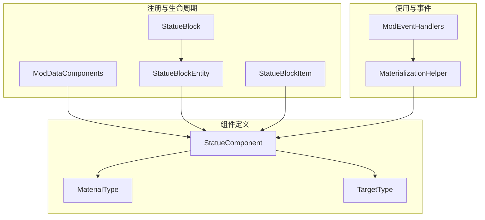
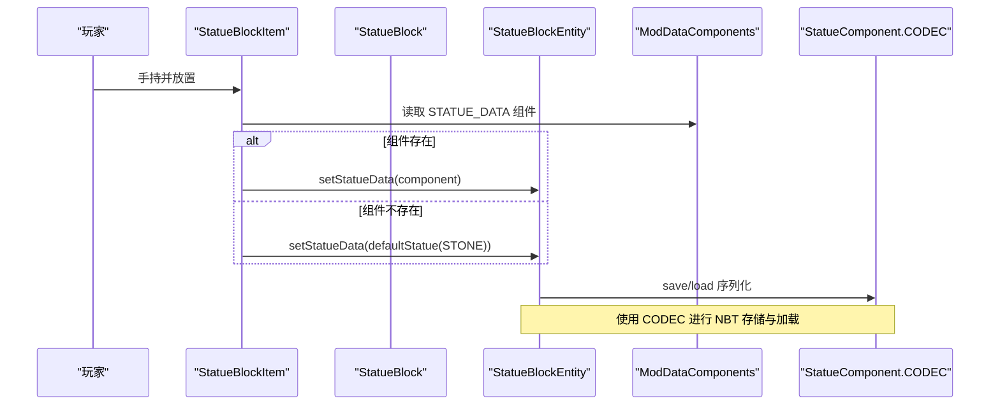
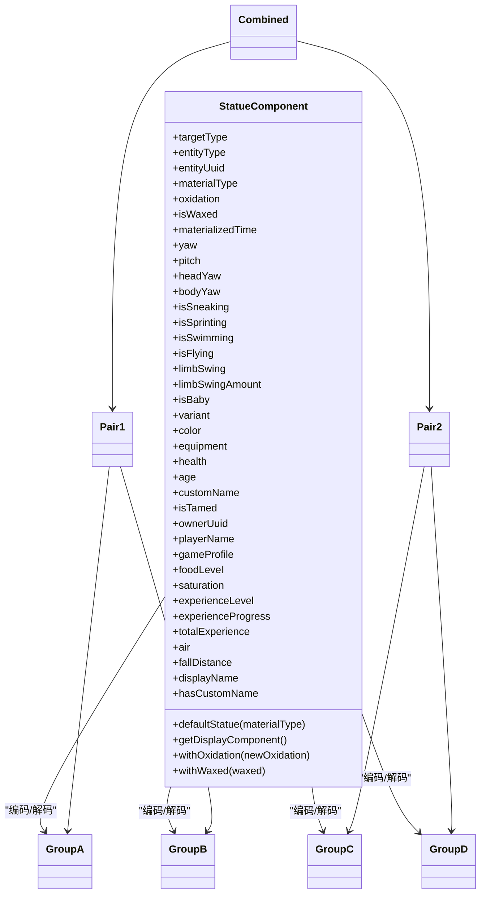
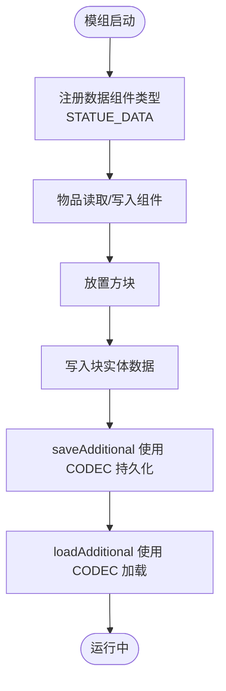
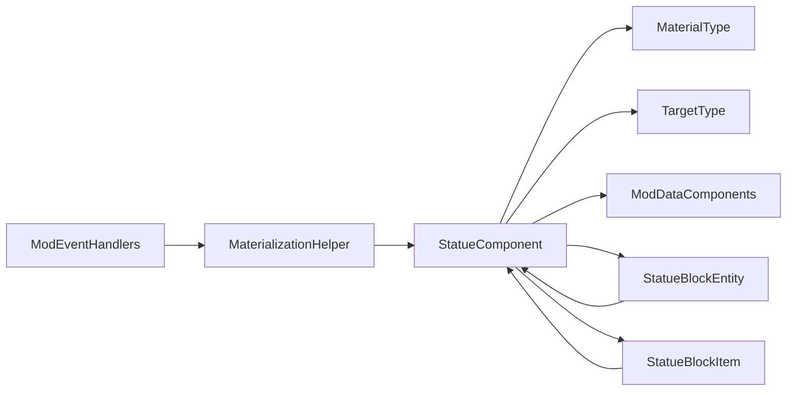

# 数据组件系统

<cite>
**本文引用的文件**
- [StatueComponent.java](file://src/main/java/com/xiong/petrification/component/StatueComponent.java)
- [MaterialType.java](file://src/main/java/com/xiong/petrification/component/MaterialType.java)
- [TargetType.java](file://src/main/java/com/xiong/petrification/component/TargetType.java)
- [ModDataComponents.java](file://src/main/java/com/xiong/petrification/registry/ModDataComponents.java)
- [StatueBlockEntity.java](file://src/main/java/com/xiong/petrification/block/StatueBlockEntity.java)
- [StatueBlock.java](file://src/main/java/com/xiong/petrification/block/StatueBlock.java)
- [StatueBlockItem.java](file://src/main/java/com/xiong/petrification/item/StatueBlockItem.java)
- [MaterializationHelper.java](file://src/main/java/com/xiong/petrification/util/MaterializationHelper.java)
- [ModEventHandlers.java](file://src/main/java/com/xiong/petrification/handler/ModEventHandlers.java)
- [ModConfigSpecHolder.java](file://src/main/java/com/xiong/petrification/ModConfigSpecHolder.java)
</cite>

## 目录
1. [简介](#简介)
2. [项目结构](#项目结构)
3. [核心组件](#核心组件)
4. [架构总览](#架构总览)
5. [详细组件分析](#详细组件分析)
6. [依赖关系分析](#依赖关系分析)
7. [性能考虑](#性能考虑)
8. [故障排查指南](#故障排查指南)
9. [结论](#结论)
10. [附录：API使用示例](#附录api使用示例)

## 简介
本文件为“石化”模组的数据组件系统提供完整技术文档，聚焦 StatueComponent 记录类的设计与编解码机制、材质类型与目标类型枚举、数据组件注册与生命周期、数据验证与默认值策略、可选字段处理，以及在实际场景中的创建、修改与序列化用法。同时给出性能优化建议与最佳实践。

## 项目结构
该系统的核心位于 component 包（数据模型与编解码）、registry 包（数据组件注册）、block 与 item 包（组件在方块与物品上的读写）、util 包（实体到组件的捕获与还原）以及 handler 包（事件驱动的使用流程）。

图表来源
- [StatueComponent.java:14-148](file://src/main/java/com/xiong/petrification/component/StatueComponent.java#L14-L148)
- [MaterialType.java:9-67](file://src/main/java/com/xiong/petrification/component/MaterialType.java#L9-L67)
- [TargetType.java:6-22](file://src/main/java/com/xiong/petrification/component/TargetType.java#L6-L22)
- [ModDataComponents.java:11-25](file://src/main/java/com/xiong/petrification/registry/ModDataComponents.java#L11-L25)
- [StatueBlockEntity.java:17-88](file://src/main/java/com/xiong/petrification/block/StatueBlockEntity.java#L17-L88)
- [StatueBlock.java:38-153](file://src/main/java/com/xiong/petrification/block/StatueBlock.java#L38-L153)
- [StatueBlockItem.java:24-83](file://src/main/java/com/xiong/petrification/item/StatueBlockItem.java#L24-L83)
- [MaterializationHelper.java:33-263](file://src/main/java/com/xiong/petrification/util/MaterializationHelper.java#L33-L263)
- [ModEventHandlers.java:30-120](file://src/main/java/com/xiong/petrification/handler/ModEventHandlers.java#L30-L120)

章节来源
- [StatueComponent.java:14-148](file://src/main/java/com/xiong/petrification/component/StatueComponent.java#L14-L148)
- [ModDataComponents.java:11-25](file://src/main/java/com/xiong/petrification/registry/ModDataComponents.java#L11-L25)

## 核心组件
- StatueComponent：包含37个字段的不可变记录，用于持久化雕像的状态信息，并提供Codec进行序列化/反序列化。
- MaterialType：材质类型枚举，定义石头、铁、铜、金、钻石、下界合金等材质及其显示前缀、颜色、对应物品与方块。
- TargetType：目标类型枚举，区分生物与玩家两类目标。

章节来源
- [StatueComponent.java:14-52](file://src/main/java/com/xiong/petrification/component/StatueComponent.java#L14-L52)
- [MaterialType.java:9-67](file://src/main/java/com/xiong/petrification/component/MaterialType.java#L9-L67)
- [TargetType.java:6-22](file://src/main/java/com/xiong/petrification/component/TargetType.java#L6-L22)

## 架构总览
数据组件系统围绕 StatueComponent 构建，通过 Codec 实现跨NBT/网络/配置的可靠序列化；由 ModDataComponents 注册为可持久化的 DataComponentType；在 StatueBlockEntity 中作为块实体数据进行读写；在 StatueBlockItem 中随物品携带并在放置时写入块实体；MaterializationHelper 负责从实体捕获数据生成组件；事件处理器将药水泼洒等行为触发材质化流程。

图表来源
- [StatueBlockItem.java:29-40](file://src/main/java/com/xiong/petrification/item/StatueBlockItem.java#L29-L40)
- [ModDataComponents.java:15-19](file://src/main/java/com/xiong/petrification/registry/ModDataComponents.java#L15-L19)
- [StatueBlockEntity.java:62-74](file://src/main/java/com/xiong/petrification/block/StatueBlockEntity.java#L62-L74)
- [StatueComponent.java:145-148](file://src/main/java/com/xiong/petrification/component/StatueComponent.java#L145-L148)

## 详细组件分析

### StatueComponent 记录类与分组策略
- 设计要点
  - 使用 Java record 表达不可变数据结构，保证线程安全与一致性。
  - 37个字段按逻辑分为四组：GroupA（基础标识与材质）、GroupB（姿态与动作）、GroupC（可选数据前半部分）、GroupD（可选数据后半部分），每组不超过16个字段以满足编解码器限制。
  - 通过中间 Pair1/Pair2/Combined 结构组合各组的 Codec，再使用 xmap 映射回 StatueComponent，形成清晰的编解码管线。
- 编解码机制
  - 每个 Group 使用 RecordCodecBuilder 定义字段名、类型、Optional 与默认值。
  - 使用 ExtraCodecs.NON_NEGATIVE_FLOAT 对氧化度进行非负约束。
  - 最终 CODEC 暴露为 public static final，供 DataComponentType 使用。
- 默认值与可选字段
  - 大量字段采用 Optional 表示可选性，避免无意义空值。
  - 关键数值字段提供合理默认值（如氧化度0.0、打蜡false、时间戳0等）。
  - defaultStatue 提供快速构造初始雕像组件的方法。
- 不可变更新
  - withOxidation、withWaxed 等方法返回新的 StatueComponent 实例，保持不可变性。

图表来源
- [StatueComponent.java:55-148](file://src/main/java/com/xiong/petrification/component/StatueComponent.java#L55-L148)

章节来源
- [StatueComponent.java:55-192](file://src/main/java/com/xiong/petrification/component/StatueComponent.java#L55-L192)
- [StatueComponent.java:194-255](file://src/main/java/com/xiong/petrification/component/StatueComponent.java#L194-L255)

### MaterialType 材质类型枚举
- 作用：定义可用材质种类，提供序列化CODEC、显示前缀、颜色、对应物品与方块。
- 使用点：
  - 决定雕像外观与行为（如铜材质支持氧化）。
  - 用于生成显示名称前缀与粒子颜色。
  - 在方块模拟中根据氧化程度输出红石信号。

章节来源
- [MaterialType.java:9-67](file://src/main/java/com/xiong/petrification/component/MaterialType.java#L9-L67)
- [StatueBlock.java:142-151](file://src/main/java/com/xiong/petrification/block/StatueBlock.java#L142-L151)
- [MaterializationHelper.java:257-261](file://src/main/java/com/xiong/petrification/util/MaterializationHelper.java#L257-L261)

### TargetType 目标类型枚举
- 作用：区分雕像目标是生物还是玩家，影响后续恢复逻辑与权限检查。
- 使用点：
  - 在捕获实体数据时设置 targetType。
  - 在恢复玩家数据时结合保存数据定位与还原。

章节来源
- [TargetType.java:6-22](file://src/main/java/com/xiong/petrification/component/TargetType.java#L6-L22)
- [MaterializationHelper.java:98-100](file://src/main/java/com/xiong/petrification/util/MaterializationHelper.java#L98-L100)

### 数据组件注册与生命周期
- 注册：
  - 通过 DeferredRegister 在 DATA_COMPONENTS 上注册名为 statue_data 的 DataComponentType<StatueComponent>。
  - 配置 persistent(StatueComponent.CODEC) 以启用NBT持久化，cacheEncoding() 提升编码缓存效率。
- 生命周期：
  - 启动时注册，运行时通过 stack.get/set 或 block entity 存取。
  - 在块实体 saveAdditional/loadAdditional 中使用 CODEC 完成持久化。
  - 在物品放置时读取组件并写入块实体，若无则创建默认组件。

图表来源
- [ModDataComponents.java:11-25](file://src/main/java/com/xiong/petrification/registry/ModDataComponents.java#L11-L25)
- [StatueBlockEntity.java:62-74](file://src/main/java/com/xiong/petrification/block/StatueBlockEntity.java#L62-L74)
- [StatueBlockItem.java:29-40](file://src/main/java/com/xiong/petrification/item/StatueBlockItem.java#L29-L40)

章节来源
- [ModDataComponents.java:11-25](file://src/main/java/com/xiong/petrification/registry/ModDataComponents.java#L11-L25)
- [StatueBlockEntity.java:62-74](file://src/main/java/com/xiong/petrification/block/StatueBlockEntity.java#L62-L74)
- [StatueBlockItem.java:29-40](file://src/main/java/com/xiong/petrification/item/StatueBlockItem.java#L29-L40)

### 数据验证规则、默认值与可选字段处理
- 验证规则
  - 氧化度使用 NON_NEGATIVE_FLOAT 确保非负。
  - 其他布尔与数值字段提供默认值，避免解析失败。
- 默认值
  - defaultStatue 提供最小可用组件，便于缺失组件时的降级处理。
- 可选字段
  - 大量字段使用 Optional，仅在必要时填充，减少冗余数据。
  - 在恢复逻辑中按需应用（如玩家经验、食物、驯服信息等）。

章节来源
- [StatueComponent.java:81-128](file://src/main/java/com/xiong/petrification/component/StatueComponent.java#L81-L128)
- [StatueComponent.java:194-227](file://src/main/java/com/xiong/petrification/component/StatueComponent.java#L194-L227)
- [MaterializationHelper.java:124-185](file://src/main/java/com/xiong/petrification/util/MaterializationHelper.java#L124-L185)

### API使用示例（创建、修改、序列化）
- 创建默认组件
  - 使用 StatueComponent.defaultStatue(MaterialType.STONE) 获取初始状态。
- 修改组件
  - 使用 withOxidation(newVal) 或 withWaxed(flag) 获得新实例。
- 序列化/反序列化
  - 通过 StatueComponent.CODEC 与 NBT/网络/配置进行转换。
  - 在块实体 save/load 中直接调用 CODEC 进行存储与读取。
- 在物品与方块间传递
  - 物品堆栈通过 stack.set/get 操作 STATUE_DATA 组件。
  - 放置时将组件写入块实体，若为空则写入默认组件。

章节来源
- [StatueComponent.java:194-255](file://src/main/java/com/xiong/petrification/component/StatueComponent.java#L194-L255)
- [StatueBlockEntity.java:62-74](file://src/main/java/com/xiong/petrification/block/StatueBlockEntity.java#L62-L74)
- [StatueBlockItem.java:29-40](file://src/main/java/com/xiong/petrification/item/StatueBlockItem.java#L29-L40)

## 依赖关系分析
- 组件与枚举
  - StatueComponent 依赖 MaterialType 与 TargetType 进行类型安全建模。
- 组件与注册
  - ModDataComponents 将 StatueComponent.CODEC 绑定到 DataComponentType，实现持久化能力。
- 组件与块实体
  - StatueBlockEntity 在 tick 中根据配置与材质类型更新氧化度，并通过 CODEC 持久化。
- 组件与物品
  - StatueBlockItem 在放置时读取/写入组件，提供工具提示与名称显示。
- 组件与事件
  - ModEventHandlers 在药水泼洒事件中触发材质化，调用 MaterializationHelper 生成组件并写入块实体。

图表来源
- [StatueComponent.java:14-148](file://src/main/java/com/xiong/petrification/component/StatueComponent.java#L14-L148)
- [ModDataComponents.java:11-25](file://src/main/java/com/xiong/petrification/registry/ModDataComponents.java#L11-L25)
- [StatueBlockEntity.java:17-88](file://src/main/java/com/xiong/petrification/block/StatueBlockEntity.java#L17-L88)
- [StatueBlockItem.java:24-83](file://src/main/java/com/xiong/petrification/item/StatueBlockItem.java#L24-L83)
- [ModEventHandlers.java:30-120](file://src/main/java/com/xiong/petrification/handler/ModEventHandlers.java#L30-L120)
- [MaterializationHelper.java:33-263](file://src/main/java/com/xiong/petrification/util/MaterializationHelper.java#L33-L263)

章节来源
- [StatueComponent.java:14-148](file://src/main/java/com/xiong/petrification/component/StatueComponent.java#L14-L148)
- [ModDataComponents.java:11-25](file://src/main/java/com/xiong/petrification/registry/ModDataComponents.java#L11-L25)
- [StatueBlockEntity.java:17-88](file://src/main/java/com/xiong/petrification/block/StatueBlockEntity.java#L17-L88)
- [StatueBlockItem.java:24-83](file://src/main/java/com/xiong/petrification/item/StatueBlockItem.java#L24-L83)
- [ModEventHandlers.java:30-120](file://src/main/java/com/xiong/petrification/handler/ModEventHandlers.java#L30-L120)
- [MaterializationHelper.java:33-263](file://src/main/java/com/xiong/petrification/util/MaterializationHelper.java#L33-L263)

## 性能考虑
- 编解码性能
  - 使用 cacheEncoding() 缓存编码结果，减少重复计算。
  - 分组编解码降低单次编解码复杂度，提高可读性与维护性。
- 氧化模拟
  - 每200tick进行一次氧化增量计算，避免每tick开销。
  - 仅对铜材质且未打蜡且未达最大氧化度的情况执行更新。
- 渲染与IO
  - 雕像方块渲染形状设为不可见，减少渲染负担。
  - 组件仅在必要时机读写，避免频繁I/O。
- 配置调优
  - 可通过配置调整氧化速率、最大氧化度、渲染距离等参数平衡性能与体验。

章节来源
- [ModDataComponents.java:15-19](file://src/main/java/com/xiong/petrification/registry/ModDataComponents.java#L15-L19)
- [StatueBlockEntity.java:18-50](file://src/main/java/com/xiong/petrification/block/StatueBlockEntity.java#L18-L50)
- [StatueBlock.java:84-87](file://src/main/java/com/xiong/petrification/block/StatueBlock.java#L84-L87)
- [ModConfigSpecHolder.java:28-43](file://src/main/java/com/xiong/petrification/ModConfigSpecHolder.java#L28-L43)

## 故障排查指南
- 常见问题
  - 组件丢失：检查物品是否设置了 STATUE_DATA 组件；放置时若无组件会写入默认值。
  - 氧化不生效：确认材质类型为铜、未打蜡、未达到最大氧化度，且配置已启用氧化。
  - 玩家恢复异常：检查登录事件中是否正确读取保存数据并应用公共属性。
- 调试建议
  - 在块实体 load/save 处断点观察 CODEC 读写。
  - 在事件处理器中打印药水效果与半径参数，确认触发范围。
  - 使用物品悬停提示查看当前组件的关键字段（材质、氧化、实体类型、自定义名称）。

章节来源
- [StatueBlockItem.java:47-72](file://src/main/java/com/xiong/petrification/item/StatueBlockItem.java#L47-L72)
- [StatueBlockEntity.java:28-50](file://src/main/java/com/xiong/petrification/block/StatueBlockEntity.java#L28-L50)
- [ModEventHandlers.java:45-63](file://src/main/java/com/xiong/petrification/handler/ModEventHandlers.java#L45-L63)
- [ModEventHandlers.java:86-107](file://src/main/java/com/xiong/petrification/handler/ModEventHandlers.java#L86-L107)

## 结论
StatueComponent 通过分组编解码与不可变设计，提供了高内聚、低耦合的数据模型；配合 ModDataComponents 的注册机制与块实体的生命周期管理，实现了稳健的持久化与同步；MaterializationHelper 与事件处理器将游戏行为与数据组件无缝衔接。遵循本文的最佳实践与性能建议，可在保证功能完整性的同时获得良好的运行效率。

## 附录：API使用示例
- 创建默认组件
  - 路径参考：[StatueComponent.defaultStatue:194-227](file://src/main/java/com/xiong/petrification/component/StatueComponent.java#L194-L227)
- 修改组件
  - 路径参考：[StatueComponent.withOxidation:236-244](file://src/main/java/com/xiong/petrification/component/StatueComponent.java#L236-L244)、[StatueComponent.withWaxed:246-254](file://src/main/java/com/xiong/petrification/component/StatueComponent.java#L246-L254)
- 序列化/反序列化
  - 路径参考：[StatueComponent.CODEC:145-148](file://src/main/java/com/xiong/petrification/component/StatueComponent.java#L145-L148)、[StatueBlockEntity.save/load:62-74](file://src/main/java/com/xiong/petrification/block/StatueBlockEntity.java#L62-L74)
- 物品与方块交互
  - 路径参考：[StatueBlockItem.updateCustomBlockEntityTag:29-40](file://src/main/java/com/xiong/petrification/item/StatueBlockItem.java#L29-L40)
- 事件驱动的材质化
  - 路径参考：[ModEventHandlers.onPotionSplash:45-63](file://src/main/java/com/xiong/petrification/handler/ModEventHandlers.java#L45-L63)、[MaterializationHelper.materializeEntity:55-81](file://src/main/java/com/xiong/petrification/util/MaterializationHelper.java#L55-L81)