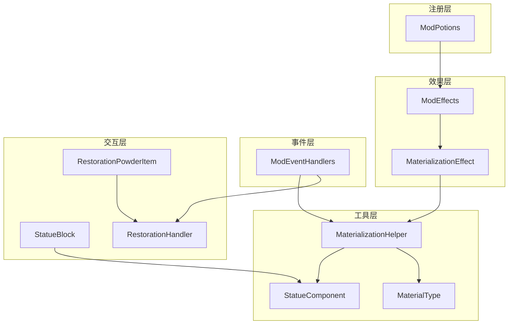
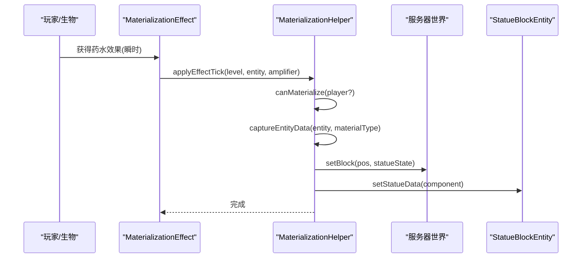
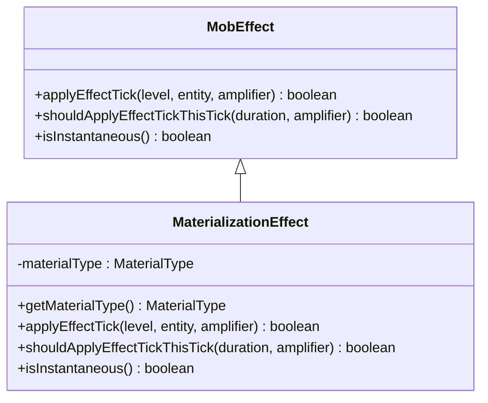
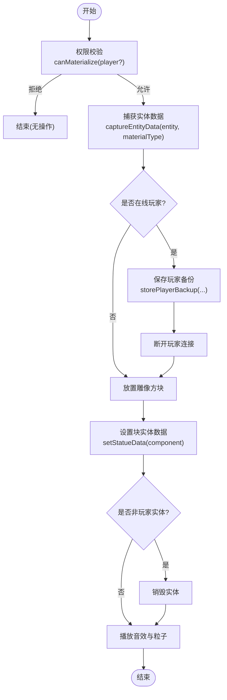
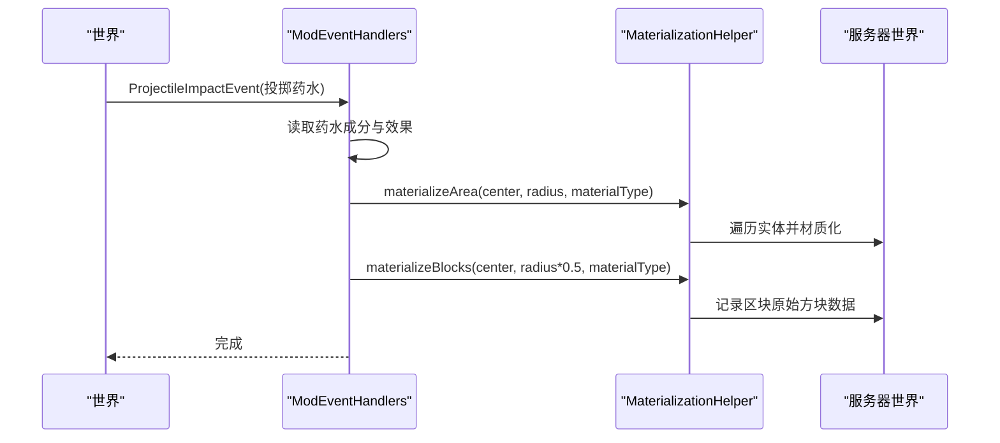
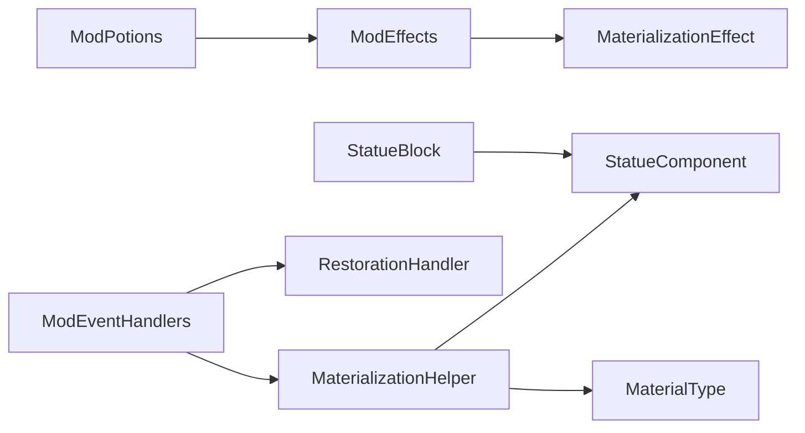
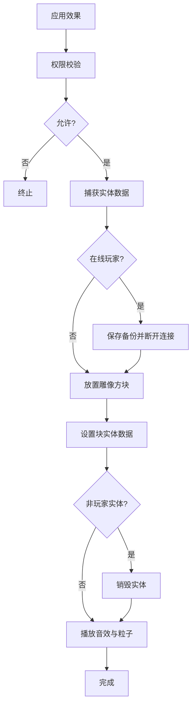

# 材质化系统

<cite>
**本文引用的文件**
- [MaterializationEffect.java](file://src/main/java/com/xiong/petrification/effect/MaterializationEffect.java)
- [MaterializationHelper.java](file://src/main/java/com/xiong/petrification/util/MaterializationHelper.java)
- [MaterialType.java](file://src/main/java/com/xiong/petrification/component/MaterialType.java)
- [StatueComponent.java](file://src/main/java/com/xiong/petrification/component/StatueComponent.java)
- [ModEffects.java](file://src/main/java/com/xiong/petrification/registry/ModEffects.java)
- [ModPotions.java](file://src/main/java/com/xiong/petrification/registry/ModPotions.java)
- [ModEventHandlers.java](file://src/main/java/com/xiong/petrification/handler/ModEventHandlers.java)
- [RestorationHandler.java](file://src/main/java/com/xiong/petrification/handler/RestorationHandler.java)
- [StatueBlock.java](file://src/main/java/com/xiong/petrification/block/StatueBlock.java)
- [RestorationPowderItem.java](file://src/main/java/com/xiong/petrification/item/RestorationPowderItem.java)
</cite>

## 目录
1. [简介](#简介)
2. [项目结构](#项目结构)
3. [核心组件](#核心组件)
4. [架构总览](#架构总览)
5. [详细组件分析](#详细组件分析)
6. [依赖关系分析](#依赖关系分析)
7. [性能考量](#性能考量)
8. [故障排查指南](#故障排查指南)
9. [结论](#结论)
10. [附录：扩展与示例](#附录：扩展与示例)

## 简介
本模组为Minecraft的“石化”机制提供一套完整的材质化系统。其核心是通过药水效果将实体（包括玩家、生物）转化为可交互的雕像，并支持按不同材质类型（石头、铁、铜、金、钻石、下界合金）进行区分与展示；同时提供恢复机制，可将雕像还原为原实体或在线玩家状态。本文档深入解析药水效果机制、材质化算法、目标捕获逻辑、投掷处理流程，以及扩展新材质类型的实践方法。

## 项目结构
该材质化系统围绕以下关键模块组织：
- 效果层：定义材质化药水效果及其生命周期控制
- 工具层：实现实体检测、数据捕获、权限校验、区域转化等核心算法
- 数据层：以组件形式持久化雕像信息（姿态、装备、属性等）
- 注册层：统一注册药水效果与对应药水
- 事件层：拦截药水投掷、右键交互、登录重放等事件驱动流程
- 方块与物品层：雕像方块与恢复粉末等交互入口

图表来源
- [MaterializationEffect.java:10-36](file://src/main/java/com/xiong/petrification/effect/MaterializationEffect.java#L10-L36)
- [MaterializationHelper.java:33-263](file://src/main/java/com/xiong/petrification/util/MaterializationHelper.java#L33-L263)
- [MaterialType.java:9-67](file://src/main/java/com/xiong/petrification/component/MaterialType.java#L9-L67)
- [StatueComponent.java:14-256](file://src/main/java/com/xiong/petrification/component/StatueComponent.java#L14-L256)
- [ModEffects.java:13-34](file://src/main/java/com/xiong/petrification/registry/ModEffects.java#L13-L34)
- [ModPotions.java:12-33](file://src/main/java/com/xiong/petrification/registry/ModPotions.java#L12-L33)
- [ModEventHandlers.java:30-120](file://src/main/java/com/xiong/petrification/handler/ModEventHandlers.java#L30-L120)
- [StatueBlock.java:38-153](file://src/main/java/com/xiong/petrification/block/StatueBlock.java#L38-L153)
- [RestorationPowderItem.java:11-33](file://src/main/java/com/xiong/petrification/item/RestorationPowderItem.java#L11-L33)
- [RestorationHandler.java:31-229](file://src/main/java/com/xiong/petrification/handler/RestorationHandler.java#L31-L229)

章节来源
- [MaterializationEffect.java:10-36](file://src/main/java/com/xiong/petrification/effect/MaterializationEffect.java#L10-L36)
- [MaterializationHelper.java:33-263](file://src/main/java/com/xiong/petrification/util/MaterializationHelper.java#L33-L263)
- [MaterialType.java:9-67](file://src/main/java/com/xiong/petrification/component/MaterialType.java#L9-L67)
- [StatueComponent.java:14-256](file://src/main/java/com/xiong/petrification/component/StatueComponent.java#L14-L256)
- [ModEffects.java:13-34](file://src/main/java/com/xiong/petrification/registry/ModEffects.java#L13-L34)
- [ModPotions.java:12-33](file://src/main/java/com/xiong/petrification/registry/ModPotions.java#L12-L33)
- [ModEventHandlers.java:30-120](file://src/main/java/com/xiong/petrification/handler/ModEventHandlers.java#L30-L120)
- [StatueBlock.java:38-153](file://src/main/java/com/xiong/petrification/block/StatueBlock.java#L38-L153)
- [RestorationPowderItem.java:11-33](file://src/main/java/com/xiong/petrification/item/RestorationPowderItem.java#L11-L33)
- [RestorationHandler.java:31-229](file://src/main/java/com/xiong/petrification/handler/RestorationHandler.java#L31-L229)

## 核心组件
- MaterializationEffect：继承自基础药水效果，负责在应用时触发材质化逻辑，且为瞬时效果，仅在持续时间为1时执行一次。
- MaterializationHelper：提供权限校验、实体检测、数据捕获、区域转化、粒子与音效、区块材质化记录等工具方法。
- MaterialType：枚举定义6种材质类型及颜色、显示前缀、对应物品与方块。
- StatueComponent：以record形式保存雕像的全部元数据（目标类型、实体ID、UUID、材质、姿态、装备、生命值、经验、饥饿等）。
- ModEffects/ModPotions：注册每种材质的药水效果与药水实例。
- ModEventHandlers：拦截药水投掷、右键交互、玩家登录等事件，串联材质化与恢复流程。
- StatueBlock/RestorationPowderItem/RestorationHandler：提供雕像方块的交互、恢复粉末的使用、以及恢复逻辑。

章节来源
- [MaterializationEffect.java:10-36](file://src/main/java/com/xiong/petrification/effect/MaterializationEffect.java#L10-L36)
- [MaterializationHelper.java:33-263](file://src/main/java/com/xiong/petrification/util/MaterializationHelper.java#L33-L263)
- [MaterialType.java:9-67](file://src/main/java/com/xiong/petrification/component/MaterialType.java#L9-L67)
- [StatueComponent.java:14-256](file://src/main/java/com/xiong/petrification/component/StatueComponent.java#L14-L256)
- [ModEffects.java:13-34](file://src/main/java/com/xiong/petrification/registry/ModEffects.java#L13-L34)
- [ModPotions.java:12-33](file://src/main/java/com/xiong/petrification/registry/ModPotions.java#L12-L33)
- [ModEventHandlers.java:30-120](file://src/main/java/com/xiong/petrification/handler/ModEventHandlers.java#L30-L120)
- [StatueBlock.java:38-153](file://src/main/java/com/xiong/petrification/block/StatueBlock.java#L38-L153)
- [RestorationPowderItem.java:11-33](file://src/main/java/com/xiong/petrification/item/RestorationPowderItem.java#L11-L33)
- [RestorationHandler.java:31-229](file://src/main/java/com/xiong/petrification/handler/RestorationHandler.java#L31-L229)

## 架构总览
材质化系统的整体工作流如下：
- 玩家或生物被施加材质化药水效果后，效果在tick中调用工具类执行材质化。
- 工具类进行权限校验、实体检测、数据捕获，生成雕像方块并存储组件数据。
- 药水投掷时，事件处理器根据药水内容计算范围，批量对范围内实体与区块执行材质化。
- 恢复流程通过恢复粉末或右键雕像，读取组件数据并还原实体或在线玩家。

图表来源
- [MaterializationEffect.java:22-31](file://src/main/java/com/xiong/petrification/effect/MaterializationEffect.java#L22-L31)
- [MaterializationHelper.java:55-81](file://src/main/java/com/xiong/petrification/util/MaterializationHelper.java#L55-L81)
- [StatueBlock.java:89-101](file://src/main/java/com/xiong/petrification/block/StatueBlock.java#L89-L101)

章节来源
- [MaterializationEffect.java:22-31](file://src/main/java/com/xiong/petrification/effect/MaterializationEffect.java#L22-L31)
- [MaterializationHelper.java:55-81](file://src/main/java/com/xiong/petrification/util/MaterializationHelper.java#L55-L81)
- [StatueBlock.java:89-101](file://src/main/java/com/xiong/petrification/block/StatueBlock.java#L89-L101)

## 详细组件分析

### 药水效果机制：MaterializationEffect
- 继承结构：继承自基础药水效果，持有材质类型字段。
- 应用流程：
  - 重写applyEffectTick：在服务器端对实体调用材质化工具方法。
  - shouldApplyEffectThisTick：仅当持续时间为1时执行，确保瞬时生效。
  - isInstantaneous：标记为瞬时效果，避免重复tick。
- 目标捕获：由工具类完成，效果层只负责调度。

图表来源
- [MaterializationEffect.java:10-36](file://src/main/java/com/xiong/petrification/effect/MaterializationEffect.java#L10-L36)

章节来源
- [MaterializationEffect.java:10-36](file://src/main/java/com/xiong/petrification/effect/MaterializationEffect.java#L10-L36)

### 材质化算法：MaterializationHelper
- 权限验证：
  - 检查创造模式与OP权限是否允许材质化，依据配置开关。
- 实体检测与转换：
  - 获取实体位置，捕获实体数据为目标组件。
  - 若为在线玩家，保存备份并断开连接（防止重复在线冲突）。
  - 放置雕像方块，设置块实体数据，非玩家实体销毁。
  - 播放音效与粒子。
- 区域材质化：
  - 基于中心点与半径构建AABB，筛选存活实体，优先处理玩家。
  - 逐个调用实体材质化。
- 区块材质化记录：
  - 记录指定半径内所有非空气与非雕像方块的原始方块ID与材质类型，用于后续恢复。
- 名称与显示：
  - 根据材质类型生成显示前缀，组合自定义名或实体类型名。

图表来源
- [MaterializationHelper.java:36-81](file://src/main/java/com/xiong/petrification/util/MaterializationHelper.java#L36-L81)
- [MaterializationHelper.java:98-209](file://src/main/java/com/xiong/petrification/util/MaterializationHelper.java#L98-L209)
- [MaterializationHelper.java:234-261](file://src/main/java/com/xiong/petrification/util/MaterializationHelper.java#L234-L261)

章节来源
- [MaterializationHelper.java:36-81](file://src/main/java/com/xiong/petrification/util/MaterializationHelper.java#L36-L81)
- [MaterializationHelper.java:98-209](file://src/main/java/com/xiong/petrification/util/MaterializationHelper.java#L98-L209)
- [MaterializationHelper.java:234-261](file://src/main/java/com/xiong/petrification/util/MaterializationHelper.java#L234-L261)

### 材质类型：MaterialType
- 六种材质：石头、铁、铜、金、钻石、下界合金。
- 特性差异：
  - 颜色：用于粒子与视觉反馈。
  - 显示前缀：用于命名雕像（如“Golden ...”、“Diamond ...”）。
  - 对应物品与方块：用于配方与掉落等扩展点。
  - 特殊行为：铜材质支持上蜡（防氧化），通过恢复处理器与方块信号输出体现。

章节来源
- [MaterialType.java:9-67](file://src/main/java/com/xiong/petrification/component/MaterialType.java#L9-L67)
- [RestorationHandler.java:184-207](file://src/main/java/com/xiong/petrification/handler/RestorationHandler.java#L184-L207)
- [StatueBlock.java:137-151](file://src/main/java/com/xiong/petrification/block/StatueBlock.java#L137-L151)

### 目标捕获与数据持久化：StatueComponent
- 捕获内容：
  - 目标类型（玩家/生物）、实体ID、UUID、材质类型、氧化度、是否上蜡、材质化时间。
  - 姿态与动画：偏航角、俯仰角、头部偏航、身体偏航、潜行/冲刺/游泳/飞行、肢体摆动。
  - 可选数据：幼体、变体、颜色、装备、生命值、年龄、自定义名、驯服状态、所有者UUID、玩家名、游戏档案、饥饿、饱和、经验等级/进度/总量、氧气、坠落距离、显示名、是否有自定义名。
- 编解码：
  - 使用Codec分组编码，保证NBT序列化稳定与兼容。
- 默认值：
  - 提供默认雕像构造，便于测试与配方产出。

章节来源
- [StatueComponent.java:14-256](file://src/main/java/com/xiong/petrification/component/StatueComponent.java#L14-L256)
- [MaterializationHelper.java:98-209](file://src/main/java/com/xiong/petrification/util/MaterializationHelper.java#L98-L209)

### 药水投掷到目标时的处理流程
- 事件拦截：
  - 拦截ProjectileImpactEvent，判断是否为投掷药水。
  - 读取药水成分，查找材质化效果实例。
  - 根据配置的范围倍率计算半径，调用区域材质化与区块材质化记录。
- 碰撞与权限：
  - 权限校验在工具类中进行，确保创造/OP限制。
  - 区域检测仅针对存活实体，并按优先级排序（玩家优先）。
- 状态更新：
  - 放置雕像方块，设置块实体数据，播放音效与粒子。
  - 记录区块原始方块信息，以便后续恢复。

图表来源
- [ModEventHandlers.java:45-63](file://src/main/java/com/xiong/petrification/handler/ModEventHandlers.java#L45-L63)
- [MaterializationHelper.java:83-96](file://src/main/java/com/xiong/petrification/util/MaterializationHelper.java#L83-L96)
- [MaterializationHelper.java:234-255](file://src/main/java/com/xiong/petrification/util/MaterializationHelper.java#L234-L255)

章节来源
- [ModEventHandlers.java:45-63](file://src/main/java/com/xiong/petrification/handler/ModEventHandlers.java#L45-L63)
- [MaterializationHelper.java:83-96](file://src/main/java/com/xiong/petrification/util/MaterializationHelper.java#L83-L96)
- [MaterializationHelper.java:234-255](file://src/main/java/com/xiong/petrification/util/MaterializationHelper.java#L234-L255)

### 恢复流程：RestorationHandler
- 方块恢复：
  - 读取雕像块实体的组件数据，判断目标类型。
  - 玩家：若在线则传送至雕像位置并应用数据；若离线则删除存档条目并提示。
  - 生物：在雕像位置生成实体并应用姿态、装备、生命值等。
- 物品恢复：
  - 从玩家背包查找雕像物品，读取组件数据。
  - 若为玩家雕像且在线，阻止恢复并提示。
  - 在玩家面前生成实体或应用玩家数据，播放音效并消耗物品。
- 铜上蜡：
  - 对铜材质雕像进行上蜡，改变组件状态并播放音效。

章节来源
- [RestorationHandler.java:34-229](file://src/main/java/com/xiong/petrification/handler/RestorationHandler.java#L34-L229)
- [RestorationPowderItem.java:16-31](file://src/main/java/com/xiong/petrification/item/RestorationPowderItem.java#L16-L31)

## 依赖关系分析
- 效果与注册：
  - ModEffects注册每种材质的MaterializationEffect，并提供颜色与材质类型。
  - ModPotions将效果包装为药水，供合成或掉落使用。
- 事件与工具：
  - ModEventHandlers监听药水投掷与右键事件，调用MaterializationHelper与RestorationHandler。
- 数据与方块：
  - StatueBlock提供雕像方块的放置、交互、掉落与红石信号输出（铜氧化度）。
  - StatueComponent作为数据载体贯穿捕获与恢复流程。

图表来源
- [ModEffects.java:13-34](file://src/main/java/com/xiong/petrification/registry/ModEffects.java#L13-L34)
- [ModPotions.java:12-33](file://src/main/java/com/xiong/petrification/registry/ModPotions.java#L12-L33)
- [ModEventHandlers.java:30-120](file://src/main/java/com/xiong/petrification/handler/ModEventHandlers.java#L30-L120)
- [MaterializationHelper.java:33-263](file://src/main/java/com/xiong/petrification/util/MaterializationHelper.java#L33-L263)
- [StatueBlock.java:38-153](file://src/main/java/com/xiong/petrification/block/StatueBlock.java#L38-L153)
- [StatueComponent.java:14-256](file://src/main/java/com/xiong/petrification/component/StatueComponent.java#L14-L256)
- [MaterialType.java:9-67](file://src/main/java/com/xiong/petrification/component/MaterialType.java#L9-L67)

章节来源
- [ModEffects.java:13-34](file://src/main/java/com/xiong/petrification/registry/ModEffects.java#L13-L34)
- [ModPotions.java:12-33](file://src/main/java/com/xiong/petrification/registry/ModPotions.java#L12-L33)
- [ModEventHandlers.java:30-120](file://src/main/java/com/xiong/petrification/handler/ModEventHandlers.java#L30-L120)
- [MaterializationHelper.java:33-263](file://src/main/java/com/xiong/petrification/util/MaterializationHelper.java#L33-L263)
- [StatueBlock.java:38-153](file://src/main/java/com/xiong/petrification/block/StatueBlock.java#L38-L153)
- [StatueComponent.java:14-256](file://src/main/java/com/xiong/petrification/component/StatueComponent.java#L14-L256)
- [MaterialType.java:9-67](file://src/main/java/com/xiong/petrification/component/MaterialType.java#L9-L67)

## 性能考量
- 区域检测优化：
  - 使用AABB快速筛选实体，并对玩家优先排序，减少不必要的处理。
  - 区块材质化仅记录非空气与非雕像方块，避免冗余。
- 权限校验前置：
  - 在实体材质化前进行权限检查，降低无效操作开销。
- 瞬时效果：
  - 效果标记为瞬时，避免每tick重复执行，提升效率。
- 粒子与音效：
  - 仅在成功材质化时播放，控制频率与数量。
- 建议：
  - 合理调整药水范围倍率，避免大范围高并发材质化导致卡顿。
  - 对大型服务器，考虑异步或批处理策略（需结合服务端线程模型）。

[本节为通用性能讨论，不直接分析具体文件]

## 故障排查指南
- 权限问题：
  - 若玩家无法材质化，检查创造模式与OP权限配置，确认是否被禁止。
  - 参考路径：[MaterializationHelper.java:36-53](file://src/main/java/com/xiong/petrification/util/MaterializationHelper.java#L36-L53)
- 在线玩家冲突：
  - 在线玩家被材质化后会断开连接，恢复时需等待离线或使用在线恢复逻辑。
  - 参考路径：[MaterializationHelper.java:63-66](file://src/main/java/com/xiong/petrification/util/MaterializationHelper.java#L63-L66)、[RestorationHandler.java:103-130](file://src/main/java/com/xiong/petrification/handler/RestorationHandler.java#L103-L130)
- 药水未生效：
  - 检查药水成分是否正确包含材质化效果，事件是否被拦截。
  - 参考路径：[ModEventHandlers.java:45-63](file://src/main/java/com/xiong/petrification/handler/ModEventHandlers.java#L45-L63)
- 恢复失败：
  - 确认雕像块实体存在且组件数据完整，玩家在线状态与UUID匹配。
  - 参考路径：[RestorationHandler.java:34-91](file://src/main/java/com/xiong/petrification/handler/RestorationHandler.java#L34-L91)
- 铜材质上蜡：
  - 仅对铜材质且未上蜡的雕像有效，使用蜂蜜块或对应方法。
  - 参考路径：[RestorationHandler.java:184-207](file://src/main/java/com/xiong/petrification/handler/RestorationHandler.java#L184-L207)

章节来源
- [MaterializationHelper.java:36-66](file://src/main/java/com/xiong/petrification/util/MaterializationHelper.java#L36-L66)
- [RestorationHandler.java:34-130](file://src/main/java/com/xiong/petrification/handler/RestorationHandler.java#L34-L130)
- [ModEventHandlers.java:45-63](file://src/main/java/com/xiong/petrification/handler/ModEventHandlers.java#L45-L63)
- [RestorationHandler.java:184-207](file://src/main/java/com/xiong/petrification/handler/RestorationHandler.java#L184-L207)

## 结论
本材质化系统通过清晰的分层设计与事件驱动机制，实现了稳定的实体材质化与恢复流程。药水效果层简洁高效，工具层提供完善的权限校验、实体检测与数据持久化能力，注册层与事件层确保扩展性与可维护性。铜材质的上蜡特性与方块信号输出进一步丰富了玩法。通过合理的范围配置与性能优化，可在大规模服务器中稳定运行。

[本节为总结性内容，不直接分析具体文件]

## 附录：扩展与示例

### 添加新的材质类型
步骤概览：
- 在材质枚举中添加新类型，定义颜色、显示前缀、对应物品与方块。
- 在效果注册中新增对应药水效果。
- 在药水注册中新增对应药水实例。
- 如需特殊行为（如氧化、上蜡），在恢复处理器与方块逻辑中补充。

参考路径
- 材质枚举扩展：[MaterialType.java:9-67](file://src/main/java/com/xiong/petrification/component/MaterialType.java#L9-L67)
- 效果注册扩展：[ModEffects.java:13-34](file://src/main/java/com/xiong/petrification/registry/ModEffects.java#L13-L34)
- 药水注册扩展：[ModPotions.java:12-33](file://src/main/java/com/xiong/petrification/registry/ModPotions.java#L12-L33)
- 特殊行为（铜上蜡）：[RestorationHandler.java:184-207](file://src/main/java/com/xiong/petrification/handler/RestorationHandler.java#L184-L207)

### 自定义药水效果
- 创建新的MaterializationEffect子类或复用现有效果，注入不同的材质类型。
- 在事件中拦截药水投掷，根据药水成分调用区域材质化。
- 如需自定义范围或行为，修改事件处理器中的半径计算与调用逻辑。

参考路径
- 效果基类：[MaterializationEffect.java:10-36](file://src/main/java/com/xiong/petrification/effect/MaterializationEffect.java#L10-L36)
- 事件拦截与范围计算：[ModEventHandlers.java:45-63](file://src/main/java/com/xiong/petrification/handler/ModEventHandlers.java#L45-L63)

### 代码级流程图（材质化核心）

图表来源
- [MaterializationEffect.java:22-31](file://src/main/java/com/xiong/petrification/effect/MaterializationEffect.java#L22-L31)
- [MaterializationHelper.java:36-81](file://src/main/java/com/xiong/petrification/util/MaterializationHelper.java#L36-L81)