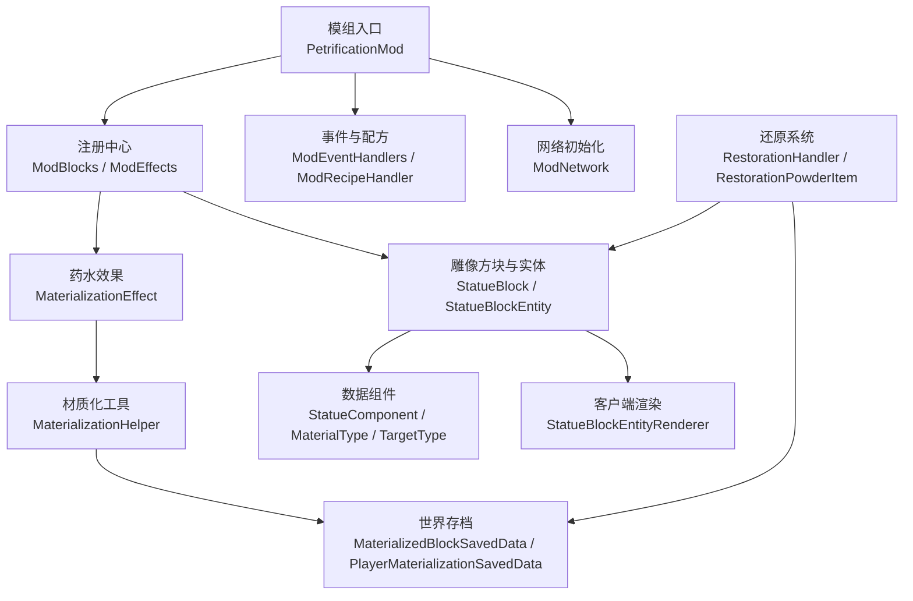
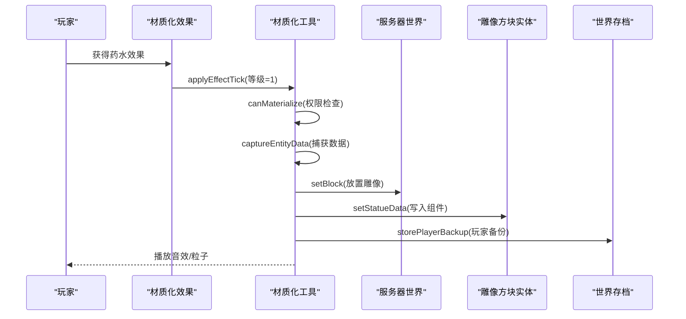
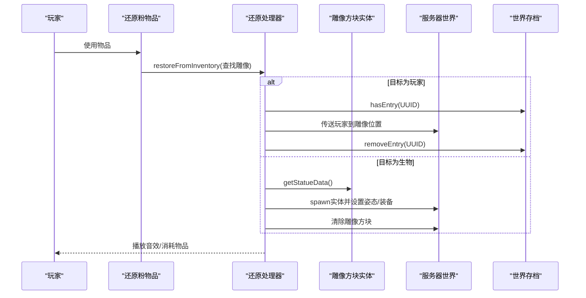
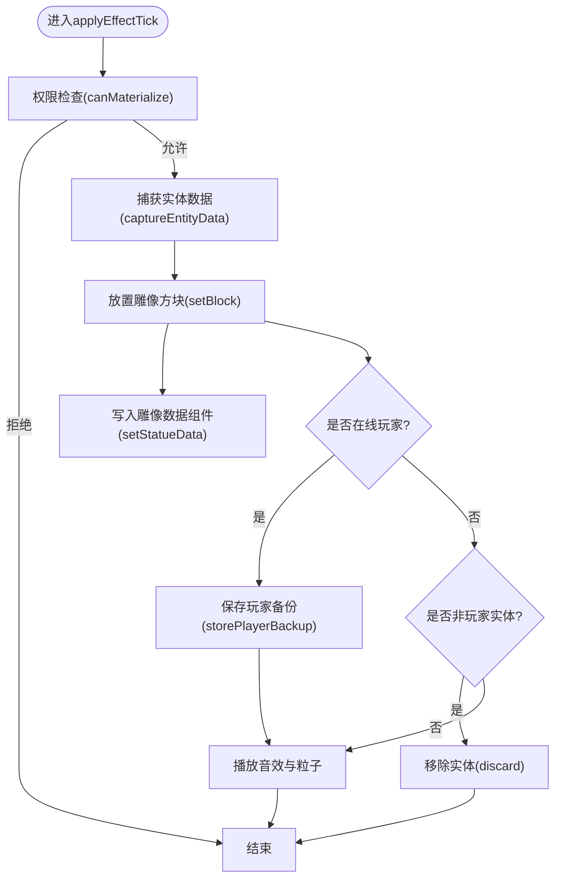
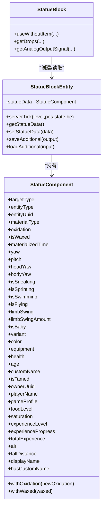
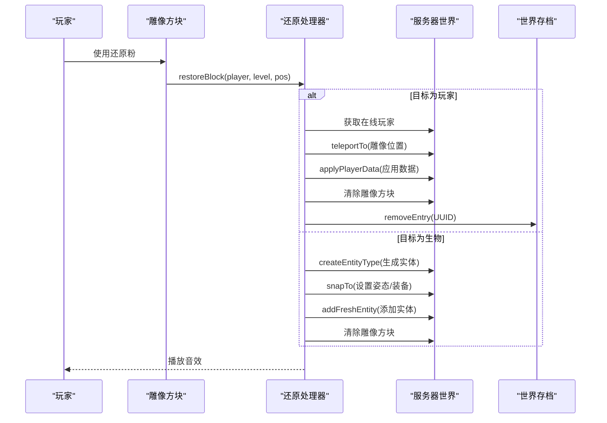
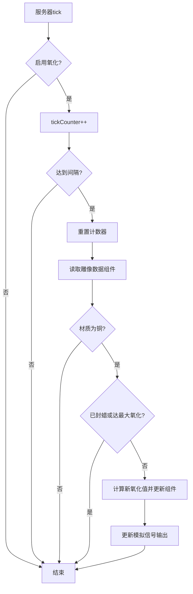
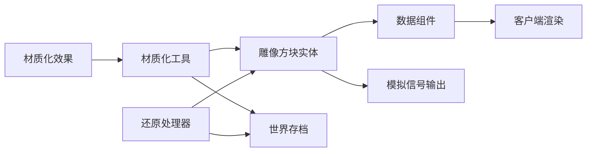
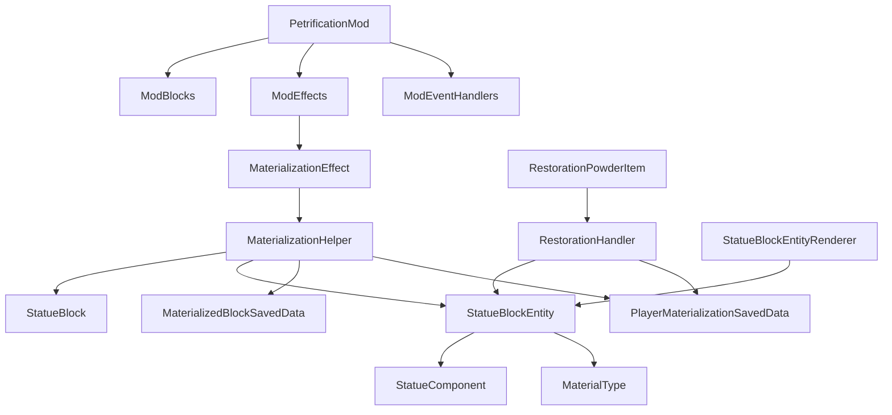

# 核心系统

<cite>
**本文引用的文件**
- [PetrificationMod.java](file://src/main/java/com/xiong/petrification/PetrificationMod.java)
- [MaterializationEffect.java](file://src/main/java/com/xiong/petrification/effect/MaterializationEffect.java)
- [StatueBlock.java](file://src/main/java/com/xiong/petrification/block/StatueBlock.java)
- [StatueBlockEntity.java](file://src/main/java/com/xiong/petrification/block/StatueBlockEntity.java)
- [StatueComponent.java](file://src/main/java/com/xiong/petrification/component/StatueComponent.java)
- [MaterialType.java](file://src/main/java/com/xiong/petrification/component/MaterialType.java)
- [TargetType.java](file://src/main/java/com/xiong/petrification/component/TargetType.java)
- [MaterializationHelper.java](file://src/main/java/com/xiong/petrification/util/MaterializationHelper.java)
- [RestorationHandler.java](file://src/main/java/com/xiong/petrification/handler/RestorationHandler.java)
- [RestorationPowderItem.java](file://src/main/java/com/xiong/petrification/item/RestorationPowderItem.java)
- [MaterializedBlockSavedData.java](file://src/main/java/com/xiong/petrification/data/MaterializedBlockSavedData.java)
- [PlayerMaterializationSavedData.java](file://src/main/java/com/xiong/petrification/data/PlayerMaterializationSavedData.java)
- [StatueBlockEntityRenderer.java](file://src/main/java/com/xiong/petrification/client/StatueBlockEntityRenderer.java)
- [ModBlocks.java](file://src/main/java/com/xiong/petrification/registry/ModBlocks.java)
- [ModEffects.java](file://src/main/java/com/xiong/petrification/registry/ModEffects.java)
</cite>

## 目录
1. [简介](#简介)
2. [项目结构](#项目结构)
3. [核心组件](#核心组件)
4. [架构总览](#架构总览)
5. [详细组件分析](#详细组件分析)
6. [依赖关系分析](#依赖关系分析)
7. [性能考量](#性能考量)
8. [故障排查指南](#故障排查指南)
9. [结论](#结论)
10. [附录](#附录)

## 简介
本模组围绕“石化”主题，提供一套完整的材质化与还原系统：通过药水效果触发实体材质化，将目标实体或玩家数据持久化为雕像方块；支持铜材质的氧化状态变化、蜂蜡封蜡保护；并提供还原粉将雕像恢复为原实体或玩家。文档从系统架构、数据流转、渲染与交互等维度深入解析，帮助开发者理解并扩展该系统。

## 项目结构
- 模块入口负责注册所有子系统（方块、物品、效果、配方、网络、事件等），并在客户端与服务端分别初始化。
- 材质化系统由效果驱动，调用工具类完成捕获、放置雕像、保存备份与粒子音效反馈。
- 雕像方块与方块实体承载数据组件，服务端定时更新铜的氧化值，客户端渲染实体模型。
- 还原系统通过物品使用与方块交互，按目标类型分别处理玩家与生物的回转流程。
- 世界存档用于持久化已材质化的区块与离线玩家的备份信息。

**图示来源**
- [PetrificationMod.java:30-53](file://src/main/java/com/xiong/petrification/PetrificationMod.java#L30-L53)
- [ModBlocks.java:16-33](file://src/main/java/com/xiong/petrification/registry/ModBlocks.java#L16-L33)
- [ModEffects.java:13-33](file://src/main/java/com/xiong/petrification/registry/ModEffects.java#L13-L33)
- [StatueBlock.java:38-101](file://src/main/java/com/xiong/petrification/block/StatueBlock.java#L38-L101)
- [StatueBlockEntity.java:17-50](file://src/main/java/com/xiong/petrification/block/StatueBlockEntity.java#L17-L50)
- [MaterializationEffect.java:10-36](file://src/main/java/com/xiong/petrification/effect/MaterializationEffect.java#L10-L36)
- [MaterializationHelper.java:55-81](file://src/main/java/com/xiong/petrification/util/MaterializationHelper.java#L55-L81)
- [StatueBlockEntityRenderer.java:31-123](file://src/main/java/com/xiong/petrification/client/StatueBlockEntityRenderer.java#L31-L123)
- [RestorationHandler.java:34-91](file://src/main/java/com/xiong/petrification/handler/RestorationHandler.java#L34-L91)
- [RestorationPowderItem.java:11-31](file://src/main/java/com/xiong/petrification/item/RestorationPowderItem.java#L11-L31)

**章节来源**
- [PetrificationMod.java:30-53](file://src/main/java/com/xiong/petrification/PetrificationMod.java#L30-L53)
- [ModBlocks.java:16-33](file://src/main/java/com/xiong/petrification/registry/ModBlocks.java#L16-L33)
- [ModEffects.java:13-33](file://src/main/java/com/xiong/petrification/registry/ModEffects.java#L13-L33)

## 核心组件
- 材质化效果：在应用时调用工具方法执行实体材质化，且为瞬时效果，仅在持续时间为1时触发。
- 材质化工具：权限校验、实体数据捕获、放置雕像、保存玩家备份、播放音效与粒子、区域批量材质化、区块材质化记录。
- 雕像方块与实体：管理朝向、水浸、不可见渲染、服务器计时器驱动的铜氧化增长、模拟信号输出（基于氧化度）。
- 数据组件：以记录形式存储目标类型、实体标识、材质类型、姿态、装备、玩家属性等，并通过Codec分组序列化。
- 材质类型：定义不同材质的颜色、对应物品与方块、显示前缀。
- 目标类型：区分生物与玩家两类目标。
- 世界存档：记录已材质化的区块信息与离线玩家备份位置及数据。
- 客户端渲染：根据数据组件创建实体渲染状态并按比例缩放与旋转展示。
- 还原系统：支持对雕像方块与背包中的雕像物品进行还原，按目标类型分别处理玩家与生物，支持蜂蜡封蜡。

**章节来源**
- [MaterializationEffect.java:10-36](file://src/main/java/com/xiong/petrification/effect/MaterializationEffect.java#L10-L36)
- [MaterializationHelper.java:36-81](file://src/main/java/com/xiong/petrification/util/MaterializationHelper.java#L36-L81)
- [StatueBlock.java:38-151](file://src/main/java/com/xiong/petrification/block/StatueBlock.java#L38-L151)
- [StatueBlockEntity.java:17-86](file://src/main/java/com/xiong/petrification/block/StatueBlockEntity.java#L17-L86)
- [StatueComponent.java:14-255](file://src/main/java/com/xiong/petrification/component/StatueComponent.java#L14-L255)
- [MaterialType.java:9-68](file://src/main/java/com/xiong/petrification/component/MaterialType.java#L9-L68)
- [TargetType.java:6-23](file://src/main/java/com/xiong/petrification/component/TargetType.java#L6-L23)
- [MaterializedBlockSavedData.java:19-86](file://src/main/java/com/xiong/petrification/data/MaterializedBlockSavedData.java#L19-L86)
- [PlayerMaterializationSavedData.java:22-95](file://src/main/java/com/xiong/petrification/data/PlayerMaterializationSavedData.java#L22-L95)
- [StatueBlockEntityRenderer.java:31-123](file://src/main/java/com/xiong/petrification/client/StatueBlockEntityRenderer.java#L31-L123)
- [RestorationHandler.java:34-227](file://src/main/java/com/xiong/petrification/handler/RestorationHandler.java#L34-L227)
- [RestorationPowderItem.java:11-31](file://src/main/java/com/xiong/petrification/item/RestorationPowderItem.java#L11-L31)

## 架构总览
整体流程分为“材质化”和“还原”两条主线，辅以“氧化系统”与“渲染系统”。

**图示来源**
- [MaterializationEffect.java:22-31](file://src/main/java/com/xiong/petrification/effect/MaterializationEffect.java#L22-L31)
- [MaterializationHelper.java:36-81](file://src/main/java/com/xiong/petrification/util/MaterializationHelper.java#L36-L81)
- [PlayerMaterializationSavedData.java:77-80](file://src/main/java/com/xiong/petrification/data/PlayerMaterializationSavedData.java#L77-L80)

**图示来源**
- [RestorationPowderItem.java:16-31](file://src/main/java/com/xiong/petrification/item/RestorationPowderItem.java#L16-L31)
- [RestorationHandler.java:55-138](file://src/main/java/com/xiong/petrification/handler/RestorationHandler.java#L55-L138)
- [PlayerMaterializationSavedData.java:77-93](file://src/main/java/com/xiong/petrification/data/PlayerMaterializationSavedData.java#L77-L93)

## 详细组件分析

### 材质化系统与药水效果机制
- 药水效果为瞬时效果，仅在持续时间为1时触发一次，避免重复执行。
- 权限控制：创意模式与OP权限可通过配置开关限制材质化能力。
- 捕获逻辑：识别目标类型（玩家/生物）、实体ID、UUID、姿态、装备、玩家专属属性（饥饿、经验、空气、掉落距离等），构建数据组件。
- 材质转换算法：将实体转换为雕像方块，若为在线玩家则断开连接并保存备份；非玩家实体直接移除；播放音效与粒子。
- 区域与区块材质化：支持半径范围批量材质化实体与区块，区块材质化信息写入世界存档以便后续还原。

**图示来源**
- [MaterializationEffect.java:22-31](file://src/main/java/com/xiong/petrification/effect/MaterializationEffect.java#L22-L31)
- [MaterializationHelper.java:36-81](file://src/main/java/com/xiong/petrification/util/MaterializationHelper.java#L36-L81)

**章节来源**
- [MaterializationEffect.java:10-36](file://src/main/java/com/xiong/petrification/effect/MaterializationEffect.java#L10-L36)
- [MaterializationHelper.java:36-81](file://src/main/java/com/xiong/petrification/util/MaterializationHelper.java#L36-L81)
- [MaterializationHelper.java:98-186](file://src/main/java/com/xiong/petrification/util/MaterializationHelper.java#L98-L186)
- [MaterializationHelper.java:234-255](file://src/main/java/com/xiong/petrification/util/MaterializationHelper.java#L234-L255)

### 雕像方块的实现：数据组件、状态管理与渲染
- 数据组件架构：使用记录类型集中存储雕像信息，通过Codec分组序列化，支持基础信息、姿态、可选属性、玩家数据等。
- 状态管理：方块状态包含朝向与水浸；方块实体维护数据组件与服务端计时器，周期性增加铜的氧化值（受配置限制）。
- 渲染系统：客户端根据数据组件创建实体渲染状态，按比例缩放并调整朝向，错误时静默忽略。

**图示来源**
- [StatueComponent.java:14-255](file://src/main/java/com/xiong/petrification/component/StatueComponent.java#L14-L255)
- [StatueBlockEntity.java:17-86](file://src/main/java/com/xiong/petrification/block/StatueBlockEntity.java#L17-L86)
- [StatueBlock.java:38-151](file://src/main/java/com/xiong/petrification/block/StatueBlock.java#L38-L151)

**章节来源**
- [StatueComponent.java:14-255](file://src/main/java/com/xiong/petrification/component/StatueComponent.java#L14-L255)
- [StatueBlockEntity.java:17-86](file://src/main/java/com/xiong/petrification/block/StatueBlockEntity.java#L17-L86)
- [StatueBlock.java:38-151](file://src/main/java/com/xiong/petrification/block/StatueBlock.java#L38-L151)
- [StatueBlockEntityRenderer.java:31-123](file://src/main/java/com/xiong/petrification/client/StatueBlockEntityRenderer.java#L31-L123)

### 还原系统的运作机制
- 方块还原：对雕像方块使用还原粉，按目标类型分别处理玩家与生物；玩家在线则传送并应用数据，离线则清理存档条目；生物则在原位生成并恢复姿态与装备。
- 物品还原：在背包中使用还原粉，找到含雕像数据的雕像物品，在玩家前方生成实体或传送玩家，播放音效并消耗物品。
- 数据结构清理：玩家离线还原后删除对应存档条目，避免残留数据。

**图示来源**
- [RestorationHandler.java:34-138](file://src/main/java/com/xiong/petrification/handler/RestorationHandler.java#L34-L138)
- [PlayerMaterializationSavedData.java:77-93](file://src/main/java/com/xiong/petrification/data/PlayerMaterializationSavedData.java#L77-L93)

**章节来源**
- [RestorationHandler.java:34-138](file://src/main/java/com/xiong/petrification/handler/RestorationHandler.java#L34-L138)
- [RestorationPowderItem.java:16-31](file://src/main/java/com/xiong/petrification/item/RestorationPowderItem.java#L16-L31)

### 氧化系统如何处理铜材质的氧化状态变化
- 服务端计时器：每固定刻数尝试增加铜雕像的氧化值，受最大氧化度与速率配置限制。
- 封蜡保护：若雕像已封蜡或达到最大氧化度，则不再增加。
- 模拟信号：方块输出强度与氧化度成正比，可用于红石联动。
- 蜂蜡操作：支持对雕像方块与物品进行封蜡，防止继续氧化。

**图示来源**
- [StatueBlockEntity.java:28-50](file://src/main/java/com/xiong/petrification/block/StatueBlockEntity.java#L28-L50)
- [StatueBlock.java:142-151](file://src/main/java/com/xiong/petrification/block/StatueBlock.java#L142-L151)
- [RestorationHandler.java:184-207](file://src/main/java/com/xiong/petrification/handler/RestorationHandler.java#L184-L207)

**章节来源**
- [StatueBlockEntity.java:28-50](file://src/main/java/com/xiong/petrification/block/StatueBlockEntity.java#L28-L50)
- [StatueBlock.java:142-151](file://src/main/java/com/xiong/petrification/block/StatueBlock.java#L142-L151)
- [RestorationHandler.java:184-207](file://src/main/java/com/xiong/petrification/handler/RestorationHandler.java#L184-L207)

### 各系统之间的交互关系与数据流转
- 效果→工具→方块→实体→存档：材质化过程贯穿多个子系统，数据通过组件与存档持久化。
- 还原→方块/物品→处理器→世界/存档：还原过程依据目标类型分流，确保玩家与生物的正确恢复。
- 氧化→方块实体→模拟信号：氧化状态影响红石输出，形成可观测的外部行为。
- 客户端渲染→数据组件：渲染层仅读取组件数据进行可视化，不修改服务端状态。

**图示来源**
- [MaterializationEffect.java:22-31](file://src/main/java/com/xiong/petrification/effect/MaterializationEffect.java#L22-L31)
- [MaterializationHelper.java:55-81](file://src/main/java/com/xiong/petrification/util/MaterializationHelper.java#L55-L81)
- [StatueBlockEntity.java:28-50](file://src/main/java/com/xiong/petrification/block/StatueBlockEntity.java#L28-L50)
- [StatueBlock.java:142-151](file://src/main/java/com/xiong/petrification/block/StatueBlock.java#L142-L151)
- [RestorationHandler.java:34-138](file://src/main/java/com/xiong/petrification/handler/RestorationHandler.java#L34-L138)
- [StatueBlockEntityRenderer.java:45-90](file://src/main/java/com/xiong/petrification/client/StatueBlockEntityRenderer.java#L45-L90)

**章节来源**
- [MaterializationHelper.java:55-81](file://src/main/java/com/xiong/petrification/util/MaterializationHelper.java#L55-L81)
- [StatueBlockEntity.java:28-50](file://src/main/java/com/xiong/petrification/block/StatueBlockEntity.java#L28-L50)
- [RestorationHandler.java:34-138](file://src/main/java/com/xiong/petrification/handler/RestorationHandler.java#L34-L138)
- [StatueBlockEntityRenderer.java:45-90](file://src/main/java/com/xiong/petrification/client/StatueBlockEntityRenderer.java#L45-L90)

## 依赖关系分析
- 模组入口依赖注册中心与事件处理器，统一装配各子系统。
- 效果依赖材质类型与工具类，工具类依赖方块、物品、存档与实体类型注册表。
- 雕像方块依赖方块实体与数据组件，实体依赖配置与材质类型。
- 还原处理器依赖方块实体、数据组件、物品与存档。
- 客户端渲染依赖方块实体与实体渲染调度器。

**图示来源**
- [PetrificationMod.java:30-53](file://src/main/java/com/xiong/petrification/PetrificationMod.java#L30-L53)
- [ModBlocks.java:16-33](file://src/main/java/com/xiong/petrification/registry/ModBlocks.java#L16-L33)
- [ModEffects.java:13-33](file://src/main/java/com/xiong/petrification/registry/ModEffects.java#L13-L33)
- [MaterializationEffect.java:10-36](file://src/main/java/com/xiong/petrification/effect/MaterializationEffect.java#L10-L36)
- [MaterializationHelper.java:55-81](file://src/main/java/com/xiong/petrification/util/MaterializationHelper.java#L55-L81)
- [StatueBlock.java:38-101](file://src/main/java/com/xiong/petrification/block/StatueBlock.java#L38-L101)
- [StatueBlockEntity.java:17-50](file://src/main/java/com/xiong/petrification/block/StatueBlockEntity.java#L17-L50)
- [StatueComponent.java:14-255](file://src/main/java/com/xiong/petrification/component/StatueComponent.java#L14-L255)
- [MaterialType.java:9-68](file://src/main/java/com/xiong/petrification/component/MaterialType.java#L9-L68)
- [MaterializedBlockSavedData.java:19-86](file://src/main/java/com/xiong/petrification/data/MaterializedBlockSavedData.java#L19-L86)
- [PlayerMaterializationSavedData.java:22-95](file://src/main/java/com/xiong/petrification/data/PlayerMaterializationSavedData.java#L22-L95)
- [RestorationHandler.java:34-138](file://src/main/java/com/xiong/petrification/handler/RestorationHandler.java#L34-L138)
- [RestorationPowderItem.java:16-31](file://src/main/java/com/xiong/petrification/item/RestorationPowderItem.java#L16-L31)
- [StatueBlockEntityRenderer.java:45-90](file://src/main/java/com/xiong/petrification/client/StatueBlockEntityRenderer.java#L45-L90)

**章节来源**
- [PetrificationMod.java:30-53](file://src/main/java/com/xiong/petrification/PetrificationMod.java#L30-L53)
- [MaterializationHelper.java:55-81](file://src/main/java/com/xiong/petrification/util/MaterializationHelper.java#L55-L81)
- [RestorationHandler.java:34-138](file://src/main/java/com/xiong/petrification/handler/RestorationHandler.java#L34-L138)

## 性能考量
- 材质化批量操作：区域材质化需遍历实体与区块，注意半径与实体数量对性能的影响。
- 服务端计时器：氧化更新频率与最大氧化度应合理配置，避免频繁写盘与状态变更。
- 渲染缓存：客户端实体渲染状态缓存减少重复创建开销。
- 世界存档：区块材质化数据随时间增长，建议定期清理或限制范围。

[本节为通用指导，不直接分析具体文件]

## 故障排查指南
- 权限问题：创意模式或OP权限被配置禁止材质化时，无法触发。
- 在线玩家还原失败：若玩家在线但UUID未匹配，不会执行离线还原流程。
- 生物还原失败：实体类型不存在或无法创建时，跳过还原。
- 氧化异常：若已封蜡或达到最大氧化度，氧化不再增加；检查配置项。
- 渲染异常：客户端渲染错误会被静默忽略，检查数据组件字段是否完整。

**章节来源**
- [MaterializationHelper.java:36-53](file://src/main/java/com/xiong/petrification/util/MaterializationHelper.java#L36-L53)
- [RestorationHandler.java:103-138](file://src/main/java/com/xiong/petrification/handler/RestorationHandler.java#L103-L138)
- [StatueBlockEntity.java:28-50](file://src/main/java/com/xiong/petrification/block/StatueBlockEntity.java#L28-L50)
- [StatueBlockEntityRenderer.java:83-90](file://src/main/java/com/xiong/petrification/client/StatueBlockEntityRenderer.java#L83-L90)

## 结论
该模组通过效果驱动的材质化与还原系统，结合数据组件与世界存档，实现了实体与玩家的“石化—复原”闭环。铜材质氧化与封蜡机制增加了玩法深度，客户端渲染保证了良好的视觉体验。开发者可基于现有架构扩展新的材质类型、优化批量操作、完善权限与配置项，以满足更多场景需求。

[本节为总结性内容，不直接分析具体文件]

## 附录
- 使用模式示例（路径引用）：
  - 材质化流程：[MaterializationEffect.applyEffectTick:22-31](file://src/main/java/com/xiong/petrification/effect/MaterializationEffect.java#L22-L31)、[MaterializationHelper.materializeEntity:55-81](file://src/main/java/com/xiong/petrification/util/MaterializationHelper.java#L55-L81)
  - 雕像数据捕获：[MaterializationHelper.captureEntityData:98-186](file://src/main/java/com/xiong/petrification/util/MaterializationHelper.java#L98-L186)
  - 还原流程：[RestorationHandler.restoreBlock:34-53](file://src/main/java/com/xiong/petrification/handler/RestorationHandler.java#L34-L53)、[RestorationHandler.restoreBiologicalAt:140-162](file://src/main/java/com/xiong/petrification/handler/RestorationHandler.java#L140-L162)
  - 氧化更新：[StatueBlockEntity.serverTick:28-50](file://src/main/java/com/xiong/petrification/block/StatueBlockEntity.java#L28-L50)
  - 客户端渲染：[StatueBlockEntityRenderer.extractRenderState:45-90](file://src/main/java/com/xiong/petrification/client/StatueBlockEntityRenderer.java#L45-L90)

[本节为参考索引，不直接分析具体文件]