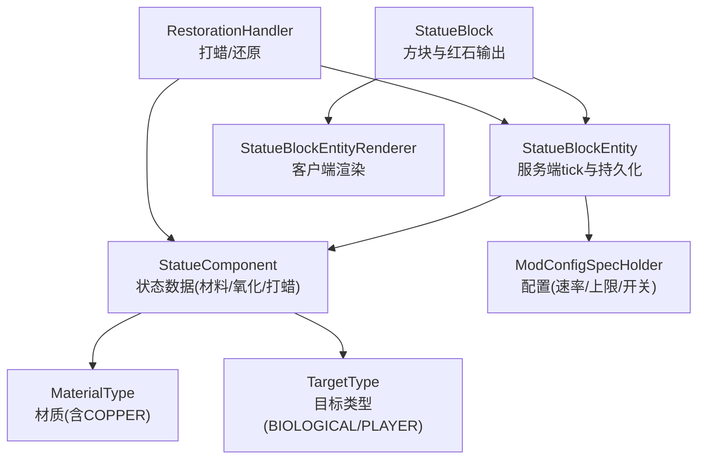
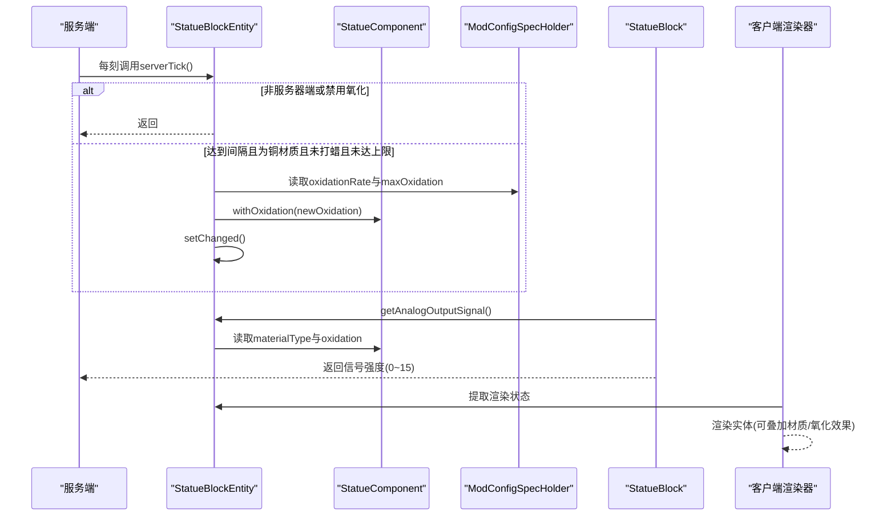
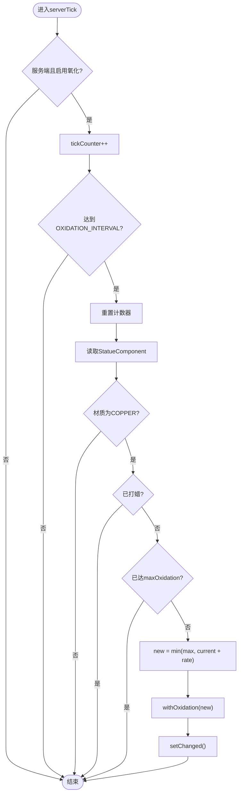
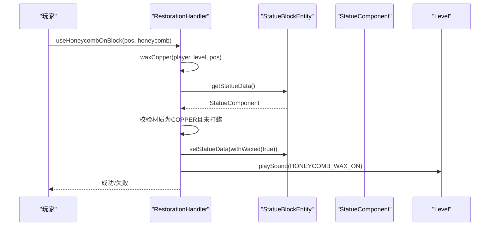
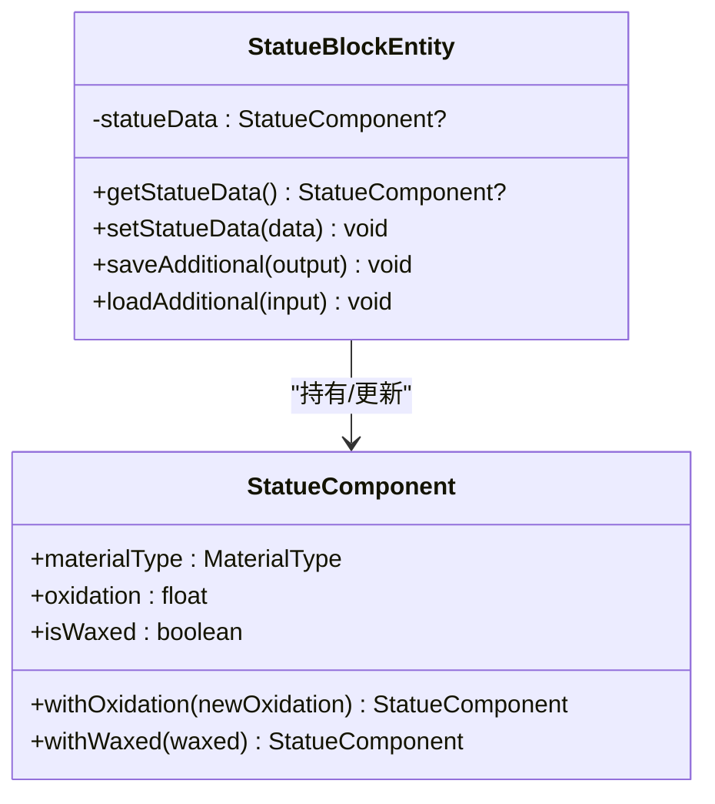
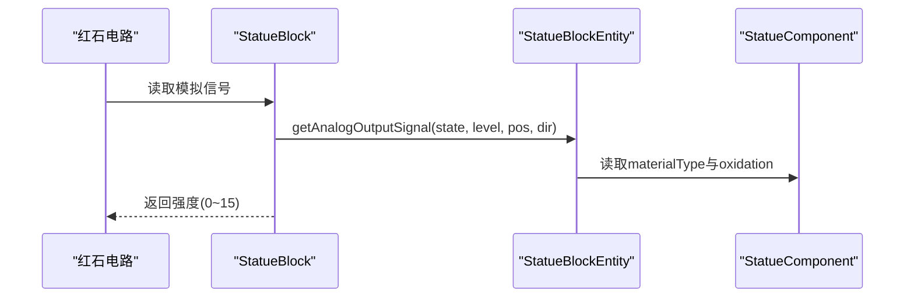
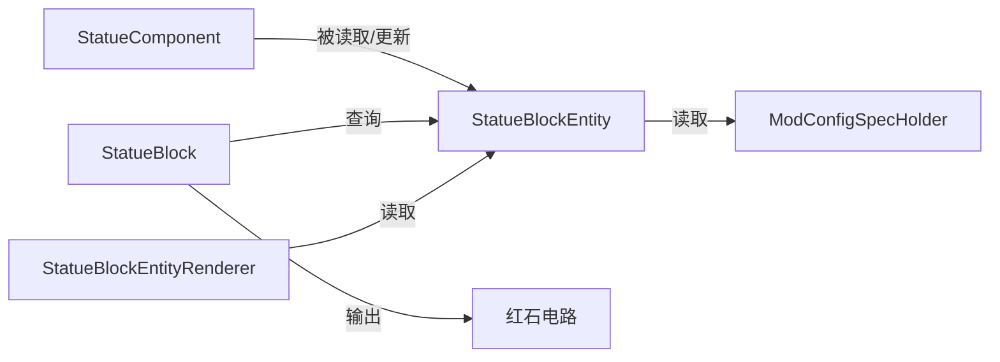

# 氧化系统

<cite>
**本文引用的文件**
- [StatueComponent.java](file://src/main/java/com/xiong/petrification/component/StatueComponent.java)
- [MaterialType.java](file://src/main/java/com/xiong/petrification/component/MaterialType.java)
- [TargetType.java](file://src/main/java/com/xiong/petrification/component/TargetType.java)
- [StatueBlockEntity.java](file://src/main/java/com/xiong/petrification/block/StatueBlockEntity.java)
- [StatueBlock.java](file://src/main/java/com/xiong/petrification/block/StatueBlock.java)
- [RestorationHandler.java](file://src/main/java/com/xiong/petrification/handler/RestorationHandler.java)
- [ModConfigSpecHolder.java](file://src/main/java/com/xiong/petrification/ModConfigSpecHolder.java)
- [StatueBlockEntityRenderer.java](file://src/main/java/com/xiong/petrification/client/StatueBlockEntityRenderer.java)
</cite>

## 目录
1. [简介](#简介)
2. [项目结构](#项目结构)
3. [核心组件](#核心组件)
4. [架构总览](#架构总览)
5. [详细组件分析](#详细组件分析)
6. [依赖关系分析](#依赖关系分析)
7. [性能考虑](#性能考虑)
8. [故障排查指南](#故障排查指南)
9. [结论](#结论)
10. [附录：配置与扩展](#附录：配置与扩展)

## 简介
本文件为Minecraft石化模组的“氧化系统”提供完整技术文档，聚焦于铜材质雕像的自然氧化过程、信号输出、打蜡防氧化、状态存储与管理、与其他系统的交互（红石信号与外观变化）、进度计算与随机性控制、配置项与扩展方式，以及性能优化建议。目标是帮助开发者与玩家理解并自定义该机制。

## 项目结构
氧化系统涉及的数据与逻辑分布在以下模块：
- 数据模型：StatueComponent 记录雕像的完整状态，包含材料类型、氧化度、是否打蜡等字段。
- 方块与实体：StatueBlock 定义方块行为与红石输出；StatueBlockEntity 负责服务端每刻更新与持久化。
- 材料与目标：MaterialType 枚举定义不同材质（含铜）；TargetType 区分生物与玩家雕像。
- 交互与恢复：RestorationHandler 提供打蜡、还原等操作。
- 配置：ModConfigSpecHolder 暴露可配置的氧化速率、上限、开关等。
- 客户端渲染：StatueBlockEntityRenderer 负责在客户端渲染雕像实体。

图表来源
- [StatueBlock.java:137-151](file://src/main/java/com/xiong/petrification/block/StatueBlock.java#L137-L151)
- [StatueBlockEntity.java:28-50](file://src/main/java/com/xiong/petrification/block/StatueBlockEntity.java#L28-L50)
- [StatueComponent.java:14-52](file://src/main/java/com/xiong/petrification/component/StatueComponent.java#L14-L52)
- [MaterialType.java:9-15](file://src/main/java/com/xiong/petrification/component/MaterialType.java#L9-L15)
- [TargetType.java:6-8](file://src/main/java/com/xiong/petrification/component/TargetType.java#L6-L8)
- [ModConfigSpecHolder.java:28-38](file://src/main/java/com/xiong/petrification/ModConfigSpecHolder.java#L28-L38)
- [StatueBlockEntityRenderer.java:45-123](file://src/main/java/com/xiong/petrification/client/StatueBlockEntityRenderer.java#L45-L123)
- [RestorationHandler.java:184-207](file://src/main/java/com/xiong/petrification/handler/RestorationHandler.java#L184-L207)

章节来源
- [StatueBlock.java:38-151](file://src/main/java/com/xiong/petrification/block/StatueBlock.java#L38-L151)
- [StatueBlockEntity.java:17-88](file://src/main/java/com/xiong/petrification/block/StatueBlockEntity.java#L17-L88)
- [StatueComponent.java:14-256](file://src/main/java/com/xiong/petrification/component/StatueComponent.java#L14-L256)
- [MaterialType.java:9-68](file://src/main/java/com/xiong/petrification/component/MaterialType.java#L9-L68)
- [TargetType.java:6-23](file://src/main/java/com/xiong/petrification/component/TargetType.java#L6-L23)
- [RestorationHandler.java:31-229](file://src/main/java/com/xiong/petrification/handler/RestorationHandler.java#L31-L229)
- [ModConfigSpecHolder.java:9-69](file://src/main/java/com/xiong/petrification/ModConfigSpecHolder.java#L9-L69)
- [StatueBlockEntityRenderer.java:31-130](file://src/main/java/com/xiong/petrification/client/StatueBlockEntityRenderer.java#L31-L130)

## 核心组件
- StatueComponent：不可变记录对象，保存雕像的核心状态，包括材料类型、氧化度、是否打蜡、实体信息、姿态、装备、属性等。提供 withOxidation 与 withWaxed 方法用于生成新状态的副本。
- MaterialType：材质枚举，包含 STONE、IRON、COPPER、GOLD、DIAMOND、NETHERITE，其中 COPPER 支持氧化。
- TargetType：目标类型枚举，区分 BIOLOGICAL（生物）与 PLAYER（玩家）。
- StatueBlock：方块类，提供红石模拟输出接口，仅当材质为铜时根据氧化度输出信号强度。
- StatueBlockEntity：服务端方块实体，周期性检查并推进铜雕像的氧化进度，受配置控制。
- RestorationHandler：提供打蜡（wax）与还原（restore）操作，支持对方块与物品进行打蜡。
- ModConfigSpecHolder：集中管理配置项，如氧化速率、最大氧化值、是否启用氧化、渲染距离等。
- StatueBlockEntityRenderer：客户端渲染器，将雕像以实体形式渲染在方块位置。

章节来源
- [StatueComponent.java:14-52](file://src/main/java/com/xiong/petrification/component/StatueComponent.java#L14-L52)
- [MaterialType.java:9-15](file://src/main/java/com/xiong/petrification/component/MaterialType.java#L9-L15)
- [TargetType.java:6-8](file://src/main/java/com/xiong/petrification/component/TargetType.java#L6-L8)
- [StatueBlock.java:137-151](file://src/main/java/com/xiong/petrification/block/StatueBlock.java#L137-L151)
- [StatueBlockEntity.java:28-50](file://src/main/java/com/xiong/petrification/block/StatueBlockEntity.java#L28-L50)
- [RestorationHandler.java:184-207](file://src/main/java/com/xiong/petrification/handler/RestorationHandler.java#L184-L207)
- [ModConfigSpecHolder.java:28-38](file://src/main/java/com/xiong/petrification/ModConfigSpecHolder.java#L28-L38)
- [StatueBlockEntityRenderer.java:45-123](file://src/main/java/com/xiong/petrification/client/StatueBlockEntityRenderer.java#L45-L123)

## 架构总览
氧化系统由“服务端tick驱动 + 数据模型 + 配置 + 客户端渲染”构成闭环：
- 服务端每刻统计计数器，达到固定间隔后尝试增加铜雕像的氧化度。
- 氧化度通过 StatuteComponent 持久化到世界存档。
- 方块对外暴露模拟信号输出，信号强度与氧化度成正比。
- 客户端根据 StatueComponent 渲染雕像实体，并可结合材质与氧化度实现外观变化（当前渲染器未直接应用颜色混合，但可扩展）。

图表来源
- [StatueBlockEntity.java:28-50](file://src/main/java/com/xiong/petrification/block/StatueBlockEntity.java#L28-L50)
- [StatueBlock.java:137-151](file://src/main/java/com/xiong/petrification/block/StatueBlock.java#L137-L151)
- [ModConfigSpecHolder.java:28-38](file://src/main/java/com/xiong/petrification/ModConfigSpecHolder.java#L28-L38)
- [StatueBlockEntityRenderer.java:45-123](file://src/main/java/com/xiong/petrification/client/StatueBlockEntityRenderer.java#L45-L123)

## 详细组件分析

### 铜材质雕像的氧化机制
- 触发条件：
  - 服务端环境且启用氧化配置。
  - 雕像材质为铜（MaterialType.COPPER）。
  - 未打蜡（isWaxed为false）。
  - 当前氧化度未达到最大氧化值（maxOxidation）。
- 进度计算：
  - 每 OXIDATION_INTERVAL（固定周期）累加一次 oxidationRate。
  - 使用 Math.min 限制不超过 maxOxidation。
- 随机性控制：
  - 当前实现为确定性增量，无随机抖动。可通过扩展引入随机因子（例如基于区块坐标或时间种子）来增加自然感。
- 状态更新与持久化：
  - 通过 StatueComponent.withOxidation 生成新状态并写入方块实体，调用 setChanged() 标记变更以便保存。

图表来源
- [StatueBlockEntity.java:28-50](file://src/main/java/com/xiong/petrification/block/StatueBlockEntity.java#L28-L50)
- [ModConfigSpecHolder.java:28-38](file://src/main/java/com/xiong/petrification/ModConfigSpecHolder.java#L28-L38)

章节来源
- [StatueBlockEntity.java:28-50](file://src/main/java/com/xiong/petrification/block/StatueBlockEntity.java#L28-L50)
- [StatueComponent.java:236-244](file://src/main/java/com/xiong/petrification/component/StatueComponent.java#L236-L244)
- [ModConfigSpecHolder.java:28-38](file://src/main/java/com/xiong/petrification/ModConfigSpecHolder.java#L28-L38)

### 打蜡防氧化功能
- 作用：阻止铜雕像继续氧化，保持当前外观与信号输出。
- 实现：
  - 对方块：RestorationHandler.waxCopper 检查材质与打蜡状态，设置 isWaxed=true，播放音效。
  - 对物品：RestorationHandler.waxCopperItem 修改物品中的 StatueComponent，同样设置 isWaxed=true。
- 状态管理：
  - 打蜡状态保存在 StatueComponent.isWaxed 字段中，随方块或物品一起持久化。
- 交互：
  - 可使用蜂巢（honeycomb）对铜雕像进行打蜡，消耗蜂巢（非创造模式）。

图表来源
- [RestorationHandler.java:184-207](file://src/main/java/com/xiong/petrification/handler/RestorationHandler.java#L184-L207)
- [StatueBlockEntity.java:57-60](file://src/main/java/com/xiong/petrification/block/StatueBlockEntity.java#L57-L60)
- [StatueComponent.java:246-254](file://src/main/java/com/xiong/petrification/component/StatueComponent.java#L246-L254)

章节来源
- [RestorationHandler.java:184-207](file://src/main/java/com/xiong/petrification/handler/RestorationHandler.java#L184-L207)
- [StatueComponent.java:246-254](file://src/main/java/com/xiong/petrification/component/StatueComponent.java#L246-L254)

### 氧化状态的存储与管理
- 存储位置：
  - 方块实体：StatueBlockEntity.statueData 字段保存 StatueComponent。
  - 物品：通过 ModDataComponents.STATUE_DATA 将 StatueComponent 绑定到物品。
- 序列化：
  - 使用 StatueComponent.CODEC 进行NBT读写，确保跨版本兼容与字段分组编码。
- 生命周期：
  - 加载：loadAdditional 读取 StatueComponent。
  - 保存：saveAdditional 写入 StatueComponent。
  - 更新：setStatueData 调用 setChanged() 标记需要保存。

图表来源
- [StatueBlockEntity.java:21-74](file://src/main/java/com/xiong/petrification/block/StatueBlockEntity.java#L21-L74)
- [StatueComponent.java:14-52](file://src/main/java/com/xiong/petrification/component/StatueComponent.java#L14-L52)
- [StatueComponent.java:236-254](file://src/main/java/com/xiong/petrification/component/StatueComponent.java#L236-L254)

章节来源
- [StatueBlockEntity.java:21-74](file://src/main/java/com/xiong/petrification/block/StatueBlockEntity.java#L21-L74)
- [StatueComponent.java:14-52](file://src/main/java/com/xiong/petrification/component/StatueComponent.java#L14-L52)

### 氧化系统与红石信号输出的交互
- 接口：StatueBlock.hasAnalogOutputSignal 返回 true，表示支持模拟信号输出。
- 信号强度：getAnalogOutputSignal 仅在材质为铜时返回 (int)(oxidation * 15)，范围0~15。
- 用途：可用于红石电路控制其他设备，直观反映氧化进度。

图表来源
- [StatueBlock.java:137-151](file://src/main/java/com/xiong/petrification/block/StatueBlock.java#L137-L151)

章节来源
- [StatueBlock.java:137-151](file://src/main/java/com/xiong/petrification/block/StatueBlock.java#L137-L151)

### 外观变化与客户端渲染
- 当前渲染器将雕像以实体形式渲染在方块位置，缩放至0.5倍，方向与姿态来自 StatueComponent。
- 材质与氧化度的视觉表现：
  - 当前实现未直接在渲染阶段应用颜色混合或材质贴图切换。
  - 可在渲染阶段依据 materialType 与 oxidation 调整着色或叠加纹理以实现更丰富的视觉效果。
- 渲染距离：
  - 通过 ModConfigSpecHolder.statueRenderDistance 控制，避免远距离渲染造成性能压力。

章节来源
- [StatueBlockEntityRenderer.java:45-123](file://src/main/java/com/xiong/petrification/client/StatueBlockEntityRenderer.java#L45-L123)
- [ModConfigSpecHolder.java:40-43](file://src/main/java/com/xiong/petrification/ModConfigSpecHolder.java#L40-L43)

### 氧化进度计算与随机性控制
- 进度计算：
  - 固定周期 OXIDATION_INTERVAL 累加 oxidationRate，上限为 maxOxidation。
- 随机性：
  - 当前为确定性增长。若需随机性，可在服务端tick中引入基于区块坐标或时间的随机因子，使不同雕像氧化速度略有差异，增强自然感。
- 性能影响：
  - 由于每刻仅做简单算术与比较，开销极低。

章节来源
- [StatueBlockEntity.java:28-50](file://src/main/java/com/xiong/petrification/block/StatueBlockEntity.java#L28-L50)
- [ModConfigSpecHolder.java:28-38](file://src/main/java/com/xiong/petrification/ModConfigSpecHolder.java#L28-L38)

## 依赖关系分析
- 低耦合设计：
  - StatueComponent 作为纯数据载体，不依赖具体方块或实体，便于跨方块/物品共享。
  - StatueBlockEntity 仅依赖 StatueComponent 与配置，职责单一。
- 外部依赖：
  - ForgeConfigSpec 提供配置框架。
  - Minecraft 网络协议与NBT用于状态同步与持久化。
- 潜在循环依赖：
  - 未发现循环引用；StatueBlock 与 StatueBlockEntity 通过标准方块-实体关系协作。

图表来源
- [StatueBlockEntity.java:28-50](file://src/main/java/com/xiong/petrification/block/StatueBlockEntity.java#L28-L50)
- [StatueBlock.java:137-151](file://src/main/java/com/xiong/petrification/block/StatueBlock.java#L137-L151)
- [StatueBlockEntityRenderer.java:45-123](file://src/main/java/com/xiong/petrification/client/StatueBlockEntityRenderer.java#L45-L123)
- [ModConfigSpecHolder.java:28-38](file://src/main/java/com/xiong/petrification/ModConfigSpecHolder.java#L28-L38)

章节来源
- [StatueBlockEntity.java:28-50](file://src/main/java/com/xiong/petrification/block/StatueBlockEntity.java#L28-L50)
- [StatueBlock.java:137-151](file://src/main/java/com/xiong/petrification/block/StatueBlock.java#L137-L151)
- [StatueBlockEntityRenderer.java:45-123](file://src/main/java/com/xiong/petrification/client/StatueBlockEntityRenderer.java#L45-L123)
- [ModConfigSpecHolder.java:28-38](file://src/main/java/com/xiong/petrification/ModConfigSpecHolder.java#L28-L38)

## 性能考虑
- 服务端tick频率：
  - 使用固定间隔 OXIDATION_INTERVAL 降低计算频率，避免每刻都进行氧化计算。
- 渲染距离：
  - 通过 statueRenderDistance 控制客户端渲染范围，减少远距离实体渲染开销。
- 数据序列化：
  - StatueComponent 使用 Codec 分组编码，提升NBT读写效率与兼容性。
- 建议优化：
  - 可为氧化计算引入惰性更新（仅在访问或相邻块变化时重新计算）。
  - 对大量雕像场景，考虑批量处理或分片更新。
  - 在客户端渲染中按需应用材质/氧化着色，避免不必要的绘制调用。

[本节为通用性能指导，无需特定文件来源]

## 故障排查指南
- 氧化不生效：
  - 检查配置 enableOxidation 是否为真。
  - 确认材质为铜且未打蜡，且未达到 maxOxidation。
  - 确认服务端环境（客户端不会执行氧化逻辑）。
- 红石信号异常：
  - 确认方块材质为铜；否则信号始终为0。
  - 检查 StatueComponent 的 oxidation 值是否正确更新。
- 打蜡无效：
  - 确认材质为铜且当前未打蜡；重复打蜡不会改变状态。
  - 检查是否使用了正确的物品（蜂巢）并在服务端执行。
- 渲染问题：
  - 检查 statueRenderDistance 是否过小导致雕像不在视距内。
  - 确认 StatueComponent 的实体类型有效，否则客户端会跳过渲染。

章节来源
- [StatueBlockEntity.java:28-50](file://src/main/java/com/xiong/petrification/block/StatueBlockEntity.java#L28-L50)
- [StatueBlock.java:137-151](file://src/main/java/com/xiong/petrification/block/StatueBlock.java#L137-L151)
- [RestorationHandler.java:184-207](file://src/main/java/com/xiong/petrification/handler/RestorationHandler.java#L184-L207)
- [StatueBlockEntityRenderer.java:45-123](file://src/main/java/com/xiong/petrification/client/StatueBlockEntityRenderer.java#L45-L123)
- [ModConfigSpecHolder.java:28-38](file://src/main/java/com/xiong/petrification/ModConfigSpecHolder.java#L28-L38)

## 结论
氧化系统以 StatueComponent 为核心，通过服务端周期性tick推进铜雕像的氧化进度，并结合配置实现可控的自然氧化过程。打蜡机制提供防氧化手段，红石信号输出将氧化状态可视化并可参与红石逻辑。当前实现简洁高效，具备良好扩展性，可在渲染层进一步丰富外观表现，或在服务端引入随机性以提升自然感。

[本节为总结性内容，无需特定文件来源]

## 附录：配置与扩展
- 配置项（位于 ModConfigSpecHolder）：
  - oxidation.oxidationRate：每200刻的氧化增量，默认0.001，范围0~1。
  - oxidation.maxOxidation：最大氧化值，默认1.0，范围0~1。
  - oxidation.enableOxidation：是否启用氧化，默认true。
  - performance.statueRenderDistance：雕像渲染距离，默认64，范围16~256。
  - general.statueBlockHardness：雕像方块硬度，默认2.0，范围0.1~100。
  - general.potionRangeMultiplier：药水效果范围倍数，默认1.0，范围0.1~10。
  - general.allowCreativeMaterialization / allowOpMaterialization：允许创造/OP玩家物质化的开关。
- 扩展建议：
  - 随机性：在服务端tick中引入基于区块坐标或时间的随机因子，使氧化速度略有波动。
  - 外观：在客户端渲染阶段依据 materialType 与 oxidation 调整颜色或贴图，实现更真实的氧化视觉效果。
  - 多材质支持：扩展 MaterialType 并在新材质上复用氧化逻辑（如需）。
  - 批量优化：对大规模雕像场景采用批处理或懒更新策略，减少每刻计算量。

章节来源
- [ModConfigSpecHolder.java:28-43](file://src/main/java/com/xiong/petrification/ModConfigSpecHolder.java#L28-L43)
- [StatueBlockEntity.java:28-50](file://src/main/java/com/xiong/petrification/block/StatueBlockEntity.java#L28-L50)
- [StatueBlockEntityRenderer.java:45-123](file://src/main/java/com/xiong/petrification/client/StatueBlockEntityRenderer.java#L45-L123)