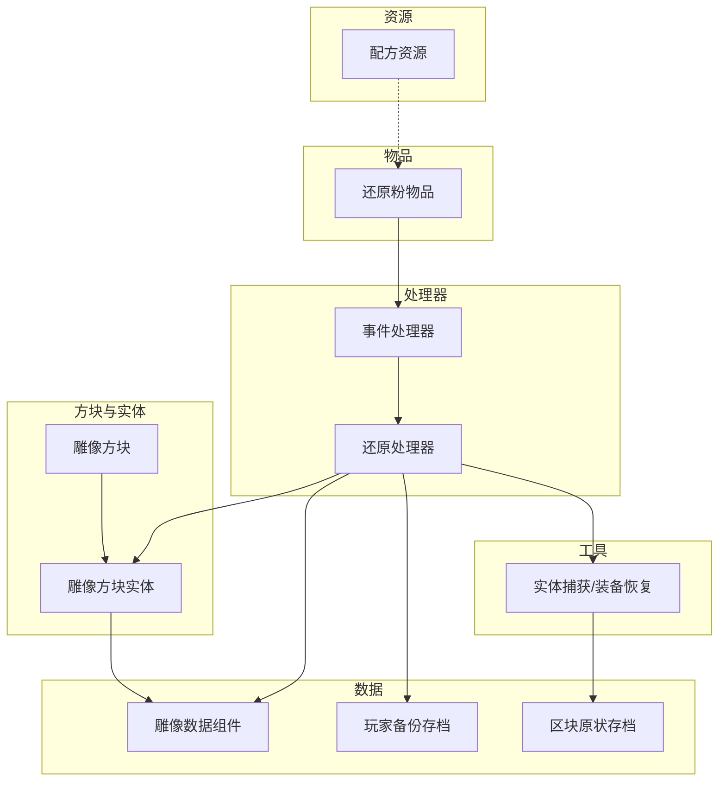
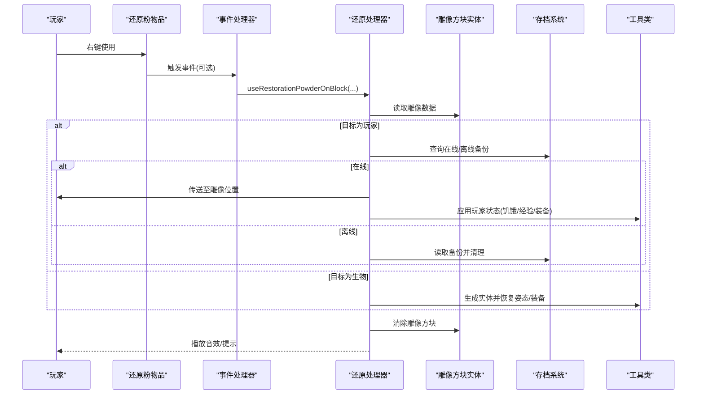
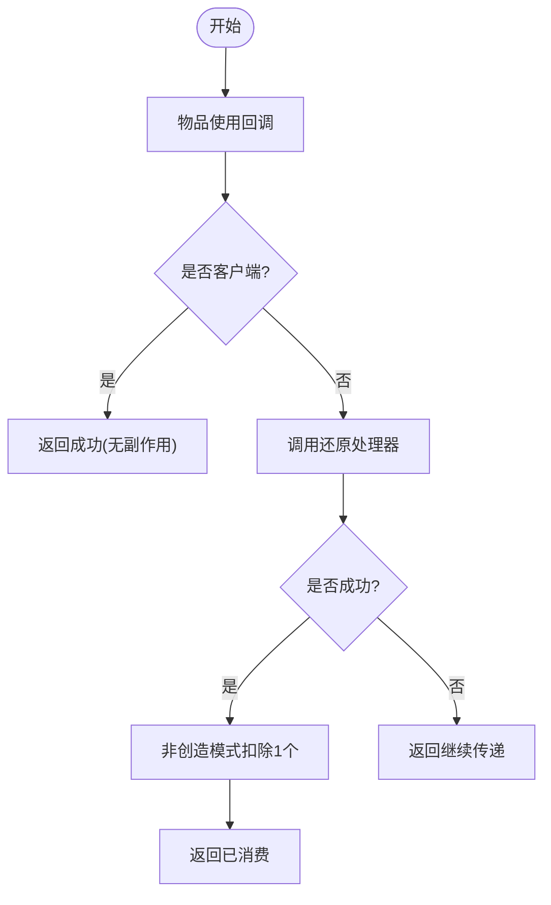
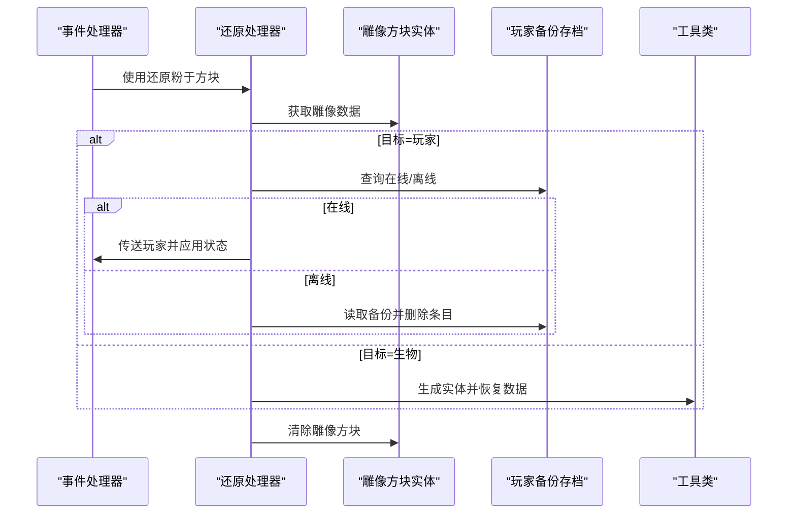
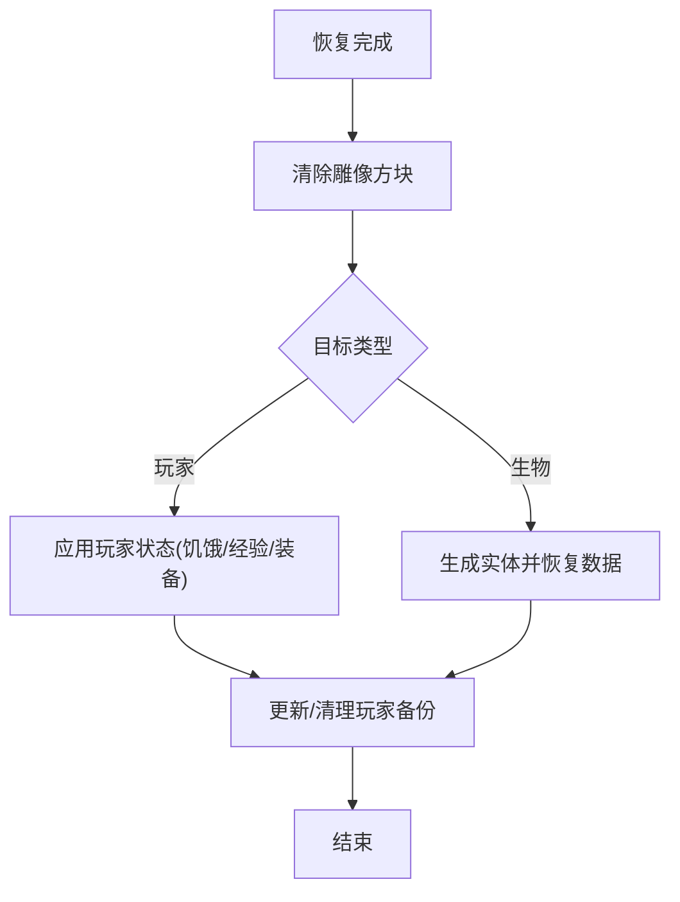
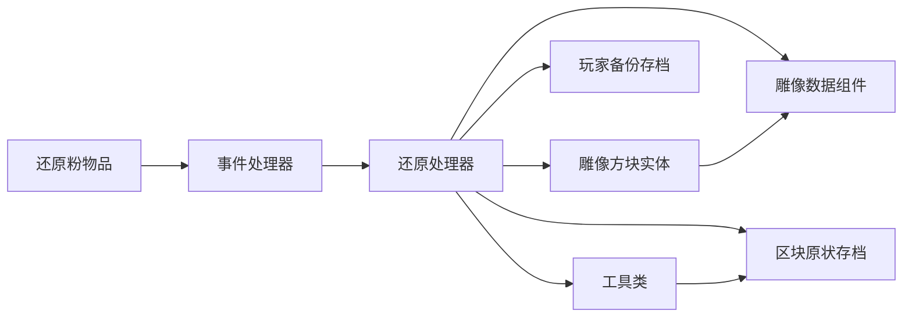

# 还原系统

<cite>
**本文引用的文件**
- [RestorationPowderItem.java](file://src/main/java/com/xiong/petrification/item/RestorationPowderItem.java)
- [RestorationHandler.java](file://src/main/java/com/xiong/petrification/handler/RestorationHandler.java)
- [StatueComponent.java](file://src/main/java/com/xiong/petrification/component/StatueComponent.java)
- [StatueBlock.java](file://src/main/java/com/xiong/petrification/block/StatueBlock.java)
- [StatueBlockEntity.java](file://src/main/java/com/xiong/petrification/block/StatueBlockEntity.java)
- [MaterializationHelper.java](file://src/main/java/com/xiong/petrification/util/MaterializationHelper.java)
- [MaterializedBlockSavedData.java](file://src/main/java/com/xiong/petrification/data/MaterializedBlockSavedData.java)
- [PlayerMaterializationSavedData.java](file://src/main/java/com/xiong/petrification/data/PlayerMaterializationSavedData.java)
- [ModEventHandlers.java](file://src/main/java/com/xiong/petrification/handler/ModEventHandlers.java)
- [restoration_powder.json](file://src/main/resources/data/petrification/recipe/restoration_powder.json)
- [statue_compose.json](file://src/main/resources/data/petrification/recipe/statue_compose.json)
- [statue_decompose.json](file://src/main/resources/data/petrification/recipe/statue_decompose.json)
- [MaterialType.java](file://src/main/java/com/xiong/petrification/component/MaterialType.java)
- [TargetType.java](file://src/main/java/com/xiong/petrification/component/TargetType.java)
</cite>

## 目录
1. [简介](#简介)
2. [项目结构](#项目结构)
3. [核心组件](#核心组件)
4. [架构总览](#架构总览)
5. [详细组件分析](#详细组件分析)
6. [依赖关系分析](#依赖关系分析)
7. [性能考量](#性能考量)
8. [故障排查指南](#故障排查指南)
9. [结论](#结论)
10. [附录](#附录)

## 简介
本文件为“石化模组”的还原系统提供完整技术文档，聚焦于“还原粉”物品与雕像（Statue）的交互、事件处理、数据清理与存档一致性。内容涵盖：
- 还原粉的使用逻辑、耐久度消耗与交互流程
- RestorationHandler 的事件驱动机制：右键检测、雕像识别、状态恢复
- 数据清理：StatueComponent 移除、原始数据恢复、保存数据更新
- 掉落物与经验值分配策略
- 与存档系统的集成与一致性保障
- 配方制作与自定义还原逻辑扩展方法
- 错误处理策略与调试技巧

## 项目结构
还原系统涉及物品、方块实体、处理器、数据持久化与配置等模块，整体按职责分层组织：
- 物品层：还原粉使用入口
- 处理器层：事件监听与业务编排
- 数据层：雕像数据组件、玩家备份、区块原状记录
- 方块层：雕像块与实体、氧化计时
- 工具层：实体捕获与装备恢复
- 资源层：配方定义

图表来源
- [RestorationPowderItem.java:16-31](file://src/main/java/com/xiong/petrification/item/RestorationPowderItem.java#L16-L31)
- [ModEventHandlers.java:65-84](file://src/main/java/com/xiong/petrification/handler/ModEventHandlers.java#L65-L84)
- [RestorationHandler.java:34-91](file://src/main/java/com/xiong/petrification/handler/RestorationHandler.java#L34-L91)
- [StatueBlock.java:103-135](file://src/main/java/com/xiong/petrification/block/StatueBlock.java#L103-L135)
- [StatueBlockEntity.java:28-50](file://src/main/java/com/xiong/petrification/block/StatueBlockEntity.java#L28-L50)
- [MaterializationHelper.java:98-186](file://src/main/java/com/xiong/petrification/util/MaterializationHelper.java#L98-L186)
- [MaterializedBlockSavedData.java:19-85](file://src/main/java/com/xiong/petrification/data/MaterializedBlockSavedData.java#L19-L85)
- [PlayerMaterializationSavedData.java:22-94](file://src/main/java/com/xiong/petrification/data/PlayerMaterializationSavedData.java#L22-L94)
- [restoration_powder.json:1-18](file://src/main/resources/data/petrification/recipe/restoration_powder.json#L1-L18)

章节来源
- [RestorationPowderItem.java:16-31](file://src/main/java/com/xiong/petrification/item/RestorationPowderItem.java#L16-L31)
- [ModEventHandlers.java:65-84](file://src/main/java/com/xiong/petrification/handler/ModEventHandlers.java#L65-L84)
- [RestorationHandler.java:34-91](file://src/main/java/com/xiong/petrification/handler/RestorationHandler.java#L34-L91)
- [StatueBlock.java:103-135](file://src/main/java/com/xiong/petrification/block/StatueBlock.java#L103-L135)
- [StatueBlockEntity.java:28-50](file://src/main/java/com/xiong/petrification/block/StatueBlockEntity.java#L28-L50)
- [MaterializationHelper.java:98-186](file://src/main/java/com/xiong/petrification/util/MaterializationHelper.java#L98-L186)
- [MaterializedBlockSavedData.java:19-85](file://src/main/java/com/xiong/petrification/data/MaterializedBlockSavedData.java#L19-L85)
- [PlayerMaterializationSavedData.java:22-94](file://src/main/java/com/xiong/petrification/data/PlayerMaterializationSavedData.java#L22-L94)
- [restoration_powder.json:1-18](file://src/main/resources/data/petrification/recipe/restoration_powder.json#L1-L18)

## 核心组件
- 还原粉物品：作为交互入口，负责客户端过滤与服务端调用还原逻辑，并在成功时扣除物品数量。
- 还原处理器：集中处理雕像识别、目标类型判断、在线/离线玩家恢复、生物实体生成、音效播放与方块清理。
- 雕像数据组件：以不可变记录形式存储雕像元数据（目标类型、实体类型、姿态、装备、玩家状态等），并支持序列化与显示名称。
- 雕像方块与实体：承载雕像数据，服务端定时执行铜材质氧化；提供掉落时将数据写入物品。
- 存档系统：
  - 玩家备份：记录离线玩家的雕像位置与数据，登录时自动恢复。
  - 区块原状：记录被石化的区块原方块信息，便于后续还原或清理。
- 工具类：负责实体数据捕获、装备序列化/反序列化、区域石化与粒子效果。
- 事件处理器：拦截右键点击、药水溅射、玩家登录、方块破坏等事件，串联还原流程。

章节来源
- [RestorationPowderItem.java:16-31](file://src/main/java/com/xiong/petrification/item/RestorationPowderItem.java#L16-L31)
- [RestorationHandler.java:34-91](file://src/main/java/com/xiong/petrification/handler/RestorationHandler.java#L34-L91)
- [StatueComponent.java:14-52](file://src/main/java/com/xiong/petrification/component/StatueComponent.java#L14-L52)
- [StatueBlock.java:123-135](file://src/main/java/com/xiong/petrification/block/StatueBlock.java#L123-L135)
- [StatueBlockEntity.java:28-50](file://src/main/java/com/xiong/petrification/block/StatueBlockEntity.java#L28-L50)
- [MaterializationHelper.java:98-186](file://src/main/java/com/xiong/petrification/util/MaterializationHelper.java#L98-L186)
- [MaterializedBlockSavedData.java:19-85](file://src/main/java/com/xiong/petrification/data/MaterializedBlockSavedData.java#L19-L85)
- [PlayerMaterializationSavedData.java:22-94](file://src/main/java/com/xiong/petrification/data/PlayerMaterializationSavedData.java#L22-L94)
- [ModEventHandlers.java:65-118](file://src/main/java/com/xiong/petrification/handler/ModEventHandlers.java#L65-L118)

## 架构总览
还原系统采用“事件驱动 + 处理器编排”的架构：
- 客户端右键点击触发物品使用回调，进入服务端校验后交由还原处理器。
- 处理器根据雕像数据决定恢复路径（在线玩家、离线玩家、生物实体）。
- 恢复完成后清理雕像方块、播放音效、更新存档、必要时应用玩家状态。
- 氧化与掉落由方块实体与方块自身逻辑维护，确保数据一致。

图表来源
- [RestorationPowderItem.java:16-31](file://src/main/java/com/xiong/petrification/item/RestorationPowderItem.java#L16-L31)
- [ModEventHandlers.java:65-84](file://src/main/java/com/xiong/petrification/handler/ModEventHandlers.java#L65-L84)
- [RestorationHandler.java:34-91](file://src/main/java/com/xiong/petrification/handler/RestorationHandler.java#L34-L91)
- [RestorationHandler.java:103-182](file://src/main/java/com/xiong/petrification/handler/RestorationHandler.java#L103-L182)
- [PlayerMaterializationSavedData.java:77-94](file://src/main/java/com/xiong/petrification/data/PlayerMaterializationSavedData.java#L77-L94)
- [MaterializationHelper.java:211-232](file://src/main/java/com/xiong/petrification/util/MaterializationHelper.java#L211-L232)

## 详细组件分析

### 还原粉物品与交互流程
- 使用逻辑：
  - 客户端侧快速返回，避免重复计算。
  - 服务端侧调用还原处理器尝试恢复，成功后在非创造模式下扣除一个还原粉。
- 耐久度消耗：
  - 当前实现每次成功使用直接减少一个物品数量，未实现基于耐久度的递减。
- 交互处理：
  - 通过事件处理器拦截右键点击，若命中雕像则阻止默认行为并消费操作。

图表来源
- [RestorationPowderItem.java:16-31](file://src/main/java/com/xiong/petrification/item/RestorationPowderItem.java#L16-L31)
- [ModEventHandlers.java:65-84](file://src/main/java/com/xiong/petrification/handler/ModEventHandlers.java#L65-L84)

章节来源
- [RestorationPowderItem.java:16-31](file://src/main/java/com/xiong/petrification/item/RestorationPowderItem.java#L16-L31)
- [ModEventHandlers.java:65-84](file://src/main/java/com/xiong/petrification/handler/ModEventHandlers.java#L65-L84)

### 还原处理器：右键检测、雕像识别与状态恢复
- 右键检测：
  - 事件处理器在右键点击时检查手持是否为还原粉，若是则调用处理器。
- 雕像识别：
  - 处理器验证目标位置是否存在雕像方块实体且包含有效雕像数据。
- 状态恢复流程：
  - 玩家目标：优先查找在线玩家并传送；否则从玩家备份中恢复并清理雕像。
  - 生物目标：根据实体类型创建实体，恢复姿态、装备、健康值等。
  - 统一清理雕像方块并播放音效。

图表来源
- [ModEventHandlers.java:65-84](file://src/main/java/com/xiong/petrification/handler/ModEventHandlers.java#L65-L84)
- [RestorationHandler.java:34-91](file://src/main/java/com/xiong/petrification/handler/RestorationHandler.java#L34-L91)
- [RestorationHandler.java:103-182](file://src/main/java/com/xiong/petrification/handler/RestorationHandler.java#L103-L182)
- [PlayerMaterializationSavedData.java:77-94](file://src/main/java/com/xiong/petrification/data/PlayerMaterializationSavedData.java#L77-L94)
- [MaterializationHelper.java:211-232](file://src/main/java/com/xiong/petrification/util/MaterializationHelper.java#L211-L232)

章节来源
- [ModEventHandlers.java:65-84](file://src/main/java/com/xiong/petrification/handler/ModEventHandlers.java#L65-L84)
- [RestorationHandler.java:34-91](file://src/main/java/com/xiong/petrification/handler/RestorationHandler.java#L34-L91)
- [RestorationHandler.java:103-182](file://src/main/java/com/xiong/petrification/handler/RestorationHandler.java#L103-L182)

### 数据清理机制：组件移除、原始数据恢复与保存数据更新
- 雕像数据组件移除：
  - 恢复成功后将雕像方块替换为空方块，从而移除雕像方块实体及其数据。
- 原始数据恢复：
  - 对于玩家目标，应用饥饿、饱和度、经验等级/进度、总经验、氧气、坠落距离与装备。
  - 对于生物目标，恢复姿态、健康值、自定义名称与装备。
- 保存数据更新：
  - 玩家离线备份：登录时自动恢复并清理雕像位置，同时从存档中移除该玩家条目。
  - 区块原状：当玩家破坏方块时，若存在原状记录则移除，保持存档一致性。

图表来源
- [RestorationHandler.java:103-182](file://src/main/java/com/xiong/petrification/handler/RestorationHandler.java#L103-L182)
- [PlayerMaterializationSavedData.java:77-94](file://src/main/java/com/xiong/petrification/data/PlayerMaterializationSavedData.java#L77-L94)
- [ModEventHandlers.java:109-118](file://src/main/java/com/xiong/petrification/handler/ModEventHandlers.java#L109-L118)

章节来源
- [RestorationHandler.java:103-182](file://src/main/java/com/xiong/petrification/handler/RestorationHandler.java#L103-L182)
- [PlayerMaterializationSavedData.java:77-94](file://src/main/java/com/xiong/petrification/data/PlayerMaterializationSavedData.java#L77-L94)
- [ModEventHandlers.java:109-118](file://src/main/java/com/xiong/petrification/handler/ModEventHandlers.java#L109-L118)

### 掉落物与经验值分配
- 掉落物：
  - 破坏雕像方块时，若包含雕像数据，则掉落一个带有相同雕像数据的雕像物品。
- 经验值分配：
  - 当前实现未在恢复过程中显式分配经验值给玩家；玩家经验通过应用状态进行恢复（保留石化前的经验等级/进度/总经验）。
  - 如需额外奖励，可在恢复流程中增加经验发放逻辑。

章节来源
- [StatueBlock.java:123-135](file://src/main/java/com/xiong/petrification/block/StatueBlock.java#L123-L135)
- [RestorationHandler.java:169-182](file://src/main/java/com/xiong/petrification/handler/RestorationHandler.java#L169-L182)

### 与存档系统的集成与一致性
- 玩家备份：
  - 石化时记录玩家UUID到雕像位置与数据；登录时自动传送并应用状态，随后清理雕像与备份。
- 区块原状：
  - 记录被石化的区块原方块信息；破坏方块时同步移除记录，防止脏数据。
- 一致性保障：
  - 所有修改均标记为脏并持久化；关键路径（恢复、登录、破坏）保证成对增删。

章节来源
- [PlayerMaterializationSavedData.java:22-94](file://src/main/java/com/xiong/petrification/data/PlayerMaterializationSavedData.java#L22-L94)
- [MaterializedBlockSavedData.java:19-85](file://src/main/java/com/xiong/petrification/data/MaterializedBlockSavedData.java#L19-L85)
- [ModEventHandlers.java:86-118](file://src/main/java/com/xiong/petrification/handler/ModEventHandlers.java#L86-L118)

### 配方制作指南与自定义还原逻辑扩展
- 还原粉配方：
  - 使用红石、火药、末影珍珠按特定图案合成。
- 雕像相关配方：
  - 提供雕像合成与分解的自定义配方类型占位，可据此扩展更多制作方式。
- 自定义还原逻辑：
  - 可通过事件处理器扩展右键行为（如添加条件判定、冷却、材料消耗）。
  - 可在还原处理器中插入额外步骤（如经验奖励、成就解锁、日志记录）。

章节来源
- [restoration_powder.json:1-18](file://src/main/resources/data/petrification/recipe/restoration_powder.json#L1-L18)
- [statue_compose.json:1-4](file://src/main/resources/data/petrification/recipe/statue_compose.json#L1-L4)
- [statue_decompose.json:1-4](file://src/main/resources/data/petrification/recipe/statue_decompose.json#L1-L4)
- [ModEventHandlers.java:65-84](file://src/main/java/com/xiong/petrification/handler/ModEventHandlers.java#L65-L84)
- [RestorationHandler.java:34-91](file://src/main/java/com/xiong/petrification/handler/RestorationHandler.java#L34-L91)

## 依赖关系分析
- 耦合与内聚：
  - 还原处理器高度内聚，封装了所有恢复分支逻辑；与事件处理器松耦合，仅通过接口调用。
  - 雕像数据组件不可变设计，提升线程安全与序列化稳定性。
- 外部依赖：
  - 依赖Minecraft注册表解析实体类型；依赖Forge事件总线进行事件订阅。
- 循环依赖：
  - 未发现明显循环导入；各模块职责清晰。

图表来源
- [RestorationPowderItem.java:16-31](file://src/main/java/com/xiong/petrification/item/RestorationPowderItem.java#L16-L31)
- [ModEventHandlers.java:65-84](file://src/main/java/com/xiong/petrification/handler/ModEventHandlers.java#L65-L84)
- [RestorationHandler.java:34-91](file://src/main/java/com/xiong/petrification/handler/RestorationHandler.java#L34-L91)
- [StatueBlockEntity.java:28-50](file://src/main/java/com/xiong/petrification/block/StatueBlockEntity.java#L28-L50)
- [StatueComponent.java:14-52](file://src/main/java/com/xiong/petrification/component/StatueComponent.java#L14-L52)
- [PlayerMaterializationSavedData.java:22-94](file://src/main/java/com/xiong/petrification/data/PlayerMaterializationSavedData.java#L22-L94)
- [MaterializedBlockSavedData.java:19-85](file://src/main/java/com/xiong/petrification/data/MaterializedBlockSavedData.java#L19-L85)
- [MaterializationHelper.java:98-186](file://src/main/java/com/xiong/petrification/util/MaterializationHelper.java#L98-L186)

章节来源
- [RestorationPowderItem.java:16-31](file://src/main/java/com/xiong/petrification/item/RestorationPowderItem.java#L16-L31)
- [ModEventHandlers.java:65-84](file://src/main/java/com/xiong/petrification/handler/ModEventHandlers.java#L65-L84)
- [RestorationHandler.java:34-91](file://src/main/java/com/xiong/petrification/handler/RestorationHandler.java#L34-L91)
- [StatueBlockEntity.java:28-50](file://src/main/java/com/xiong/petrification/block/StatueBlockEntity.java#L28-L50)
- [StatueComponent.java:14-52](file://src/main/java/com/xiong/petrification/component/StatueComponent.java#L14-L52)
- [PlayerMaterializationSavedData.java:22-94](file://src/main/java/com/xiong/petrification/data/PlayerMaterializationSavedData.java#L22-L94)
- [MaterializedBlockSavedData.java:19-85](file://src/main/java/com/xiong/petrification/data/MaterializedBlockSavedData.java#L19-L85)
- [MaterializationHelper.java:98-186](file://src/main/java/com/xiong/petrification/util/MaterializationHelper.java#L98-L186)

## 性能考量
- 服务端校验：
  - 物品使用与事件处理均在服务端执行关键逻辑，客户端仅做快速返回，降低网络开销。
- 氧化计时：
  - 雕像方块实体每200刻检查一次氧化，避免频繁计算；仅在铜材质且未上蜡时递增。
- 渲染距离：
  - 可通过配置调整雕像渲染距离，平衡性能与体验。
- 区域石化：
  - 药水溅射会扫描区域内实体与区块，建议合理设置范围倍数以避免卡顿。

章节来源
- [StatueBlockEntity.java:28-50](file://src/main/java/com/xiong/petrification/block/StatueBlockEntity.java#L28-L50)
- [ModConfigSpecHolder.java:28-53](file://src/main/java/com/xiong/petrification/ModConfigSpecHolder.java#L28-L53)
- [ModEventHandlers.java:45-63](file://src/main/java/com/xiong/petrification/handler/ModEventHandlers.java#L45-L63)

## 故障排查指南
- 常见问题定位：
  - 还原失败：检查目标位置是否为雕像方块实体且包含雕像数据。
  - 玩家无法恢复：确认在线玩家列表与玩家备份是否存在对应UUID。
  - 数据不一致：检查破坏方块时是否正确移除区块原状记录。
- 调试技巧：
  - 在服务端打印关键变量（目标类型、实体类型、UUID、坐标）。
  - 启用/禁用氧化功能以隔离问题。
  - 使用聊天消息提示辅助定位流程断点。
- 错误处理策略：
  - 空指针防护：对雕像数据、实体类型、存档条目进行Optional判空。
  - 权限控制：根据配置限制创造模式与OP玩家的石化能力。

章节来源
- [RestorationHandler.java:34-91](file://src/main/java/com/xiong/petrification/handler/RestorationHandler.java#L34-L91)
- [RestorationHandler.java:103-182](file://src/main/java/com/xiong/petrification/handler/RestorationHandler.java#L103-L182)
- [ModEventHandlers.java:86-118](file://src/main/java/com/xiong/petrification/handler/ModEventHandlers.java#L86-L118)
- [MaterializationHelper.java:36-53](file://src/main/java/com/xiong/petrification/util/MaterializationHelper.java#L36-L53)

## 结论
还原系统通过清晰的职责划分与事件驱动架构，实现了稳定的雕像恢复流程。其核心优势包括：
- 数据不可变与强类型组件，提升可靠性
- 完善的存档集成，确保离线恢复与数据一致性
- 可扩展的事件与处理器设计，便于定制与增强
建议在后续版本中考虑引入耐久度机制与经验奖励，以提升玩法深度与平衡性。

## 附录
- 类型与枚举：
  - 材质类型：石头、铁、铜、金、钻石、下界合金，用于外观与颜色。
  - 目标类型：生物与玩家，用于区分恢复路径。
- 配置项：
  - 药水范围倍数、创造/OP权限、雕像硬度、氧化速率与上限、氧化开关、渲染距离。

章节来源
- [MaterialType.java:9-68](file://src/main/java/com/xiong/petrification/component/MaterialType.java#L9-L68)
- [TargetType.java:6-23](file://src/main/java/com/xiong/petrification/component/TargetType.java#L6-L23)
- [ModConfigSpecHolder.java:12-53](file://src/main/java/com/xiong/petrification/ModConfigSpecHolder.java#L12-L53)