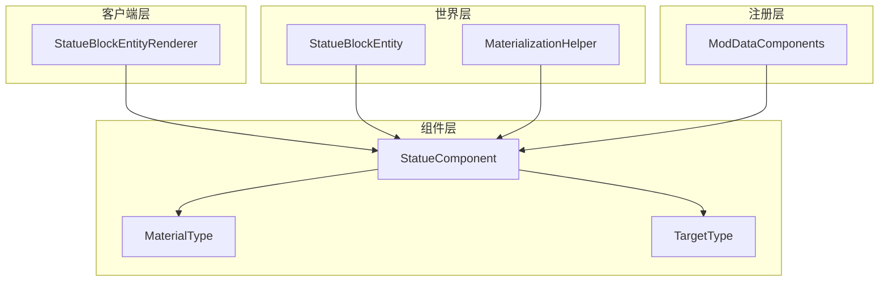
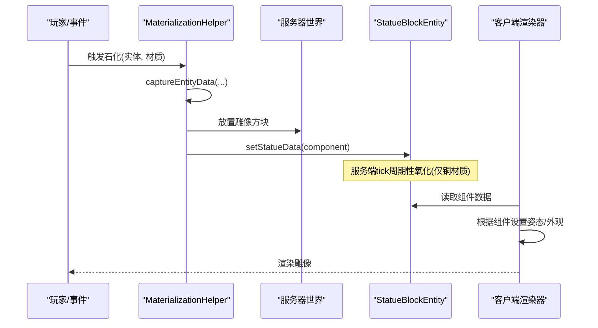
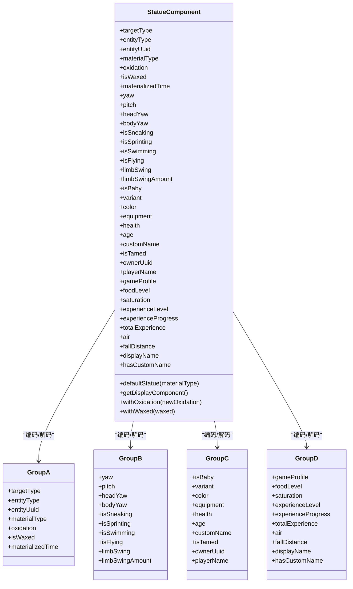
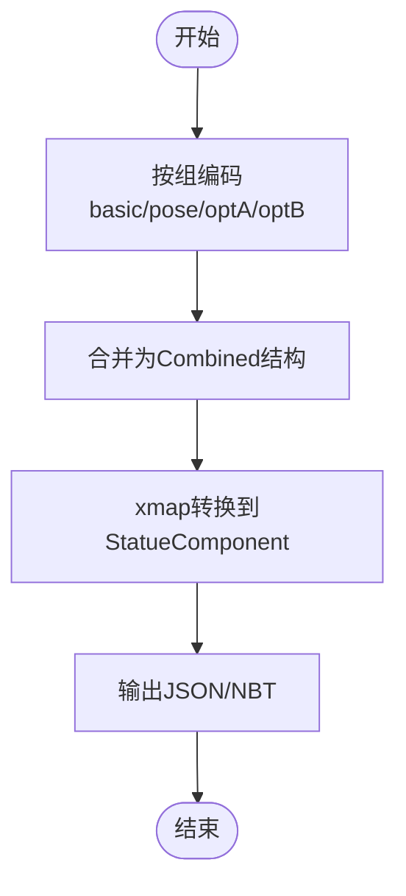
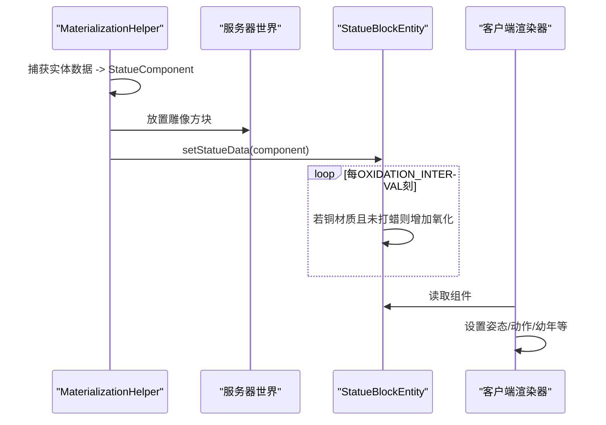
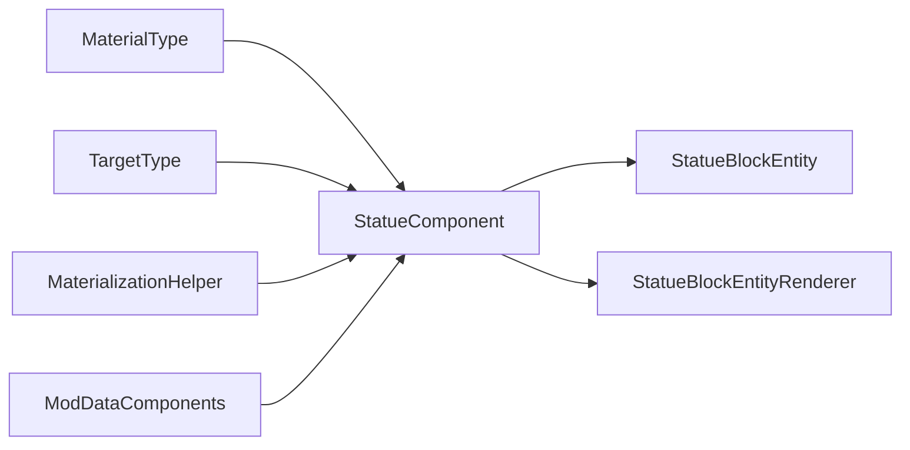

# 雕像数据组件

<cite>
**本文引用的文件**
- [StatueComponent.java](file://src/main/java/com/xiong/petrification/component/StatueComponent.java)
- [MaterialType.java](file://src/main/java/com/xiong/petrification/component/MaterialType.java)
- [TargetType.java](file://src/main/java/com/xiong/petrification/component/TargetType.java)
- [StatueBlockEntity.java](file://src/main/java/com/xiong/petrification/block/StatueBlockEntity.java)
- [StatueBlockEntityRenderer.java](file://src/main/java/com/xiong/petrification/client/StatueBlockEntityRenderer.java)
- [ModDataComponents.java](file://src/main/java/com/xiong/petrification/registry/ModDataComponents.java)
- [MaterializationHelper.java](file://src/main/java/com/xiong/petrification/util/MaterializationHelper.java)
</cite>

## 目录
1. [简介](#简介)
2. [项目结构](#项目结构)
3. [核心组件](#核心组件)
4. [架构总览](#架构总览)
5. [详细组件分析](#详细组件分析)
6. [依赖关系分析](#依赖关系分析)
7. [性能考量](#性能考量)
8. [故障排查指南](#故障排查指南)
9. [结论](#结论)
10. [附录：扩展指南](#附录扩展指南)

## 简介
本文件为Minecraft石化模组的“雕像数据组件”提供系统化、可操作的文档。重点围绕 StatueComponent 的37个字段设计、MaterialType 与 TargetType 枚举、序列化机制（JSON/NBT）、生命周期管理（创建、更新、销毁）、数据验证规则，以及扩展新材质类型和目标类型的实践指南展开。目标是帮助开发者快速理解并安全地扩展该组件。

## 项目结构
与雕像数据组件直接相关的代码主要分布在以下位置：
- 组件定义：component 包下的 StatueComponent、MaterialType、TargetType
- 块实体与渲染：block 与 client 包下的 StatueBlockEntity 与 StatueBlockEntityRenderer
- 注册与持久化：registry 包下的 ModDataComponents
- 使用与构造：util 包下的 MaterializationHelper

图表来源
- [StatueComponent.java:14-52](file://src/main/java/com/xiong/petrification/component/StatueComponent.java#L14-L52)
- [MaterialType.java:9-67](file://src/main/java/com/xiong/petrification/component/MaterialType.java#L9-L67)
- [TargetType.java:6-22](file://src/main/java/com/xiong/petrification/component/TargetType.java#L6-L22)
- [StatueBlockEntity.java:17-88](file://src/main/java/com/xiong/petrification/block/StatueBlockEntity.java#L17-L88)
- [StatueBlockEntityRenderer.java:31-129](file://src/main/java/com/xiong/petrification/client/StatueBlockEntityRenderer.java#L31-L129)
- [ModDataComponents.java:11-26](file://src/main/java/com/xiong/petrification/registry/ModDataComponents.java#L11-L26)
- [MaterializationHelper.java:55-186](file://src/main/java/com/xiong/petrification/util/MaterializationHelper.java#L55-L186)

章节来源
- [StatueComponent.java:14-52](file://src/main/java/com/xiong/petrification/component/StatueComponent.java#L14-L52)
- [MaterialType.java:9-67](file://src/main/java/com/xiong/petrification/component/MaterialType.java#L9-L67)
- [TargetType.java:6-22](file://src/main/java/com/xiong/petrification/component/TargetType.java#L6-L22)
- [StatueBlockEntity.java:17-88](file://src/main/java/com/xiong/petrification/block/StatueBlockEntity.java#L17-L88)
- [StatueBlockEntityRenderer.java:31-129](file://src/main/java/com/xiong/petrification/client/StatueBlockEntityRenderer.java#L31-L129)
- [ModDataComponents.java:11-26](file://src/main/java/com/xiong/petrification/registry/ModDataComponents.java#L11-L26)
- [MaterializationHelper.java:55-186](file://src/main/java/com/xiong/petrification/util/MaterializationHelper.java#L55-L186)

## 核心组件
- StatueComponent：以记录（record）形式承载雕像的全部状态，包含目标类型、实体标识、材质、姿态、可选属性等共37个字段。内部通过分组Codec实现稳定且可扩展的序列化。
- MaterialType：定义石头、铁、铜、金、钻石、下界合金等材质，附带颜色、对应物品与方块、显示前缀等元信息。
- TargetType：区分生物与玩家两类目标，用于后续处理逻辑分支。

章节来源
- [StatueComponent.java:14-52](file://src/main/java/com/xiong/petrification/component/StatueComponent.java#L14-L52)
- [MaterialType.java:9-67](file://src/main/java/com/xiong/petrification/component/MaterialType.java#L9-L67)
- [TargetType.java:6-22](file://src/main/java/com/xiong/petrification/component/TargetType.java#L6-L22)

## 架构总览
雕像数据在服务器侧由 MaterializationHelper 捕获实体状态并生成 StatueComponent；StatueBlockEntity 持有该组件并在服务端tick中执行氧化等逻辑；客户端通过 StatueBlockEntityRenderer 读取组件并渲染出半比例实体模型；所有数据通过 ModDataComponents 注册的 DataComponentType 进行持久化与网络同步。

图表来源
- [MaterializationHelper.java:55-186](file://src/main/java/com/xiong/petrification/util/MaterializationHelper.java#L55-L186)
- [StatueBlockEntity.java:28-50](file://src/main/java/com/xiong/petrification/block/StatueBlockEntity.java#L28-L50)
- [StatueBlockEntityRenderer.java:45-113](file://src/main/java/com/xiong/petrification/client/StatueBlockEntityRenderer.java#L45-L113)

## 详细组件分析

### StatueComponent 字段设计与职责
StatueComponent 将37个字段划分为四组，分别负责基础信息、姿态动画、可选属性A、可选属性B，并通过 Codec 组合实现稳定的序列化与版本兼容。

- 基础信息（Group A，7项）
  - targetType: 目标类型（生物或玩家）
  - entityType: 实体类型标识符
  - entityUuid: 实体UUID（可选）
  - materialType: 材质类型（石头/铁/铜/金/钻石/下界合金）
  - oxidation: 氧化程度（非负浮点）
  - isWaxed: 是否打蜡（阻止氧化）
  - materializedTime: 石化时间戳（游戏刻）

- 姿态与动画（Group B，10项）
  - yaw/pitch/headYaw/bodyYaw: 旋转角度
  - isSneaking/isSprinting/isSwimming/isFlying: 动作状态
  - limbSwing/limbSwingAmount: 肢体摆动参数

- 可选属性A（Group C，10项）
  - isBaby: 是否为幼年
  - variant/color: 变体与颜色（可选）
  - equipment: 装备NBT（可选）
  - health/age/customName: 生命、年龄、自定义名称（可选）
  - isTamed/ownerUuid/playerName: 驯服信息与所有者（可选）

- 可选属性B（Group D，10项）
  - gameProfile: 玩家档案（可选）
  - foodLevel/saturation: 饥饿与饱和度（可选）
  - experienceLevel/experienceProgress/totalExperience: 经验相关（可选）
  - air/fallDistance: 空气量与坠落距离（可选）
  - displayName/hasCustomName: 显示名与是否有自定义名

- 辅助方法
  - defaultStatue(materialType): 创建默认雕像组件
  - getDisplayComponent(): 获取显示文本
  - withOxidation(newOxidation)/withWaxed(waxed): 不可变更新

章节来源
- [StatueComponent.java:14-52](file://src/main/java/com/xiong/petrification/component/StatueComponent.java#L14-L52)
- [StatueComponent.java:55-79](file://src/main/java/com/xiong/petrification/component/StatueComponent.java#L55-L79)
- [StatueComponent.java:81-148](file://src/main/java/com/xiong/petrification/component/StatueComponent.java#L81-L148)
- [StatueComponent.java:150-192](file://src/main/java/com/xiong/petrification/component/StatueComponent.java#L150-L192)
- [StatueComponent.java:194-254](file://src/main/java/com/xiong/petrification/component/StatueComponent.java#L194-L254)

#### 类图（字段分组与Codec组合）

图表来源
- [StatueComponent.java:55-79](file://src/main/java/com/xiong/petrification/component/StatueComponent.java#L55-L79)
- [StatueComponent.java:81-148](file://src/main/java/com/xiong/petrification/component/StatueComponent.java#L81-L148)

### MaterialType 枚举特性
- 内置材质：石头、铁、铜、金、钻石、下界合金
- 每个材质包含：
  - 名称（序列化键）
  - 颜色（用于粒子效果）
  - 对应锭物品
  - 对应方块
  - 显示前缀（如“Petrified”、“Iron”、“Golden”等）
- 支持从字符串到枚举的反序列化（StringRepresentable）
- 提供 fromEffectId 回退逻辑（未知时返回石头）

章节来源
- [MaterialType.java:9-67](file://src/main/java/com/xiong/petrification/component/MaterialType.java#L9-L67)

### TargetType 枚举用途
- BIOLOGICAL：普通生物
- PLAYER：玩家
- 用于决定后续处理分支（例如玩家专属数据的捕获与恢复）

章节来源
- [TargetType.java:6-22](file://src/main/java/com/xiong/petrification/component/TargetType.java#L6-L22)

### 序列化机制与版本兼容
- 使用 Mojang Codec 体系，将37个字段按组编码为 JSON/NBT 结构，便于跨版本兼容与增量升级
- 分组策略：
  - part1.basic：基础信息（Group A）
  - part1.pose：姿态（Group B）
  - part2.optA：可选属性A（Group C）
  - part2.optB：可选属性B（Group D）
- 通过 xmap 将分组结构映射到 StatueComponent 记录，新增字段可通过新增可选字段或新版本分组实现向后兼容
- 在块实体中通过 ValueInput/ValueOutput 读写，确保存档与网络同步的一致性

图表来源
- [StatueComponent.java:81-148](file://src/main/java/com/xiong/petrification/component/StatueComponent.java#L81-L148)
- [StatueBlockEntity.java:62-74](file://src/main/java/com/xiong/petrification/block/StatueBlockEntity.java#L62-L74)
- [ModDataComponents.java:15-19](file://src/main/java/com/xiong/petrification/registry/ModDataComponents.java#L15-L19)

章节来源
- [StatueComponent.java:81-148](file://src/main/java/com/xiong/petrification/component/StatueComponent.java#L81-L148)
- [StatueBlockEntity.java:62-74](file://src/main/java/com/xiong/petrification/block/StatueBlockEntity.java#L62-L74)
- [ModDataComponents.java:15-19](file://src/main/java/com/xiong/petrification/registry/ModDataComponents.java#L15-L19)

### 生命周期管理（创建、更新、销毁）
- 创建
  - MaterializationHelper.captureEntityData 捕获实体状态并构建 StatueComponent
  - 放置雕像方块并将组件写入 StatueBlockEntity
- 更新
  - 服务端 tick 中检查铜材质且未打蜡，按配置速率增加氧化值
  - 客户端渲染器读取组件并设置实体姿态、动作状态、幼年标志等
- 销毁
  - 当实体被移除或世界卸载时，组件随块实体一起持久化或清理
  - 客户端渲染异常会被静默忽略，保证稳定性

图表来源
- [MaterializationHelper.java:55-186](file://src/main/java/com/xiong/petrification/util/MaterializationHelper.java#L55-L186)
- [StatueBlockEntity.java:28-50](file://src/main/java/com/xiong/petrification/block/StatueBlockEntity.java#L28-L50)
- [StatueBlockEntityRenderer.java:45-113](file://src/main/java/com/xiong/petrification/client/StatueBlockEntityRenderer.java#L45-L113)

章节来源
- [MaterializationHelper.java:55-186](file://src/main/java/com/xiong/petrification/util/MaterializationHelper.java#L55-L186)
- [StatueBlockEntity.java:28-50](file://src/main/java/com/xiong/petrification/block/StatueBlockEntity.java#L28-L50)
- [StatueBlockEntityRenderer.java:45-113](file://src/main/java/com/xiong/petrification/client/StatueBlockEntityRenderer.java#L45-L113)

### 数据验证规则与约束条件
- 氧化度：非负浮点数，上限受配置限制
- 打蜡：布尔值，打蜡后阻止氧化
- 材质：必须为已定义的枚举之一
- 目标类型：必须为生物或玩家
- 实体类型：需存在于注册表中，否则客户端渲染跳过
- 可选字段：均为 Optional，缺失时采用默认值或空值
- 显示名：优先使用自定义显示名，否则使用材料前缀+实体名

章节来源
- [StatueComponent.java:81-148](file://src/main/java/com/xiong/petrification/component/StatueComponent.java#L81-L148)
- [StatueBlockEntity.java:28-50](file://src/main/java/com/xiong/petrification/block/StatueBlockEntity.java#L28-L50)
- [StatueBlockEntityRenderer.java:56-71](file://src/main/java/com/xiong/petrification/client/StatueBlockEntityRenderer.java#L56-L71)

## 依赖关系分析
- StatueComponent 依赖 MaterialType 与 TargetType 作为关键分类
- StatueBlockEntity 依赖 StatueComponent 进行状态存储与氧化逻辑
- StatueBlockEntityRenderer 依赖 StatueComponent 进行姿态与外观渲染
- MaterializationHelper 负责构造 StatueComponent，并调用块实体设置数据
- ModDataComponents 注册 StatueComponent 的数据组件类型，提供持久化能力

图表来源
- [StatueComponent.java:14-52](file://src/main/java/com/xiong/petrification/component/StatueComponent.java#L14-L52)
- [StatueBlockEntity.java:17-88](file://src/main/java/com/xiong/petrification/block/StatueBlockEntity.java#L17-L88)
- [StatueBlockEntityRenderer.java:31-129](file://src/main/java/com/xiong/petrification/client/StatueBlockEntityRenderer.java#L31-L129)
- [MaterializationHelper.java:55-186](file://src/main/java/com/xiong/petrification/util/MaterializationHelper.java#L55-L186)
- [ModDataComponents.java:11-26](file://src/main/java/com/xiong/petrification/registry/ModDataComponents.java#L11-L26)

章节来源
- [StatueComponent.java:14-52](file://src/main/java/com/xiong/petrification/component/StatueComponent.java#L14-L52)
- [StatueBlockEntity.java:17-88](file://src/main/java/com/xiong/petrification/block/StatueBlockEntity.java#L17-L88)
- [StatueBlockEntityRenderer.java:31-129](file://src/main/java/com/xiong/petrification/client/StatueBlockEntityRenderer.java#L31-L129)
- [MaterializationHelper.java:55-186](file://src/main/java/com/xiong/petrification/util/MaterializationHelper.java#L55-L186)
- [ModDataComponents.java:11-26](file://src/main/java/com/xiong/petrification/registry/ModDataComponents.java#L11-L26)

## 性能考量
- 客户端渲染缓存：对实体类型进行缓存以减少重复创建开销
- 氧化计算节流：按固定间隔（OXIDATION_INTERVAL）执行，避免每刻计算
- 可选字段最小化：大量使用 Optional，减少不必要的数据传输与存储
- 渲染异常静默处理：防止个别实体渲染错误影响整体帧率

[本节为通用指导，不直接分析具体文件]

## 故障排查指南
- 客户端无法渲染雕像
  - 检查实体类型是否存在于注册表，不存在则渲染跳过
  - 检查组件是否完整（尤其是 entityType 与姿态字段）
- 氧化不生效
  - 确认材质为铜且未打蜡
  - 检查配置中的最大氧化度与氧化速率
- 存档加载失败
  - 检查字段是否因版本变更而缺失，利用 Optional 与默认值保证兼容
  - 查看 NBT/JSON 中 basic/pose/optA/optB 分组是否正确

章节来源
- [StatueBlockEntityRenderer.java:56-71](file://src/main/java/com/xiong/petrification/client/StatueBlockEntityRenderer.java#L56-L71)
- [StatueBlockEntity.java:28-50](file://src/main/java/com/xiong/petrification/block/StatueBlockEntity.java#L28-L50)
- [StatueComponent.java:81-148](file://src/main/java/com/xiong/petrification/component/StatueComponent.java#L81-L148)

## 结论
StatueComponent 通过分组Codec实现了高内聚、低耦合的雕像数据模型，结合 MaterialType 与 TargetType 提供了清晰的材质与目标分类。其生命周期贯穿创建、更新与销毁，配合服务端tick与客户端渲染形成完整闭环。通过可选字段与默认值策略，保证了良好的版本兼容性。扩展新材质与目标类型时，只需遵循现有模式即可无缝集成。

[本节为总结性内容，不直接分析具体文件]

## 附录：扩展指南

### 添加新的材质类型
- 在 MaterialType 中添加新枚举项，指定名称、颜色、对应物品与方块、显示前缀
- 如需新行为（如特殊氧化曲线），可在 StatueBlockEntity 的tick逻辑中扩展判断
- 确保渲染与粒子效果能正确使用该材质的颜色

章节来源
- [MaterialType.java:9-67](file://src/main/java/com/xiong/petrification/component/MaterialType.java#L9-L67)
- [StatueBlockEntity.java:28-50](file://src/main/java/com/xiong/petrification/block/StatueBlockEntity.java#L28-L50)

### 添加新的目标类型
- 在 TargetType 中新增枚举项，并更新相关逻辑分支（如 MaterializationHelper 中对目标的判定）
- 在 StatueComponent 的捕获与恢复流程中，为新目标类型补充必要字段（如玩家专属字段）
- 在客户端渲染中，根据新目标类型调整姿态或外观

章节来源
- [TargetType.java:6-22](file://src/main/java/com/xiong/petrification/component/TargetType.java#L6-L22)
- [MaterializationHelper.java:98-186](file://src/main/java/com/xiong/petrification/util/MaterializationHelper.java#L98-L186)
- [StatueBlockEntityRenderer.java:45-113](file://src/main/java/com/xiong/petrification/client/StatueBlockEntityRenderer.java#L45-L113)

### 扩展 StatueComponent 字段
- 将新字段归入合适的分组（Group A/B/C/D），保持每组不超过16个字段
- 在对应 Group Codec 中添加 optionalFieldOf 或 fieldOf 映射
- 更新 fromCombined/toCombined 以包含新字段
- 在 StatueBlockEntity 与客户端渲染中按需读取/应用新字段

章节来源
- [StatueComponent.java:55-79](file://src/main/java/com/xiong/petrification/component/StatueComponent.java#L55-L79)
- [StatueComponent.java:81-148](file://src/main/java/com/xiong/petrification/component/StatueComponent.java#L81-L148)
- [StatueComponent.java:150-192](file://src/main/java/com/xiong/petrification/component/StatueComponent.java#L150-L192)