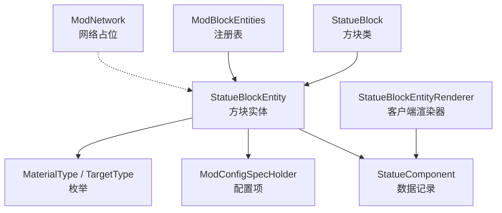
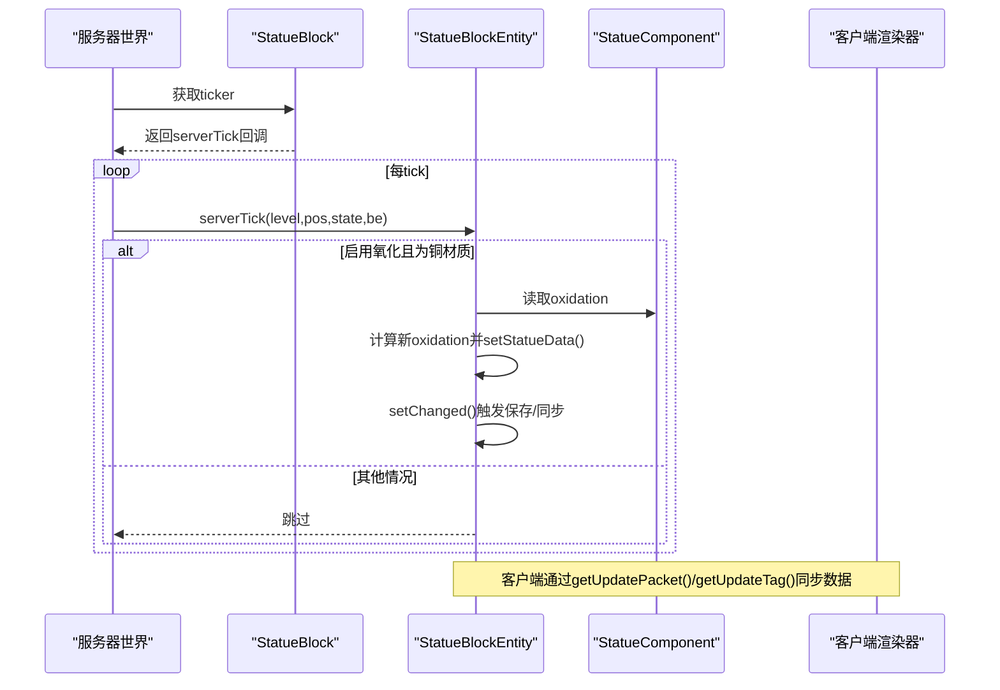
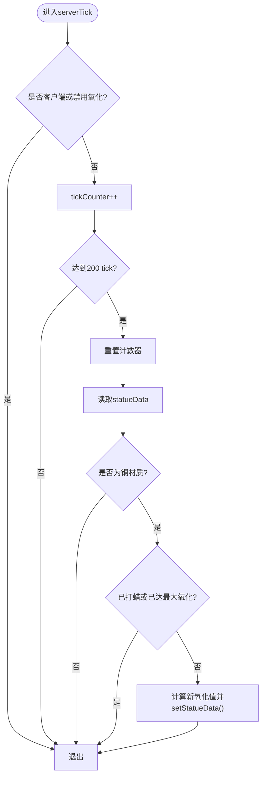
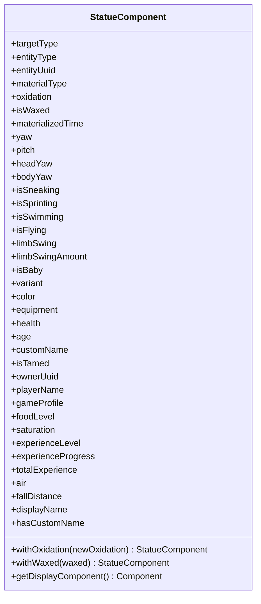
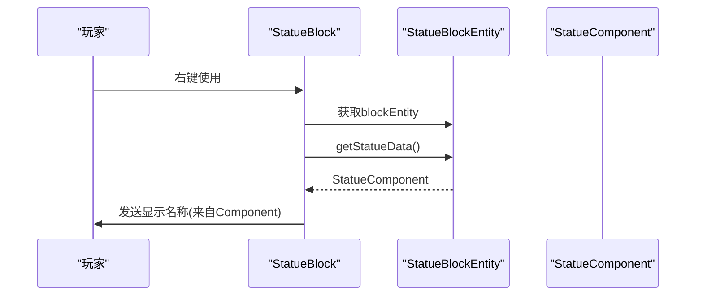
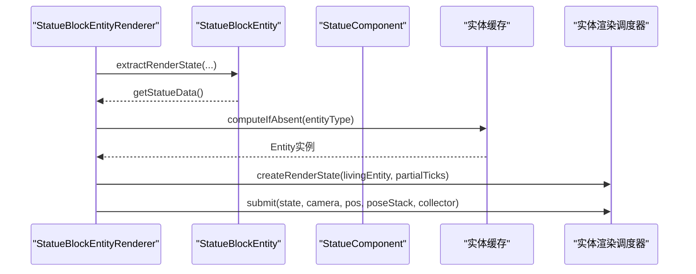
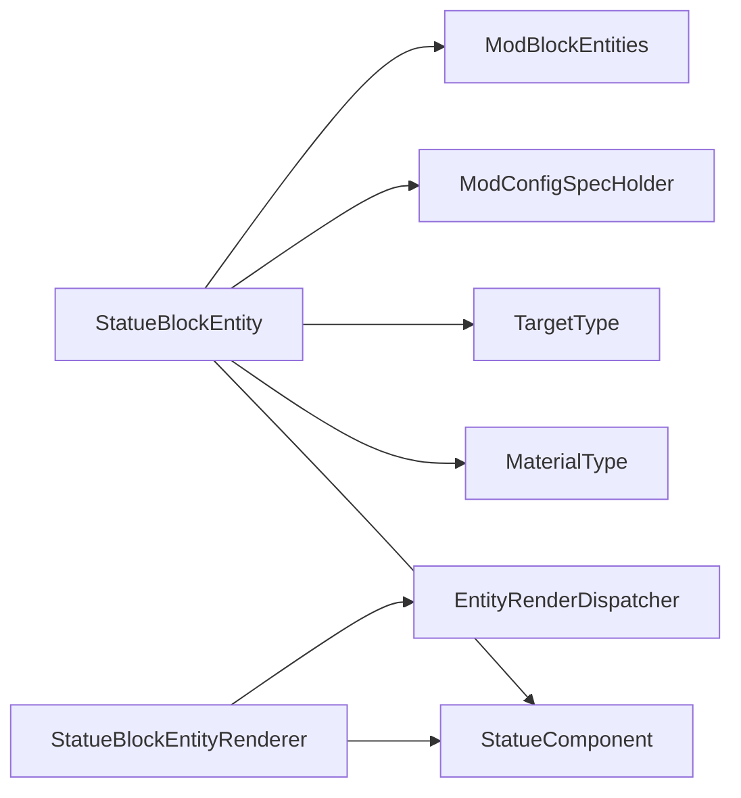

# 雕像方块实体

<cite>
**本文引用的文件**
- [StatueBlockEntity.java](file://src/main/java/com/xiong/petrification/block/StatueBlockEntity.java)
- [StatueComponent.java](file://src/main/java/com/xiong/petrification/component/StatueComponent.java)
- [StatueBlock.java](file://src/main/java/com/xiong/petrification/block/StatueBlock.java)
- [StatueBlockEntityRenderer.java](file://src/main/java/com/xiong/petrification/client/StatueBlockEntityRenderer.java)
- [ModNetwork.java](file://src/main/java/com/xiong/petrification/network/ModNetwork.java)
- [MaterialType.java](file://src/main/java/com/xiong/petrification/component/MaterialType.java)
- [TargetType.java](file://src/main/java/com/xiong/petrification/component/TargetType.java)
- [ModBlockEntities.java](file://src/main/java/com/xiong/petrification/registry/ModBlockEntities.java)
- [ModConfigSpecHolder.java](file://src/main/java/com/xiong/petrification/ModConfigSpecHolder.java)
</cite>

## 目录
1. [简介](#简介)
2. [项目结构](#项目结构)
3. [核心组件](#核心组件)
4. [架构总览](#架构总览)
5. [详细组件分析](#详细组件分析)
6. [依赖关系分析](#依赖关系分析)
7. [性能与内存管理](#性能与内存管理)
8. [故障排查指南](#故障排查指南)
9. [结论](#结论)
10. [附录：扩展指南](#附录：扩展指南)

## 简介
本文件为“石化模组”中的雕像方块实体提供系统化技术文档。重点覆盖以下方面：
- StatueBlockEntity 的数据管理机制，包括 StatueComponent 的存储、更新与同步
- 服务器端 tick 逻辑与雕像状态更新时机、条件
- 数据持久化机制（NBT/Codec 读写）与网络数据包处理现状
- 客户端渲染器通信协议与数据同步策略
- 内存管理与性能优化措施（含大数据对象缓存与清理）
- 调试技巧与常见问题解决方案
- 扩展指南：如何添加新字段与自定义更新逻辑

## 项目结构
围绕雕像方块实体的关键代码分布在 block、component、client、network、registry 等包中：
- block: 定义雕像方块与方块实体，包含服务端 tick 与交互逻辑
- component: 定义雕像数据模型 StatueComponent 及材料/目标类型枚举
- client: 客户端渲染器，负责将雕像数据映射到实体渲染
- network: 网络层占位实现，预留多玩家同步扩展点
- registry: 注册方块实体类型，绑定到雕像方块

图表来源
- [StatueBlock.java:38-101](file://src/main/java/com/xiong/petrification/block/StatueBlock.java#L38-L101)
- [StatueBlockEntity.java:17-87](file://src/main/java/com/xiong/petrification/block/StatueBlockEntity.java#L17-L87)
- [StatueComponent.java:14-52](file://src/main/java/com/xiong/petrification/component/StatueComponent.java#L14-L52)
- [StatueBlockEntityRenderer.java:30-128](file://src/main/java/com/xiong/petrification/client/StatueBlockEntityRenderer.java#L30-L128)
- [ModBlockEntities.java:13-25](file://src/main/java/com/xiong/petrification/registry/ModBlockEntities.java#L13-L25)
- [ModNetwork.java:1-10](file://src/main/java/com/xiong/petrification/network/ModNetwork.java#L1-L10)

章节来源
- [StatueBlock.java:38-153](file://src/main/java/com/xiong/petrification/block/StatueBlock.java#L38-L153)
- [StatueBlockEntity.java:17-87](file://src/main/java/com/xiong/petrification/block/StatueBlockEntity.java#L17-L87)
- [StatueComponent.java:14-256](file://src/main/java/com/xiong/petrification/component/StatueComponent.java#L14-L256)
- [StatueBlockEntityRenderer.java:30-128](file://src/main/java/com/xiong/petrification/client/StatueBlockEntityRenderer.java#L30-L128)
- [ModBlockEntities.java:13-25](file://src/main/java/com/xiong/petrification/registry/ModBlockEntities.java#L13-L25)
- [ModNetwork.java:1-10](file://src/main/java/com/xiong/petrification/network/ModNetwork.java#L1-L10)

## 核心组件
- StatueBlockEntity：承载雕像数据的方块实体，维护 StatueComponent，并在服务端每 200 tick 对铜材质雕像执行氧化增量更新；提供 NBT 序列化与客户端数据包生成。
- StatueComponent：不可变记录类型，封装雕像的全部外观与状态信息（实体类型、姿态、装备、血量、经验、名称等），通过 Codec 分组编码以适配 Minecraft 的序列化限制。
- MaterialType / TargetType：枚举类型，描述雕像材质与目标类别，参与序列化与显示前缀。
- StatueBlock：方块类，负责创建方块实体、注册服务端 tick、用户交互、掉落物携带 StatueComponent。
- StatueBlockEntityRenderer：客户端渲染器，基于 StatueComponent 构建并渲染实体，使用实体缓存减少重复创建开销。
- ModBlockEntities：注册雕像方块实体类型，将其绑定到雕像方块。
- ModNetwork：当前为空实现，预留未来多玩家数据同步扩展点。

章节来源
- [StatueBlockEntity.java:17-87](file://src/main/java/com/xiong/petrification/block/StatueBlockEntity.java#L17-L87)
- [StatueComponent.java:14-256](file://src/main/java/com/xiong/petrification/component/StatueComponent.java#L14-L256)
- [MaterialType.java:9-68](file://src/main/java/com/xiong/petrification/component/MaterialType.java#L9-L68)
- [TargetType.java:6-23](file://src/main/java/com/xiong/petrification/component/TargetType.java#L6-L23)
- [StatueBlock.java:38-153](file://src/main/java/com/xiong/petrification/block/StatueBlock.java#L38-L153)
- [StatueBlockEntityRenderer.java:30-128](file://src/main/java/com/xiong/petrification/client/StatueBlockEntityRenderer.java#L30-L128)
- [ModBlockEntities.java:13-25](file://src/main/java/com/xiong/petrification/registry/ModBlockEntities.java#L13-L25)
- [ModNetwork.java:1-10](file://src/main/java/com/xiong/petrification/network/ModNetwork.java#L1-L10)

## 架构总览
雕像系统由“服务端数据 + 客户端渲染”构成。服务端负责数据生命周期（加载、更新、持久化），客户端根据接收到的数据渲染实体。

图表来源
- [StatueBlock.java:97-101](file://src/main/java/com/xiong/petrification/block/StatueBlock.java#L97-L101)
- [StatueBlockEntity.java:28-60](file://src/main/java/com/xiong/petrification/block/StatueBlockEntity.java#L28-L60)
- [StatueBlockEntity.java:76-86](file://src/main/java/com/xiong/petrification/block/StatueBlockEntity.java#L76-L86)

章节来源
- [StatueBlock.java:97-101](file://src/main/java/com/xiong/petrification/block/StatueBlock.java#L97-L101)
- [StatueBlockEntity.java:28-86](file://src/main/java/com/xiong/petrification/block/StatueBlockEntity.java#L28-L86)

## 详细组件分析

### StatueBlockEntity：数据管理与服务端tick
- 数据持有：私有字段 statueData（StatueComponent），提供 get/set 访问。设置时调用 setChanged() 标记脏数据，以便后续持久化或同步。
- 服务端tick：
  - 仅在非客户端且开启氧化功能时执行
  - 每 200 tick 检查一次，仅对铜材质雕像进行氧化递增
  - 若已打蜡或已达最大氧化值则跳过
  - 更新后调用 setStatueData() 触发保存/同步
- 持久化：
  - saveAdditional/loadAdditional 使用 StatueComponent.CODEC 进行序列化和反序列化
- 网络同步：
  - getUpdatePacket() 返回标准块实体数据包
  - getUpdateTag() 返回空标签（未自定义写入），实际同步依赖默认行为

图表来源
- [StatueBlockEntity.java:28-50](file://src/main/java/com/xiong/petrification/block/StatueBlockEntity.java#L28-L50)

章节来源
- [StatueBlockEntity.java:17-87](file://src/main/java/com/xiong/petrification/block/StatueBlockEntity.java#L17-L87)

### StatueComponent：数据结构与编解码
- 数据结构：record 类型，包含 37 个字段，分为四组（A/B/C/D）并通过 xmap 组合成统一 CODEC，规避单组字段数限制。
- 主要字段分类：
  - 基础信息：目标类型、实体类型、UUID、材质、氧化度、是否打蜡、生成时间
  - 姿态与动画：偏航角、俯仰角、头部偏航、身体偏航、潜行/冲刺/游泳/飞行标志、肢体摆动
  - 可选属性：幼体、变种、颜色、装备、血量、年龄、自定义名、驯服、拥有者、玩家名、游戏档案、饥饿/饱和、经验等级/进度/总量、空气量、坠落距离、显示名、是否有自定义名
- 工厂方法：defaultStatue(MaterialType) 用于创建默认雕像数据
- 不可变更新：withOxidation(withWaxed) 返回新实例，保证线程安全与一致性

图表来源
- [StatueComponent.java:14-52](file://src/main/java/com/xiong/petrification/component/StatueComponent.java#L14-L52)
- [StatueComponent.java:194-254](file://src/main/java/com/xiong/petrification/component/StatueComponent.java#L194-L254)

章节来源
- [StatueComponent.java:14-256](file://src/main/java/com/xiong/petrification/component/StatueComponent.java#L14-L256)

### StatueBlock：方块行为与数据流转
- 创建方块实体：newBlockEntity 返回 StatueBlockEntity
- 服务端tick：getTicker 返回 StatueBlockEntity::serverTick
- 交互：useWithoutItem 在服务器端读取 StatueComponent 并发送系统消息给玩家
- 掉落：getDrops 将 StatueComponent 写入物品数据组件，使雕像可被拾取和转移
- 红石输出：当材质为铜时，按氧化程度输出信号强度

图表来源
- [StatueBlock.java:104-121](file://src/main/java/com/xiong/petrification/block/StatueBlock.java#L104-L121)
- [StatueBlockEntity.java:52-60](file://src/main/java/com/xiong/petrification/block/StatueBlockEntity.java#L52-L60)

章节来源
- [StatueBlock.java:38-153](file://src/main/java/com/xiong/petrification/block/StatueBlock.java#L38-L153)

### 客户端渲染器：数据到渲染的映射
- 渲染状态提取：extractRenderState 从 StatueBlockEntity 获取 StatueComponent，查找对应实体类型，复用实体缓存，设置姿态与动作标志，创建渲染状态
- 提交渲染：submit 调整位置、旋转、缩放，并提交实体渲染
- 视距控制：getViewDistance 使用配置项 statueRenderDistance

图表来源
- [StatueBlockEntityRenderer.java:44-113](file://src/main/java/com/xiong/petrification/client/StatueBlockEntityRenderer.java#L44-L113)

章节来源
- [StatueBlockEntityRenderer.java:30-128](file://src/main/java/com/xiong/petrification/client/StatueBlockEntityRenderer.java#L30-L128)

### 网络与同步：现状与扩展点
- 现状：
  - StatueBlockEntity.getUpdatePacket() 返回标准块实体数据包，依赖引擎默认同步流程
  - getUpdateTag() 未自定义写入，不会额外传输数据
  - ModNetwork.register() 为空，尚未实现自定义数据包
- 建议扩展：
  - 在 ModNetwork 中注册自定义数据包，用于跨玩家同步雕像数据变更（如氧化度变化）
  - 在服务端数据变更后主动发送数据包至相关玩家，避免全量同步开销

章节来源
- [StatueBlockEntity.java:76-86](file://src/main/java/com/xiong/petrification/block/StatueBlockEntity.java#L76-L86)
- [ModNetwork.java:1-10](file://src/main/java/com/xiong/petrification/network/ModNetwork.java#L1-L10)

## 依赖关系分析
- StatueBlockEntity 依赖：
  - StatueComponent：数据载体
  - MaterialType / TargetType：枚举类型，参与序列化与逻辑判断
  - ModConfigSpecHolder：读取氧化开关、速率、最大值、渲染距离等配置
  - ModBlockEntities：注册方块实体类型
- StatueBlockEntityRenderer 依赖：
  - StatueComponent：读取渲染所需姿态与实体类型
  - 实体渲染调度器：创建并提交渲染状态
  - 配置项：渲染距离

图表来源
- [StatueBlockEntity.java:17-87](file://src/main/java/com/xiong/petrification/block/StatueBlockEntity.java#L17-L87)
- [StatueBlockEntityRenderer.java:30-128](file://src/main/java/com/xiong/petrification/client/StatueBlockEntityRenderer.java#L30-L128)
- [ModConfigSpecHolder.java:40-69](file://src/main/java/com/xiong/petrification/ModConfigSpecHolder.java#L40-L69)

章节来源
- [StatueBlockEntity.java:17-87](file://src/main/java/com/xiong/petrification/block/StatueBlockEntity.java#L17-L87)
- [StatueBlockEntityRenderer.java:30-128](file://src/main/java/com/xiong/petrification/client/StatueBlockEntityRenderer.java#L30-L128)
- [ModConfigSpecHolder.java:40-69](file://src/main/java/com/xiong/petrification/ModConfigSpecHolder.java#L40-L69)

## 性能与内存管理
- 服务端tick节流：
  - 氧化逻辑每 200 tick 执行一次，降低频繁计算开销
  - 仅在铜材质雕像且未打蜡且未达最大氧化值时更新
- 客户端渲染缓存：
  - 实体缓存 Map<EntityType<?>, Entity> 避免每帧重复创建实体
  - 渲染异常静默捕获，防止渲染错误导致崩溃
- 配置驱动的性能参数：
  - statueRenderDistance 控制雕像渲染距离，影响可见性与性能
- 数据序列化优化：
  - StatueComponent 使用分组 Codec，减少单次序列化负担
- 建议优化：
  - 在大规模雕像场景中，考虑按需同步（仅向附近玩家广播）
  - 对大型装备 CompoundTag 进行懒加载或压缩存储

章节来源
- [StatueBlockEntity.java:28-50](file://src/main/java/com/xiong/petrification/block/StatueBlockEntity.java#L28-L50)
- [StatueBlockEntityRenderer.java:30-128](file://src/main/java/com/xiong/petrification/client/StatueBlockEntityRenderer.java#L30-L128)
- [StatueComponent.java:81-148](file://src/main/java/com/xiong/petrification/component/StatueComponent.java#L81-L148)
- [ModConfigSpecHolder.java:40-69](file://src/main/java/com/xiong/petrification/ModConfigSpecHolder.java#L40-L69)

## 故障排查指南
- 雕像不氧化：
  - 检查配置 enableOxidation 是否为 true
  - 确认材质为铜且未打蜡，且未达到最大氧化值
  - 查看服务端日志中是否触发了氧化逻辑
- 客户端不显示雕像：
  - 检查 StatueComponent 中的 entityType 是否存在于注册表
  - 确认客户端渲染距离配置足够大
  - 查看渲染异常捕获日志（当前静默忽略异常）
- 数据不同步：
  - 当前未实现自定义数据包，依赖引擎默认同步；如需跨玩家实时同步，需扩展 ModNetwork
- 掉落物丢失数据：
  - 确认 getDrops 已将 StatueComponent 写入物品数据组件
  - 检查物品数据组件是否正确读取并传递

章节来源
- [StatueBlockEntity.java:28-50](file://src/main/java/com/xiong/petrification/block/StatueBlockEntity.java#L28-L50)
- [StatueBlockEntityRenderer.java:56-89](file://src/main/java/com/xiong/petrification/client/StatueBlockEntityRenderer.java#L56-L89)
- [StatueBlock.java:123-135](file://src/main/java/com/xiong/petrification/block/StatueBlock.java#L123-L135)
- [ModNetwork.java:1-10](file://src/main/java/com/xiong/petrification/network/ModNetwork.java#L1-L10)

## 结论
雕像方块实体通过 StatueBlockEntity 与 StatueComponent 实现了完整的数据生命周期管理，结合服务端节流 tick 与客户端渲染缓存，保证了基本性能。当前网络层为空实现，适合在多玩家场景下扩展自定义数据包以实现更精细的同步策略。通过合理配置与扩展，可在保持性能的同时增强雕像系统的表现力与可玩性。

## 附录：扩展指南

### 添加新的数据字段
- 在 StatueComponent 中添加新字段：
  - 选择合适的数据类型，优先使用 Optional 包裹可选字段
  - 将字段归入现有分组（A/B/C/D）或新增分组，确保每组不超过字段上限
  - 更新 fromCombined/toCombined 映射逻辑，保证序列化/反序列化一致
- 在 StatueBlockEntity 中暴露访问器：
  - 提供 getter/setter，并在 setter 中调用 setChanged() 触发保存/同步
- 在客户端渲染器中使用新字段：
  - 在 extractRenderState 中读取并应用到实体渲染状态

章节来源
- [StatueComponent.java:14-52](file://src/main/java/com/xiong/petrification/component/StatueComponent.java#L14-L52)
- [StatueComponent.java:81-148](file://src/main/java/com/xiong/petrification/component/StatueComponent.java#L81-L148)
- [StatueBlockEntity.java:52-60](file://src/main/java/com/xiong/petrification/block/StatueBlockEntity.java#L52-L60)
- [StatueBlockEntityRenderer.java:44-89](file://src/main/java/com/xiong/petrification/client/StatueBlockEntityRenderer.java#L44-L89)

### 自定义更新逻辑
- 在 StatueBlockEntity.serverTick 中添加条件分支：
  - 基于材质、状态或外部事件触发更新
  - 使用 withXxx 方法创建新 StatueComponent 实例，避免修改原对象
  - 调用 setStatueData() 触发保存/同步
- 在 StatuteBlock 中增加交互或红石响应：
  - useWithoutItem 中读取 StatueComponent 并执行相应操作
  - getAnalogOutputSignal 中根据新字段输出信号

章节来源
- [StatueBlockEntity.java:28-50](file://src/main/java/com/xiong/petrification/block/StatueBlockEntity.java#L28-L50)
- [StatueComponent.java:236-254](file://src/main/java/com/xiong/petrification/component/StatueComponent.java#L236-L254)
- [StatueBlock.java:104-151](file://src/main/java/com/xiong/petrification/block/StatueBlock.java#L104-L151)

### 网络数据包扩展
- 在 ModNetwork.register 中注册自定义数据包：
  - 定义数据包编解码器（Codec）
  - 在服务端数据变更后发送数据包至目标玩家
  - 在客户端接收并应用数据到本地 StatueBlockEntity
- 注意事项：
  - 避免频繁发送大包，采用增量同步或批量同步
  - 校验客户端输入，防止恶意数据导致崩溃

章节来源
- [ModNetwork.java:1-10](file://src/main/java/com/xiong/petrification/network/ModNetwork.java#L1-L10)