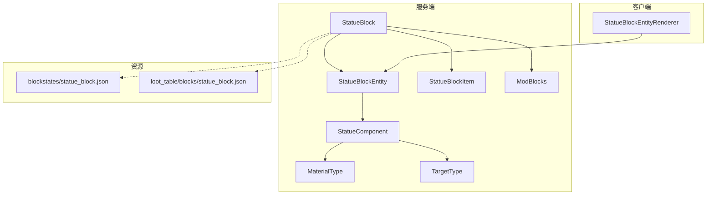
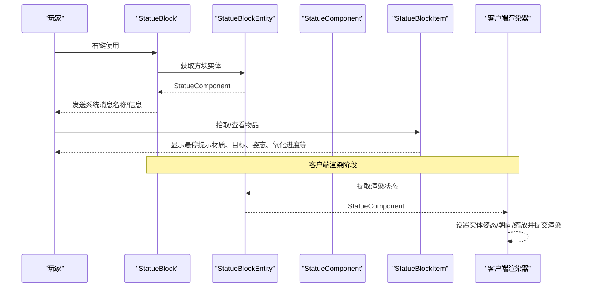
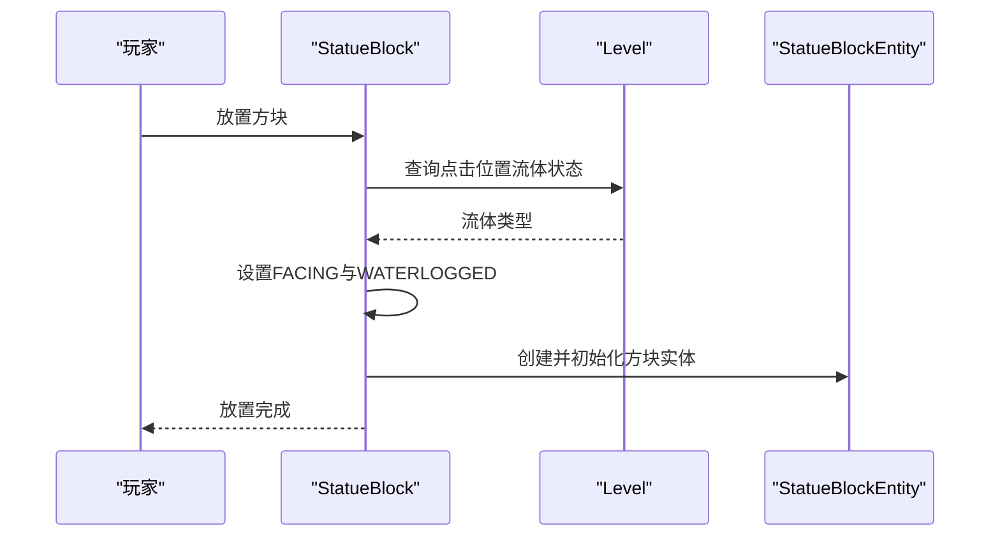
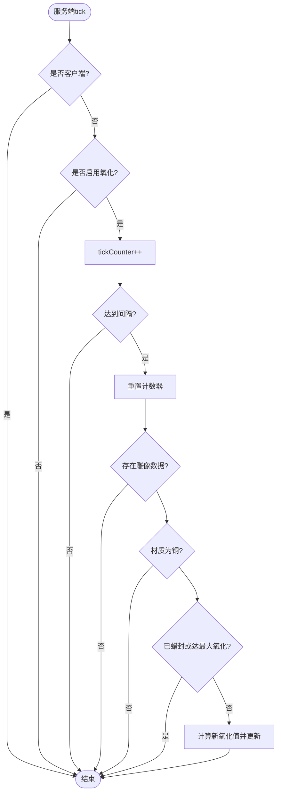
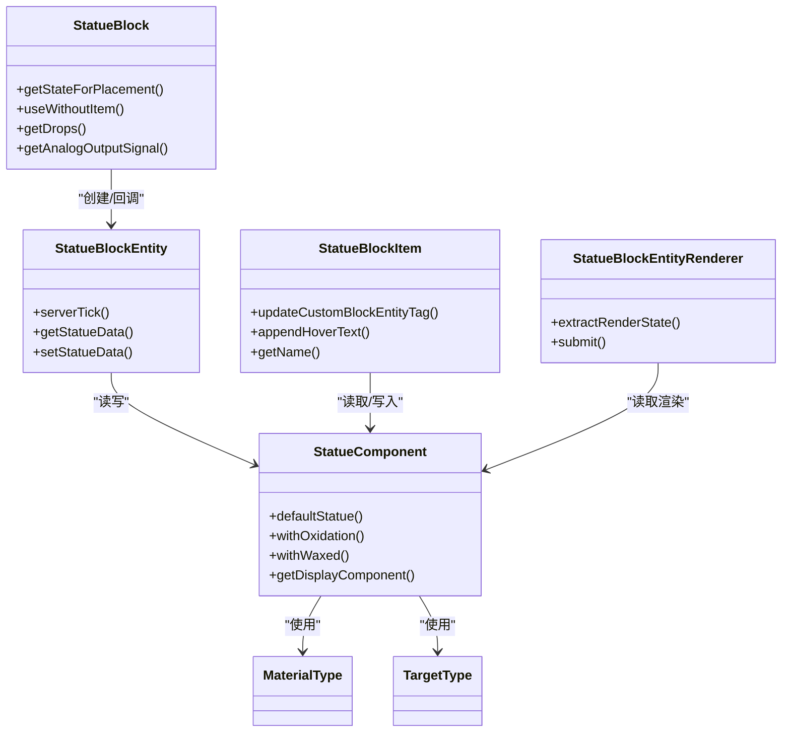

# 雕像方块实现

<cite>
**本文引用的文件**
- [StatueBlock.java](file://src/main/java/com/xiong/petrification/block/StatueBlock.java)
- [StatueBlockEntity.java](file://src/main/java/com/xiong/petrification/block/StatueBlockEntity.java)
- [StatueBlockItem.java](file://src/main/java/com/xiong/petrification/item/StatueBlockItem.java)
- [StatueComponent.java](file://src/main/java/com/xiong/petrification/component/StatueComponent.java)
- [MaterialType.java](file://src/main/java/com/xiong/petrification/component/MaterialType.java)
- [TargetType.java](file://src/main/java/com/xiong/petrification/component/TargetType.java)
- [ModBlocks.java](file://src/main/java/com/xiong/petrification/registry/ModBlocks.java)
- [statue_block.json（方块状态）](file://src/main/resources/assets/petrification/blockstates/statue_block.json)
- [statue_block.json（掉落表）](file://src/main/resources/data/petrification/loot_table/blocks/statue_block.json)
- [StatueBlockEntityRenderer.java](file://src/main/java/com/xiong/petrification/client/StatueBlockEntityRenderer.java)
</cite>

## 目录
1. [简介](#简介)
2. [项目结构](#项目结构)
3. [核心组件](#核心组件)
4. [架构总览](#架构总览)
5. [详细组件分析](#详细组件分析)
6. [依赖关系分析](#依赖关系分析)
7. [性能考量](#性能考量)
8. [故障排查指南](#故障排查指南)
9. [结论](#结论)
10. [附录：扩展指南](#附录：扩展指南)

## 简介
本文件为“石化”模组中“雕像方块”的完整技术文档，聚焦 StatueBlock 的设计与实现。内容涵盖：
- 继承自 BaseEntityBlock 并实现 SimpleWaterloggedBlock 的特性
- 放置逻辑：方向性 FACING 与可含水 WATERLOGGED 的处理
- 交互系统：右键点击显示雕像信息
- 掉落物系统：将雕像数据保存到物品中
- 模拟信号输出：基于铜材质氧化状态的信号强度计算
- 客户端渲染：实体姿态、朝向与缩放
- 扩展建议：新增属性与自定义行为的方法
- 性能优化与最佳实践

## 项目结构
该功能由服务端与客户端两部分协作完成：
- 服务端：方块类、方块实体、数据组件、物品类、注册表
- 客户端：方块实体渲染器
- 资源：方块状态 JSON、掉落表 JSON、模型与语言文件

图表来源
- [StatueBlock.java:38-152](file://src/main/java/com/xiong/petrification/block/StatueBlock.java#L38-L152)
- [StatueBlockEntity.java:17-88](file://src/main/java/com/xiong/petrification/block/StatueBlockEntity.java#L17-L88)
- [StatueComponent.java:14-256](file://src/main/java/com/xiong/petrification/component/StatueComponent.java#L14-L256)
- [MaterialType.java:9-68](file://src/main/java/com/xiong/petrification/component/MaterialType.java#L9-L68)
- [TargetType.java:6-23](file://src/main/java/com/xiong/petrification/component/TargetType.java#L6-L23)
- [StatueBlockItem.java:24-99](file://src/main/java/com/xiong/petrification/item/StatueBlockItem.java#L24-L99)
- [ModBlocks.java:16-35](file://src/main/java/com/xiong/petrification/registry/ModBlocks.java#L16-L35)
- [statue_block.json（方块状态）:1-9](file://src/main/resources/assets/petrification/blockstates/statue_block.json#L1-L9)
- [statue_block.json（掉落表）:1-20](file://src/main/resources/data/petrification/loot_table/blocks/statue_block.json#L1-L20)

章节来源
- [StatueBlock.java:38-152](file://src/main/java/com/xiong/petrification/block/StatueBlock.java#L38-L152)
- [StatueBlockEntity.java:17-88](file://src/main/java/com/xiong/petrification/block/StatueBlockEntity.java#L17-L88)
- [StatueBlockItem.java:24-99](file://src/main/java/com/xiong/petrification/item/StatueBlockItem.java#L24-L99)
- [StatueComponent.java:14-256](file://src/main/java/com/xiong/petrification/component/StatueComponent.java#L14-L256)
- [MaterialType.java:9-68](file://src/main/java/com/xiong/petrification/component/MaterialType.java#L9-L68)
- [TargetType.java:6-23](file://src/main/java/com/xiong/petrification/component/TargetType.java#L6-L23)
- [ModBlocks.java:16-35](file://src/main/java/com/xiong/petrification/registry/ModBlocks.java#L16-L35)
- [statue_block.json（方块状态）:1-9](file://src/main/resources/assets/petrification/blockstates/statue_block.json#L1-L9)
- [statue_block.json（掉落表）:1-20](file://src/main/resources/data/petrification/loot_table/blocks/statue_block.json#L1-L20)

## 核心组件
- StatueBlock：定义方块的属性、放置、交互、掉落、模拟信号输出等核心逻辑
- StatueBlockEntity：承载雕像数据（StatueComponent），负责服务端周期性更新（如铜氧化）
- StatueComponent：不可变记录类型，保存雕像的全部状态（目标类型、实体、材质、姿态、装备、血量、经验等）
- MaterialType / TargetType：枚举，限定材质与目标类型
- StatueBlockItem：处理放置时写入方块实体数据，并在物品悬停提示中展示雕像信息
- ModBlocks：注册方块及其基础属性（硬度、声音、不遮挡等）
- 客户端渲染器：根据 StatueComponent 渲染实体姿态与朝向

章节来源
- [StatueBlock.java:38-152](file://src/main/java/com/xiong/petrification/block/StatueBlock.java#L38-L152)
- [StatueBlockEntity.java:17-88](file://src/main/java/com/xiong/petrification/block/StatueBlockEntity.java#L17-L88)
- [StatueComponent.java:14-256](file://src/main/java/com/xiong/petrification/component/StatueComponent.java#L14-L256)
- [MaterialType.java:9-68](file://src/main/java/com/xiong/petrification/component/MaterialType.java#L9-L68)
- [TargetType.java:6-23](file://src/main/java/com/xiong/petrification/component/TargetType.java#L6-L23)
- [StatueBlockItem.java:24-99](file://src/main/java/com/xiong/petrification/item/StatueBlockItem.java#L24-L99)
- [ModBlocks.java:16-35](file://src/main/java/com/xiong/petrification/registry/ModBlocks.java#L16-L35)

## 架构总览
StatueBlock 作为服务端方块，提供放置、交互、掉落与红石信号输出；其内部持有 StatueBlockEntity，用于持久化与周期性更新雕像数据。客户端通过 StatueBlockEntityRenderer 读取 StatueComponent 并渲染实体。

图表来源
- [StatueBlock.java:103-121](file://src/main/java/com/xiong/petrification/block/StatueBlock.java#L103-L121)
- [StatueBlockEntity.java:28-50](file://src/main/java/com/xiong/petrification/block/StatueBlockEntity.java#L28-L50)
- [StatueBlockItem.java:47-89](file://src/main/java/com/xiong/petrification/item/StatueBlockItem.java#L47-L89)
- [StatueBlockEntityRenderer.java:44-113](file://src/main/java/com/xiong/petrification/client/StatueBlockEntityRenderer.java#L44-L113)

## 详细组件分析

### StatueBlock：方块基类与水淹支持
- 继承与特性
  - 继承自 BaseEntityBlock，获得实体方块能力（可拥有 BlockEntity）
  - 实现 SimpleWaterloggedBlock，支持水浸没与流体状态同步
- 属性定义
  - FACING：水平方向属性，默认北
  - WATERLOGGED：布尔属性，表示是否含水
- 放置逻辑
  - getStateForPlacement：根据放置时的水平朝向设置 FACING，并根据当前流体是否为水设置 WATERLOGGED
  - updateShape：若含水则调度水的 tick，确保流体状态正确
  - getFluidState：返回源水或父类默认流体状态
- 渲染形状
  - getRenderShape：返回不可见，实际渲染由客户端渲染器完成
- 方块实体与 Tick
  - newBlockEntity：创建 StatueBlockEntity
  - getTicker：在服务端调用 StatueBlockEntity::serverTick 进行周期更新
- 交互系统
  - useWithoutItem：客户端直接成功；服务端检查是否存在 StatueComponent 并向玩家发送系统消息
- 掉落物系统
  - getDrops：从 LootParams 获取 BlockEntity，若存在 StatueComponent，则生成雕像物品并将 StatueComponent 写入物品的数据组件
- 模拟信号输出
  - hasAnalogOutputSignal：始终返回 true
  - getAnalogOutputSignal：仅当材质为铜且存在 StatueComponent 时，按氧化程度比例映射到 0-15 的信号强度

章节来源
- [StatueBlock.java:38-152](file://src/main/java/com/xiong/petrification/block/StatueBlock.java#L38-L152)
- [statue_block.json（方块状态）:1-9](file://src/main/resources/assets/petrification/blockstates/statue_block.json#L1-L9)
- [statue_block.json（掉落表）:1-20](file://src/main/resources/data/petrification/loot_table/blocks/statue_block.json#L1-L20)

#### 放置流程时序图

图表来源
- [StatueBlock.java:60-67](file://src/main/java/com/xiong/petrification/block/StatueBlock.java#L60-L67)
- [StatueBlock.java:90-93](file://src/main/java/com/xiong/petrification/block/StatueBlock.java#L90-L93)

### StatueBlockEntity：数据载体与氧化更新
- 数据字段
  - statueData：StatueComponent 的可空引用
- 服务端 Tick
  - serverTick：每固定刻数尝试增加铜材质的氧化值，受配置项控制（最大氧化、速率、是否启用）
  - 蜡封保护：已蜡封或达到最大氧化时不再变化
- 序列化
  - saveAdditional/loadAdditional：将 StatueComponent 编码/解码到 NBT
- 网络同步
  - getUpdatePacket/getUpdateTag：提供块实体更新数据包

章节来源
- [StatueBlockEntity.java:17-88](file://src/main/java/com/xiong/petrification/block/StatueBlockEntity.java#L17-L88)

#### 氧化更新流程图

图表来源
- [StatueBlockEntity.java:28-50](file://src/main/java/com/xiong/petrification/block/StatueBlockEntity.java#L28-L50)

### StatueComponent：不可变数据记录
- 设计要点
  - 使用 record 与分组 Codec 组合，保证高效序列化与反序列化
  - 包含目标类型、实体标识、UUID、材质、氧化度、蜡封、姿态、装备、血量、经验、空气量、自定义名等大量可选字段
- 常用方法
  - defaultStatue：创建默认雕像数据
  - withOxidation/withWaxed：生成新的不可变实例以更新状态
  - getDisplayComponent：提供显示名称或默认未命名文本

章节来源
- [StatueComponent.java:14-256](file://src/main/java/com/xiong/petrification/component/StatueComponent.java#L14-L256)

### StatueBlockItem：物品与放置数据传递
- 放置时写入数据
  - updateCustomBlockEntityTag：从物品数据组件读取 StatueComponent 并写入方块实体；若无数据则写入默认石头材质雕像
- 悬停提示
  - appendHoverText：展示目标类型、材质、实体名、自定义名、铜材质氧化条与蜡封状态、所需工具等信息
- 名称覆盖
  - getName：若存在自定义名则返回自定义名

章节来源
- [StatueBlockItem.java:24-99](file://src/main/java/com/xiong/petrification/item/StatueBlockItem.java#L24-L99)

### 客户端渲染：StatueBlockEntityRenderer
- 渲染状态提取
  - extractRenderState：根据 StatueComponent 设置实体姿态、朝向、蹲伏/冲刺、年龄等，并缓存实体以减少创建开销
- 提交渲染
  - submit：调整位置、旋转与缩放后提交渲染
- 可见性与距离
  - shouldRenderOffScreen：允许屏幕外渲染
  - getViewDistance：依据配置决定渲染距离

章节来源
- [StatueBlockEntityRenderer.java:30-123](file://src/main/java/com/xiong/petrification/client/StatueBlockEntityRenderer.java#L30-L123)

### 方块状态与资源
- blockstates/statue_block.json：声明四种水平朝向的模型与旋转
- loot_table/blocks/statue_block.json：掉落自身物品，并保留爆炸存活条件

章节来源
- [statue_block.json（方块状态）:1-9](file://src/main/resources/assets/petrification/blockstates/statue_block.json#L1-L9)
- [statue_block.json（掉落表）:1-20](file://src/main/resources/data/petrification/loot_table/blocks/statue_block.json#L1-L20)

## 依赖关系分析
- 低耦合高内聚
  - StatueBlock 仅依赖 StatueBlockEntity 与 StatueComponent，职责清晰
  - StatueComponent 作为不可变数据载体，避免共享可变状态带来的并发问题
- 外部依赖
  - MaterialType/TargetType 限制枚举域，便于扩展与校验
  - 客户端渲染器仅在客户端运行，与服务端解耦
- 可能的循环依赖
  - 未发现循环导入；模块边界清晰

图表来源
- [StatueBlock.java:38-152](file://src/main/java/com/xiong/petrification/block/StatueBlock.java#L38-L152)
- [StatueBlockEntity.java:17-88](file://src/main/java/com/xiong/petrification/block/StatueBlockEntity.java#L17-L88)
- [StatueComponent.java:14-256](file://src/main/java/com/xiong/petrification/component/StatueComponent.java#L14-L256)
- [StatueBlockItem.java:24-99](file://src/main/java/com/xiong/petrification/item/StatueBlockItem.java#L24-L99)
- [StatueBlockEntityRenderer.java:30-123](file://src/main/java/com/xiong/petrification/client/StatueBlockEntityRenderer.java#L30-L123)

## 性能考量
- 服务端 Tick 节流
  - 氧化更新采用固定间隔计数，避免每刻都计算，降低 CPU 占用
- 客户端渲染优化
  - 实体缓存：按 EntityType 缓存实体实例，减少频繁创建销毁
  - 屏幕外渲染：允许离屏渲染，提升视口切换体验
  - 视图距离：通过配置控制渲染距离，平衡画质与性能
- 数据序列化
  - StatueComponent 使用分组 Codec，减少单次编解码负担，提高 NBT 读写效率
- 流体状态
  - 含水方块调度水 tick，确保流体状态一致性，但应避免过多含水方块同时更新

[本节为通用性能建议，不直接分析具体代码]

## 故障排查指南
- 右键无响应
  - 检查服务端是否成功获取 StatueBlockEntity 与 StatueComponent
  - 确认客户端与服务端版本一致，避免组件缺失
- 掉落物丢失数据
  - 确认 getDrops 中已将 StatueComponent 写入物品数据组件
  - 检查掉落表是否被其他模组覆盖
- 氧化不生效
  - 检查配置是否启用氧化、是否已达最大氧化或已蜡封
  - 确认材质为铜
- 渲染异常
  - 客户端渲染器捕获异常并静默忽略，检查日志定位具体错误
  - 确认实体类型有效且可渲染

章节来源
- [StatueBlock.java:103-121](file://src/main/java/com/xiong/petrification/block/StatueBlock.java#L103-L121)
- [StatueBlock.java:123-135](file://src/main/java/com/xiong/petrification/block/StatueBlock.java#L123-L135)
- [StatueBlockEntity.java:28-50](file://src/main/java/com/xiong/petrification/block/StatueBlockEntity.java#L28-L50)
- [StatueBlockEntityRenderer.java:83-113](file://src/main/java/com/xiong/petrification/client/StatueBlockEntityRenderer.java#L83-L113)

## 结论
StatueBlock 通过 BaseEntityBlock 与 SimpleWaterloggedBlock 的组合，实现了具备方向性与含水能力的雕像方块。配合 StatueBlockEntity 与 StatueComponent，完成了数据的持久化、周期性更新（铜氧化）、交互信息显示与掉落物数据保存。客户端渲染器基于 StatueComponent 精确还原实体姿态与朝向。整体架构清晰、职责分离，具备良好的可扩展性与性能表现。

[本节为总结性内容，不直接分析具体代码]

## 附录：扩展指南
- 添加新材质
  - 在 MaterialType 中添加枚举项，并配置颜色、对应物品与方块
  - 如需特殊行为（如不同氧化曲线），可在 StatueBlockEntity 的 serverTick 中分支处理
- 添加新属性
  - 在 StatueComponent 中新增字段，并通过分组 Codec 扩展序列化
  - 在 StatueBlockItem 的悬停提示中展示新属性
- 自定义交互行为
  - 重写 StatueBlock.useWithoutItem，根据 StatueComponent 的不同状态执行不同逻辑
- 自定义掉落规则
  - 修改 StatueBlock.getDrops，根据材质或状态返回不同掉落
- 自定义红石输出
  - 扩展 StatueBlock.getAnalogOutputSignal，支持更多材质或状态映射
- 客户端扩展
  - 在 StatueBlockEntityRenderer 中根据新属性调整渲染参数（如着色、纹理、特效）

[本节为概念性指导，不直接分析具体代码]