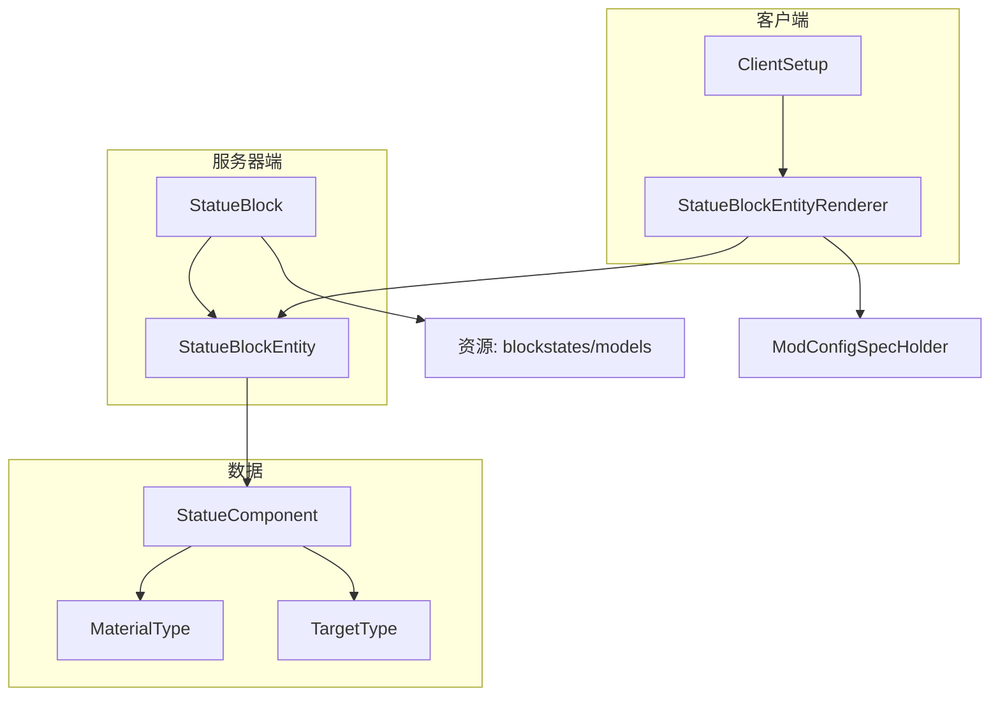
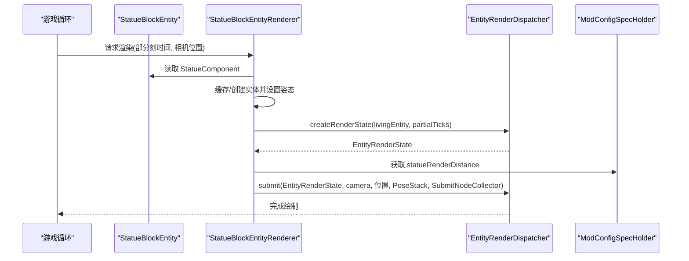
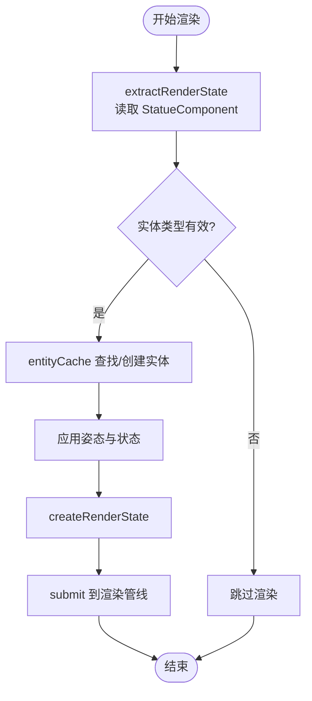
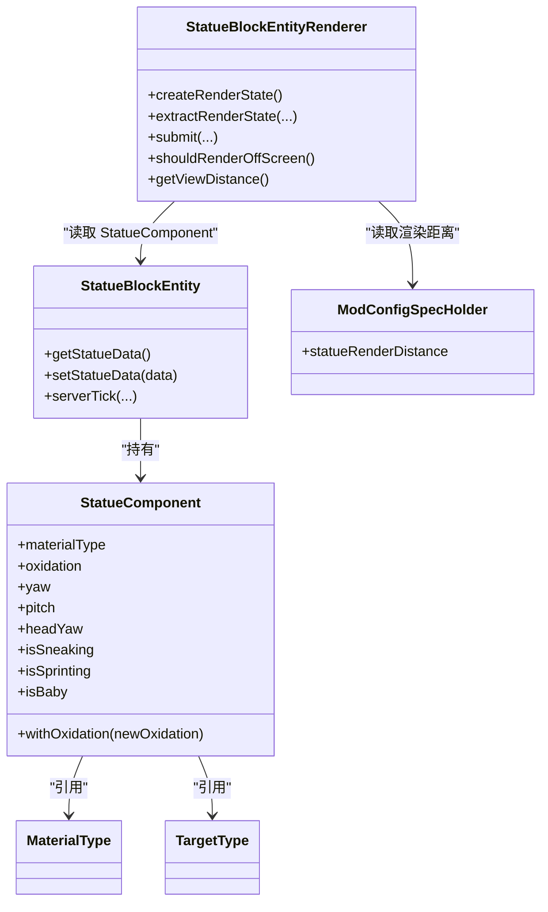

# 雕像渲染器

<cite>
**本文引用的文件**
- [StatueBlockEntityRenderer.java](file://src/main/java/com/xiong/petrification/client/StatueBlockEntityRenderer.java)
- [ClientSetup.java](file://src/main/java/com/xiong/petrification/client/ClientSetup.java)
- [StatueBlock.java](file://src/main/java/com/xiong/petrification/block/StatueBlock.java)
- [StatueBlockEntity.java](file://src/main/java/com/xiong/petrification/block/StatueBlockEntity.java)
- [MaterialType.java](file://src/main/java/com/xiong/petrification/component/MaterialType.java)
- [StatueComponent.java](file://src/main/java/com/xiong/petrification/component/StatueComponent.java)
- [TargetType.java](file://src/main/java/com/xiong/petrification/component/TargetType.java)
- [ModConfigSpecHolder.java](file://src/main/java/com/xiong/petrification/ModConfigSpecHolder.java)
- [statue_block.json（方块模型）](file://src/main/resources/assets/petrification/models/block/statue_block.json)
- [statue_block.json（方块状态）](file://src/main/resources/assets/petrification/blockstates/statue_block.json)
</cite>

## 目录
1. [简介](#简介)
2. [项目结构](#项目结构)
3. [核心组件](#核心组件)
4. [架构总览](#架构总览)
5. [详细组件分析](#详细组件分析)
6. [依赖关系分析](#依赖关系分析)
7. [性能考量](#性能考量)
8. [故障排查指南](#故障排查指南)
9. [结论](#结论)
10. [附录](#附录)

## 简介
本文件为“石化模组”的雕像渲染系统提供综合文档，聚焦于客户端渲染管线与上下文管理、不同材质类型的渲染效果、雕像模型的加载机制、动画系统的实现、性能优化技术以及扩展与调试方法。该系统的核心是 StatueBlockEntityRenderer，它负责在客户端将存储的生物姿态数据还原到实体渲染流程中，并通过配置控制渲染距离等性能参数。

## 项目结构
本项目采用按功能域组织的结构：
- 客户端渲染：StatueBlockEntityRenderer 负责雕像的渲染；ClientSetup 注册渲染器。
- 方块与方块实体：StatueBlock 定义方块行为；StatueBlockEntity 维护雕像数据并在服务端进行氧化等逻辑。
- 数据组件：StatueComponent 保存雕像的材质、姿态、装备等完整信息；MaterialType 与 TargetType 描述材质与目标类型。
- 配置：ModConfigSpecHolder 提供渲染距离、氧化速率等可调参数。
- 资源：blockstates 与 models 定义方块外观（实际渲染由 BlockEntity 接管）。

图表来源
- [StatueBlockEntityRenderer.java:31-129](file://src/main/java/com/xiong/petrification/client/StatueBlockEntityRenderer.java#L31-L129)
- [ClientSetup.java:13-18](file://src/main/java/com/xiong/petrification/client/ClientSetup.java#L13-L18)
- [StatueBlock.java:38-152](file://src/main/java/com/xiong/petrification/block/StatueBlock.java#L38-L152)
- [StatueBlockEntity.java:17-88](file://src/main/java/com/xiong/petrification/block/StatueBlockEntity.java#L17-L88)
- [StatueComponent.java:14-256](file://src/main/java/com/xiong/petrification/component/StatueComponent.java#L14-L256)
- [MaterialType.java:9-68](file://src/main/java/com/xiong/petrification/component/MaterialType.java#L9-L68)
- [TargetType.java:6-23](file://src/main/java/com/xiong/petrification/component/TargetType.java#L6-L23)
- [ModConfigSpecHolder.java:40-67](file://src/main/java/com/xiong/petrification/ModConfigSpecHolder.java#L40-L67)

章节来源
- [StatueBlockEntityRenderer.java:31-129](file://src/main/java/com/xiong/petrification/client/StatueBlockEntityRenderer.java#L31-L129)
- [ClientSetup.java:13-18](file://src/main/java/com/xiong/petrification/client/ClientSetup.java#L13-L18)
- [StatueBlock.java:38-152](file://src/main/java/com/xiong/petrification/block/StatueBlock.java#L38-L152)
- [StatueBlockEntity.java:17-88](file://src/main/java/com/xiong/petrification/block/StatueBlockEntity.java#L17-L88)
- [StatueComponent.java:14-256](file://src/main/java/com/xiong/petrification/component/StatueComponent.java#L14-L256)
- [MaterialType.java:9-68](file://src/main/java/com/xiong/petrification/component/MaterialType.java#L9-L68)
- [TargetType.java:6-23](file://src/main/java/com/xiong/petrification/component/TargetType.java#L6-L23)
- [ModConfigSpecHolder.java:40-67](file://src/main/java/com/xiong/petrification/ModConfigSpecHolder.java#L40-L67)

## 核心组件
- 雕像方块与方块实体
  - StatueBlock：定义方块属性、交互、掉落物，并将渲染委托给 BlockEntity。
  - StatueBlockEntity：持有 StatueComponent，在服务端周期性更新铜材质氧化值，并持久化数据。
- 客户端渲染器
  - StatueBlockEntityRenderer：从 BlockEntity 提取渲染状态，创建或复用实体实例，设置姿态，提交到实体渲染调度器完成绘制。
- 数据组件
  - StatueComponent：记录材质、姿态、装备、健康值、名称等大量字段，支持序列化与构造默认值。
  - MaterialType：枚举材质类型（石、铁、铜、金、钻石、下界合金），提供颜色、物品与方块映射。
  - TargetType：区分生物与玩家目标类型。
- 配置
  - ModConfigSpecHolder：提供雕像渲染距离、氧化速率、最大氧化度等配置项。

章节来源
- [StatueBlock.java:38-152](file://src/main/java/com/xiong/petrification/block/StatueBlock.java#L38-L152)
- [StatueBlockEntity.java:17-88](file://src/main/java/com/xiong/petrification/block/StatueBlockEntity.java#L17-L88)
- [StatueBlockEntityRenderer.java:31-129](file://src/main/java/com/xiong/petrification/client/StatueBlockEntityRenderer.java#L31-L129)
- [StatueComponent.java:14-256](file://src/main/java/com/xiong/petrification/component/StatueComponent.java#L14-L256)
- [MaterialType.java:9-68](file://src/main/java/com/xiong/petrification/component/MaterialType.java#L9-L68)
- [TargetType.java:6-23](file://src/main/java/com/xiong/petrification/component/TargetType.java#L6-L23)
- [ModConfigSpecHolder.java:40-67](file://src/main/java/com/xiong/petrification/ModConfigSpecHolder.java#L40-L67)

## 架构总览
雕像渲染的整体流程如下：
- 客户端启动时通过 ClientSetup 注册 StatueBlockEntityRenderer。
- 游戏运行时，StatueBlock 作为不可见方块承载 StatueBlockEntity。
- 每帧渲染时，StatueBlockEntityRenderer 从 BlockEntity 读取 StatueComponent，构建或复用实体，设置姿态与状态，生成 EntityRenderState 并提交到渲染管线。
- 渲染距离由配置 ModConfigSpecHolder.statueRenderDistance 控制。

图表来源
- [ClientSetup.java:13-18](file://src/main/java/com/xiong/petrification/client/ClientSetup.java#L13-L18)
- [StatueBlockEntityRenderer.java:44-113](file://src/main/java/com/xiong/petrification/client/StatueBlockEntityRenderer.java#L44-L113)
- [ModConfigSpecHolder.java:40-67](file://src/main/java/com/xiong/petrification/ModConfigSpecHolder.java#L40-L67)

## 详细组件分析

### StatueBlockEntityRenderer 渲染架构
- 渲染状态提取
  - 从 BlockEntity 读取 StatueComponent，校验实体类型是否存在，若不存在则跳过渲染。
  - 使用 entityCache 缓存已创建的实体以减少重复分配。
  - 将 StatueComponent 的姿态（yaw、pitch、headYaw）、动作（sneaking、sprinting、baby）应用到 LivingEntity。
  - 通过 EntityRenderDispatcher.getRenderer 获取对应实体的渲染器，并调用 createRenderState 生成可提交的渲染状态。
- 渲染提交
  - 使用 PoseStack 调整位置与朝向，并按比例缩放以适配雕像尺寸。
  - 调用 submit 将 EntityRenderState 提交到渲染管线，传入相机状态与收集器。
  - 捕获异常并静默忽略，保证渲染稳定性。
- 视图距离与可见性
  - shouldRenderOffScreen 返回 true，允许离屏渲染。
  - getViewDistance 返回配置的 statueRenderDistance，用于视锥剔除与渲染调度。

图表来源
- [StatueBlockEntityRenderer.java:44-113](file://src/main/java/com/xiong/petrification/client/StatueBlockEntityRenderer.java#L44-L113)

章节来源
- [StatueBlockEntityRenderer.java:44-113](file://src/main/java/com/xiong/petrification/client/StatueBlockEntityRenderer.java#L44-L113)

### 材质系统与着色效果
- 材质类型
  - MaterialType 定义了石、铁、铜、金、钻石、下界合金六种材质，并提供颜色、物品与方块映射。
  - StatueComponent 包含 materialType、oxidation、isWaxed 等字段，用于驱动材质表现。
- 当前实现
  - 渲染器未直接绑定自定义着色器或纹理替换，而是复用实体渲染器的默认材质与光照。
  - 方块模型（cube_all）仅用于占位，实际渲染由 BlockEntity 接管。
- 扩展建议
  - 可在 StatueBlockEntityRenderer 中根据 MaterialType 切换贴图或注入着色器 Uniform（如 materialColor、oxidation）。
  - 对铜材质结合 oxidation 实现颜色渐变与半透明氧化层。
  - 对钻石/下界合金添加边缘高光与镜面反射增强。

章节来源
- [MaterialType.java:9-68](file://src/main/java/com/xiong/petrification/component/MaterialType.java#L9-L68)
- [StatueComponent.java:14-256](file://src/main/java/com/xiong/petrification/component/StatueComponent.java#L14-L256)
- [statue_block.json（方块模型）:1-7](file://src/main/resources/assets/petrification/models/block/statue_block.json#L1-L7)
- [statue_block.json（方块状态）:1-9](file://src/main/resources/assets/petrification/blockstates/statue_block.json#L1-L9)

### 雕像模型的加载机制与缓存策略
- 动态模型生成
  - 渲染器通过 EntityType 动态创建实体实例，并使用对应实体的渲染器生成渲染状态。
  - 这避免了硬编码模型路径，支持任意生物类型。
- 缓存策略
  - entityCache 以 EntityType 为键缓存实体实例，减少频繁创建开销。
  - 建议在后续版本中加入更细粒度的缓存（如材质+姿态组合），并结合对象池进一步降低 GC 压力。

章节来源
- [StatueBlockEntityRenderer.java:63-89](file://src/main/java/com/xiong/petrification/client/StatueBlockEntityRenderer.java#L63-L89)

### 动画系统：旋转、缩放与特殊效果
- 姿态与动画
  - StatueComponent 保存 yaw、pitch、headYaw、bodyYaw、limbSwing、limbSwingAmount 等字段，渲染器将其应用到 LivingEntity，从而保持行走、转头等动画。
  - sneaking、sprinting、swimming、flying、isBaby 等布尔字段影响实体姿态与动画播放。
- 缩放与定位
  - 渲染时使用 PoseStack 平移至方块中心，绕 Y 轴旋转以匹配朝向，并整体缩放 0.5 倍以适配雕像尺寸。
- 特殊效果
  - 当前未实现粒子或特效层；可扩展为基于材质的发光、粒子环绕或名称标签渲染。

章节来源
- [StatueComponent.java:14-256](file://src/main/java/com/xiong/petrification/component/StatueComponent.java#L14-L256)
- [StatueBlockEntityRenderer.java:99-113](file://src/main/java/com/xiong/petrification/client/StatueBlockEntityRenderer.java#L99-L113)

### 服务端氧化逻辑与同步
- 氧化过程
  - StatueBlockEntity.serverTick 每隔固定刻数检查是否为铜材质且未上蜡，未达到最大氧化度则逐步增加 oxidation。
  - 通过 StatueComponent.withOxidation 生成新实例并 setChanged 触发同步。
- 方块信号输出
  - StatueBlock.getAnalogOutputSignal 根据铜材质氧化程度输出模拟信号，可用于红石联动。

章节来源
- [StatueBlockEntity.java:28-50](file://src/main/java/com/xiong/petrification/block/StatueBlockEntity.java#L28-L50)
- [StatueBlock.java:142-151](file://src/main/java/com/xiong/petrification/block/StatueBlock.java#L142-L151)

## 依赖关系分析
- 客户端依赖
  - StatueBlockEntityRenderer 依赖 EntityRenderDispatcher 与 BlockEntity 提供的 StatueComponent。
  - 渲染距离依赖 ModConfigSpecHolder.statueRenderDistance。
- 数据依赖
  - StatueComponent 依赖 MaterialType 与 TargetType，用于材质与目标类型标识。
- 资源依赖
  - 方块模型与状态文件存在但被 BlockEntity 渲染覆盖，不影响实际渲染流程。

图表来源
- [StatueBlockEntityRenderer.java:31-129](file://src/main/java/com/xiong/petrification/client/StatueBlockEntityRenderer.java#L31-L129)
- [StatueBlockEntity.java:17-88](file://src/main/java/com/xiong/petrification/block/StatueBlockEntity.java#L17-L88)
- [StatueComponent.java:14-256](file://src/main/java/com/xiong/petrification/component/StatueComponent.java#L14-L256)
- [MaterialType.java:9-68](file://src/main/java/com/xiong/petrification/component/MaterialType.java#L9-L68)
- [TargetType.java:6-23](file://src/main/java/com/xiong/petrification/component/TargetType.java#L6-L23)
- [ModConfigSpecHolder.java:40-67](file://src/main/java/com/xiong/petrification/ModConfigSpecHolder.java#L40-L67)

章节来源
- [StatueBlockEntityRenderer.java:31-129](file://src/main/java/com/xiong/petrification/client/StatueBlockEntityRenderer.java#L31-L129)
- [StatueBlockEntity.java:17-88](file://src/main/java/com/xiong/petrification/block/StatueBlockEntity.java#L17-L88)
- [StatueComponent.java:14-256](file://src/main/java/com/xiong/petrification/component/StatueComponent.java#L14-L256)
- [MaterialType.java:9-68](file://src/main/java/com/xiong/petrification/component/MaterialType.java#L9-L68)
- [TargetType.java:6-23](file://src/main/java/com/xiong/petrification/component/TargetType.java#L6-L23)
- [ModConfigSpecHolder.java:40-67](file://src/main/java/com/xiong/petrification/ModConfigSpecHolder.java#L40-L67)

## 性能考量
- 批处理渲染
  - 通过 EntityRenderDispatcher.submit 将渲染任务交给引擎批处理，减少 CPU-GPU 同步开销。
- LOD 系统
  - 当前未实现 LOD；可根据距离切换低模或使用平面纹理替代复杂模型。
- 视锥剔除
  - getViewDistance 返回配置的 statueRenderDistance，配合引擎剔除不可见雕像。
- 模型缓存
  - entityCache 避免重复创建实体；可进一步优化为材质+姿态组合的缓存键。
- 异步加载
  - 玩家皮肤等耗时资源可考虑异步加载以避免卡顿（当前未实现）。

[本节为通用性能指导，不直接分析具体文件]

## 故障排查指南
- 渲染失败或无显示
  - 检查 StatueComponent 中的 entityType 是否有效，无效时将跳过渲染。
  - 确认 ClientSetup 已正确注册 StatueBlockEntityRenderer。
- 姿态不正确
  - 核对 StatueComponent 的 yaw、pitch、headYaw 等字段是否正确写入与读取。
- 性能问题
  - 调整 ModConfigSpecHolder.statueRenderDistance 降低渲染距离。
  - 评估 entityCache 命中率，必要时引入更细粒度缓存或对象池。
- 氧化不生效
  - 确认服务端启用氧化（enableOxidation）且材质为铜，未上蜡且未达到最大氧化度。

章节来源
- [StatueBlockEntityRenderer.java:56-89](file://src/main/java/com/xiong/petrification/client/StatueBlockEntityRenderer.java#L56-L89)
- [ClientSetup.java:13-18](file://src/main/java/com/xiong/petrification/client/ClientSetup.java#L13-L18)
- [StatueBlockEntity.java:28-50](file://src/main/java/com/xiong/petrification/block/StatueBlockEntity.java#L28-L50)
- [ModConfigSpecHolder.java:40-67](file://src/main/java/com/xiong/petrification/ModConfigSpecHolder.java#L40-L67)

## 结论
StatueBlockEntityRenderer 通过复用 Minecraft 实体渲染管线，实现了高效的雕像渲染。其核心优势在于动态模型加载、姿态还原与配置驱动的渲染距离控制。当前实现未直接绑定自定义着色器或纹理替换，但为后续扩展提供了清晰的数据接口（StatueComponent、MaterialType）。建议在未来版本中引入材质化着色器、LOD 与更精细的缓存策略，以提升视觉效果与性能。

[本节为总结，不直接分析具体文件]

## 附录
- 扩展指南
  - 新增材质：在 MaterialType 中添加枚举项，并在渲染器中根据材质切换贴图或着色器 Uniform。
  - 特效开发：在 StatueBlockEntityRenderer.submit 前后插入特效层（粒子、名称标签、光晕）。
  - 着色器集成：参考 Core Shader 系统，传入 materialColor、oxidation、time 等 Uniform，实现材质化与动画效果。
- 调试工具
  - 使用游戏内调试模式查看渲染距离与实体状态。
  - 打印 StatueComponent 的关键字段以验证姿态与材质数据。
  - 通过日志观察 entityCache 命中情况与异常堆栈。

[本节为通用指导，不直接分析具体文件]