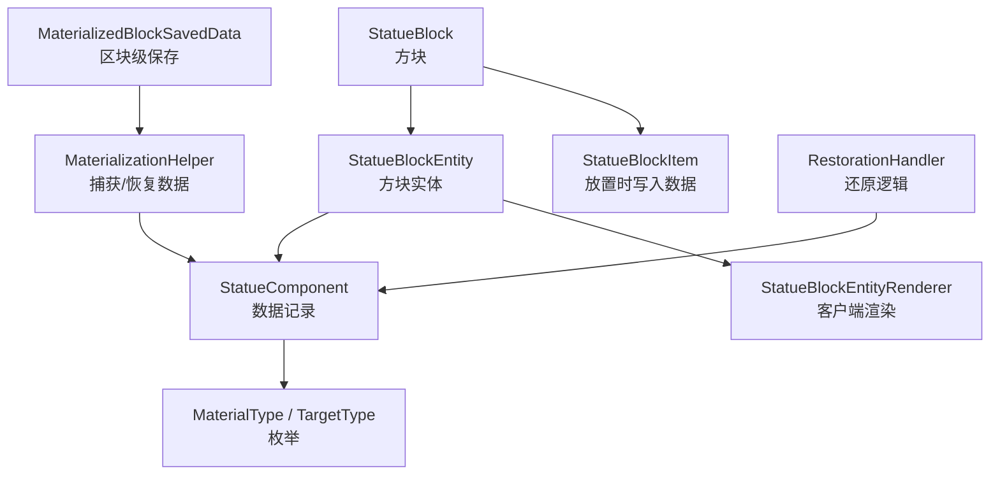
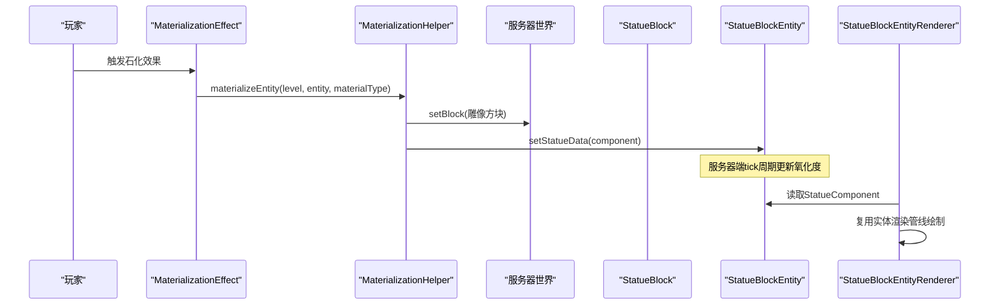
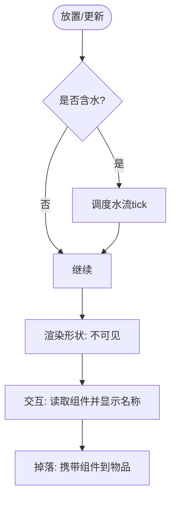
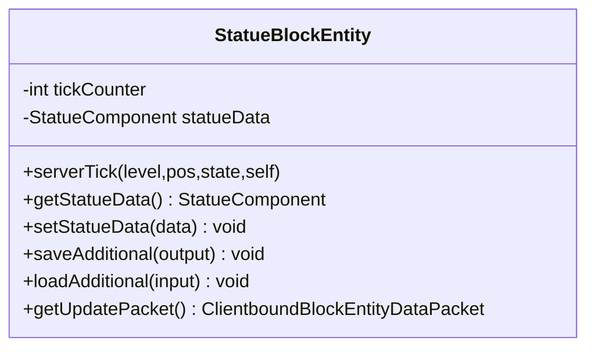
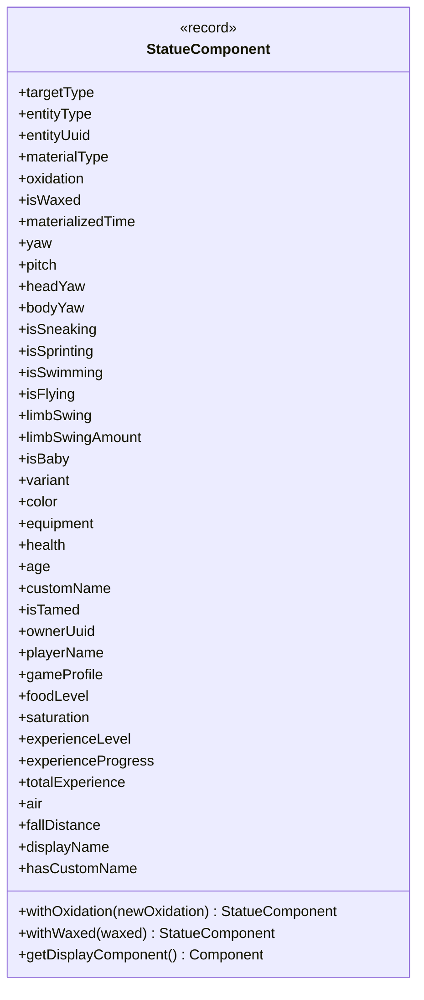
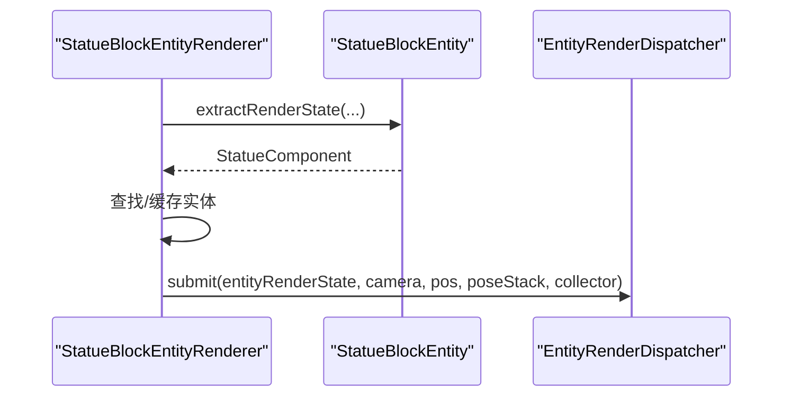
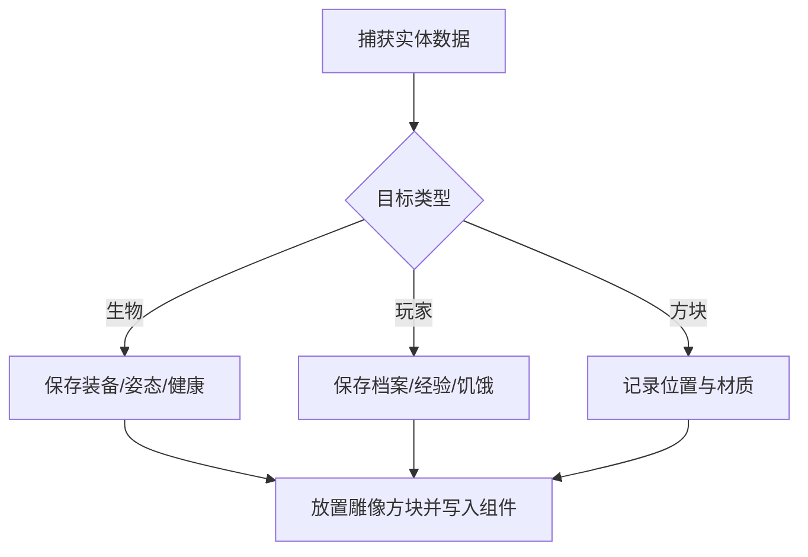
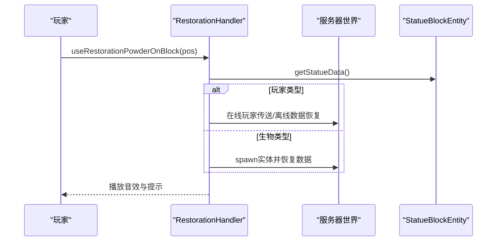
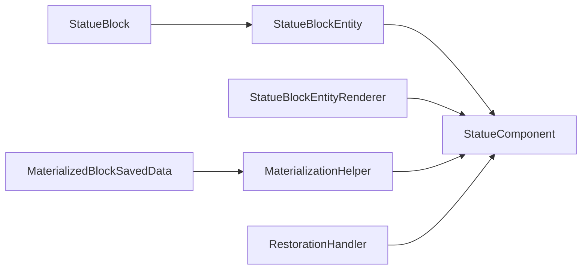

# 雕像系统

<cite>
**本文引用的文件**
- [StatueBlock.java](file://src/main/java/com/xiong/petrification/block/StatueBlock.java)
- [StatueBlockEntity.java](file://src/main/java/com/xiong/petrification/block/StatueBlockEntity.java)
- [StatueComponent.java](file://src/main/java/com/xiong/petrification/component/StatueComponent.java)
- [MaterialType.java](file://src/main/java/com/xiong/petrification/component/MaterialType.java)
- [TargetType.java](file://src/main/java/com/xiong/petrification/component/TargetType.java)
- [StatueBlockEntityRenderer.java](file://src/main/java/com/xiong/petrification/client/StatueBlockEntityRenderer.java)
- [ModBlocks.java](file://src/main/java/com/xiong/petrification/registry/ModBlocks.java)
- [ModBlockEntities.java](file://src/main/java/com/xiong/petrification/registry/ModBlockEntities.java)
- [StatueBlockItem.java](file://src/main/java/com/xiong/petrification/item/StatueBlockItem.java)
- [MaterializationEffect.java](file://src/main/java/com/xiong/petrification/effect/MaterializationEffect.java)
- [MaterializationHelper.java](file://src/main/java/com/xiong/petrification/util/MaterializationHelper.java)
- [RestorationHandler.java](file://src/main/java/com/xiong/petrification/handler/RestorationHandler.java)
- [MaterializedBlockSavedData.java](file://src/main/java/com/xiong/petrification/data/MaterializedBlockSavedData.java)
- [statue_block.json（方块状态）](file://src/main/resources/assets/petrification/blockstates/statue_block.json)
- [statue_block.json（方块模型）](file://src/main/resources/assets/petrification/models/block/statue_block.json)
- [zh_cn.json（语言文件）](file://src/main/resources/assets/petrification/lang/zh_cn.json)
</cite>

## 目录
1. [简介](#简介)
2. [项目结构](#项目结构)
3. [核心组件](#核心组件)
4. [架构总览](#架构总览)
5. [详细组件分析](#详细组件分析)
6. [依赖关系分析](#依赖关系分析)
7. [性能考量](#性能考量)
8. [故障排查指南](#故障排查指南)
9. [结论](#结论)
10. [附录](#附录)

## 简介
本文件为“石化”模组中的雕像系统提供完整技术文档。内容覆盖：
- StatueBlock方块的放置、方向与水浸特性
- StatueBlockEntity的数据管理、持久化与网络同步
- StatueComponent的37个字段结构与用途
- 客户端渲染器、模型加载与动画复用
- 雕像与原始目标（生物、玩家、方块）的关联机制
- 扩展指南（新增特性与自定义渲染）
- 性能优化与内存管理最佳实践

## 项目结构
该模块围绕“方块-实体-数据-渲染-交互”分层组织，关键路径如下：
- 方块与实体：block/StatueBlock.java、block/StatueBlockEntity.java
- 数据与类型：component/StatueComponent.java、MaterialType.java、TargetType.java
- 客户端渲染：client/StatueBlockEntityRenderer.java
- 注册表：registry/ModBlocks.java、registry/ModBlockEntities.java
- 物品与交互：item/StatueBlockItem.java、effect/MaterializationEffect.java、handler/RestorationHandler.java
- 工具与保存：util/MaterializationHelper.java、data/MaterializedBlockSavedData.java
- 资源：assets/petrification 下的方块状态、模型与本地化

图示来源
- [StatueBlock.java:38-152](file://src/main/java/com/xiong/petrification/block/StatueBlock.java#L38-L152)
- [StatueBlockEntity.java:17-87](file://src/main/java/com/xiong/petrification/block/StatueBlockEntity.java#L17-L87)
- [StatueComponent.java:14-255](file://src/main/java/com/xiong/petrification/component/StatueComponent.java#L14-L255)
- [StatueBlockEntityRenderer.java:31-129](file://src/main/java/com/xiong/petrification/client/StatueBlockEntityRenderer.java#L31-L129)
- [StatueBlockItem.java:24-82](file://src/main/java/com/xiong/petrification/item/StatueBlockItem.java#L24-L82)
- [MaterializationHelper.java:55-263](file://src/main/java/com/xiong/petrification/util/MaterializationHelper.java#L55-L263)
- [RestorationHandler.java:31-229](file://src/main/java/com/xiong/petrification/handler/RestorationHandler.java#L31-L229)
- [MaterializedBlockSavedData.java:19-86](file://src/main/java/com/xiong/petrification/data/MaterializedBlockSavedData.java#L19-L86)

章节来源
- [StatueBlock.java:38-152](file://src/main/java/com/xiong/petrification/block/StatueBlock.java#L38-L152)
- [ModBlocks.java:16-35](file://src/main/java/com/xiong/petrification/registry/ModBlocks.java#L16-L35)
- [ModBlockEntities.java:13-27](file://src/main/java/com/xiong/petrification/registry/ModBlockEntities.java#L13-L27)

## 核心组件
- StatueBlock：定义可含水、带朝向的不可见渲染方块，负责创建并绑定StatueBlockEntity；支持模拟信号输出（铜材质氧化度）。
- StatueBlockEntity：持有StatueComponent，周期性执行氧化逻辑（仅服务器端），并通过NBT持久化与网络更新。
- StatueComponent：以record形式承载37个字段，按四组Codec序列化，用于跨层传递雕像数据。
- MaterialType/TargetType：材质与目标类型枚举，决定外观前缀、颜色、对应物品/方块以及雕像类别。
- StatueBlockEntityRenderer：客户端复用实体渲染管线，将雕像以半尺寸居中渲染，应用姿态与动作状态。
- MaterializationHelper：从活体实体捕获数据生成StatueComponent，或批量处理区域实体/方块。
- RestorationHandler：根据雕像数据还原生物或玩家，并处理在线/离线玩家差异与装备恢复。
- MaterializedBlockSavedData：服务端世界数据，记录被石化的方块位置与材质信息。

章节来源
- [StatueBlock.java:38-152](file://src/main/java/com/xiong/petrification/block/StatueBlock.java#L38-L152)
- [StatueBlockEntity.java:17-87](file://src/main/java/com/xiong/petrification/block/StatueBlockEntity.java#L17-L87)
- [StatueComponent.java:14-255](file://src/main/java/com/xiong/petrification/component/StatueComponent.java#L14-L255)
- [MaterialType.java:9-68](file://src/main/java/com/xiong/petrification/component/MaterialType.java#L9-L68)
- [TargetType.java:6-23](file://src/main/java/com/xiong/petrification/component/TargetType.java#L6-L23)
- [StatueBlockEntityRenderer.java:31-129](file://src/main/java/com/xiong/petrification/client/StatueBlockEntityRenderer.java#L31-L129)
- [MaterializationHelper.java:55-263](file://src/main/java/com/xiong/petrification/util/MaterializationHelper.java#L55-L263)
- [RestorationHandler.java:31-229](file://src/main/java/com/xiong/petrification/handler/RestorationHandler.java#L31-L229)
- [MaterializedBlockSavedData.java:19-86](file://src/main/java/com/xiong/petrification/data/MaterializedBlockSavedData.java#L19-L86)

## 架构总览
整体流程分为“捕获-存储-渲染-还原”四个阶段：
- 捕获：通过效果或工具调用MaterializationHelper，将活体实体数据封装为StatueComponent，并在原位置放置StatueBlock并写入数据。
- 存储：StatueBlockEntity在服务器端周期更新氧化度（铜材质），并将StatueComponent持久化到NBT。
- 渲染：客户端渲染器读取StatueComponent，复用实体渲染管线进行可视化展示。
- 还原：使用还原粉或交互逻辑，依据StatueComponent重建实体或恢复玩家数据。

图示来源
- [MaterializationEffect.java:10-38](file://src/main/java/com/xiong/petrification/effect/MaterializationEffect.java#L10-L38)
- [MaterializationHelper.java:55-81](file://src/main/java/com/xiong/petrification/util/MaterializationHelper.java#L55-L81)
- [StatueBlockEntity.java:28-50](file://src/main/java/com/xiong/petrification/block/StatueBlockEntity.java#L28-L50)
- [StatueBlockEntityRenderer.java:44-113](file://src/main/java/com/xiong/petrification/client/StatueBlockEntityRenderer.java#L44-L113)

## 详细组件分析

### StatueBlock：放置、方向与水浸
- 放置逻辑：根据放置上下文设置水平朝向，若点击处有水则标记为可含水。
- 水浸特性：实现SimpleWaterloggedBlock接口，updateShape中调度水流tick，getFluidState返回水源。
- 渲染形状：返回不可见，实际由方块实体渲染。
- 交互行为：右键读取StatueComponent并显示名称；掉落时携带StatueComponent至物品。
- 模拟信号：铜材质雕像输出与氧化度成比例的信号强度。

图示来源
- [StatueBlock.java:60-87](file://src/main/java/com/xiong/petrification/block/StatueBlock.java#L60-L87)
- [StatueBlock.java:103-151](file://src/main/java/com/xiong/petrification/block/StatueBlock.java#L103-L151)

章节来源
- [StatueBlock.java:38-152](file://src/main/java/com/xiong/petrification/block/StatueBlock.java#L38-L152)
- [statue_block.json（方块状态）:1-9](file://src/main/resources/assets/petrification/blockstates/statue_block.json#L1-L9)
- [statue_block.json（方块模型）:1-7](file://src/main/resources/assets/petrification/models/block/statue_block.json#L1-L7)

### StatueBlockEntity：数据管理与网络同步
- 数据持有：私有字段statueData，提供getter/setter并在修改时标记变更。
- 服务器tick：每OXIDATION_INTERVAL刻检查是否为铜材质且未打蜡，逐步增加氧化度至上限。
- 持久化：saveAdditional/loadAdditional通过StatueComponent.CODEC读写NBT。
- 网络同步：getUpdatePacket返回块实体数据包，供客户端增量更新。

图示来源
- [StatueBlockEntity.java:17-87](file://src/main/java/com/xiong/petrification/block/StatueBlockEntity.java#L17-L87)

章节来源
- [StatueBlockEntity.java:17-87](file://src/main/java/com/xiong/petrification/block/StatueBlockEntity.java#L17-L87)

### StatueComponent：数据结构与序列化
- 37个字段分组：
  - GroupA（基础信息）：targetType、entityType、entityUuid、materialType、oxidation、isWaxed、materializedTime
  - GroupB（姿态与动作）：yaw、pitch、headYaw、bodyYaw、isSneaking、isSprinting、isSwimming、isFlying、limbSwing、limbSwingAmount
  - GroupC（可选数据1）：isBaby、variant、color、equipment、health、age、customName、isTamed、ownerUuid、playerName
  - GroupD（可选数据2）：gameProfile、foodLevel、saturation、experienceLevel、experienceProgress、totalExperience、air、fallDistance、displayName、hasCustomName
- 序列化：通过RecordCodecBuilder分组合并，最终xmap为统一CODEC，便于NBT与网络传输。
- 辅助方法：withOxidation、withWaxed用于生成新实例；getDisplayComponent提供显示文本。

图示来源
- [StatueComponent.java:14-255](file://src/main/java/com/xiong/petrification/component/StatueComponent.java#L14-L255)

章节来源
- [StatueComponent.java:14-255](file://src/main/java/com/xiong/petrification/component/StatueComponent.java#L14-L255)

### 客户端渲染系统
- 渲染状态提取：从StatueBlockEntity获取StatueComponent，查找对应EntityType并缓存实体实例，复制姿态与动作状态。
- 渲染提交：将实体渲染状态提交给渲染管线，调整位置、旋转与缩放（0.5倍居中）。
- 可见性与距离：支持屏幕外渲染，视图距离由配置控制。

图示来源
- [StatueBlockEntityRenderer.java:44-113](file://src/main/java/com/xiong/petrification/client/StatueBlockEntityRenderer.java#L44-L113)

章节来源
- [StatueBlockEntityRenderer.java:31-129](file://src/main/java/com/xiong/petrification/client/StatueBlockEntityRenderer.java#L31-L129)

### 雕像与原始目标的关联机制
- 生物：捕获健康值、装备、姿态、动作等，生成雕像后丢弃原实体。
- 玩家：保存游戏档案、经验、饥饿等；断开连接并保留离线数据以便后续还原。
- 方块：记录被石化的方块位置与材质，用于后续还原或统计。

图示来源
- [MaterializationHelper.java:98-186](file://src/main/java/com/xiong/petrification/util/MaterializationHelper.java#L98-L186)
- [MaterializationHelper.java:234-255](file://src/main/java/com/xiong/petrification/util/MaterializationHelper.java#L234-L255)

章节来源
- [MaterializationHelper.java:55-263](file://src/main/java/com/xiong/petrification/util/MaterializationHelper.java#L55-L263)
- [MaterializedBlockSavedData.java:19-86](file://src/main/java/com/xiong/petrification/data/MaterializedBlockSavedData.java#L19-L86)

### 还原流程
- 生物雕像：根据EntityType与姿态重建实体，恢复装备与健康。
- 玩家雕像：优先尝试在线玩家传送并恢复数据；否则利用离线存档恢复。
- 物品还原：扫描背包找到雕像物品，就地生成实体并播放音效。

图示来源
- [RestorationHandler.java:31-229](file://src/main/java/com/xiong/petrification/handler/RestorationHandler.java#L31-L229)

章节来源
- [RestorationHandler.java:31-229](file://src/main/java/com/xiong/petrification/handler/RestorationHandler.java#L31-L229)

## 依赖关系分析
- 方块与实体：StatueBlock创建并绑定StatueBlockEntity；注册表中声明实体类型支持的方块集合。
- 数据与渲染：StatueBlockEntityRenderer依赖StatueComponent与内置实体注册表进行渲染。
- 工具与处理器：MaterializationHelper与RestorationHandler共同消费/生产StatueComponent。
- 保存数据：MaterializedBlockSavedData在服务端世界数据中维护方块级信息。

图示来源
- [ModBlocks.java:16-35](file://src/main/java/com/xiong/petrification/registry/ModBlocks.java#L16-L35)
- [ModBlockEntities.java:13-27](file://src/main/java/com/xiong/petrification/registry/ModBlockEntities.java#L13-L27)
- [StatueBlockEntityRenderer.java:31-129](file://src/main/java/com/xiong/petrification/client/StatueBlockEntityRenderer.java#L31-L129)
- [MaterializationHelper.java:55-263](file://src/main/java/com/xiong/petrification/util/MaterializationHelper.java#L55-L263)
- [RestorationHandler.java:31-229](file://src/main/java/com/xiong/petrification/handler/RestorationHandler.java#L31-L229)
- [MaterializedBlockSavedData.java:19-86](file://src/main/java/com/xiong/petrification/data/MaterializedBlockSavedData.java#L19-L86)

章节来源
- [ModBlocks.java:16-35](file://src/main/java/com/xiong/petrification/registry/ModBlocks.java#L16-L35)
- [ModBlockEntities.java:13-27](file://src/main/java/com/xiong/petrification/registry/ModBlockEntities.java#L13-L27)

## 性能考量
- 服务器端氧化tick：使用固定间隔减少频繁计算，仅在铜材质且未打蜡时推进。
- 客户端渲染缓存：按EntityType缓存实体实例，避免重复创建开销。
- 渲染范围：通过配置控制雕像渲染距离，降低远端渲染压力。
- 数据序列化：StatueComponent采用分组Codec，减少冗余字段写入，提升NBT效率。
- 内存管理：
  - 实体缓存需考虑生命周期，避免长期持有导致内存泄漏（当前实现基于HashMap缓存，建议结合区块卸载清理策略）。
  - 大型区域材料化时注意批量处理的性能影响，必要时分片或延迟处理。
- 网络同步：仅当数据变化时标记并发送更新包，减少带宽占用。

[本节为通用性能指导，不直接分析具体文件]

## 故障排查指南
- 雕像无渲染：
  - 检查StatueComponent是否包含有效的entityType，并确保客户端能解析该类型。
  - 确认StatueBlockEntityRenderer的视图距离配置合理。
- 氧化不生效：
  - 确认材质为铜且未打蜡；检查服务器配置是否启用氧化。
- 还原失败：
  - 玩家雕像：在线玩家无法通过物品还原；离线玩家需存在对应存档条目。
  - 生物雕像：确保EntityType存在且可创建LivingEntity。
- 掉落异常：
  - 确认方块掉落逻辑正确携带StatueComponent到物品。

章节来源
- [StatueBlockEntityRenderer.java:44-113](file://src/main/java/com/xiong/petrification/client/StatueBlockEntityRenderer.java#L44-L113)
- [StatueBlockEntity.java:28-50](file://src/main/java/com/xiong/petrification/block/StatueBlockEntity.java#L28-L50)
- [RestorationHandler.java:31-229](file://src/main/java/com/xiong/petrification/handler/RestorationHandler.java#L31-L229)
- [StatueBlock.java:123-151](file://src/main/java/com/xiong/petrification/block/StatueBlock.java#L123-L151)

## 结论
本雕像系统以StatueComponent为核心数据载体，贯穿捕获、存储、渲染与还原全流程。通过清晰的模块划分与高效的序列化方案，实现了稳定的多端一致性与良好的可扩展性。建议在扩展时遵循现有分组Codec模式，谨慎管理实体缓存与网络同步，以获得更佳的性能表现。

[本节为总结性内容，不直接分析具体文件]

## 附录

### 37字段说明与作用
- 基础信息（GroupA）：标识目标类型、实体类型、UUID、材质、氧化度、是否打蜡、材料化时间。
- 姿态与动作（GroupB）：头部与身体角度、蹲伏/冲刺/游泳/飞行状态、肢体摆动参数。
- 可选数据1（GroupC）：幼体标志、变体/颜色、装备、健康、年龄、自定义名、驯服状态、所有者UUID、玩家名。
- 可选数据2（GroupD）：游戏档案、饥饿/饱和、经验等级/进度/总量、空气量、坠落距离、显示名、是否有自定义名。

章节来源
- [StatueComponent.java:55-128](file://src/main/java/com/xiong/petrification/component/StatueComponent.java#L55-L128)

### 扩展指南
- 新增材质：
  - 在MaterialType中添加枚举项，定义颜色、对应物品与方块、显示前缀。
  - 如需特殊行为（如不同氧化速率），可在服务器tick中扩展判断。
- 新增目标类型：
  - 在TargetType中添加枚举项，并在MaterializationHelper中适配捕获逻辑。
- 自定义渲染效果：
  - 在StatueBlockEntityRenderer中扩展渲染状态，添加着色、纹理叠加或粒子效果。
  - 可通过StatueComponent新增字段承载渲染参数，并在客户端读取应用。
- 数据持久化：
  - 在StatueComponent的分组Codec中添加新字段，保持向后兼容（使用optionalFieldOf）。
- 交互扩展：
  - 在RestorationHandler中增加新的还原或操作逻辑，配合物品或方块事件触发。

[本节为概念性扩展指导，不直接分析具体文件]