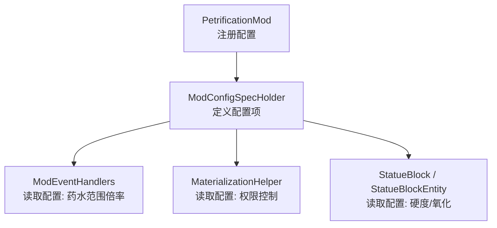
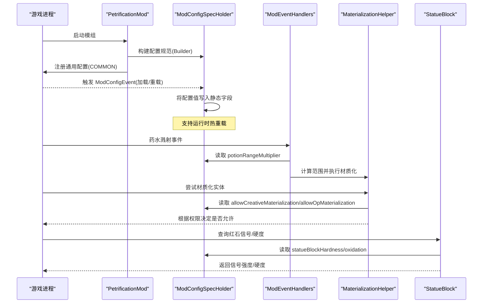
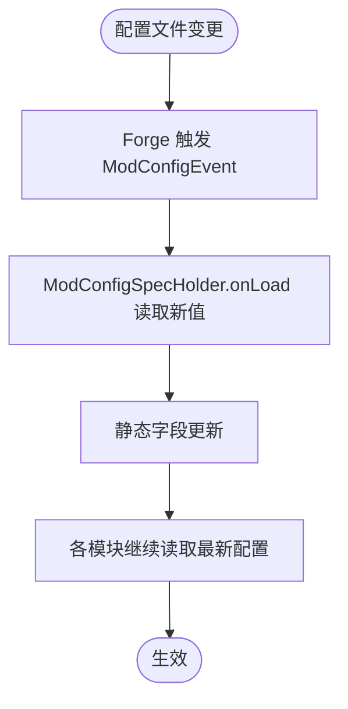
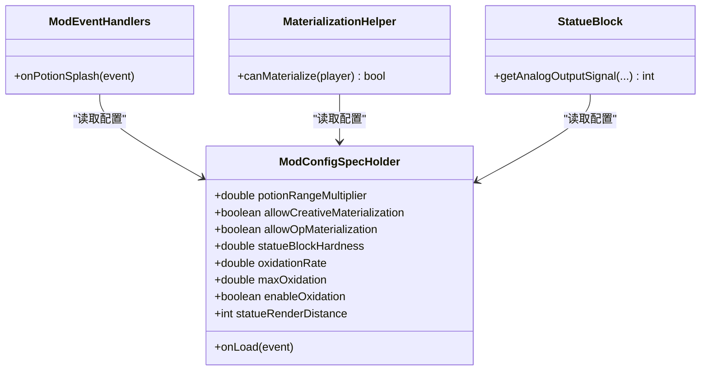

# 配置系统

<cite>
**本文引用的文件**
- [ModConfigSpecHolder.java](file://src/main/java/com/xiong/petrification/ModConfigSpecHolder.java)
- [PetrificationMod.java](file://src/main/java/com/xiong/petrification/PetrificationMod.java)
- [ModEventHandlers.java](file://src/main/java/com/xiong/petrification/handler/ModEventHandlers.java)
- [MaterializationHelper.java](file://src/main/java/com/xiong/petrification/util/MaterializationHelper.java)
- [StatueBlock.java](file://src/main/java/com/xiong/petrification/block/StatueBlock.java)
- [mods.toml](file://src/main/resources/META-INF/mods.toml)
</cite>

## 目录
1. [简介](#简介)
2. [项目结构](#项目结构)
3. [核心组件](#核心组件)
4. [架构总览](#架构总览)
5. [详细组件分析](#详细组件分析)
6. [依赖关系分析](#依赖关系分析)
7. [性能考量](#性能考量)
8. [故障排除指南](#故障排除指南)
9. [结论](#结论)
10. [附录](#附录)

## 简介
本文件为“石化”模组的配置系统技术文档，聚焦于 Forge Config API 的使用方式、配置文件结构与参数含义、服务器端与客户端配置的差异、运行时热重载机制、配置验证与默认值、以及管理员部署与多实例管理建议。内容基于代码实现进行说明，并提供可视化图示帮助理解。

## 项目结构
该模组采用模块化组织：
- 配置定义与加载集中在 ModConfigSpecHolder，使用 ForgeConfigSpec 构建规范并监听 ModConfigEvent 完成热重载。
- 主类 PetrificationMod 在模组启动时注册通用（COMMON）配置。
- 游戏逻辑通过事件处理器和工具类读取配置项，如药水范围倍率、是否允许创造模式/OP玩家材质化、雕像硬度等。
- 方块行为与红石信号输出也受配置影响（例如铜氧化程度）。

图表来源
- [PetrificationMod.java:27-46](file://src/main/java/com/xiong/petrification/PetrificationMod.java#L27-L46)
- [ModConfigSpecHolder.java:10-44](file://src/main/java/com/xiong/petrification/ModConfigSpecHolder.java#L10-L44)
- [ModEventHandlers.java:45-63](file://src/main/java/com/xiong/petrification/handler/ModEventHandlers.java#L45-L63)
- [MaterializationHelper.java:36-53](file://src/main/java/com/xiong/petrification/util/MaterializationHelper.java#L36-L53)
- [StatueBlock.java:142-151](file://src/main/java/com/xiong/petrification/block/StatueBlock.java#L142-L151)

章节来源
- [PetrificationMod.java:27-46](file://src/main/java/com/xiong/petrification/PetrificationMod.java#L27-L46)
- [ModConfigSpecHolder.java:10-44](file://src/main/java/com/xiong/petrification/ModConfigSpecHolder.java#L10-L44)

## 核心组件
- 配置定义与热重载：ModConfigSpecHolder
  - 使用 ForgeConfigSpec.Builder 定义所有配置项，包含注释、默认值与取值范围。
  - 通过 @SubscribeEvent(ModConfigEvent) 将配置值同步到静态字段，支持运行时热重载。
- 配置注册：PetrificationMod
  - 在模组构造中调用 registerConfig(ModConfig.Type.COMMON, SPEC)，将配置以通用配置形式注册。
- 配置使用点：
  - 药水溅射触发材质化范围：ModEventHandlers 根据 potionRangeMultiplier 计算半径。
  - 权限控制：MaterializationHelper 依据 allowCreativeMaterialization 与 allowOpMaterialization 限制可材质化的目标。
  - 雕像属性：StatueBlock 的硬度由 statueBlockHardness 控制；铜雕像的红石信号强度与氧化程度相关。

章节来源
- [ModConfigSpecHolder.java:10-67](file://src/main/java/com/xiong/petrification/ModConfigSpecHolder.java#L10-L67)
- [PetrificationMod.java:43-46](file://src/main/java/com/xiong/petrification/PetrificationMod.java#L43-L46)
- [ModEventHandlers.java:45-63](file://src/main/java/com/xiong/petrification/handler/ModEventHandlers.java#L45-L63)
- [MaterializationHelper.java:36-53](file://src/main/java/com/xiong/petrification/util/MaterializationHelper.java#L36-L53)
- [StatueBlock.java:142-151](file://src/main/java/com/xiong/petrification/block/StatueBlock.java#L142-L151)

## 架构总览
下图展示了配置从定义到生效的关键路径：

图表来源
- [PetrificationMod.java:27-46](file://src/main/java/com/xiong/petrification/PetrificationMod.java#L27-L46)
- [ModConfigSpecHolder.java:57-67](file://src/main/java/com/xiong/petrification/ModConfigSpecHolder.java#L57-L67)
- [ModEventHandlers.java:45-63](file://src/main/java/com/xiong/petrification/handler/ModEventHandlers.java#L45-L63)
- [MaterializationHelper.java:36-53](file://src/main/java/com/xiong/petrification/util/MaterializationHelper.java#L36-L53)
- [StatueBlock.java:142-151](file://src/main/java/com/xiong/petrification/block/StatueBlock.java#L142-L151)

## 详细组件分析

### 配置项清单与含义
以下为 ModConfigSpecHolder 中定义的全部配置项及其作用说明：

- general.potionRangeMultiplier（double，范围 0.1~10.0，默认 1.0）
  - 药水效果范围倍率。用于放大或缩小药水溅射触发的材质化区域半径。
  - 使用位置：ModEventHandlers 在药水溅射事件中乘以基础半径。

- general.allowCreativeMaterialization（boolean，默认 false）
  - 是否允许对创造模式玩家进行材质化。若为 false，则阻止创造模式玩家被材质化。
  - 使用位置：MaterializationHelper.canMaterialize 中进行判断。

- general.allowOpMaterialization（boolean，默认 false）
  - 是否允许对拥有较高权限（OP）的玩家进行材质化。若为 false，则阻止高权限玩家被材质化。
  - 使用位置：MaterializationHelper.canMaterialize 中检查权限等级。

- general.statueBlockHardness（double，范围 0.1~100.0，默认 2.0）
  - 雕像方块的硬度。影响挖掘难度与掉落等行为。
  - 使用位置：在雕像方块相关逻辑中作为硬度参考（具体应用取决于方块属性设置）。

- oxidation.oxidationRate（double，范围 0.0~1.0，默认 0.001）
  - 铜氧化增量速率（每固定刻数增加的值）。控制铜材质雕像的氧化速度。
  - 使用位置：与雕像氧化状态更新逻辑配合（当前代码中氧化状态由数据组件维护）。

- oxidation.maxOxidation（double，范围 0.0~1.0，默认 1.0）
  - 最大氧化值。表示完全氧化的上限。
  - 使用位置：限制铜雕像氧化程度的最大值。

- oxidation.enableOxidation（boolean，默认 true）
  - 是否启用铜氧化机制。关闭后不会进行氧化更新。
  - 使用位置：在氧化相关逻辑中作为开关。

- performance.statueRenderDistance（int，范围 16~256，默认 64）
  - 雕像渲染距离（方块单位）。超过此距离可能降低渲染精度或使用 LOD。
  - 使用位置：客户端渲染管线中用于裁剪或降级渲染。

章节来源
- [ModConfigSpecHolder.java:12-43](file://src/main/java/com/xiong/petrification/ModConfigSpecHolder.java#L12-L43)
- [ModEventHandlers.java:58-60](file://src/main/java/com/xiong/petrification/handler/ModEventHandlers.java#L58-L60)
- [MaterializationHelper.java:36-53](file://src/main/java/com/xiong/petrification/util/MaterializationHelper.java#L36-L53)
- [StatueBlock.java:142-151](file://src/main/java/com/xiong/petrification/block/StatueBlock.java#L142-L151)

### 服务器端与客户端配置差异
- 当前实现仅注册了通用配置（COMMON），适用于服务器与客户端共享。
- 这意味着上述配置项在服务器与客户端均生效，且通过 ModConfigEvent 在两端同时热重载。
- 若未来需要区分服务端与客户端行为，可在主类中分别注册 Type.SERVER 与 Type.CLIENT 的配置。

章节来源
- [PetrificationMod.java:43-46](file://src/main/java/com/xiong/petrification/PetrificationMod.java#L43-L46)

### 运行时配置修改与热重载
- 热重载机制：
  - 当配置文件被修改并保存后，Forge 会触发 ModConfigEvent。
  - ModConfigSpecHolder 中的 onLoad 方法会将最新配置值读入静态字段，供全局读取。
- 影响范围：
  - 药水范围倍率：立即影响后续药水溅射事件的计算。
  - 权限控制：立即影响新的材质化请求。
  - 雕像硬度与氧化：影响后续交互与信号输出。
  - 渲染距离：客户端重新渲染时生效。

图表来源
- [ModConfigSpecHolder.java:57-67](file://src/main/java/com/xiong/petrification/ModConfigSpecHolder.java#L57-L67)

### 配置验证与默认值
- 验证：
  - 使用 defineInRange 确保数值型配置在合法范围内，超出范围将被拒绝或回退。
  - 布尔型配置无额外验证。
- 默认值：
  - 每个配置项都提供了合理的默认值，保证首次运行即可正常工作。
- 错误处理：
  - 若配置文件格式错误或值非法，Forge 会在日志中提示并忽略无效项，保持其他配置可用。

章节来源
- [ModConfigSpecHolder.java:12-43](file://src/main/java/com/xiong/petrification/ModConfigSpecHolder.java#L12-L43)

### 配置使用示例与推荐设置
- 药水范围倍率：
  - 推荐设置为 1.0~3.0，平衡效果范围与性能。
  - 大型服务器可适当提高以扩大范围，但需注意性能开销。
- 权限控制：
  - 公共服务器建议保持 allowCreativeMaterialization=false 与 allowOpMaterialization=false，防止滥用。
  - 单人或信任环境可开启以增强玩法。
- 雕像硬度：
  - 默认 2.0 适合大多数场景；如需更耐久可提升至 5.0~10.0。
- 氧化机制：
  - 建议 enableOxidation=true，并根据服务器节奏调整 oxidationRate（如 0.001~0.01）。
  - maxOxidation=1.0 表示完全氧化；如需渐进式外观变化可保持默认。
- 渲染距离：
  - 默认 64 适合中等配置；低配设备可降低至 32~48，高配设备可提升至 128~256。

章节来源
- [ModConfigSpecHolder.java:12-43](file://src/main/java/com/xiong/petrification/ModConfigSpecHolder.java#L12-L43)
- [ModEventHandlers.java:58-60](file://src/main/java/com/xiong/petrification/handler/ModEventHandlers.java#L58-L60)
- [MaterializationHelper.java:36-53](file://src/main/java/com/xiong/petrification/util/MaterializationHelper.java#L36-L53)
- [StatueBlock.java:142-151](file://src/main/java/com/xiong/petrification/block/StatueBlock.java#L142-L151)

## 依赖关系分析
- 配置定义与使用：
  - ModConfigSpecHolder 提供配置项与热重载。
  - 多个模块通过静态字段访问配置，形成松耦合依赖。
- 事件驱动：
  - 药水溅射事件触发材质化流程，读取配置并调用工具类。
- 方块行为：
  - 雕像方块根据配置输出红石信号与硬度。

图表来源
- [ModConfigSpecHolder.java:46-67](file://src/main/java/com/xiong/petrification/ModConfigSpecHolder.java#L46-L67)
- [ModEventHandlers.java:45-63](file://src/main/java/com/xiong/petrification/handler/ModEventHandlers.java#L45-L63)
- [MaterializationHelper.java:36-53](file://src/main/java/com/xiong/petrification/util/MaterializationHelper.java#L36-L53)
- [StatueBlock.java:142-151](file://src/main/java/com/xiong/petrification/block/StatueBlock.java#L142-L151)

章节来源
- [ModConfigSpecHolder.java:46-67](file://src/main/java/com/xiong/petrification/ModConfigSpecHolder.java#L46-L67)
- [ModEventHandlers.java:45-63](file://src/main/java/com/xiong/petrification/handler/ModEventHandlers.java#L45-L63)
- [MaterializationHelper.java:36-53](file://src/main/java/com/xiong/petrification/util/MaterializationHelper.java#L36-L53)
- [StatueBlock.java:142-151](file://src/main/java/com/xiong/petrification/block/StatueBlock.java#L142-L151)

## 性能考量
- 药水范围倍率：
  - 过大的范围会导致大量实体检测与材质化操作，建议在大型服务器谨慎调高。
- 雕像渲染距离：
  - 增大渲染距离会增加 GPU/CPU 负载，应根据硬件条件调整。
- 氧化机制：
  - 高频氧化更新可能带来额外计算，合理设置 oxidationRate 与 enableOxidation。
- 权限检查：
  - 每次材质化都会进行权限校验，避免频繁调用以提升性能。

[本节为通用性能建议，不直接分析具体文件]

## 故障排除指南
- 配置文件无法加载或报错：
  - 检查 TOML 语法与键名是否与配置规范一致。
  - 确认数值在 defineInRange 指定范围内。
- 配置修改未生效：
  - 确认已保存配置文件并等待 ModConfigEvent 触发。
  - 检查日志中是否有配置重载相关提示。
- 权限问题导致无法材质化：
  - 检查 allowCreativeMaterialization 与 allowOpMaterialization 的设置。
  - 确认玩家权限等级是否符合预期。
- 雕像硬度异常：
  - 检查 statueBlockHardness 是否在合理范围。
  - 确认方块属性是否正确应用硬度。

章节来源
- [ModConfigSpecHolder.java:12-43](file://src/main/java/com/xiong/petrification/ModConfigSpecHolder.java#L12-L43)
- [ModConfigSpecHolder.java:57-67](file://src/main/java/com/xiong/petrification/ModConfigSpecHolder.java#L57-L67)
- [MaterializationHelper.java:36-53](file://src/main/java/com/xiong/petrification/util/MaterializationHelper.java#L36-L53)
- [StatueBlock.java:142-151](file://src/main/java/com/xiong/petrification/block/StatueBlock.java#L142-L151)

## 结论
该模组的配置系统基于 Forge Config API，采用通用配置（COMMON）并在运行时支持热重载。配置项覆盖药水范围、权限控制、雕像属性与性能优化等方面，并通过事件与工具类在各模块中安全读取。管理员可根据服务器环境与玩家群体调整配置以获得最佳体验。

[本节为总结性内容，不直接分析具体文件]

## 附录

### 服务器部署配置指导
- 安装与启用：
  - 确保 Forge 版本满足 mods.toml 要求。
  - 将模组放入服务器 mods 目录并启动。
- 配置文件位置：
  - 通用配置文件位于 config 目录下，文件名由模组 ID 决定。
- 多实例管理：
  - 每个服务器实例拥有独立配置文件，便于差异化设置。
  - 可通过脚本批量复制与修改配置文件，快速部署多实例。

章节来源
- [mods.toml:1-28](file://src/main/resources/META-INF/mods.toml#L1-L28)
- [PetrificationMod.java:43-46](file://src/main/java/com/xiong/petrification/PetrificationMod.java#L43-L46)

### 常见配置场景推荐
- 小型生存服：
  - potionRangeMultiplier=1.5，allowCreativeMaterialization=false，allowOpMaterialization=false，statueBlockHardness=2.0，oxidationRate=0.001，statueRenderDistance=64。
- 大型多人服：
  - potionRangeMultiplier=1.0~2.0，严格权限控制，statueBlockHardness=3.0~5.0，oxidationRate=0.001~0.005，statueRenderDistance=48~64。
- 创意/测试服：
  - 可开启 allowCreativeMaterialization=true，适当提高 potionRangeMultiplier 与 statueRenderDistance 以增强体验。

章节来源
- [ModConfigSpecHolder.java:12-43](file://src/main/java/com/xiong/petrification/ModConfigSpecHolder.java#L12-L43)
- [ModEventHandlers.java:58-60](file://src/main/java/com/xiong/petrification/handler/ModEventHandlers.java#L58-L60)
- [MaterializationHelper.java:36-53](file://src/main/java/com/xiong/petrification/util/MaterializationHelper.java#L36-L53)
- [StatueBlock.java:142-151](file://src/main/java/com/xiong/petrification/block/StatueBlock.java#L142-L151)