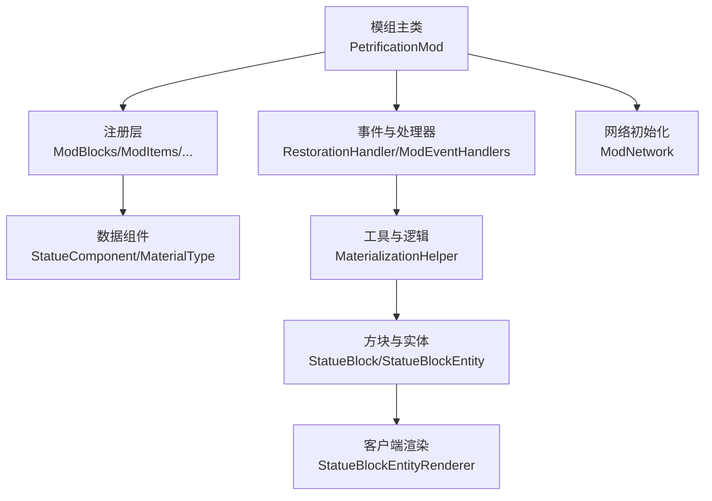
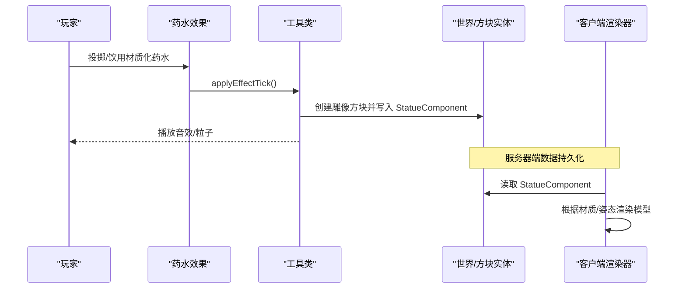
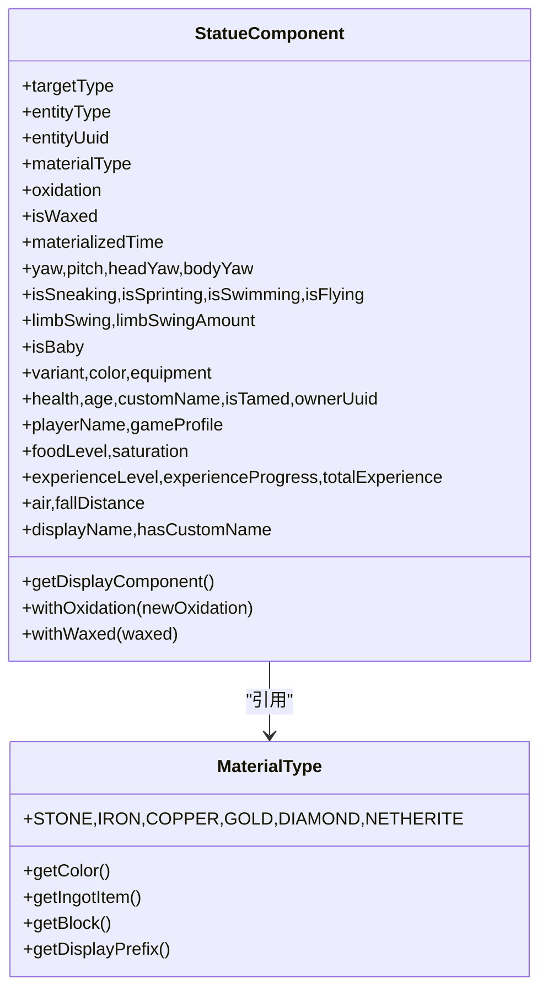
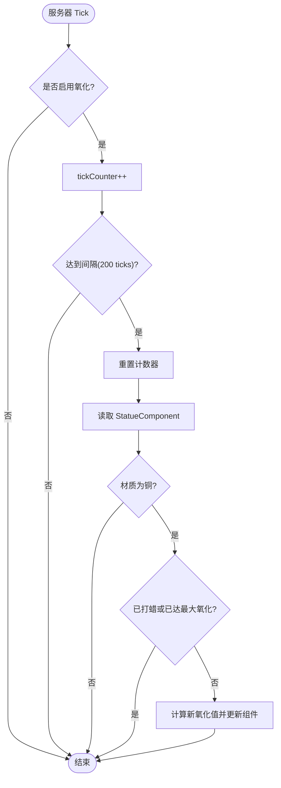
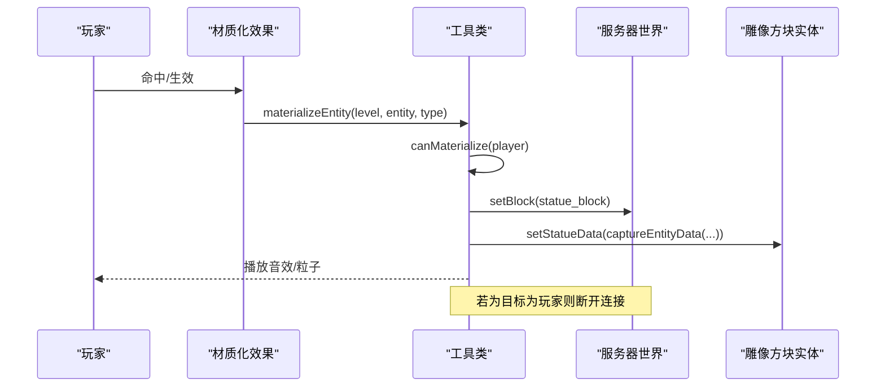
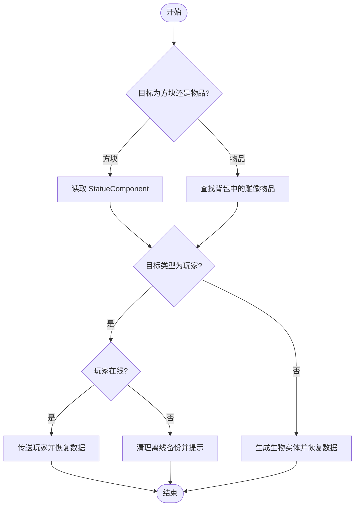
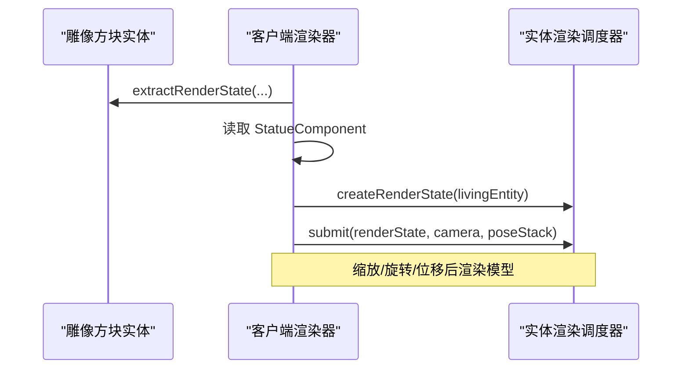
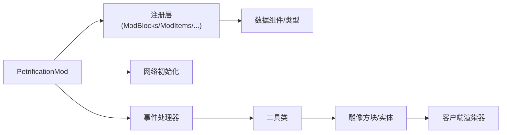

# 项目概述

<cite>
**本文引用的文件**
- [PetrificationMod.java](file://src/main/java/com/xiong/petrification/PetrificationMod.java)
- [mods.toml](file://src/main/resources/META-INF/mods.toml)
- [build.gradle](file://build.gradle)
- [Minecraft+26.2模组完整思路.md](file://Minecraft+26.2模组完整思路.md)
- [StatueComponent.java](file://src/main/java/com/xiong/petrification/component/StatueComponent.java)
- [MaterialType.java](file://src/main/java/com/xiong/petrification/component/MaterialType.java)
- [StatueBlock.java](file://src/main/java/com/xiong/petrification/block/StatueBlock.java)
- [StatueBlockEntity.java](file://src/main/java/com/xiong/petrification/block/StatueBlockEntity.java)
- [MaterializationEffect.java](file://src/main/java/com/xiong/petrification/effect/MaterializationEffect.java)
- [RestorationHandler.java](file://src/main/java/com/xiong/petrification/handler/RestorationHandler.java)
- [MaterializationHelper.java](file://src/main/java/com/xiong/petrification/util/MaterializationHelper.java)
- [ModBlocks.java](file://src/main/java/com/xiong/petrification/registry/ModBlocks.java)
- [ModItems.java](file://src/main/java/com/xiong/petrification/registry/ModItems.java)
- [StatueBlockEntityRenderer.java](file://src/main/java/com/xiong/petrification/client/StatueBlockEntityRenderer.java)
</cite>

## 目录
1. [简介](#简介)
2. [项目结构](#项目结构)
3. [核心组件](#核心组件)
4. [架构总览](#架构总览)
5. [详细组件分析](#详细组件分析)
6. [依赖关系分析](#依赖关系分析)
7. [性能考量](#性能考量)
8. [故障排查指南](#故障排查指南)
9. [结论](#结论)
10. [附录](#附录)

## 简介
石化（Petrification）是一款基于 Forge 的 Minecraft 26.2 模组，核心理念是“用极少的方块与物品，通过数据组件系统与渲染管线实现无限的材质化组合”。玩家可使用不同材质的药水将生物、玩家与方块转化为对应材质的雕像；雕像可被挖掘、放置、合成与还原。模组采用“零实体注册”的设计：材质化后的目标不再保留实体，而是以“雕像方块 + 方块实体”的形式持久化，并通过客户端渲染器在正确位置显示原实体的模型外观。

主要特性包括：
- 六类材质：石化、铁化、铜化、金化、钻石化、下界合金化
- 完整的生命周期闭环：材质化 → 挖掘掉落 → 放置 → 分解/合成 → 还原
- 铜材质氧化系统：支持打蜡锁定氧化进度
- 数据驱动渲染：通过数据组件传递颜色、姿态、装备等，由客户端渲染器应用材质化着色效果
- 配置化行为：范围、权限、氧化速度、渲染距离等均可调

技术栈与版本：
- 框架：Forge（loaderVersion "[65,)"）
- Minecraft：26.2（版本范围 "[26.2,26.3,)"）
- Java：25（构建脚本指定语言级别）
- 构建工具：Gradle（net.minecraftforge.gradle 插件）

安装要求与依赖：
- 需要安装 Forge 65.x 及以上
- 运行环境为 Minecraft 26.2
- 无第三方模组强制依赖（仅依赖 Forge 与 Minecraft）

基本配置选项（示例说明，具体键名见设计文档）：
- 通用：药水影响范围倍率、是否允许创造模式/OP玩家材质化、雕像硬度
- 氧化：氧化速率、最大氧化值、是否启用氧化
- 合成：分解是否返还经验、合成是否消耗经验及所需等级
- 性能：雕像渲染距离、是否启用模型缓存与实例化渲染

使用场景示例：
- 对僵尸投掷“铜化药水”，生成可氧化、可打蜡的铜化僵尸雕像
- 手持还原粉右键雕像方块或背包中的雕像物品，恢复为原生物或在线玩家
- 将雕像放入工作台按配方分解为对应材料，或用同种材料合成空雕像

章节来源
- [Minecraft+26.2模组完整思路.md:1-12](file://Minecraft+26.2模组完整思路.md#L1-L12)
- [mods.toml:1-28](file://src/main/resources/META-INF/mods.toml#L1-L28)
- [build.gradle:15-16](file://build.gradle#L15-L16)

## 项目结构
模组采用分层组织方式：
- 入口与生命周期：模组主类负责注册、事件订阅、网络初始化与客户端设置
- 注册层：统一注册方块、物品、效果、药水、数据组件、创意栏等
- 逻辑层：材质化/还原处理、药水效果、辅助工具
- 数据层：数据组件（StatueComponent）、类型枚举（MaterialType、TargetType）、世界/玩家持久化数据
- 客户端层：方块实体渲染器、着色器与模型缓存
- 资源层：语言、模型、方块状态、战利品表、配方与标签

图表来源
- [PetrificationMod.java:25-63](file://src/main/java/com/xiong/petrification/PetrificationMod.java#L25-L63)
- [ModBlocks.java:16-33](file://src/main/java/com/xiong/petrification/registry/ModBlocks.java#L16-L33)
- [ModItems.java:12-30](file://src/main/java/com/xiong/petrification/registry/ModItems.java#L12-L30)
- [StatueBlock.java:38-101](file://src/main/java/com/xiong/petrification/block/StatueBlock.java#L38-L101)
- [StatueBlockEntityRenderer.java:30-123](file://src/main/java/com/xiong/petrification/client/StatueBlockEntityRenderer.java#L30-L123)

章节来源
- [PetrificationMod.java:25-63](file://src/main/java/com/xiong/petrification/PetrificationMod.java#L25-L63)
- [ModBlocks.java:16-33](file://src/main/java/com/xiong/petrification/registry/ModBlocks.java#L16-L33)
- [ModItems.java:12-30](file://src/main/java/com/xiong/petrification/registry/ModItems.java#L12-L30)

## 核心组件
- 数据组件 StatueComponent：承载所有材质化信息（目标类型、实体标识、材质类型、姿态、装备、玩家状态等），通过 Codec 分组序列化，保证 NBT/数据组件存储与传输的类型安全与可扩展性
- 材质类型 MaterialType：定义六种材质及其颜色、对应锭/块、显示前缀等
- 雕像方块 StatueBlock：不可见渲染占位，持有 StatueBlockEntity；支持方向与水浸；提供模拟信号输出（用于铜氧化进度）
- 方块实体 StatueBlockEntity：服务器 Tick 中按配置进行铜氧化更新；持久化 StatueComponent
- 药水效果 MaterializationEffect：瞬时效果，命中时调用工具类执行材质化
- 工具类 MaterializationHelper：封装实体/区域材质化、数据捕获、装备保存/恢复、方块覆层记录、粒子与音效
- 还原处理器 RestorationHandler：处理方块/物品中的雕像还原、在线/离线玩家还原、铜打蜡交互

章节来源
- [StatueComponent.java:14-148](file://src/main/java/com/xiong/petrification/component/StatueComponent.java#L14-L148)
- [MaterialType.java:9-68](file://src/main/java/com/xiong/petrification/component/MaterialType.java#L9-L68)
- [StatueBlock.java:38-153](file://src/main/java/com/xiong/petrification/block/StatueBlock.java#L38-L153)
- [StatueBlockEntity.java:17-88](file://src/main/java/com/xiong/petrification/block/StatueBlockEntity.java#L17-L88)
- [MaterializationEffect.java:10-38](file://src/main/java/com/xiong/petrification/effect/MaterializationEffect.java#L10-L38)
- [MaterializationHelper.java:33-263](file://src/main/java/com/xiong/petrification/util/MaterializationHelper.java#L33-L263)
- [RestorationHandler.java:31-229](file://src/main/java/com/xiong/petrification/handler/RestorationHandler.java#L31-L229)

## 架构总览
整体采用“注册层 + 事件/处理器 + 数据组件 + 客户端渲染”的分层架构。模组主类集中完成注册与生命周期绑定；业务逻辑集中在工具类与处理器；数据通过数据组件跨世界/物品/网络同步；客户端通过专用渲染器读取数据并渲染模型。

图表来源
- [MaterializationEffect.java:22-31](file://src/main/java/com/xiong/petrification/effect/MaterializationEffect.java#L22-L31)
- [MaterializationHelper.java:55-81](file://src/main/java/com/xiong/petrification/util/MaterializationHelper.java#L55-L81)
- [StatueBlockEntity.java:28-50](file://src/main/java/com/xiong/petrification/block/StatueBlockEntity.java#L28-L50)
- [StatueBlockEntityRenderer.java:44-113](file://src/main/java/com/xiong/petrification/client/StatueBlockEntityRenderer.java#L44-L113)

## 详细组件分析

### 数据组件与材质系统
- StatueComponent 使用 Record 与分组 Codec，将字段分为基础信息、姿态、可选数据等组，便于序列化与扩展
- MaterialType 提供材质到颜色、物品、方块的映射，以及显示前缀，支撑 UI 提示与合成/分解逻辑
- 默认雕像名称由材质前缀与实体名拼接，支持自定义名称覆盖

图表来源
- [StatueComponent.java:14-148](file://src/main/java/com/xiong/petrification/component/StatueComponent.java#L14-L148)
- [MaterialType.java:9-68](file://src/main/java/com/xiong/petrification/component/MaterialType.java#L9-L68)

章节来源
- [StatueComponent.java:14-148](file://src/main/java/com/xiong/petrification/component/StatueComponent.java#L14-L148)
- [MaterialType.java:9-68](file://src/main/java/com/xiong/petrification/component/MaterialType.java#L9-L68)

### 雕像方块与方块实体
- StatueBlock 继承 BaseEntityBlock，支持方向与水浸，渲染形状为不可见，实际视觉由客户端渲染器负责
- 提供模拟信号输出：当材质为铜且存在氧化进度时，输出强度与氧化值成正比
- StatueBlockEntity 维护 StatueComponent 并在服务器 Tick 中按配置递增铜氧化值，同时持久化数据

图表来源
- [StatueBlockEntity.java:28-50](file://src/main/java/com/xiong/petrification/block/StatueBlockEntity.java#L28-L50)
- [StatueBlock.java:137-151](file://src/main/java/com/xiong/petrification/block/StatueBlock.java#L137-L151)

章节来源
- [StatueBlock.java:38-153](file://src/main/java/com/xiong/petrification/block/StatueBlock.java#L38-L153)
- [StatueBlockEntity.java:17-88](file://src/main/java/com/xiong/petrification/block/StatueBlockEntity.java#L17-L88)

### 药水与材质化流程
- 药水效果为瞬时，命中后调用工具类的材质化方法
- 工具类负责权限检查、数据捕获、生成雕像方块、写入数据组件、移除原实体（玩家则断开连接）
- 区域材质化支持按半径扫描实体并按优先级（玩家优先）处理

图表来源
- [MaterializationEffect.java:22-31](file://src/main/java/com/xiong/petrification/effect/MaterializationEffect.java#L22-L31)
- [MaterializationHelper.java:36-81](file://src/main/java/com/xiong/petrification/util/MaterializationHelper.java#L36-L81)

章节来源
- [MaterializationEffect.java:10-38](file://src/main/java/com/xiong/petrification/effect/MaterializationEffect.java#L10-L38)
- [MaterializationHelper.java:33-96](file://src/main/java/com/xiong/petrification/util/MaterializationHelper.java#L33-L96)

### 还原系统
- 支持从方块与背包物品两种触发点还原
- 玩家在线：传送至雕像位置并恢复数据；离线：清理存档条目并提示
- 生物：在指定位置生成实体并恢复姿态、装备、健康等
- 铜打蜡：对铜材质雕像进行打蜡，锁定氧化进度

图表来源
- [RestorationHandler.java:34-138](file://src/main/java/com/xiong/petrification/handler/RestorationHandler.java#L34-L138)
- [RestorationHandler.java:184-229](file://src/main/java/com/xiong/petrification/handler/RestorationHandler.java#L184-L229)

章节来源
- [RestorationHandler.java:31-229](file://src/main/java/com/xiong/petrification/handler/RestorationHandler.java#L31-L229)

### 客户端渲染
- 客户端渲染器从方块实体提取 StatueComponent，根据 entityType 获取实体并复用缓存
- 设置姿态、年龄、奔跑/潜行状态，提交渲染状态到渲染管线
- 支持视距与渲染距离配置，提升大量雕像时的性能

图表来源
- [StatueBlockEntityRenderer.java:44-113](file://src/main/java/com/xiong/petrification/client/StatueBlockEntityRenderer.java#L44-L113)

章节来源
- [StatueBlockEntityRenderer.java:30-123](file://src/main/java/com/xiong/petrification/client/StatueBlockEntityRenderer.java#L30-L123)

## 依赖关系分析
- 运行时依赖：Forge（loaderVersion "[65,)"）、Minecraft（"[26.2,26.3,)"）
- 构建依赖：Java 25、Gradle Forge 插件
- 内部模块耦合：
  - 主类依赖注册层与事件处理器
  - 工具类依赖数据组件与方块/物品注册
  - 客户端渲染器依赖数据组件与实体渲染调度
  - 方块实体依赖配置与数据组件

图表来源
- [PetrificationMod.java:25-63](file://src/main/java/com/xiong/petrification/PetrificationMod.java#L25-L63)
- [ModBlocks.java:16-33](file://src/main/java/com/xiong/petrification/registry/ModBlocks.java#L16-L33)
- [ModItems.java:12-30](file://src/main/java/com/xiong/petrification/registry/ModItems.java#L12-L30)
- [StatueBlockEntityRenderer.java:30-123](file://src/main/java/com/xiong/petrification/client/StatueBlockEntityRenderer.java#L30-L123)

章节来源
- [mods.toml:15-27](file://src/main/resources/META-INF/mods.toml#L15-L27)
- [build.gradle:53-56](file://build.gradle#L53-L56)

## 性能考量
- 模型缓存：客户端渲染器维护实体缓存，避免重复创建
- 渲染距离：可通过配置调整雕像渲染距离，减少远距离渲染开销
- 服务器 Tick 节流：铜氧化每 200 ticks 更新一次，避免频繁计算
- 数据序列化：数据组件分组 Codec 降低序列化复杂度
- 建议优化：
  - 在大规模雕像场景中启用实例化渲染（如后续扩展）
  - 对可见性进行剔除优化，减少无效渲染
  - 异步加载玩家皮肤（若有皮肤渲染需求）

章节来源
- [StatueBlockEntityRenderer.java:115-123](file://src/main/java/com/xiong/petrification/client/StatueBlockEntityRenderer.java#L115-L123)
- [StatueBlockEntity.java:28-50](file://src/main/java/com/xiong/petrification/block/StatueBlockEntity.java#L28-L50)
- [StatueComponent.java:81-148](file://src/main/java/com/xiong/petrification/component/StatueComponent.java#L81-L148)

## 故障排查指南
- 雕像不显示：检查客户端渲染器是否正确提取 StatueComponent 并创建渲染状态；确认实体类型是否存在
- 氧化不工作：确认服务器 Tick 计数与配置项启用；检查是否为铜材质且未打蜡
- 还原失败：确认背包中存在带数据的雕像物品；在线玩家无法从物品还原（保护机制）
- 权限问题：创造模式/OP玩家默认免疫材质化，可在配置中调整
- 数据丢失：检查数据组件序列化与方块实体持久化是否正常；确认挖掘掉落时数据组件附加成功

章节来源
- [StatueBlockEntityRenderer.java:44-113](file://src/main/java/com/xiong/petrification/client/StatueBlockEntityRenderer.java#L44-L113)
- [StatueBlockEntity.java:28-50](file://src/main/java/com/xiong/petrification/block/StatueBlockEntity.java#L28-L50)
- [RestorationHandler.java:55-91](file://src/main/java/com/xiong/petrification/handler/RestorationHandler.java#L55-L91)
- [MaterializationHelper.java:36-53](file://src/main/java/com/xiong/petrification/util/MaterializationHelper.java#L36-L53)

## 结论
石化模组以数据组件为核心，结合 Forge 的事件与注册体系，实现了“少注册、多组合”的材质化玩法。其架构清晰、职责分离，便于扩展新的材质与交互。通过配置化与性能优化策略，模组在多人环境与大量雕像场景下仍保持良好表现。对于初学者，可从药水投掷与雕像还原入手体验；对于开发者，可围绕数据组件与客户端渲染器进一步扩展材质特效与交互逻辑。

## 附录
- 安装与运行：确保已安装 Forge 65.x 与 Minecraft 26.2；将模组放入 mods 目录启动
- 依赖：仅依赖 Forge 与 Minecraft，无需其他模组
- 配置：参考设计文档中的配置项清单，按需调整范围、权限、氧化与性能相关参数
- 使用示例：
  - 对生物投掷对应材质药水生成雕像
  - 手持还原粉右键雕像方块/物品进行还原
  - 对铜材质雕像使用蜜脾打蜡锁定氧化

章节来源
- [Minecraft+26.2模组完整思路.md:665-735](file://Minecraft+26.2模组完整思路.md#L665-L735)
- [mods.toml:1-28](file://src/main/resources/META-INF/mods.toml#L1-L28)
- [build.gradle:15-16](file://build.gradle#L15-L16)